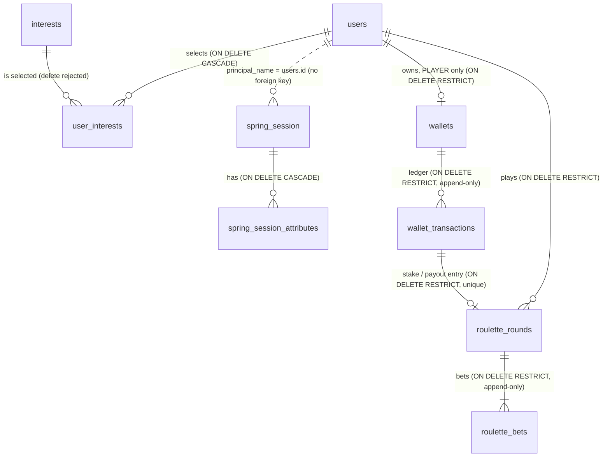

# Database

PostgreSQL 17 locally (Docker Compose, Testcontainers); the Neon project runs PostgreSQL 18 (see [Neon](#neon)). The schema is owned exclusively by **Flyway**; Hibernate only validates entity
mappings (`spring.jpa.hibernate.ddl-auto=validate`).

## Migration conventions

- Location: `backend/src/main/resources/db/migration`
- Naming: `V<version>__<description>.sql`, e.g. `V3__create_users.sql`. Versions follow the order of
  implementation: Flyway rejects a new migration whose version is lower than one already applied.
- Applied migrations are **never edited**; every change is a new migration.
- Each table is introduced by the module (and week) that owns it.
- Conventions for new tables:
  - `snake_case` plural table names, `id` primary key (`uuid` or `bigint identity`, decided per table)
  - `created_at timestamptz not null default now()`; mutable tables also get `updated_at` with the
    `set_updated_at()` trigger
  - Monetary-like values (virtual coins) as `bigint` — never floating point
  - Business invariants as database constraints where possible (`CHECK (balance >= 0)`, unique
    idempotency keys) in addition to application checks

## Migrations

| Version | Description |
|---|---|
| V1 | `set_updated_at()` trigger function shared by tables with an `updated_at` column |
| V2 | `spring_session`, `spring_session_attributes`: HTTP sessions (official Spring Session JDBC 4.1.1 schema, verbatim) |
| V3 | `users`: accounts (UUID id, normalised unique email, encoded password hash, `role`, `status`, 18+ confirmation, timestamps, `version`) with `set_updated_at()` trigger |
| V4 | `auth_throttle`: fixed-window counters for login/registration throttling; keys are `<scope>:<HMAC-SHA-256 hex>` with the secret `APP_SECURITY_THROTTLE_SECRET` (no raw email or IP, enforced by a `CHECK`); rows are deleted hourly a day after their window ended |
| V5 | `interests`: catalogue of educational interests (stable upper-case `code` as key, `sort_order`, `active`), seeded with 8 fixed entries; `user_interests`: each user's selection, replacing the plan's use of `user_preferences` for interests (primary key `(user_id, interest_code)`, cascade on user deletion, interests referenced by users cannot be deleted, only deactivated) |
| V6 | `wallets` (one per player, balance `bigint` 0 … 2⁵³ − 1, owner fixed by trigger) and `wallet_transactions` (append-only ledger: `UPDATE`/`DELETE` rejected by trigger, `ON DELETE RESTRICT`, idempotency key unique per wallet, type list `STARTING_BALANCE`). Details: [Wallets and ledger](#wallets-and-ledger-v6-v7) |
| V7 | Data only: every `PLAYER` (active or disabled) that has no wallet gets one with **1,000** coins and one `STARTING_BALANCE` entry (key `starting-balance`). Admins get none; existing wallets and entries are untouched. Details: [V7](#v7-wallets-for-existing-players) |
| V8 | Week 4 ledger types: replaces `ck_wallet_transactions_type` (now `STARTING_BALANCE`, `ROULETTE_STAKE`, `ROULETTE_PAYOUT`) and `ck_wallet_transactions_direction` (stake < 0, payout and starting balance > 0). No row, table, key or trigger changes. Details: [V8](#v8-roulette-ledger-types) |
| V9 | `roulette_rounds` and `roulette_bets` (game module): append-only (generic `reject_row_change()` trigger), rounds unique per player and request, ledger entries referenced by id (`ON DELETE RESTRICT`), bet options checked per category, no selection twice per round. Details: [Roulette rounds and bets](#roulette-rounds-and-bets-v9) |

Flyway records every applied migration in `flyway_schema_history`. `GET /api/v1/system/status`
reports the latest version as `schemaVersion`.

**Where each version is applied:**

| Database | Schema version |
|---|---|
| Testcontainers, and a local Docker database started from `feature/week-04-roulette` | **V9** (Flyway applies V8 and V9 at the first start of a build that contains them) |
| `main` | V7 (since the Week 3 merge, PR #9) |
| Neon `staging` (used by Render staging) | **V7** since 2026-11-15: Render applied V6 and V7 at the start of the first Week 3 deploy, following the approved [Week 3 rollout runbook](../infrastructure/wallet-rollout.md#rollout-record-2026-11-15). The V5 state is preserved in the Neon branch `staging-before-week-03`. **V8 and V9 are not applied**: the first Render start of a build that contains them would apply them automatically, so that deploy needs its own approval (`docs/plans/week-04.md` §15; runbook [roulette-rollout.md](../infrastructure/roulette-rollout.md), prepared in W4-09, not executed) |
| Neon `production` | Empty and untouched until the Week 12 release |

## Current schema (after V9)



`auth_throttle` stands alone: its keys are HMACs, so it does not reference `users`.

### Wallets and ledger (V6, V7)

**`wallets`** — one per player; the current balance.

| Column | Notes |
|---|---|
| `id` | `UUID`, `gen_random_uuid()` |
| `user_id` | `UUID`, unique (`uq_wallets_user_id`), `fk_wallets_user` → `users(id)` **`ON DELETE RESTRICT`**: an account with a wallet cannot be deleted (account deletion: Week 11, `docs/plans/week-03.md` §6.5). Cannot change (`trg_wallets_owner_fixed`) |
| `balance` | `BIGINT`, `ck_wallets_balance`: 0 … 9007199254740991 (2⁵³ − 1, exact in JavaScript) |
| `created_at`, `updated_at` | `updated_at` by `trg_wallets_updated_at` (`set_updated_at()`) |

**`wallet_transactions`** — the append-only ledger; one row per balance change.

| Column | Notes |
|---|---|
| `id` | `BIGINT GENERATED ALWAYS AS IDENTITY`. Entries of one wallet are inserted only while its row is locked, so their ids increase in commit order per wallet: history order and keyset pagination. Rolled-back inserts leave gaps |
| `wallet_id` | `fk_wallet_transactions_wallet` → `wallets(id)` `ON DELETE RESTRICT` |
| `type` | `VARCHAR(30)`, `ck_wallet_transactions_type`: `STARTING_BALANCE`, `ROULETTE_STAKE`, `ROULETTE_PAYOUT` (since V8; V6 allowed `STARTING_BALANCE` only; each week adds its types in its own migration) |
| `amount` | `BIGINT`, signed (credit > 0, debit < 0), never 0, within ± (2⁵³ − 1) (`ck_wallet_transactions_amount`); `STARTING_BALANCE` and `ROULETTE_PAYOUT` positive, `ROULETTE_STAKE` negative (`ck_wallet_transactions_direction`, V8) |
| `balance_after` | `BIGINT`, 0 … 2⁵³ − 1 (`ck_wallet_transactions_balance`): the balance right after this entry |
| `idempotency_key` | `VARCHAR(100)`, `^[a-z0-9][a-z0-9:._-]{0,99}$` (`ck_wallet_transactions_key`), unique per wallet (`uq_wallet_transactions_idempotency`). The starting entry always uses `starting-balance` |
| `reference` | optional `VARCHAR(100)` (e.g. a game round, Week 4); never returned by the API |
| `created_at` | insert time |

Index `ix_wallet_transactions_wallet_id_id (wallet_id, id DESC)` serves the history pages.

**Triggers (immutability):**
- `trg_wallet_transactions_append_only` (`reject_ledger_change()`): `BEFORE UPDATE OR DELETE` on
  the ledger raises SQLSTATE `23000` "wallet_transactions is append-only: … rejected". Corrections
  are new entries, never edits. `TRUNCATE` is not blocked; only the guarded test cleanup uses it
  (G1–G5, `docs/plans/week-03.md` §6.5).
- `trg_wallets_owner_fixed` (`reject_wallet_owner_change()`): a wallet never changes owner.

**Invariants** (enforced by `WalletService` under the row lock and by the constraints above; tested
by `LedgerIntegrityIT`; checked read-only by
[`verify-wallets.sql`](../infrastructure/neon/verify-wallets.sql)):
- balance = Σ `amount` of the wallet's entries = `balance_after` of its newest entry;
- every `balance_after` is the running sum of the wallet's amounts in id order;
- a wallet's first entry is its only `STARTING_BALANCE` entry (key `starting-balance`);
- at most one wallet per user, and only `PLAYER` accounts have one (the application ensures the
  role; a `CHECK` cannot read `users.role`).

**How rows are written:** only `WalletService` writes, one transaction per operation:
lock the wallet row (`SELECT … FOR NO KEY UPDATE`, at most `APP_WALLET_LOCK_TIMEOUT`, default 5 s),
look up the idempotency key, check the rules, append one entry and set the balance
([architecture.md](architecture.md#wallet-module-week-3)). Registration opens the wallet in the
registration transaction (`WalletOpener`).

### V7: wallets for existing players

`V7__backfill_existing_player_wallets.sql` gives every player who existed before wallets did what
registration gives since W3-05:

```sql
WITH new_wallets AS (
    INSERT INTO wallets (user_id, balance)
    SELECT u.id, 1000 FROM users u
    WHERE u.role = 'PLAYER' AND NOT EXISTS (SELECT 1 FROM wallets w WHERE w.user_id = u.id)
    ON CONFLICT (user_id) DO NOTHING
    RETURNING id
)
INSERT INTO wallet_transactions (wallet_id, type, amount, balance_after, idempotency_key)
SELECT id, 'STARTING_BALANCE', 1000, 1000, 'starting-balance' FROM new_wallets;
```

- **Who:** `role = 'PLAYER'`, active or disabled, without a wallet. Admins never get one.
- **One statement:** the entries are inserted for exactly the wallets this statement creates, so a
  wallet is never left without its entry and an existing wallet is **never credited again**.
- **Amount:** the literal `1000`, independent of `APP_WALLET_STARTING_BALANCE`, so the result is
  the same in every database.
- **Runs once per database.** V7 is a versioned migration: Flyway applies it once, at the first
  start that contains it, for the accounts that exist at that moment. Players registered later get
  their wallet from the registration listener (`WalletOpener`), never from V7.
- **Idempotent in itself** (`NOT EXISTS` plus `ON CONFLICT (user_id) DO NOTHING`): executed again by
  hand, it never touches an existing wallet or adds a second starting entry.
- **No constraint or trigger is disabled or changed.** Flyway runs each migration in its own
  transaction. If V7 fails, no row of it remains and it is not recorded, so the next start runs it
  again (for the first time). V6 and V7 are separate transactions: a failure in V7 leaves V6
  applied.
- `created_at` of the backfilled rows is the migration time, not the registration time.
- Tested on PostgreSQL 17.11 and 18.6 (`MigrationCompatibilityIT`): from a V5 schema with accounts
  (the staging state before the Week 3 rollout), from V6 with an existing wallet, a re-run, and a fault injected into
  the ledger insert.

### V8: roulette ledger types

`V8__add_roulette_wallet_transaction_types.sql` (W4-03) prepares the ledger for roulette rounds
(`docs/plans/week-04.md` §5.2):

```sql
ALTER TABLE wallet_transactions
    DROP CONSTRAINT ck_wallet_transactions_type,
    DROP CONSTRAINT ck_wallet_transactions_direction,
    ADD CONSTRAINT ck_wallet_transactions_type
        CHECK (type IN ('STARTING_BALANCE', 'ROULETTE_STAKE', 'ROULETTE_PAYOUT')),
    ADD CONSTRAINT ck_wallet_transactions_direction
        CHECK ((type NOT IN ('STARTING_BALANCE', 'ROULETTE_PAYOUT') OR amount > 0)
           AND (type <> 'ROULETTE_STAKE' OR amount < 0));
```

- **Only these two constraints change; their names stay.** Every row, wallet, balance and ledger
  entry stays as it is, and so do the amount and balance bounds, the key format, the unique key per
  wallet, the foreign keys and the three triggers (append-only ledger, fixed owner, `updated_at`).
  Existing rows (`STARTING_BALANCE`, amount > 0) satisfy the new rules.
- The type list is the only place that names the allowed types; the direction rule constrains the
  sign of the listed types only, so an unknown type is reported as `ck_wallet_transactions_type`
  (PostgreSQL checks constraints in name order).
- One `ALTER TABLE`, one Flyway transaction: if it fails, the V6 rules stay in place and V8 is not
  recorded. Adding the checks validates the existing rows under a short `ACCESS EXCLUSIVE` lock
  (milliseconds for the few ledger rows on staging).
- The Week 3 test-only types (`TEST_CREDIT`/`TEST_DEBIT`) were never allowed by the production schema
  and still are not; their test-only callback was removed with them, so tests now run on exactly the
  production schema.
- Tested on PostgreSQL 17.11 and 18.6 (`MigrationCompatibilityIT`): a clean V1–V8 migration, V7 → V8
  on a database with players and wallets (rows byte-for-byte unchanged, only the two constraint
  definitions differ, triggers identical), the sign and zero rules, a failed V8 that leaves V7 intact
  and applies on the next start, and the read-only scripts at V8.
- Week 3 code is compatible with V8's change (it never writes the new types; the Week 3 build was
  verified locally on a V9 schema in W4-10, see the rollback limitation below). Once roulette rounds
  exist, Week 3 code could not read their ledger entries; see the rollback limits in
  `docs/plans/week-04.md` §15.3.

### Roulette rounds and bets (V9)

`V9__create_roulette_rounds.sql` (W4-05; design: `docs/plans/week-04.md` §5.3, §5.7). Owned by the
`game` module. A round is written once, complete, in the transaction that also writes its ledger
entries (W4-06); there is no pending state.

**`roulette_rounds`** — one played round.

| Column | Notes |
|---|---|
| `id` | `UUID`, generated by the application before the ledger writes (named in the ledger keys `roulette-round:<id>:stake`/`:payout` and references) |
| `user_id` | the player; `fk_roulette_rounds_user` → `users(id)` `ON DELETE RESTRICT` |
| `request_id` | the client's `Idempotency-Key`; `uq_roulette_rounds_request (user_id, request_id)`: one round per request and player |
| `winning_number` | `SMALLINT` 0–36 (`ck_roulette_rounds_number`) |
| `total_stake` | 1 … 2⁵³ − 1 (`ck_roulette_rounds_stake`) |
| `total_payout` | 0 … 2⁵³ − 1 (`ck_roulette_rounds_payout`) |
| `balance_after` | wallet balance right after the round, 0 … 2⁵³ − 1 (`ck_roulette_rounds_balance`); returned unchanged by a replay |
| `stake_transaction_id` | the round's `ROULETTE_STAKE` entry; `fk_roulette_rounds_stake_entry` → `wallet_transactions(id)` `RESTRICT`, unique |
| `payout_transaction_id` | its `ROULETTE_PAYOUT` entry; `fk_roulette_rounds_payout_entry` `RESTRICT`, unique; present exactly when `total_payout > 0` (`ck_roulette_rounds_payout_entry`) and never the stake entry (`ck_roulette_rounds_distinct_entries`) |
| `created_at` | when the round was played; provided by the application (microsecond precision), database default `now()` |

**`roulette_bets`** — the bets of a round, in request order (identity id).

| Column | Notes |
|---|---|
| `id` | `BIGINT IDENTITY`: the order of the bets in the request |
| `round_id` | `fk_roulette_bets_round` → `roulette_rounds(id)` `RESTRICT` |
| `category` | `STRAIGHT`, `RED_BLACK`, `EVEN_ODD`, `LOW_HIGH`, `DOZEN` (`ck_roulette_bets_category`; names of the API contract) |
| `selection` | the option of `RED_BLACK` (`RED`/`BLACK`), `EVEN_ODD` (`EVEN`/`ODD`), `LOW_HIGH` (`LOW`/`HIGH`), `DOZEN` (`FIRST`/`SECOND`/`THIRD`); `NULL` for `STRAIGHT` |
| `number` | the option of `STRAIGHT`, 0–36; `NULL` otherwise |
| `amount` | 1 … 2⁵³ − 1 (`ck_roulette_bets_amount`; the API limit of 1,000 is checked by the application) |
| `payout` | 0 or exactly 36×/3×/2× the amount for `STRAIGHT`/`DOZEN`/even-money (`ck_roulette_bets_payout`) |

- `ck_roulette_bets_option` allows exactly the option of the category (each branch tests `IS NOT NULL`
  first, because a `CHECK` whose expression is `NULL` passes). `uq_roulette_bets_selection` is
  `UNIQUE NULLS NOT DISTINCT (round_id, category, selection, number)`: a selection at most once per
  round (PostgreSQL 15+).
- **Append-only:** `trg_roulette_rounds_append_only` and `trg_roulette_bets_append_only` call the generic
  `reject_row_change()` and reject every `UPDATE` and `DELETE` (SQLSTATE `23000`, "… is append-only: …
  rejected"). The ledger keeps its own `reject_ledger_change()` (V6), unchanged. A rolled-back round
  leaves nothing (MVCC).
- **What the foreign keys prove:** that the referenced user and ledger entries exist and cannot be deleted.
  They do not prove that the entries belong to the round's player, have the right type and amount, or
  reference the round: the single writer (`RouletteService`, W4-06) guarantees that, and the read-only
  reconciliation checks it (below; `docs/plans/week-04.md` §5.7, §5.8).
- **Java mapping:** `game.entity.RouletteRound` (`@Immutable`, `Persistable`) and `RouletteBet`
  (`@Immutable`), ids only towards `users` and `wallet_transactions`; `RouletteRoundRepository` has
  `saveAndFlush` (W4-06; `save` until then) and `findByUserIdAndRequestId` only.
- Tested on PostgreSQL 17.11 and 18.6 (`MigrationCompatibilityIT`): clean V1–V9, V8 → V9 with data (the
  wallet tables unchanged), every constraint by name, the triggers, a failed V9, and the read-only
  migration check at V9 (empty and with rounds) and roulette reconciliation; `RouletteRoundRepositoryIT`
  through JPA.
- Test cleanup: `TestDatabase` truncates `roulette_bets, roulette_rounds` first (explicit list, no
  `CASCADE`).

**Round–ledger invariants** (W4-08; kept by `RouletteService`, the only writer of rounds, in the
transaction that writes the round's ledger entries; checked read-only by
[`verify-roulette.sql`](../infrastructure/neon/verify-roulette.sql), which reports 0 in every column
when they hold, also with empty tables):
- a round has 1–10 bets; `total_stake` and `total_payout` are the sums of its bets, and every bet pays
  what the winning number pays (36×, 2× or 3× the amount on a win, 0 on a loss; zero wins only a straight
  bet on 0);
- its stake entry is a `ROULETTE_STAKE` of `−total_stake` in the round player's wallet with the round id as
  reference and key `roulette-round:<id>:stake`; its payout entry (exactly when `total_payout > 0`) a
  `ROULETTE_PAYOUT` of `+total_payout` in the same wallet, same reference, key `…:payout`, newer than the
  stake entry;
- `balance_after` is the `balance_after` of the round's last entry;
- every `ROULETTE_STAKE` and `ROULETTE_PAYOUT` entry belongs to exactly one round;
- the wallet invariants above (`verify-wallets.sql`) still hold.

The script counts each rule separately (eleven counters) and is NULL-safe (`IS DISTINCT FROM`,
`LEFT JOIN`): a missing value is counted, never skipped. Run it only at V9 (after `verify-migrations.sql`
reports `V9: Week 4 roulette rounds`); before V9 the tables do not exist. `MigrationCompatibilityIT` proves
on PostgreSQL 17.11 and 18.6 that it reports nothing for a fresh V9 schema and for consistent rounds, and
that each counter finds its own deliberately written inconsistency; `RouletteConcurrencyIT` and
`RoundLedgerIntegrityIT` run it on rounds played by `RouletteService`. Every run uses
`default_transaction_read_only = on`, so no statement can write. It has not been run against Neon.

**Concurrency** (W4-08, `RouletteConcurrencyIT`): the spins of one player are serialized by the wallet row
lock, taken before the round lookup (`docs/plans/week-04.md` §8.2). 20 parallel spins of 100 coins on
1,000 coins: 10 rounds, 10 `INSUFFICIENT_FUNDS`, balance 0. 10 parallel copies of one request: one round,
one stake and one payout entry, ten equal results. Spins of two players do not wait for each other.

**Not enforced by the database** (accepted, `docs/plans/week-04.md` §5.7): the ownership, type, amount
and reference of a round's entries, the bet totals and the payout for the winning number. A second writer
of rounds or manual SQL could break them; `verify-roulette.sql` would report it.

**Guarantees at a glance** (database level = rejected by PostgreSQL whatever the writer; application
level = kept by the single writer and detected read-only):

| Guarantee | Database (V6–V9) | Application (`WalletService`, `RouletteService`) | Detected / tested by |
|---|---|---|---|
| No negative balance, cap 2⁵³ − 1 | `ck_wallets_balance`, `ck_wallet_transactions_balance` | `INSUFFICIENT_FUNDS`/`BALANCE_LIMIT_EXCEEDED` under the row lock | `verify-wallets.sql`, `LedgerIntegrityIT` |
| Only known ledger types, each with its sign | `ck_wallet_transactions_type`, `ck_wallet_transactions_direction` (V8) | Exhaustive enum mapping | `MigrationCompatibilityIT` |
| Ledger, rounds and bets never change | Append-only triggers (V6, V9), `ON DELETE RESTRICT` | `@Immutable` entities, no update/delete methods | `MigrationCompatibilityIT`, `RouletteRoundRepositoryIT` |
| One round per player and request | `uq_roulette_rounds_request` | Wallet lock before the lookup (§8.2 of the plan) | `RouletteConcurrencyIT` |
| A stake/payout entry serves one round | Unique entry columns, `ck_roulette_rounds_distinct_entries`, unique ledger keys | Keys `roulette-round:<id>:stake` and `…:payout` | `verify-roulette.sql` |
| Payout entry exactly when something was won | `ck_roulette_rounds_payout_entry` | Credit only if the total payout > 0 | `verify-roulette.sql` |
| Valid bet options, no selection twice, payout a valid multiple | `ck_roulette_bets_category`, `_option`, `_payout`, `uq_roulette_bets_selection` | Bean Validation, `RouletteSelection`, `RouletteRules` | `MigrationCompatibilityIT`, `RouletteControllerTest` |
| Entries belong to the round's player, with its type, amount and reference | — | Single writer, one transaction | `verify-roulette.sql`, `RoundLedgerIntegrityIT` |
| Bet totals and the exact payout for the winning number | — (multiple only) | `RouletteRules.settle` | `verify-roulette.sql`, `RoundLedgerIntegrityIT` |
| Bet limits (1–10 bets, 1–1,000 coins) | — (structural bounds only) | Contract constants, DTO validation, `RouletteService` | `RouletteControllerTest`, `RouletteServiceTest` |

### Read-only verification scripts

In [`infrastructure/neon/`](../infrastructure/neon/), run with
[`readonly-query.sh`](../infrastructure/neon/readonly-query.sh) (one `READ ONLY` transaction that is
rolled back; credentials from `.env.neon`, never printed). They count rows and never read row contents.
`MigrationCompatibilityIT` runs the three `verify-*` scripts on PostgreSQL 17.11 and 18.6 under
`default_transaction_read_only = on`.

| Script | Valid at | Checks | Run against Neon |
|---|---|---|---|
| `preflight.sql` | an empty branch | location, no tables, privileges | 2026-11-07 (staging, before V1) |
| `verify-migrations.sql` | V5, V7, V8, V9 | location (`neon.branch_id`), migration history, `schema_state`, expected and unexpected tables, counts (roulette counts `NULL` before V9) | Week 3 rollout (V5 and V7) |
| `verify-wallets.sql` | V6 and later | every player has one wallet with one starting entry; every balance equals its ledger | Week 3 rollout (V7) |
| `verify-roulette.sql` | **V9 only** | the eleven round–ledger counters above | **never**; only after `verify-migrations.sql` reports `V9: Week 4 roulette rounds` |

The Week 4 rollout uses them in this order: preflight at V7 (`verify-migrations`, `verify-wallets`),
then after the deploy `verify-migrations` (gate: V9), `verify-wallets` and `verify-roulette`
([roulette-rollout.md](../infrastructure/roulette-rollout.md)).

**Rollback limitation (V8/V9), verified locally in W4-10** (`docs/plans/week-04.md` §15.5; disposable
PostgreSQL 17.11 databases, not Neon). The actual Week 3 build (`b07e656`) starts on a V9 schema: Flyway
validates the 9 applied migrations, warns that the schema is newer than its latest migration (7) and
migrates nothing. **Without rounds** its balance, history and registration work. **With rounds** it still
starts and reads balances, but the history of the tested player who played answered `500`
(`No enum constant …TransactionType.ROULETTE_STAKE`), as would every player with a roulette entry; players without rounds are unaffected and no data
changes. Starting the Week 4 build again restores the history. So once `ROULETTE_*` entries exist, roll
forward; a return to Week 3 code then needs a database restore
([roulette-rollout.md §11](../infrastructure/roulette-rollout.md#11-rollback-and-recovery)).

### Users and roles (`users`, V3)

| Column | Notes |
|---|---|
| `id` | `UUID`, generated (`gen_random_uuid()`), so account ids cannot be enumerated |
| `email` | `VARCHAR(254)`, unique (`uq_users_email`), stored trimmed and lower-cased (`ck_users_email_normalized`) |
| `password_hash` | `VARCHAR(100)`, only an encoded hash with the `{id}` prefix, e.g. `{bcrypt}$2a$12$…` (`ck_users_password_hash_encoded`) |
| `display_name` | `VARCHAR(30)` |
| `role` | `PLAYER` (default) or `ADMIN` (`ck_users_role`); one role per account |
| `status` | `ACTIVE` (default) or `DISABLED` (`ck_users_status`); disabled accounts cannot log in |
| `adult_confirmed_at` | when the 18+ confirmation was given (server clock); no date of birth is stored |
| `last_login_at` | set at each successful login |
| `created_at`, `updated_at` | `updated_at` maintained by the `trg_users_updated_at` trigger (`set_updated_at()`, V1) |
| `version` | optimistic locking (`409 CONCURRENT_MODIFICATION`) |

Registration always creates a `PLAYER`. An `ADMIN` is created only by the start-up bootstrap
(`APP_BOOTSTRAP_ADMIN_EMAIL`/`_PASSWORD`). Week 2 has no feature that changes a role or a status.

### Interests (`interests`, `user_interests`, V5)

- `interests`: reference data maintained only by migrations. Columns: `code` (primary key,
  `^[A-Z][A-Z0-9_]*$`), `name`, `description`, `sort_order`, `active`. Eight entries are seeded.
  `GET /api/v1/interests` lists the active ones by `sort_order`, then `code`.
- `user_interests`: a user's selection. The primary key is `(user_id, interest_code)`, so there are
  no duplicates. Deleting a user deletes its rows; an interest that is still referenced cannot be
  deleted, only deactivated. The limit of 8 per user and the rejection of inactive codes are
  enforced by the application.

### Session persistence (`spring_session`, `spring_session_attributes`, V2)

- The official Spring Session JDBC schema. Hibernate and Spring Session do not create it
  (`spring.session.jdbc.initialize-schema=never`).
- One row per HTTP session. `session_id` is the value of the session cookie, so these rows are as
  sensitive as passwords: never copy them into tickets or logs. `principal_name` holds the **user
  id** of a signed-in session and is indexed (`spring_session_ix3`) for revocation.
- The attributes hold the Spring Security context (user id and role, never the password hash) and
  `com.casino.auth.service.SessionSignInService.AUTHENTICATED_AT` (sign-in time) for the 12-hour
  absolute lifetime.
- Logout deletes the row. Expired sessions are deleted by Spring Session's periodic cleanup job.
  Sessions survive backend restarts.

### Authentication throttling (`auth_throttle`, V4)

- One row per throttle key: `throttle_key` (`<SCOPE>:<64 hex>`, enforced by
  `ck_auth_throttle_key_hashed`), `attempt_count` (> 0) and `window_started_at` (indexed for the
  cleanup).
- Scopes: `LOGIN_ACCOUNT_IP` (5 failed logins for one account from one IP per 15 min), `LOGIN_IP`
  (50 failed logins from one IP per 15 min) and `REGISTER_IP` (10 registration attempts from one IP
  per hour, whatever their outcome). Limits: `app.security.throttle.*` in `application.yml`.
- The key is an HMAC of the normalised email and/or client IP (see
  [Throttling secret](#throttling-secret)), so the table contains no email or IP address.

## Planned tables (from the implementation plan)

`wallets` and `wallet_transactions` (Week 3) are implemented: [Wallets and ledger](#wallets-and-ledger-v6-v7).
`roulette_rounds` and `roulette_bets` (Week 4) are implemented: [Roulette rounds and bets](#roulette-rounds-and-bets-v9).
The plan's "row version (optimistic locking)" for `wallets` was replaced by a pessimistic row lock
(`docs/plans/week-03.md` §7.4).

The Week 2 design is in [`docs/plans/week-02.md`](plans/week-02.md) §6. Deviations from the
original plan are listed in
[`docs/proposals/0001-implementation-plan-alignment.md`](proposals/0001-implementation-plan-alignment.md).

| Table | Purpose | Week |
|---|---|---|
| `user_preferences` | UI preferences (sound, reduced motion, …) | 6 |
| `learning_modules` | Educational materials and categories | 7 |
| `quiz_questions` | Questions and correct answers | 8 |
| `quiz_attempts` | Submitted answers and results | 8 |
| `learning_rewards` | Reward conditions and granted rewards | 8 |
| `play_limits` | User-defined limits, breaks, self-exclusion | 9 |
| `user_sessions` | Play-session history and duration (not HTTP sessions) | 9 |
| `audit_events` | Important system and administrative actions | 10 |

## Integrity requirements

1. A user cannot spend more virtual coins than they own. *Week 3:* `ck_wallets_balance` and
   `ck_wallet_transactions_balance` (never below 0) plus `INSUFFICIENT_FUNDS` under the row lock.
2. A game round cannot be processed or paid out twice. *Week 4:* one round per player and request
   (`uq_roulette_rounds_request`, looked up under the wallet lock), one stake and at most one payout
   entry per round (unique entry references and ledger keys), append-only rounds and bets; reconciled
   read-only by `verify-roulette.sql`.
3. An educational reward cannot be granted twice for the same eligible completion.
4. Completed transactions are durable and traceable. *Week 3:* one append-only ledger entry per
   balance change, with a unique idempotency key per wallet.
5. Only personal data that is strictly necessary is stored.

## Throttling secret

`auth_throttle.throttle_key` is an HMAC-SHA-256 of the scope and the normalised email and/or client
IP, keyed with `APP_SECURITY_THROTTLE_SECRET` (Base64, at least 32 random bytes; the backend does not
start without a valid value). Without the secret a row cannot be linked to an email or IP address.

- **Local:** generate your own value with `openssl rand -base64 32` and put it in `.env`. Tests use a
  random secret per run and need none.
- **Production:** a separate value, kept only in the hosting provider's secret store; never in Git,
  logs, tickets or chat.

**Effect of changing the secret.** Every existing row becomes unreachable: new attempts produce new
keys, so all throttle counters start again at zero, once. Nothing breaks and no migration is needed.
The orphaned rows are deleted by the hourly cleanup at most 1 h (longest window) + 1 day later.

**Rotation (production):**
1. Rotate only when needed: suspected exposure of the secret (or of a database backup together with
   it) or a staff change with access to it. Routine rotation brings no benefit here, because the rows
   are short-lived.
2. Generate a new value, replace it in the secret store, and restart or redeploy **all** instances
   together. During a rolling deploy, instances with different secrets keep separate counters, so the
   effective limits are briefly higher.
3. Prefer a quiet period: for up to 15 min (1 h for registration) an attacker gets a fresh attempt
   budget.
4. Optionally run `DELETE FROM auth_throttle;` right after the switch, instead of waiting for the
   cleanup.

## Profile data (W2-10)

- `PATCH /api/v1/users/me` changes only `users.display_name` and the user's rows in
  `user_interests`, in one transaction. The primary key prevents duplicate selections; the limit of
  8 and the rejection of unknown or inactive codes are checked by the application. Interests that
  stay selected keep their row (`created_at`).
- Every profile change increments `users.version` (optimistic locking), also a change of the
  interests only. `last_login_at` is set without a new version, so logins never conflict with a
  profile update; updates write only the changed columns, so neither overwrites the other.
- To withdraw an interest, set `interests.active = false` (a migration). Users who selected it no
  longer see it in their profile; their row is removed at their next change of the selection.
- Manual changes of `users` in the database bypass these rules. Follow the
  [session revocation runbook](#session-revocation-runbook) after such a change.

## Session revocation runbook

**Why:** a session keeps the role and status that the account had at sign-in. Week 2 has no feature
that disables a user or changes a role or password, so nothing revokes sessions automatically
(`docs/plans/week-02.md` §7.5; mandatory with the admin features in Week 10). Without revocation, a
session after a manual change lasts at most 30 minutes idle or 12 hours in total.

**When:** after every manual change in the database that deletes an account, disables it
(`status = 'DISABLED'`), changes its `role` or replaces its `password_hash`.

**Steps** (in `psql`, see [Local database](#local-database)):

1. Find the user id:

   ```sql
   SELECT id, role, status FROM users WHERE email = lower('alice@example.com');
   ```

2. Make the change, then delete all sessions of that user in the same transaction:

   ```sql
   BEGIN;
   UPDATE users SET status = 'DISABLED' WHERE id = '<user id>';   -- the manual change
   DELETE FROM spring_session WHERE principal_name = '<user id>'; -- attributes are deleted by cascade
   COMMIT;
   ```

3. Check: `SELECT count(*) FROM spring_session WHERE principal_name = '<user id>';` returns `0`. The
   user's next request gets `401 SESSION_EXPIRED`.

## Local database

```bash
docker compose up -d       # start (repository root)
docker compose ps          # state and health
docker compose stop        # stop, keep the data
docker exec -it casino-postgres psql -U <POSTGRES_USER> -d <POSTGRES_DB>   # SQL shell (both "casino" in .env.example)
```

`docker compose down -v` **deletes the volume with all local data** (accounts, sessions). Use it
only as a deliberate reset, not as a routine fix.

## Neon

The local Docker database stays the default. The backend connects to Neon (managed PostgreSQL 18,
project `online-casino-simulator`, AWS Europe Central 1) only when the Spring profile `neon` is
active. Nothing is copied between the two: Flyway creates an empty schema in Neon, and no local
accounts, passwords or sessions go there.

| | Local (default) | Neon (profile `neon`) |
|---|---|---|
| Activated by | — | `SPRING_PROFILES_ACTIVE=neon` |
| Values from | `.env` | `.env.neon` (git-ignored, template `.env.neon.example`); everything else still from `.env` |
| Connection variables | `DB_URL`, `DB_USERNAME`, `DB_PASSWORD` | `NEON_DB_HOST`, `NEON_DB_NAME`, `NEON_DB_USERNAME`, `NEON_DB_PASSWORD` |
| TLS | none (localhost only) | `verify-full` (certificate and host name) plus SCRAM channel binding |
| Connection pool | 10 connections, 5 s timeout | 5 connections, 15 s timeout (compute wake-up) |
| Configuration | `application.yml` | `application-neon.yml` (overrides only the data source) |

**Current state:**

| Branch | State |
|---|---|
| `staging` | **V7.** V1–V5 were applied on 2026-11-07 with the procedure below (7 tables, 8 seeded interests, then no accounts or sessions); since then the Render staging backend uses it with registration closed. V6 and V7 were applied on 2026-11-15 by the Render start-up of the first Week 3 deploy ([Week 3 rollout record](../infrastructure/wallet-rollout.md#rollout-record-2026-11-15)): the one existing `PLAYER` received a wallet with 1,000 coins and one `STARTING_BALANCE` entry; the read-only integrity checks reported zero violations |
| `staging-before-week-03` | Restore point of `staging` at V5, created before the Week 3 deploy. Not used by any application; **kept** (deleting it needs a separate approval) |
| `production` | Empty, unused and untouched until the release (Week 12) |

**Version difference:** Neon runs PostgreSQL 18.6, while the local database and the Testcontainers
integration tests use 17.11.
- Flyway 12.4.0 supports major versions up to 18, and the migrations use only features available
  in both versions.
- Since Week 3 `MigrationCompatibilityIT` applies every migration on **both** 17.11 and 18.6 and
  checks the wallet constraints, triggers, V7 and the read-only scripts there. The application
  integration tests still run on 17.11 only. Aligning both on one major version is open for the
  deployment review (Week 12).

To check which branch `.env.neon` points to, compare `neon.branch_id` with the branch ID on the
branch's page in the Console:

```sql
SELECT current_setting('neon.branch_id'), current_setting('neon.endpoint_id');
```

The pre-flight SQL alone does not identify the branch.

### Connection configuration

[`application-neon.yml`](../backend/src/main/resources/application-neon.yml) builds the JDBC URL
from the variables:

```text
jdbc:postgresql://${NEON_DB_HOST}/${NEON_DB_NAME}?sslmode=verify-full&sslfactory=org.postgresql.ssl.DefaultJavaSSLFactory&channelBinding=require
```

- **Direct endpoint, not the pooler.** Neon's pooled hosts (`-pooler`) run PgBouncer in
  transaction mode, which does not support session-level advisory locks, and Flyway takes one per
  migration run. Neon recommends direct connections for migrations. Flyway and Spring Session JDBC
  use the same direct connection; a 0.25 CU compute allows 97 application connections, and the
  pool uses at most 5. If app traffic ever needs the pooler, Flyway must keep a direct URL
  (`spring.flyway.url`); that is a deployment decision (Week 12).
- **`sslmode=verify-full`** checks the certificate chain and that the certificate matches the host
  name. Neon uses a Let's Encrypt certificate (ISRG Root X1).
- **`DefaultJavaSSLFactory`** validates the chain against the JVM trust store, which already
  contains ISRG Root X1 (JDK 21). The driver's default factory would instead require a
  `root.crt` file in `%APPDATA%\postgresql\`. The host name check is done by the driver for
  `verify-full` whichever factory is used.
- **`channelBinding=require`**: SCRAM-SHA-256-PLUS binds the login to the TLS channel (supported
  by the driver 42.7.14 that Spring Boot 4.1.2 manages).
- **Credentials are separate properties**, never in the URL. Flyway logs the URL at start-up, so it
  shows the host and database name, never the user or password. Do not use Neon's ready-made Java
  connection string: it contains `user=` and `password=`.
- **Values are not interchangeable with the local ones.** Without the `NEON_DB_*` values the
  backend does not start: the connection fails with `UnknownHostException: ${NEON_DB_HOST}`. It
  never falls back to the local database.

### One-time setup (Neon Console)

1. **Create a branch for the first tests** instead of using `production`: **Branches → Create
   branch**, name `staging`, parent `production`. The branch has its own compute and the same
   database `neondb` and roles. `production` stays unused until the deployment (Week 12).
2. **Find the connection values:** on the dashboard, **Connect**, then choose branch `staging`,
   database `neondb`, the role (for example `neondb_owner`) and switch **Connection pooling off**.
   You need the host (`ep-….eu-central-1.aws.neon.tech`, without `-pooler`), the database, the role
   and the password.
3. **Store them privately in `.env.neon`** (repository root). Type or paste the values in your
   editor, never in a chat, a prompt or a shell command:

   ```bash
   cp .env.neon.example .env.neon
   code .env.neon                  # or any editor; values without quotes
   git check-ignore -v .env.neon   # must print the .gitignore rule `.env.*`
   grep -c '^NEON_DB_[A-Z]*=.' .env.neon   # 4 = all four values set (prints only the count)
   ```

### Migration procedure (first migration, V1–V5, done on staging 2026-11-07)

This is the procedure for an **empty** database, kept for a new branch. Later versions on a branch
that already has a schema follow their rollout runbook instead, where Render applies them at start-up:
V6 and V7 the executed [Week 3 rollout runbook](../infrastructure/wallet-rollout.md), V8 and V9 the
prepared, not yet executed [Week 4 rollout runbook](../infrastructure/roulette-rollout.md).

Flyway applies migrations automatically when the backend starts with the profile, so the backend is
started against Neon only after the checks below.

1. **Read-only pre-flight check.**
   [`readonly-query.sh`](../infrastructure/neon/readonly-query.sh) runs SQL with `psql` from the
   PostgreSQL Docker image (no local `psql` needed). It works like this:
   - credentials go from `.env.neon` into the container environment only;
   - TLS is `verify-full` with channel binding;
   - everything runs in one `READ ONLY` transaction that is rolled back.

   ```bash
   bash infrastructure/neon/readonly-query.sh < infrastructure/neon/preflight.sql
   ```

   Expected:
   - `\conninfo` names the `staging` endpoint's host, database `neondb` and an SSL connection;
   - **no tables** outside the system schemas;
   - `flyway_history_exists = f` and `can_create_in_public = t`.

   **Stop if anything else appears**: it is the wrong branch or database.
2. **What will run:** V1–V5 from [Migrations](#migrations), in this order:
   - V1: `set_updated_at()`;
   - V2: `spring_session` and `spring_session_attributes`;
   - V3: `users`;
   - V4: `auth_throttle`;
   - V5: `interests` (8 seeded rows) and `user_interests`.

   Flyway adds `flyway_schema_history`. These Flyway defaults are safety nets:
   - Flyway refuses a non-empty schema without history, because `baseline-on-migrate` is off;
   - `clean` is disabled, so Flyway never drops anything.
3. **Migrate** (only after the pre-flight check matches). From `backend/`, on a port that does not
   clash with the local backend:

   ```bash
   SPRING_PROFILES_ACTIVE=neon SERVER_PORT=8081 ./mvnw spring-boot:run
   ```

   Expected log:
   - `The following 1 profile is active: "neon"`;
   - `Database: jdbc:postgresql://ep-…/neondb… (PostgreSQL 18.…)`;
   - `Successfully applied 5 migrations to schema "public", now at version v5`;
   - `Started CasinoSimulatorApplication`.

   http://localhost:8081/api/v1/system/status then reports `schemaVersion` `5`. Stop with
   `Ctrl+C`. Do not set `APP_BOOTSTRAP_ADMIN_*` for this run, and do not register accounts on the
   branch unless you mean to.
4. **Verify (read-only):**

   ```bash
   bash infrastructure/neon/readonly-query.sh < infrastructure/neon/verify-migrations.sql
   ```

   Expected right after this first migration:
   - `neon_branch_id` = the staging branch ID from Neon Console;
   - versions 1–5, each with `success = t`; `schema_state` = `V5: before the Week 3 rollout`;
   - every expected table `present = t` (`auth_throttle`, `flyway_schema_history`, `interests`,
     `spring_session`, `spring_session_attributes`, `user_interests`, `users`), `unexpected_tables` 0;
   - 8 interests, no players, admins, sessions or throttle rows; `wallets`/`ledger_entries` empty.

   The same script recognises V7 after the [Week 3 rollout](../infrastructure/wallet-rollout.md)
   (`schema_state` = `V7: Week 3 wallet schema`), V8 (`V8: Week 4 ledger types`) and V9
   (`V9: Week 4 roulette rounds`). It is tested on PostgreSQL 17 and 18 at these states
   (`MigrationCompatibilityIT`).
5. **Later starts** validate the checksums of the applied migrations and apply only new ones.

### Browsing the tables in Neon Console

Open project `online-casino-simulator` and select branch **`staging`** in the branch selector.
**Tables** (left navigation) lists the tables of database `neondb`, schema `public`:
- `flyway_schema_history` shows the applied versions;
- `interests` shows the 8 seeded entries.

The **SQL Editor** (same branch and database) runs queries as the selected role, with write access,
so use it for `SELECT` only. Do not open `spring_session` rows: session ids are as sensitive as
passwords.

### Troubleshooting Neon connections

| Symptom | Cause and fix |
|---|---|
| `UnknownHostException: ${NEON_DB_HOST}` | The profile is active but no value was found: `.env.neon` is missing, is not in the repository root, or the backend was started outside `backend/` or the root. |
| `UnknownHostException: ep-…` | Typo in `NEON_DB_HOST`, or the branch or endpoint was deleted. Copy the host again from **Connect**. |
| `password authentication failed for user` | Wrong role or password, quotes around a value, or the password was reset in the Console. Re-copy the values into `.env.neon`. |
| `PKIX path building failed` / `SSLHandshakeException` | The certificate chain cannot be verified. Usual causes are an old JDK without ISRG Root X1, or antivirus or proxy software that intercepts TLS. Use JDK 21 and allow the connection. **Never lower `sslmode`** to get around it. |
| `The hostname … could not be verified` | `NEON_DB_HOST` is not the endpoint name from **Connect** (for example an IP address or an alias). |
| `channel binding required but not supported` | Something between you and Neon terminates TLS (corporate proxy). Use another network; do not disable channel binding. |
| Connection timeout / `Couldn't connect to compute node` | The compute is waking up from scale-to-zero (retry after a few seconds), or the network blocks outbound port 5432. Check the compute state on the branch page, and try another network. |
| `terminating connection due to administrator command` | The compute was suspended while a pooled connection was idle. The pool replaces the connection; retry the request. |
| `Found non-empty schema(s) "public" without schema history table` | The database is not empty. **Stop**: it is probably the wrong branch or database. Never enable `baseline-on-migrate` to get past it. |
| `Validate failed: Migrations have failed validation` | An applied migration file was changed locally. Restore it; changes go into a new migration. |
| `readonly-query.sh` prints a validation message | It names the problem (missing file, empty value, quotes, `-pooler` host) without showing any value. |
