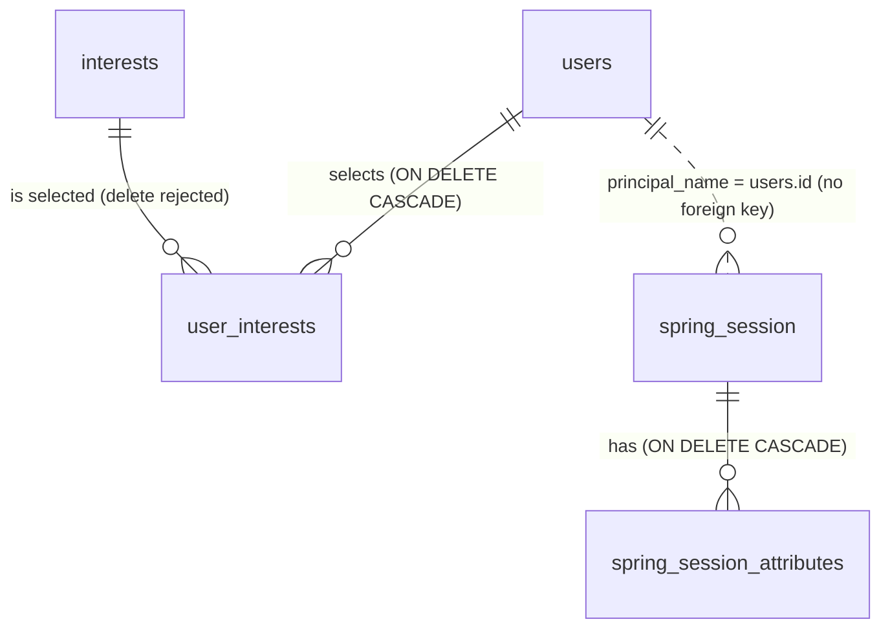

# Database

PostgreSQL 17. The schema is owned exclusively by **Flyway**; Hibernate only validates entity
mappings (`spring.jpa.hibernate.ddl-auto=validate`).

## Migration conventions

- Location: `backend/src/main/resources/db/migration`
- Naming: `V<version>__<description>.sql`, e.g. `V3__create_users.sql`. Versions follow the order of
  implementation: Flyway rejects a new migration whose version is lower than one already applied.
- Applied migrations are **never edited**; every change is a new migration.
- Each table is introduced by the module (and week) that owns it.
- Conventions for new tables:
  - `snake_case` plural table names, `id` primary key (`uuid` or `bigint identity`, decided per table)
  - `created_at timestamptz not null default now()`; mutable tables also get `updated_at` with the
    `set_updated_at()` trigger
  - Monetary-like values (virtual coins) as `bigint` — never floating point
  - Business invariants as database constraints where possible (`CHECK (balance >= 0)`, unique
    idempotency keys) in addition to application checks

## Applied migrations

| Version | Description |
|---|---|
| V1 | `set_updated_at()` trigger function shared by tables with an `updated_at` column |
| V2 | `spring_session`, `spring_session_attributes`: HTTP sessions (official Spring Session JDBC 4.1.1 schema, verbatim) |
| V3 | `users`: accounts (UUID id, normalised unique email, encoded password hash, `role`, `status`, 18+ confirmation, timestamps, `version`) with `set_updated_at()` trigger |
| V4 | `auth_throttle`: fixed-window counters for login/registration throttling; keys are `<scope>:<HMAC-SHA-256 hex>` with the secret `APP_SECURITY_THROTTLE_SECRET` (no raw email or IP, enforced by a `CHECK`); rows are deleted hourly a day after their window ended |
| V5 | `interests`: catalogue of educational interests (stable upper-case `code` as key, `sort_order`, `active`), seeded with 8 fixed entries; `user_interests`: each user's selection, replacing the plan's use of `user_preferences` for interests (primary key `(user_id, interest_code)`, cascade on user deletion, interests referenced by users cannot be deleted, only deactivated) |

Flyway records every applied migration in `flyway_schema_history`. `GET /api/v1/system/status`
reports the latest version as `schemaVersion` (`5`).

## Current schema (after V5)



`auth_throttle` stands alone: its keys are HMACs, so it does not reference `users`.

### Users and roles (`users`, V3)

| Column | Notes |
|---|---|
| `id` | `UUID`, generated (`gen_random_uuid()`), so account ids cannot be enumerated |
| `email` | `VARCHAR(254)`, unique (`uq_users_email`), stored trimmed and lower-cased (`ck_users_email_normalized`) |
| `password_hash` | `VARCHAR(100)`, only an encoded hash with the `{id}` prefix, e.g. `{bcrypt}$2a$12$…` (`ck_users_password_hash_encoded`) |
| `display_name` | `VARCHAR(30)` |
| `role` | `PLAYER` (default) or `ADMIN` (`ck_users_role`); one role per account |
| `status` | `ACTIVE` (default) or `DISABLED` (`ck_users_status`); disabled accounts cannot log in |
| `adult_confirmed_at` | when the 18+ confirmation was given (server clock); no date of birth is stored |
| `last_login_at` | set at each successful login |
| `created_at`, `updated_at` | `updated_at` maintained by the `trg_users_updated_at` trigger (`set_updated_at()`, V1) |
| `version` | optimistic locking (`409 CONCURRENT_MODIFICATION`) |

Registration always creates a `PLAYER`. An `ADMIN` is created only by the start-up bootstrap
(`APP_BOOTSTRAP_ADMIN_EMAIL`/`_PASSWORD`). Week 2 has no feature that changes a role or a status.

### Interests (`interests`, `user_interests`, V5)

- `interests`: reference data maintained only by migrations. Columns: `code` (primary key,
  `^[A-Z][A-Z0-9_]*$`), `name`, `description`, `sort_order`, `active`. Eight entries are seeded.
  `GET /api/v1/interests` lists the active ones by `sort_order`, then `code`.
- `user_interests`: a user's selection. The primary key is `(user_id, interest_code)`, so there are
  no duplicates. Deleting a user deletes its rows; an interest that is still referenced cannot be
  deleted, only deactivated. The limit of 8 per user and the rejection of inactive codes are
  enforced by the application.

### Session persistence (`spring_session`, `spring_session_attributes`, V2)

- The official Spring Session JDBC schema. Hibernate and Spring Session do not create it
  (`spring.session.jdbc.initialize-schema=never`).
- One row per HTTP session. `session_id` is the value of the session cookie, so these rows are as
  sensitive as passwords: never copy them into tickets or logs. `principal_name` holds the **user
  id** of a signed-in session and is indexed (`spring_session_ix3`) for revocation.
- The attributes hold the Spring Security context (user id and role, never the password hash) and
  `com.casino.auth.service.SessionSignInService.AUTHENTICATED_AT` (sign-in time) for the 12-hour
  absolute lifetime.
- Logout deletes the row. Expired sessions are deleted by Spring Session's periodic cleanup job.
  Sessions survive backend restarts.

### Authentication throttling (`auth_throttle`, V4)

- One row per throttle key: `throttle_key` (`<SCOPE>:<64 hex>`, enforced by
  `ck_auth_throttle_key_hashed`), `attempt_count` (> 0) and `window_started_at` (indexed for the
  cleanup).
- Scopes: `LOGIN_ACCOUNT_IP` (5 failed logins for one account from one IP per 15 min), `LOGIN_IP`
  (50 failed logins from one IP per 15 min) and `REGISTER_IP` (10 registration attempts from one IP
  per hour, whatever their outcome). Limits: `app.security.throttle.*` in `application.yml`.
- The key is an HMAC of the normalised email and/or client IP (see
  [Throttling secret](#throttling-secret)), so the table contains no email or IP address.

## Planned tables (from the implementation plan)

The Week 2 design is in [`docs/plans/week-02.md`](plans/week-02.md) §6. Deviations from the
original plan are listed in
[`docs/proposals/0001-implementation-plan-alignment.md`](proposals/0001-implementation-plan-alignment.md).

| Table | Purpose | Week |
|---|---|---|
| `user_preferences` | UI preferences (sound, reduced motion, …) | 6 |
| `wallets` | Current virtual balance and row version (optimistic locking) | 3 |
| `wallet_transactions` | Immutable ledger of balance changes, unique idempotency key | 3 |
| `roulette_rounds` | Rounds, winning number, timestamps | 4 |
| `roulette_bets` | Bet type, amount, payout | 4 |
| `learning_modules` | Educational materials and categories | 7 |
| `quiz_questions` | Questions and correct answers | 8 |
| `quiz_attempts` | Submitted answers and results | 8 |
| `learning_rewards` | Reward conditions and granted rewards | 8 |
| `play_limits` | User-defined limits, breaks, self-exclusion | 9 |
| `user_sessions` | Play-session history and duration (not HTTP sessions) | 9 |
| `audit_events` | Important system and administrative actions | 10 |

## Integrity requirements

1. A user cannot spend more virtual coins than they own.
2. A game round cannot be processed or paid out twice.
3. An educational reward cannot be granted twice for the same eligible completion.
4. Completed transactions are durable and traceable.
5. Only personal data that is strictly necessary is stored.

## Throttling secret

`auth_throttle.throttle_key` is an HMAC-SHA-256 of the scope and the normalised email and/or client
IP, keyed with `APP_SECURITY_THROTTLE_SECRET` (Base64, at least 32 random bytes; the backend does not
start without a valid value). Without the secret a row cannot be linked to an email or IP address.

- **Local:** generate your own value with `openssl rand -base64 32` and put it in `.env`. Tests use a
  random secret per run and need none.
- **Production:** a separate value, kept only in the hosting provider's secret store; never in Git,
  logs, tickets or chat.

**Effect of changing the secret.** Every existing row becomes unreachable: new attempts produce new
keys, so all throttle counters start again at zero, once. Nothing breaks and no migration is needed.
The orphaned rows are deleted by the hourly cleanup at most 1 h (longest window) + 1 day later.

**Rotation (production):**
1. Rotate only when needed: suspected exposure of the secret (or of a database backup together with
   it) or a staff change with access to it. Routine rotation brings no benefit here, because the rows
   are short-lived.
2. Generate a new value, replace it in the secret store, and restart or redeploy **all** instances
   together. During a rolling deploy, instances with different secrets keep separate counters, so the
   effective limits are briefly higher.
3. Prefer a quiet period: for up to 15 min (1 h for registration) an attacker gets a fresh attempt
   budget.
4. Optionally run `DELETE FROM auth_throttle;` right after the switch, instead of waiting for the
   cleanup.

## Profile data (W2-10)

- `PATCH /api/v1/users/me` changes only `users.display_name` and the user's rows in
  `user_interests`, in one transaction. The primary key prevents duplicate selections; the limit of
  8 and the rejection of unknown or inactive codes are checked by the application. Interests that
  stay selected keep their row (`created_at`).
- Every profile change increments `users.version` (optimistic locking), also a change of the
  interests only. `last_login_at` is set without a new version, so logins never conflict with a
  profile update; updates write only the changed columns, so neither overwrites the other.
- To withdraw an interest, set `interests.active = false` (a migration). Users who selected it no
  longer see it in their profile; their row is removed at their next change of the selection.
- Manual changes of `users` in the database bypass these rules. Follow the
  [session revocation runbook](#session-revocation-runbook) after such a change.

## Session revocation runbook

**Why:** a session keeps the role and status that the account had at sign-in. Week 2 has no feature
that disables a user or changes a role or password, so nothing revokes sessions automatically
(`docs/plans/week-02.md` §7.5; mandatory with the admin features in Week 10). Without revocation, a
session after a manual change lasts at most 30 minutes idle or 12 hours in total.

**When:** after every manual change in the database that deletes an account, disables it
(`status = 'DISABLED'`), changes its `role` or replaces its `password_hash`.

**Steps** (in `psql`, see [Local database](#local-database)):

1. Find the user id:

   ```sql
   SELECT id, role, status FROM users WHERE email = lower('alice@example.com');
   ```

2. Make the change, then delete all sessions of that user in the same transaction:

   ```sql
   BEGIN;
   UPDATE users SET status = 'DISABLED' WHERE id = '<user id>';   -- the manual change
   DELETE FROM spring_session WHERE principal_name = '<user id>'; -- attributes are deleted by cascade
   COMMIT;
   ```

3. Check: `SELECT count(*) FROM spring_session WHERE principal_name = '<user id>';` returns `0`. The
   user's next request gets `401 SESSION_EXPIRED`.

## Local database

```bash
docker compose up -d       # start (repository root)
docker compose ps          # state and health
docker compose stop        # stop, keep the data
docker exec -it casino-postgres psql -U <POSTGRES_USER> -d <POSTGRES_DB>   # SQL shell (both "casino" in .env.example)
```

`docker compose down -v` **deletes the volume with all local data** (accounts, sessions). Use it
only as a deliberate reset, not as a routine fix.
