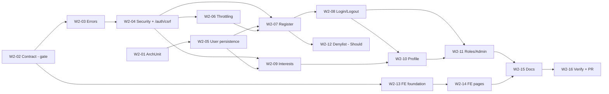

# Week 2 Plan — Authentication & User Management

- **Status:** Revision 3 (simplified), awaiting final review.
- **Stage:** 1 — Project foundation (Weeks 1–2)
- **Source:** Implementation plan §4 (Week 2), §5 (database), §6 (API), §7 (acceptance criteria)
- **Architecture:** modular monolith ([ADR-0001](../decisions/0001-modular-monolith.md)), layered
  packages and design-first API ([ADR-0004](../decisions/0004-design-first-api.md)), ArchUnit
  ([ADR-0005](../decisions/0005-architecture-rules-archunit.md)), security approach
  ([ADR-0006](../decisions/0006-session-authentication-security.md), Proposed)
- **Expected result (plan):** users can register, sign in securely and manage their profiles.

| Revision | Date | Change |
|---|---|---|
| 1 | 2026-10-27 | Initial plan |
| 2 | 2026-10-29 | Aligned with ADR-0004; contract-first ordering; security refinements; ArchUnit renumbered to ADR-0005 |
| 3 | 2026-10-29 | **Simplified for delivery:** standard Spring Security and Spring Session mechanisms only. Device cookies, the `security_version` trigger and per-request database checks removed. Throttling reduced to fixed-window limits. Proxy handling is configuration plus a deployment checklist. |

---

## 0. Current state vs. this plan

**Implemented (on `main`, Week 1 + PR #1):**
- `GET /api/v1/system/status` and Actuator health/info;
- `openapi.yaml` (contract, v0.1.0) with `OpenApiContractTest`/`OpenApiContractIT`;
- `common.exception.GlobalExceptionHandler` (Problem Details for 404/405/500);
- `common.config` (CORS, OpenAPI, clock);
- Flyway V1 (`set_updated_at()`);
- frontend status page with a typed API client;
- CI.

**Planned in this document (Week 2):** everything below. Nothing of it exists in the code yet.

### Changes from revision 2

| Area | Revision 2 | Revision 3 | Why |
|---|---|---|---|
| Device cookies | Must (W2-11) | **Deferred** (future enhancement, §12) | Extra secret management and code without an established need for an MVP |
| Session invalidation | `security_version` trigger + DB query on every request | **Spring Security / Spring Session only.** Disabled users cannot log in. Sessions end by idle (30 min) and absolute (12 h) timeout. Explicit revocation via Spring Session's principal index when admin features arrive (Week 10). | No trigger, no extra query per request; the limitation is documented (§7.5) |
| Throttling | 5 scopes, exponential backoff, device classification | **3 fixed-window limits:** account + IP, IP, registration per IP | Same protection goals with a simple algorithm |
| Proxies | Start-up validator, real-HTTP proxy tests in Week 2 | Configuration only, safe default (`none`) + **deployment checklist** (§7.8) | No custom infrastructure before deployment |
| Cookie validation | Custom start-up validator for `__Host-` rules | Configuration + `CookieAttributesIT` with production-like properties | Fewer moving parts |
| CSRF cookie | Customised repository with `__Host-XSRF-TOKEN` | `csrf.spa()` defaults (`XSRF-TOKEN`) | No customisation of the SPA handler needed |
| CSRF renewal | Server issues the new token in the same response | Spring rotates and clears the token; the SPA fetches a new one via `GET /auth/csrf` | Standard Spring behaviour; simpler client logic |
| Session principal | Custom `AuthenticatedUser` + `@CurrentUserId` resolver | Spring's `User` (username = user id), controllers use `java.security.Principal` | No custom principal or argument resolver |
| Request id, method security, eager revocation | Should | **Deferred** to the week that needs them | No callers in Week 2 |
| Password denylist | Should | Should **only if** source and licence are verified, otherwise deferred | — |
| Tasks | 19 | **16**, endpoint tasks follow contract → DTO → controller → service → repository → tests | Smaller, vertical slices |

---

## 1. Scope

### 1.1 Plan tasks → deliverables

| # | Plan task (Week 2) | Deliverable | Task (§11) |
|---|---|---|---|
| — | Design-first prerequisite | Week 2 operations in `openapi.yaml`, marked `planned` until implemented | W2-02 |
| 1 | User data model | `users`, `interests`, `user_interests`; `UserAccount`, `Interest` entities | W2-05 |
| 2 | Registration | `POST /api/v1/auth/register` with 18+ confirmation and automatic sign-in | W2-07 |
| 3 | Secure password hashing | BCrypt cost 12; password policy | W2-04, W2-07 |
| 4 | Login/logout with secure session cookies | `POST /auth/login`, `POST /auth/logout`, Spring Session JDBC | W2-04, W2-08 |
| 5 | Spring Security authN/authZ | Deny-by-default filter chain, CSRF, JSON 401/403 | W2-04 |
| 6 | Roles PLAYER and ADMIN | `users.role`, `/api/v1/admin/**` → ADMIN, admin bootstrap | W2-11 |
| 7 | User profile | `GET/PATCH /api/v1/users/me` | W2-10 |
| 8 | Interests | `GET /api/v1/interests`, interests in the profile | W2-09, W2-10 |
| 9 | Validation & standard errors | Bean Validation, Problem Details with stable `code` and field errors | W2-03 |
| 10 | Authentication tests | Unit, slice, integration, security, contract, frontend tests (§10) | all |
| — | Agreed additions | Login/registration throttling, ArchUnit | W2-01, W2-06 |
| — | User-facing outcome | Register, login and profile pages, auth state, protected routes | W2-13, W2-14 |

### 1.2 Out of scope (Week 2)

| Item | Where it belongs |
|---|---|
| Starting virtual balance on registration | Week 3. Registration publishes `UserRegistered` for the wallet module. |
| Disabling users, changing roles, revoking their sessions | Week 10 (admin), using Spring Session's principal index (§7.5) |
| Audit events | Week 10 |
| `user_sessions` (play-session history) | Week 9 |
| `user_preferences` (UI settings) | Week 6 |
| Email verification, password reset, MFA, social login | Post-MVP |
| Account deletion / data export | Before the public beta (Week 11 privacy review) |
| Trusted-proxy configuration and same-site routing | Week 12 deployment (requirements in §7.8 and §7.10) |
| Device cookies, request-id correlation | Future enhancements (§12) |
| Playwright E2E | Week 11 |

### 1.3 Priorities

Everything is **Must** unless marked **Should** (may move into the Week 3 buffer without blocking
Week 3).

---

## 2. Approved decisions

| # | Decision | Approved |
|---|---|---|
| A1 | Modular architecture, dependency direction `auth → user` | 2026-10-28 |
| A2 | Spring Session JDBC with PostgreSQL | 2026-10-28 |
| A3 | Spring Security with secure session cookies | 2026-10-28 |
| A4 | BCrypt cost 12; passwords longer than 72 UTF-8 bytes rejected | 2026-10-28 |
| A5 | Spring Security SPA CSRF configuration (`csrf.spa()`) | 2026-10-28 |
| A6 | ArchUnit (ADR-0005) | 2026-10-28 |
| A7 | React Router 8 in Week 2 | 2026-10-28 |
| A8 | Roles PLAYER and ADMIN | 2026-10-28 |
| A9 | Flyway is the only schema owner | 2026-10-28 |
| P1 | Automatic sign-in after registration (session-id rotation, CSRF renewal) | 2026-10-28 |
| P2 | `409` for duplicate registration email, with registration rate limiting | 2026-10-28 |
| P3 | Common-password denylist, if its licence is verified | 2026-10-28 |
| P4 | Branch `feature/week-02-auth`, pull request with passing CI | 2026-10-28 |
| D1 | Design-first contract and layered packages (ADR-0004) | 2026-10-29 (PR #1) |

---

## 3. Functional requirements & acceptance criteria

### FR-0 API contract (design-first)

| ID | Acceptance criterion |
|---|---|
| AC-0.1 | All Week 2 operations, schemas, error responses and security requirements are in `openapi.yaml`, marked `x-implementation-status: planned`, and reviewed before implementation starts (W2-02). |
| AC-0.2 | While an operation is `planned`, `./mvnw verify` stays green. A planned operation that is already implemented fails the build (the marker must be removed). |
| AC-0.3 | `OpenApiContractIT` reports zero differences for `/api/**`, including the operation `security` requirements and request bodies. |
| AC-0.4 | No Week 2 operation is still `planned` at the end of the week. |
| AC-0.5 | Every operation has runtime contract checks for its success response and each documented error status. |
| AC-0.6 | `AccessRulesContractIT` proves the contract's `security` matches runtime access. Operations without `sessionCookie` are reachable without a session (with a CSRF token for unsafe methods); all others return `401`. |
| AC-0.7 | Frontend types in `frontend/src/types/` match the contract schemas (reviewed in the same pull request). |

### FR-1 Registration

| ID | Acceptance criterion |
|---|---|
| AC-1.1 | Valid request → `201` with `UserProfile`, user signed in, session id newly issued. |
| AC-1.2 | `adultConfirmed` must be `true`, otherwise `400 VALIDATION_FAILED`. `adult_confirmed_at` comes from the server clock. |
| AC-1.3 | Email trimmed and lower-cased before the uniqueness check and storage. |
| AC-1.4 | Existing email → `409 EMAIL_ALREADY_REGISTERED`. |
| AC-1.5 | Password policy: 12 characters to 72 UTF-8 bytes, not equal to the email or display name → otherwise `400` with a field error. |
| AC-1.6 | The password is stored only as a BCrypt hash (`{bcrypt}$2a$12$…`), never in logs or responses. |
| AC-1.7 | Registration always creates a `PLAYER`; extra request properties such as `role` have no effect. |
| AC-1.8 | More than 10 registration attempts per client IP per hour, including attempts that end in `409`, → `429 TOO_MANY_ATTEMPTS` with `Retry-After`. |
| AC-1.9 | Without a valid CSRF token → `403 CSRF_TOKEN_INVALID`. |

### FR-2 Login

| ID | Acceptance criterion |
|---|---|
| AC-2.1 | Correct credentials → `200` with `UserProfile`; session id changed (fixation protection); CSRF token rotated. |
| AC-2.2 | Wrong password, unknown email and disabled account → identical `401 INVALID_CREDENTIALS` body. Spring's `DaoAuthenticationProvider` hashes a dummy password for unknown users, which keeps response times comparable. |
| AC-2.3 | The session is stored in PostgreSQL and survives a backend restart. |
| AC-2.4 | `last_login_at` updated on success. |

### FR-3 Logout

| ID | Acceptance criterion |
|---|---|
| AC-3.1 | `POST /auth/logout` → `204`; session row deleted, session cookie expired, CSRF token cleared. |
| AC-3.2 | The old session cookie → `401` afterwards. |
| AC-3.3 | Requires a CSRF token. Without a session it still returns `204` (idempotent). |

### FR-4 CSRF

| ID | Acceptance criterion |
|---|---|
| AC-4.1 | `GET /api/v1/auth/csrf` (public) → `204` and sets the `XSRF-TOKEN` cookie; `Cache-Control: no-store`. |
| AC-4.2 | Every `POST/PUT/PATCH/DELETE` requires `X-XSRF-TOKEN`, including login and registration (prevents login CSRF). |
| AC-4.3 | The SPA fetches a token before its first unsafe request and again after registration, login and logout. A fresh browser can register on the first attempt. |
| AC-4.4 | The token from before login/registration/logout is rejected afterwards (`403`). |
| AC-4.5 | On `403 CSRF_TOKEN_INVALID` the client refreshes the token and retries **once**. |

### FR-5 Sessions and cookies

| ID | Acceptance criterion |
|---|---|
| AC-5.1 | Session cookie: `HttpOnly`, `SameSite=Lax`, `Path=/`, no `Domain`. With production properties: name `__Host-SESSION` and `Secure` (verified by `CookieAttributesIT`). |
| AC-5.2 | Inactivity timeout 30 min (configurable): afterwards the session no longer exists → `401 SESSION_EXPIRED`. |
| AC-5.3 | Absolute lifetime 12 h (configurable): a session older than this is invalidated on its next request → `401 SESSION_EXPIRED`, even if it was active. |
| AC-5.4 | A `DISABLED` user cannot log in (`401 INVALID_CREDENTIALS`). |
| AC-5.5 | The session contains no password hash (Spring erases credentials after authentication). |

### FR-6 Login and registration throttling

| ID | Acceptance criterion |
|---|---|
| AC-6.1 | 5 failed logins for the same account from the same IP within 15 min → further attempts from that pair → `429 TOO_MANY_ATTEMPTS` with `Retry-After` until the window ends. |
| AC-6.2 | **No trivial lockout:** failures from one IP do not block the same account from another IP. |
| AC-6.3 | 50 failed logins from one IP within 15 min (any accounts) → login from that IP blocked until the window ends (credential stuffing from a single source). |
| AC-6.4 | Throttled responses are identical for existing and unknown accounts. |
| AC-6.5 | The throttle check happens **before** password verification. |
| AC-6.6 | A successful login resets the account + IP counter. |
| AC-6.7 | Registration limit: see AC-1.8. |

### FR-7 Profile

| ID | Acceptance criterion |
|---|---|
| AC-7.1 | `GET /users/me` returns the signed-in user's profile; anonymous → `401 AUTHENTICATION_REQUIRED`. |
| AC-7.2 | `PATCH /users/me` updates `displayName` and/or `interests`; omitted fields unchanged. |
| AC-7.3 | `email`, `role`, `status` and `adultConfirmedAt` cannot be changed (mass-assignment protection). |
| AC-7.4 | Invalid values → `400 VALIDATION_FAILED`; concurrent update → `409 CONCURRENT_MODIFICATION`. |

### FR-8 Interests

| ID | Acceptance criterion |
|---|---|
| AC-8.1 | `GET /api/v1/interests` (public) lists active interests in display order. |
| AC-8.2 | 0–8 distinct interests per user; unknown or inactive codes → `400 VALIDATION_FAILED`. |
| AC-8.3 | Saving replaces the whole selection. |

### FR-9 Roles & authorization

| ID | Acceptance criterion |
|---|---|
| AC-9.1 | Deny by default: unmapped paths are denied. An unmapped `/api/**` path returns `401` when anonymous. |
| AC-9.2 | `/api/v1/admin/**` → `401` anonymous, `403 ACCESS_DENIED` for `PLAYER`, allowed for `ADMIN`. Verified with a test-only endpoint in test sources. |
| AC-9.3 | Self-service endpoints use only the user id from the session (`/users/me`), never one from the request. |
| AC-9.4 | The first admin is created at start-up only when `APP_BOOTSTRAP_ADMIN_EMAIL` and `APP_BOOTSTRAP_ADMIN_PASSWORD` are set. The operation is idempotent, never promotes an existing account and never logs the password. |

### FR-10 Secure error handling

| ID | Acceptance criterion |
|---|---|
| AC-10.1 | All errors (MVC, Spring Security 401/403, `/error` fallback) are `application/problem+json` with a stable `code` that matches the contract. |
| AC-10.2 | No stack traces, exception messages, SQL or class names in responses. |
| AC-10.3 | Error responses carry `Cache-Control: no-store`. |
| AC-10.4 | Passwords, session ids, CSRF tokens and request bodies are never logged. |

### FR-11 Frontend

| ID | Acceptance criterion |
|---|---|
| AC-11.1 | Register, login and profile pages work on desktop and mobile widths, are keyboard accessible and show server validation errors next to the fields. |
| AC-11.2 | Protected pages redirect anonymous users to login and back afterwards (internal paths only). |
| AC-11.3 | The header shows the display name and a logout action when signed in. |
| AC-11.4 | Registration requires the 18+ checkbox and shows the "virtual coins have no monetary value" notice. |
| AC-11.5 | `401 SESSION_EXPIRED` clears the auth state and shows the login page with an explanation. |

### FR-12 Architecture

| ID | Acceptance criterion |
|---|---|
| AC-12.1 | ArchUnit rules (§9) run in `./mvnw test` and fail the build on violations. |

---

## 4. Module design

```
com.casino
├── common                      (existing)
│   ├── config/      CorsProperties, WebConfig, TimeConfig, OpenApiConfig
│   └── exception/   GlobalExceptionHandler (extended), + ApiException, ProblemCode, ProblemDetailFactory
│
├── auth             depends on: user (service, dto, exception), common
│   ├── controller/  AuthController — GET /auth/csrf, POST /auth/register, /auth/login, /auth/logout
│   ├── service/     RegistrationService, LoginService, SessionSignInService, AuthThrottleService,
│   │                AccountUserDetailsService (Spring UserDetailsService), PasswordPolicy
│   ├── repository/  AuthThrottleRepository (JdbcTemplate, atomic upsert)
│   ├── dto/         RegisterRequest, LoginRequest
│   ├── config/      SecurityConfig, SecurityProperties, AbsoluteSessionTimeoutFilter, AdminBootstrapRunner
│   └── exception/   InvalidCredentialsException, TooManyAttemptsException,
│                    ProblemAuthenticationEntryPoint, ProblemAccessDeniedHandler
│
└── user             depends on: common only
    ├── controller/  UserProfileController (/users/me), InterestController (/interests)
    ├── service/     UserAccountService, UserProfileService, InterestService
    ├── repository/  UserAccountRepository, InterestRepository (Spring Data JPA)
    ├── entity/      UserAccount, Interest, Role, UserStatus
    ├── dto/         UserProfileResponse, UpdateProfileRequest, InterestResponse,
    │                NewAccount, UserCredentials (auth only), UserRegistered (event)
    └── exception/   EmailAlreadyRegisteredException, UnknownInterestException, ConcurrentModificationException
```

How the layers work together, using registration as the example:

```
AuthController.register(RegisterRequest)            controller: validation (@Valid), HTTP status, cookies
 └─ RegistrationService.register(...)                service: throttle, password policy, hashing
     ├─ AuthThrottleService ─ AuthThrottleRepository repository: auth_throttle (JDBC)
     └─ UserAccountService.createAccount(NewAccount) service (user module): duplicate check, event
         └─ UserAccountRepository.save(UserAccount)  repository → entity → users table
 └─ SessionSignInService.signIn(...)                 session-id rotation, SecurityContext, CSRF rotation
```

Rules (enforced by ArchUnit, §9):
- **`auth → user` only.** `user` never imports `auth`.
- **Current user:** controllers take a `java.security.Principal` parameter. The principal is
  Spring's `User` whose username is the **user id**, so `UUID.fromString(principal.getName())`
  works in any module without a custom principal class.
- **`UserCredentials`** (contains the password hash) is used only by `user` and `auth`.
- Module exceptions extend `common.exception.ApiException` (code + status). The single
  `GlobalExceptionHandler` maps all of them.
- `auth` has no `entity` package; throttling uses plain JDBC.
- `SessionSignInService` is the only service that touches the servlet API (session, CSRF). It wraps
  Spring Security's standard components and is shared by login and registration.

---

## 5. API contract (design-first)

### 5.1 Workflow

1. **W2-02** adds every Week 2 operation to `openapi.yaml` with `x-implementation-status: planned`
   and a summary suffix "(planned)", so Swagger UI shows what is not implemented yet. The full
   contract is reviewed once (gate).
2. Each endpoint task follows the order: **contract (already approved) → DTO records → controller →
   service → repository → tests**. The `planned` marker is removed in the same change as the
   implementation.
3. Contract changes found during implementation are made explicitly in `openapi.yaml` and reviewed.
4. `info.version` becomes `0.2.0`.

**Compatibility with the existing contract tests:** today `OpenApiContractIT` would fail for a
documented but unimplemented path. W2-02 adds these rules to the test code (`OpenApiContract`):
- `differencesTo` skips operations marked `planned`, but reports an error if the implementation
  already has them;
- `everyDocumentedOperationIsVerifiedByThisTest` ignores planned operations;
- `validateResponse` rejects planned operations.

`OpenApiContractTest` gets cases for all three. swagger-core already parses `x-…` extensions
(`Operation.getExtensions()`), so no new dependency is needed.

### 5.2 Operations

Security schemes: `sessionCookie` (`apiKey`, cookie `SESSION`; `__Host-SESSION` in production) and
`csrfHeader` (`apiKey`, header `X-XSRF-TOKEN`).

| Method | Path | operationId | Security | Success | Documented errors |
|---|---|---|---|---|---|
| GET | `/api/v1/auth/csrf` | `getCsrfToken` | none | `204` | — |
| POST | `/api/v1/auth/register` | `register` | `csrfHeader` | `201` `UserProfile` | 400, 403, 409, 429 |
| POST | `/api/v1/auth/login` | `login` | `csrfHeader` | `200` `UserProfile` | 400, 401, 403, 429 |
| POST | `/api/v1/auth/logout` | `logout` | `csrfHeader` | `204` | 403 |
| GET | `/api/v1/users/me` | `getCurrentUser` | `sessionCookie` | `200` `UserProfile` | 401 |
| PATCH | `/api/v1/users/me` | `updateCurrentUser` | `sessionCookie` + `csrfHeader` | `200` `UserProfile` | 400, 401, 403, 409 |
| GET | `/api/v1/interests` | `listInterests` | none | `200` `Interest[]` | — |

`401` responses on protected operations use `AUTHENTICATION_REQUIRED` or `SESSION_EXPIRED`. Existing
operations are unchanged. The admin test endpoint lives in test sources and is not in the contract.

### 5.3 Schemas

| Schema | Fields |
|---|---|
| `RegisterRequest` | `email` (email, ≤ 254), `password` (12 chars … 72 UTF-8 bytes), `displayName` (3–30), `adultConfirmed` (boolean, must be `true`) |
| `LoginRequest` | `email`, `password` |
| `UpdateProfileRequest` | `displayName?`, `interests?` (0–8 unique codes) |
| `UserProfile` | `id` (uuid), `email`, `displayName`, `role` (`PLAYER`/`ADMIN`), `interests` (codes), `adultConfirmedAt`, `createdAt` (date-time) |
| `Interest` | `code`, `name`, `description` |
| `ProblemDetail` (extended) | existing fields + `code` (enum §5.4) + `errors` (array of `{field, message}`, only for `VALIDATION_FAILED`) |

```json
{
  "id": "0b8f0c2e-5f3a-4c55-9d8e-2f6c1a7e9b10",
  "email": "alice@example.com",
  "displayName": "Alice",
  "role": "PLAYER",
  "interests": ["PROBABILITY", "MATHEMATICS"],
  "adultConfirmedAt": "2026-11-02T09:15:00Z",
  "createdAt": "2026-11-02T09:15:00Z"
}
```

### 5.4 Error codes

| `code` | Status | When |
|---|---|---|
| `VALIDATION_FAILED` | 400 | Bean Validation or password-policy failures (`errors[]`) |
| `MALFORMED_REQUEST` | 400 | Unreadable JSON, wrong types, rejected request |
| `AUTHENTICATION_REQUIRED` | 401 | No session on a protected operation |
| `SESSION_EXPIRED` | 401 | The request carried a session cookie, but the session expired (idle or absolute) or was removed |
| `INVALID_CREDENTIALS` | 401 | Any login failure (non-specific) |
| `ACCESS_DENIED` | 403 | Insufficient role |
| `CSRF_TOKEN_INVALID` | 403 | Missing or invalid CSRF token |
| `NOT_FOUND` | 404 | Unknown resource (authenticated) |
| `METHOD_NOT_ALLOWED` | 405 | Unsupported method |
| `EMAIL_ALREADY_REGISTERED` | 409 | Duplicate registration |
| `CONCURRENT_MODIFICATION` | 409 | Optimistic-locking conflict |
| `TOO_MANY_ATTEMPTS` | 429 | Throttled; `Retry-After` in seconds |
| `INTERNAL_ERROR` | 500 | Unexpected error, generic message |

---

## 6. Database design

Four Flyway migrations, following [`docs/database.md`](../database.md).

### V2 — `V2__create_users.sql`

```sql
CREATE TABLE users (
    id                 UUID         PRIMARY KEY DEFAULT gen_random_uuid(),
    email              VARCHAR(254) NOT NULL,
    password_hash      VARCHAR(100) NOT NULL,
    display_name       VARCHAR(30)  NOT NULL,
    role               VARCHAR(20)  NOT NULL DEFAULT 'PLAYER',
    status             VARCHAR(20)  NOT NULL DEFAULT 'ACTIVE',
    adult_confirmed_at TIMESTAMPTZ  NOT NULL,
    last_login_at      TIMESTAMPTZ,
    created_at         TIMESTAMPTZ  NOT NULL DEFAULT now(),
    updated_at         TIMESTAMPTZ  NOT NULL DEFAULT now(),
    version            BIGINT       NOT NULL DEFAULT 0,
    CONSTRAINT uq_users_email            UNIQUE (email),
    CONSTRAINT ck_users_email_normalized CHECK (email = lower(btrim(email))),
    CONSTRAINT ck_users_role             CHECK (role IN ('PLAYER', 'ADMIN')),
    CONSTRAINT ck_users_status           CHECK (status IN ('ACTIVE', 'DISABLED'))
);

CREATE TRIGGER trg_users_updated_at BEFORE UPDATE ON users
    FOR EACH ROW EXECUTE FUNCTION set_updated_at();
```

- UUID ids (not enumerable); one `role` column (two exclusive roles); `version` for optimistic
  locking; no date of birth or IP address (data minimisation).
- The only trigger is the existing `set_updated_at()` from V1.

### V3 — `V3__create_interests.sql`

```sql
CREATE TABLE interests (
    code        VARCHAR(40)  PRIMARY KEY,
    name        VARCHAR(80)  NOT NULL,
    description VARCHAR(255) NOT NULL,
    sort_order  SMALLINT     NOT NULL,
    active      BOOLEAN      NOT NULL DEFAULT TRUE,
    CONSTRAINT ck_interests_code CHECK (code ~ '^[A-Z][A-Z0-9_]*$')
);

CREATE TABLE user_interests (
    user_id       UUID        NOT NULL REFERENCES users (id) ON DELETE CASCADE,
    interest_code VARCHAR(40) NOT NULL REFERENCES interests (code),
    created_at    TIMESTAMPTZ NOT NULL DEFAULT now(),
    PRIMARY KEY (user_id, interest_code)
);

INSERT INTO interests (code, name, description, sort_order) VALUES
    ('PROBABILITY',        'Probability & odds',      'How likely outcomes are and how odds are expressed',                      10),
    ('MATHEMATICS',        'Mathematics of games',    'Expected value, house edge and variance',                                 20),
    ('STATISTICS',         'Statistics & data',       'Reading results, randomness and the law of large numbers',                30),
    ('GAME_THEORY',        'Game theory & strategy',  'Decision-making under uncertainty',                                       40),
    ('PSYCHOLOGY',         'Psychology of decisions', 'Cognitive biases such as the gambler''s fallacy',                         50),
    ('FINANCIAL_LITERACY', 'Financial literacy',      'Budgeting, risk and personal finance basics',                             60),
    ('HISTORY',            'History of games',        'Origins and evolution of casino games',                                   70),
    ('RESPONSIBLE_PLAY',   'Responsible play',        'Healthy habits, limits and self-awareness (informational, not clinical)', 80);
```

The implementation plan uses `user_preferences` for interests. Interests get `user_interests`
(many-to-many), and `user_preferences` stays reserved for UI settings in Week 6. See
[change proposal 0001](../proposals/0001-implementation-plan-alignment.md).

### V4 — `V4__create_spring_session.sql`

The official Spring Session JDBC 4.1.1 PostgreSQL schema
(`org/springframework/session/jdbc/schema-postgresql.sql`), copied verbatim. It defines tables
`SPRING_SESSION` (with indexes on `SESSION_ID`, `EXPIRY_TIME`, `PRINCIPAL_NAME`) and
`SPRING_SESSION_ATTRIBUTES` (foreign key with `ON DELETE CASCADE`).

```sql
CREATE TABLE SPRING_SESSION (
    PRIMARY_ID            CHAR(36) NOT NULL,
    SESSION_ID            CHAR(36) NOT NULL,
    CREATION_TIME         BIGINT   NOT NULL,
    LAST_ACCESS_TIME      BIGINT   NOT NULL,
    MAX_INACTIVE_INTERVAL INT      NOT NULL,
    EXPIRY_TIME           BIGINT   NOT NULL,
    PRINCIPAL_NAME        VARCHAR(100),
    CONSTRAINT SPRING_SESSION_PK PRIMARY KEY (PRIMARY_ID)
);
CREATE UNIQUE INDEX SPRING_SESSION_IX1 ON SPRING_SESSION (SESSION_ID);
CREATE INDEX SPRING_SESSION_IX2 ON SPRING_SESSION (EXPIRY_TIME);
CREATE INDEX SPRING_SESSION_IX3 ON SPRING_SESSION (PRINCIPAL_NAME);

CREATE TABLE SPRING_SESSION_ATTRIBUTES (
    SESSION_PRIMARY_ID CHAR(36)     NOT NULL,
    ATTRIBUTE_NAME     VARCHAR(200) NOT NULL,
    ATTRIBUTE_BYTES    BYTEA        NOT NULL,
    CONSTRAINT SPRING_SESSION_ATTRIBUTES_PK PRIMARY KEY (SESSION_PRIMARY_ID, ATTRIBUTE_NAME),
    CONSTRAINT SPRING_SESSION_ATTRIBUTES_FK FOREIGN KEY (SESSION_PRIMARY_ID)
        REFERENCES SPRING_SESSION (PRIMARY_ID) ON DELETE CASCADE
);
```

- `spring.session.jdbc.initialize-schema=never`, so Flyway owns the schema.
- Spring Session's cleanup job removes expired sessions (default every minute).
- `PRINCIPAL_NAME` = user id, which allows "find all sessions of a user" for Week 10 revocation.

### V5 — `V5__create_auth_throttle.sql`

```sql
CREATE TABLE auth_throttle (
    throttle_key      VARCHAR(90) PRIMARY KEY,  -- '<scope>:<sha-256 hex>'
    attempt_count     INTEGER     NOT NULL,
    window_started_at TIMESTAMPTZ NOT NULL
);
CREATE INDEX ix_auth_throttle_window_started_at ON auth_throttle (window_started_at);
```

- **Fixed window.** One row per key. An attempt either starts a new window (when the old one has
  ended) or increments the counter. Both happen in a single atomic
  `INSERT … ON CONFLICT … DO UPDATE` statement, which is safe for concurrent requests.
- The key is blocked while `attempt_count >= limit` and the window has not ended.
  `Retry-After` = end of the window − now.
- Keys are SHA-256 hashes of the normalised email and/or IP; no raw personal data is stored.
- An hourly job deletes rows whose window ended more than one day ago.
- PostgreSQL rather than memory, so limits survive restarts and work with more than one instance;
  no new infrastructure.

---

## 7. Security architecture

Details and rationale: [ADR-0006](../decisions/0006-session-authentication-security.md) (Proposed).

### 7.1 Filter chain (`auth.config.SecurityConfig`)

```
CorsFilter → SessionRepositoryFilter (Spring Session) → SecurityContextHolderFilter
  → AbsoluteSessionTimeoutFilter → CsrfFilter → AuthorizationFilter (deny by default) → controllers
```

- `formLogin`, `httpBasic`, `rememberMe` and the default logout filter are disabled. Login, logout
  and registration are controller endpoints (contract-testable).
- JSON errors: `ProblemAuthenticationEntryPoint` (401) and `ProblemAccessDeniedHandler` (403 with
  `CSRF_TOKEN_INVALID` or `ACCESS_DENIED`). Both use `ProblemDetailFactory`.
- CORS via a `CorsConfigurationSource` bean, replacing the Week 1 `WebMvcConfigurer` mapping, with
  `X-XSRF-TOKEN` allowed and credentials enabled.
- Spring Security's default security headers (`X-Content-Type-Options`, `X-Frame-Options`,
  `Cache-Control: no-store`, HSTS on HTTPS) plus `Referrer-Policy: no-referrer`.

### 7.2 Authorization rules

| Matcher | Rule |
|---|---|
| `GET /api/v1/system/status`, `/actuator/health/**`, `/actuator/info` | permitAll |
| `GET /api/v1/auth/csrf`, `POST /api/v1/auth/register`, `/login`, `/logout` | permitAll (CSRF still enforced) |
| `GET /api/v1/interests` | permitAll |
| `/openapi.yaml`, `/swagger-ui.html`, `/swagger-ui/**`, `/v3/api-docs/**` | permitAll (development; disabled in production in Week 12) |
| `/error` | permitAll (errors must not turn into 401) |
| `/api/v1/admin/**` | `hasRole("ADMIN")` |
| `/api/**` | `authenticated()` |
| everything else | `denyAll()` |

### 7.3 Passwords

- `DelegatingPasswordEncoder` with `BCryptPasswordEncoder(12)` → `{bcrypt}$2a$12$…`. Cost is
  configurable (minimum 10). Tests use a low cost, except one test that asserts the production prefix.
- Policy (`PasswordPolicy`): 12 characters minimum and 72 UTF-8 bytes maximum (never truncate), not
  equal to the email or display name.
- **Should:** common-password denylist, only after its source and licence are verified (W2-12).
  Otherwise it is deferred and recorded as a residual risk.

### 7.4 Sessions and cookies

| | Development | Production | Property / env var |
|---|---|---|---|
| Store | PostgreSQL | PostgreSQL | `spring-boot-starter-session-jdbc` |
| Session cookie name | `SESSION` | `__Host-SESSION` | `server.servlet.session.cookie.name` / `APP_SESSION_COOKIE_NAME` |
| `Secure` | `false` (http://localhost) | `true` | `APP_SESSION_COOKIE_SECURE` |
| `HttpOnly` / `SameSite` / `Path` | `true` / `Lax` / `/` | same | fixed / `APP_SESSION_COOKIE_SAME_SITE` |
| `Domain` | not set | not set (required for `__Host-`) | — |
| Inactivity timeout | 30 min | 30 min | `spring.session.timeout` / `APP_SESSION_TIMEOUT` |
| Absolute lifetime | 12 h | 12 h | `app.security.session.absolute-timeout` / `APP_SESSION_ABSOLUTE_TIMEOUT` |

- **Principal:** Spring's `User`, with the user id as username and `ROLE_PLAYER`/`ROLE_ADMIN` as
  authorities. Spring erases the password after authentication, so the session never contains the
  hash. `PRINCIPAL_NAME` in `spring_session` = user id.
- **Session fixation:** on login and registration, `SessionSignInService` applies Spring's
  `ChangeSessionIdAuthenticationStrategy` and `CsrfAuthenticationStrategy`, then saves the context
  with `HttpSessionSecurityContextRepository`.
- **Absolute lifetime:** at sign-in the session gets the attribute `AUTHENTICATED_AT` (from `Clock`).
  `AbsoluteSessionTimeoutFilter` compares it with the configured lifetime. It reads only the session
  that Spring Session has already loaded, so there is **no extra database query**. An expired
  session is invalidated, and the request continues as anonymous.
- **`SESSION_EXPIRED` vs `AUTHENTICATION_REQUIRED`:** the entry point returns `SESSION_EXPIRED` when
  the request carried a session id that is no longer valid
  (`request.getRequestedSessionId() != null && !request.isRequestedSessionIdValid()`).
- **`__Host-` requirements:** `Secure`, `Path=/`, no `Domain`, set over HTTPS. Spring Session sets no
  domain and uses the root path by default, so production only needs the name and `Secure` from
  environment variables. This is verified by `CookieAttributesIT` with production-like properties.
  Over plain-HTTP development the prefix cannot be used.
- **CSRF cookie:** `csrf.spa()` defaults (`XSRF-TOKEN`, readable by JavaScript, `Secure` when
  `request.isSecure()`). In production that depends on correct `X-Forwarded-Proto` handling (§7.8).

### 7.5 Session revocation — standard mechanisms and limitations

| Situation | Mechanism (Week 2) | Effect |
|---|---|---|
| Logout | Session invalidated, row deleted | immediate |
| Inactivity | Spring Session `MAX_INACTIVE_INTERVAL` | after 30 min |
| Long-lived session | `AbsoluteSessionTimeoutFilter` | after 12 h |
| Account disabled | `DaoAuthenticationProvider` rejects disabled accounts at login | new logins blocked immediately |
| Existing sessions of a disabled or demoted user | **not revoked automatically in Week 2** | until the session ends (≤ 30 min idle, ≤ 12 h absolute) |

**Limitation and plan:** Week 2 has no feature that disables users or changes roles. The bootstrap
only creates new admins. So there is nothing to revoke yet. Before such features exist, the
following applies:

- **Week 10 (admin features), required:** every operation that disables a user, changes a role or
  changes a password deletes all of the user's sessions with Spring Session's
  `FindByIndexNameSessionRepository.findByPrincipalName(userId)`. That is an existing Spring Session
  API on the indexed `PRINCIPAL_NAME` column, and it gets an integration test.
- **Operations until then:** a manual change in the database must also run
  `DELETE FROM spring_session WHERE principal_name = '<user id>';`. This is documented in
  `docs/database.md`.
- Before the public release (Week 11 security review) we confirm that no code path changes
  role, status or password without revocation.

### 7.6 CSRF lifecycle

| Moment | Server | SPA |
|---|---|---|
| Start-up | `GET /auth/csrf` → `204` + `XSRF-TOKEN` cookie | `ensureCsrfToken()` (single-flight) before the first unsafe request |
| Unsafe request | `CsrfFilter` compares `X-XSRF-TOKEN` with the cookie | reads the cookie, sends the header |
| After register/login | `CsrfAuthenticationStrategy` rotates the token | calls `ensureCsrfToken({ refresh: true })` |
| After logout | `CsrfLogoutHandler` clears the token | calls `ensureCsrfToken({ refresh: true })` |
| `403 CSRF_TOKEN_INVALID` | — | refreshes and retries once |

Swagger UI (development): `springdoc.swagger-ui.csrf.enabled=true`.

### 7.7 Login and registration throttling

| Scope | Key | Limit | Window | Purpose |
|---|---|---|---|---|
| `LOGIN_ACCOUNT_IP` | email + IP | 5 failures | 15 min | Online guessing from one source. Only that source is blocked (no account lockout). |
| `LOGIN_IP` | IP | 50 failures | 15 min | Credential stuffing across many accounts from one source |
| `REGISTER_IP` | IP | 10 registration attempts | 1 h | Mass registration and email enumeration via `409` |

- The check runs before the password is verified; blocked requests cost no BCrypt work.
- The same responses and timing apply to unknown emails.
- Success deletes the `LOGIN_ACCOUNT_IP` row.
- Limits and windows are configurable (`app.security.throttle.*`). The IP limit is generous because
  of shared networks (NAT).
- **Not covered (residual risk):** slow guessing against one account from many different IPs. It is
  mitigated by the password policy and BCrypt. Possible later measures are device cookies or an edge
  rate limit (§12).

### 7.8 Client IP and trusted proxies

- The application uses `request.getRemoteAddr()` (passed from the controller to `AuthThrottleService`)
  and never parses `X-Forwarded-For` itself.
- **Default:** `server.forward-headers-strategy=none`. Forwarding headers are ignored, so they cannot
  be spoofed. Tested: a request with a forged `X-Forwarded-For` is throttled by its real address.
- **Deployment checklist (Week 12, before public access):**
  1. Set `SERVER_FORWARD_HEADERS_STRATEGY=native`, so Tomcat's `RemoteIpValve` handles
     `X-Forwarded-For`/`-Proto`.
  2. Set `SERVER_TOMCAT_REMOTEIP_INTERNAL_PROXIES` (and/or `…TRUSTED_PROXIES`) **explicitly** to the
     hosting platform's proxy addresses. Spring Boot's default trusts *all private address ranges*.
  3. Verify that the right-most untrusted `X-Forwarded-For` entry is used and that
     `request.isSecure()` is `true` (`Secure` cookies, HSTS).
  4. Add a smoke test for the cookie attributes over HTTPS.
- No custom proxy code, validators or additional infrastructure in Week 2.

### 7.9 Secure error handling

- `ProblemDetailFactory` builds every error body. It is used by `GlobalExceptionHandler`, the
  security entry point and access-denied handler, and the `/error` fallback.
- `500`: generic detail, the exception only in the log.
- Validation errors name the field and use the application's own messages, never rejected values
  of password fields.
- `Cache-Control: no-store` on all error responses.
- No logging of passwords, tokens, cookies or request bodies.

### 7.10 Production routing (designed now, decided in Week 12)

The frontend on Cloudflare Pages and the backend on Render are different sites, so a session cookie
would be a third-party cookie and blocked by Safari and Firefox.

- **Preferred (A):** serve `/api/*` from the frontend's site through a reverse proxy, so cookies are
  first-party.
- **Fallback (B):** a shared custom domain (`app.` + `api.`), with CORS enabled.

The code supports both: the relative `/api` path by default, and cookie, CORS and proxy settings
from environment variables. The decision goes into ADR-0007 in Week 12.

---

## 8. Frontend design

React Router 8; no form or state library.

```
src/
├── services/  apiClient.ts (post/patch, CSRF header, ProblemDetails → ApiError, one CSRF retry),
│              csrf.ts (read XSRF-TOKEN, ensureCsrfToken), authApi.ts, userApi.ts
├── features/  auth/ (AuthProvider, useAuth, RequireAuth, LoginForm, RegisterForm)
│              profile/ (ProfileForm, InterestPicker)
├── components/form/  TextField, CheckboxField, FormAlert
├── pages/     LoginPage, RegisterPage, ProfilePage (+ HomePage)
└── types/     auth.ts, user.ts, problem.ts — mirror openapi.yaml
```

- Auth state from `GET /users/me` at start-up (`401` = anonymous, not an error).
- `401 SESSION_EXPIRED` → clear the state, go to `/login` with a message.
- Redirect after login only to internal paths (starts with `/`, not `//`).
- Accessible forms: labels, `aria-invalid`, `aria-describedby`, focus on the first error.

---

## 9. Architecture rules (ArchUnit, ADR-0005)

`archunit-junit5:1.5.1` (test scope), `backend/src/test/java/com/casino/architecture/ModuleArchitectureTest.java`:

| Rule | Description |
|---|---|
| R1 | `common` does not depend on business modules |
| R2 | Business modules are free of cycles |
| R3 | Cross-module access only to another module's `service`, `dto`, `exception` packages |
| R4 | `controller → service → repository → entity`, with no reverse dependencies |
| R5 | `@RestController` in `controller`, `@RestControllerAdvice` in `exception`, `@Entity` in `entity`, Spring Data repositories in `repository`, `@Configuration` in `config` |
| R6 | Controllers do not use repositories or entities |
| R7 | DTOs do not depend on `@Entity` classes (enums allowed) |
| R8 | `user.dto.UserCredentials` used only by `user` and `auth` |
| R9 | `org.springframework.security.config..` only in `auth.config` |
| R10 | No field injection |

The existing `common.system` code already complies.

---

## 10. Test plan

### 10.1 Contract and architecture

| Test | Covers |
|---|---|
| `OpenApiContractTest` (extended) | `planned` marker rules, `security` comparison, request bodies, extended `ProblemDetail` |
| `OpenApiContractIT` (extended) | zero diffs for `/api/**`; success and documented error responses validated for every implemented operation |
| `AccessRulesContractIT` (new) | contract `security` = runtime access (AC-0.6) |
| `ModuleArchitectureTest` (new) | R1–R10 |

### 10.2 Unit tests (JUnit + Mockito)

| Test class | Covers |
|---|---|
| `UserAccountServiceTest` | email normalisation, duplicate → exception, hash stored, 18+ timestamp from `Clock`, `UserRegistered` published |
| `UserProfileServiceTest` | partial update, interest replacement, unknown/inactive codes |
| `PasswordPolicyTest` | 12 chars, 72 bytes incl. multi-byte characters, equals email/display name; denylist (Should) |
| `AuthThrottleServiceTest` | limits per scope, window reset, `Retry-After`, reset on success (fixed `Clock`) |
| `AbsoluteSessionTimeoutFilterTest` | within/over the lifetime, missing attribute |
| `AdminBootstrapRunnerTest` | disabled without env, creates once, idempotent, never promotes, no password in logs |
| `ProblemDetailFactoryTest` | codes, field errors, no internals |

### 10.3 Web slice tests (`@WebMvcTest` + `spring-security-test`)

| Test class | Covers |
|---|---|
| `AuthControllerTest` | validation errors, malformed JSON, 401/409/429 mapping |
| `UserProfileControllerTest` | PATCH semantics, unknown properties ignored, 401 anonymous |
| `SystemStatusControllerTest` (adapted) | still green with the security filter chain (public, CORS) |

### 10.4 Integration and security tests (Testcontainers PostgreSQL)

| Test class | Covers |
|---|---|
| `MigrationsIT` | V2–V5 apply, constraints, interests seeded |
| `RegistrationIT` | 201 + signed in + new session id; hash prefix; case-variant duplicate → 409; `REGISTER_IP` → 429; `"role":"ADMIN"` ignored |
| `LoginLogoutIT` | login → me → logout → me = 401; session row created and deleted; disabled user → 401; identical body for unknown email / wrong password / disabled; `last_login_at` |
| `CsrfIT` | missing/invalid token → 403 on every unsafe operation; fresh client: `GET /auth/csrf` then register works; token before login/logout rejected afterwards |
| `SessionLifetimeIT` | idle timeout (short test value) → `SESSION_EXPIRED`; absolute lifetime (fixed `Clock`) → `SESSION_EXPIRED`; session store contains no password hash |
| `CookieAttributesIT` | session cookie `HttpOnly`, `SameSite=Lax`, `Path=/`, no `Domain`; with production properties: `__Host-SESSION` + `Secure` |
| `ThrottleIT` | account + IP limit → 429 + `Retry-After`; other IP for the same account still works; IP limit; forged `X-Forwarded-For` ignored; parallel failures counted exactly |
| `ProfileIT` | profile and interests end to end; optimistic locking → 409; `"role":"ADMIN"` ignored |
| `AdminAuthorizationIT` | test-only admin endpoint: 401 / 403 / 200; bootstrap admin can log in |
| `ErrorHandlingIT` | Problem Details incl. security errors and `/error`; no internals; `no-store` |

### 10.5 Frontend (Vitest + React Testing Library)

`csrf.test.ts`, `apiClient.test.ts` (CSRF header only on unsafe methods, ProblemDetails parsing, one
retry), `AuthProvider.test.tsx`, `RequireAuth.test.tsx` (open-redirect protection),
`RegisterForm.test.tsx`, `LoginForm.test.tsx`, `ProfileForm.test.tsx`.

Coverage target: ≥ 80 % lines for the `auth` and `user` service packages (measured in Week 11).

---

## 11. Task breakdown (implementation order)

Branch `feature/week-02-auth`. Each task is one or a few commits that keep all checks green.
Size: **S** ≤ 2 h, **M** ≈ ½ day, **L** ≈ 1 day.

**Endpoint tasks always follow:** ① contract (approved in W2-02, remove `planned`) → ② DTO records →
③ controller → ④ service → ⑤ repository usage → ⑥ tests (slice, integration, contract).

| # | Task | Size | Depends on |
|---|---|---|---|
| W2-01 | ArchUnit `ModuleArchitectureTest` (R1–R10) | S | — |
| W2-02 | **Contract:** all Week 2 operations and schemas in `openapi.yaml` as `planned`, security schemes, extended `ProblemDetail`; `planned`/`security` support in `OpenApiContract` + tests. **Review gate.** | M | — |
| W2-03 | Error model: `ApiException`, `ProblemCode`, `ProblemDetailFactory`, field errors and `no-store` in `GlobalExceptionHandler` | S | W2-02 |
| W2-04 | Security foundation: dependencies, `SecurityConfig` (§7.1–7.2), entry point and denied handler, CORS source, Spring Session JDBC + **V4**, cookie properties, `PasswordEncoder`; **endpoint `GET /auth/csrf`** (①–⑥); adapt existing tests | L | W2-02, W2-03 |
| W2-05 | Persistence foundation for `user`: **V2, V3**, entities `UserAccount`/`Interest`, repositories, `MigrationsIT` (shared by W2-07…W2-10) | M | W2-01 |
| W2-06 | Throttling: **V5**, `AuthThrottleRepository` (atomic upsert), `AuthThrottleService`, cleanup job, unit tests | M | W2-04 |
| W2-07 | **Endpoint `POST /auth/register`** (①–⑥): `RegisterRequest`, `UserProfileResponse`; `AuthController`; `RegistrationService`, `UserAccountService`, `PasswordPolicy`, `SessionSignInService`; `REGISTER_IP`; `RegistrationIT`, `CsrfIT` (part) | L | W2-04, W2-05, W2-06 |
| W2-08 | **Endpoints `POST /auth/login` and `/auth/logout`** (①–⑥): `LoginRequest`; `AccountUserDetailsService`, `LoginService`; `AbsoluteSessionTimeoutFilter`; login limits; `LoginLogoutIT`, `CsrfIT`, `SessionLifetimeIT`, `CookieAttributesIT`, `ThrottleIT` | L | W2-07 |
| W2-09 | **Endpoint `GET /interests`** (①–⑥): `InterestResponse`, `InterestController`, `InterestService` | S | W2-04, W2-05 |
| W2-10 | **Endpoints `GET/PATCH /users/me`** (①–⑥): `UpdateProfileRequest`; `UserProfileController`; `UserProfileService`; `ProfileIT` | M | W2-08, W2-09 |
| W2-11 | Roles: `/admin/**` rule, `AdminBootstrapRunner`, test-only admin endpoint, `AdminAuthorizationIT`, `AccessRulesContractIT`, `ErrorHandlingIT` | M | W2-08, W2-10 |
| W2-12 | **Should:** password denylist (only with a verified licence; otherwise record as deferred) | S | W2-07 |
| W2-13 | Frontend foundation: React Router, `apiClient` (methods, CSRF, ProblemDetails), `csrf.ts`, types from the contract, `AuthProvider`, `RequireAuth` | L | W2-02 (parallel with mocks) |
| W2-14 | Frontend pages: Register, Login, Profile with InterestPicker, header user menu | L | W2-13 (+ W2-07/08/10 for the manual walkthrough) |
| W2-15 | Docs & config: `api.md`, `database.md` (revocation runbook), `architecture.md`, README, `.env.example` | S | W2-04…W2-14 |
| W2-16 | Verification: all suites, manual walkthrough, CI green, pull request | M | all |



**Checkpoints** (backend and frontend builds verified at each):
1. W2-02 contract review;
2. W2-04 security foundation with existing tests green;
3. W2-08 authentication end to end;
4. W2-11 backend complete;
5. W2-14 frontend complete.

---

## 12. Deferred enhancements (not part of Week 2)

| Enhancement | Trigger for adding it |
|---|---|
| Device cookies (OWASP) | Evidence of distributed attacks on individual accounts, or a public release with real users |
| Automatic session revocation on role/status/password change | **Required in Week 10** together with the admin features (§7.5) |
| Per-request verification of role/status | Only if Week 10 revocation proves insufficient |
| `__Host-` prefix for the CSRF cookie | Only with routing option B (shared subdomains) |
| Request-id correlation (`X-Request-Id`) | Week 12 monitoring |
| Edge rate limiting (e.g. CDN rules) | Week 12 deployment review |
| Method security (`@PreAuthorize`) | Week 10 admin services |

---

## 13. Configuration additions

| Variable | Default (dev) | Production |
|---|---|---|
| `APP_SESSION_COOKIE_NAME` | `SESSION` | `__Host-SESSION` |
| `APP_SESSION_COOKIE_SECURE` | `false` | `true` |
| `APP_SESSION_COOKIE_SAME_SITE` | `lax` | `lax` |
| `APP_SESSION_TIMEOUT` | `30m` | `30m` |
| `APP_SESSION_ABSOLUTE_TIMEOUT` | `12h` | `12h` |
| `APP_SECURITY_BCRYPT_STRENGTH` | `12` | `12` |
| `APP_BOOTSTRAP_ADMIN_EMAIL` / `APP_BOOTSTRAP_ADMIN_PASSWORD` | *(empty — disabled)* | secret store, removed after first start |
| `SERVER_FORWARD_HEADERS_STRATEGY` | `none` | `native` (with the checklist §7.8) |
| `SERVER_TOMCAT_REMOTEIP_INTERNAL_PROXIES` | *(not used)* | explicit proxy addresses (Week 12) |

New dependencies: `spring-boot-starter-security`, `spring-boot-starter-session-jdbc`,
`spring-boot-starter-security-test` (test), `archunit-junit5` (test), `react-router` (frontend).

---

## 14. Security risks

| # | Risk | Mitigation | Verified by |
|---|---|---|---|
| S1 | Password guessing / credential stuffing | Account + IP and IP limits, BCrypt 12, password policy | `ThrottleIT` |
| S2 | Lockout abuse | No account lockout; limits keyed on account + IP | `ThrottleIT` (other IP succeeds) |
| S3 | Distributed slow guessing of one account | **Residual:** password policy + BCrypt; device cookies / edge limits later | documented |
| S4 | Enumeration via login | Identical 401 and timing; identical throttling | `LoginLogoutIT` |
| S5 | Enumeration via registration (409) | Accepted (P2); `REGISTER_IP` limit | `RegistrationIT` |
| S6 | Session fixation | Session id changed on register/login | `RegistrationIT`, `LoginLogoutIT` |
| S7 | Session theft via XSS | `HttpOnly`, React escaping, no `dangerouslySetInnerHTML`; CSP in Week 12 | review, `CookieAttributesIT` |
| S8 | CSRF incl. login CSRF and forced logout | Token on all unsafe methods, rotation, `SameSite=Lax`, strict CORS | `CsrfIT` |
| S9 | Privilege escalation / mass assignment | DTOs without `role`/`email`; bootstrap never promotes | `RegistrationIT`, `ProfileIT` |
| S10 | Sessions outliving a disable/role change | **Limitation:** ≤ 30 min idle / ≤ 12 h; no such feature in Week 2; mandatory revocation in Week 10; manual runbook | §7.5, Week 10 test |
| S11 | Password hash in session or logs | Credentials erased by Spring; no body logging | `SessionLifetimeIT`, review |
| S12 | Spoofed `X-Forwarded-For` | Forwarded headers ignored by default; checklist before deployment | `ThrottleIT`, Week 12 |
| S13 | BCrypt CPU exhaustion | Throttle before hashing | `ThrottleIT` |
| S14 | Information leakage in errors | Central factory, generic 500, `no-store` | `ErrorHandlingIT` |
| S15 | Third-party cookie blocking in production | Same-site routing (§7.10) | Week 12 |
| S16 | Hard-coded admin credentials | Environment-only bootstrap | `AdminBootstrapRunnerTest` |
| S17 | Open redirect after login | Internal paths only | `RequireAuth.test.tsx` |
| S18 | Contract drift | Contract-first tasks, contract tests | FR-0 |

---

## 15. Definition of Done

- All Must acceptance criteria (§3) are covered by passing automated tests, locally and in CI.
- `openapi.yaml` (v0.2.0) has no `planned` Week 2 operations. Contract tests and ArchUnit are green.
- `./mvnw verify` and `npm run lint && npm run typecheck && npm test && npm run build` pass without
  new warnings.
- No secrets in the repository; `.env.example` documents every new variable.
- Docs updated, including the revocation runbook (§7.5) and the deployment checklist (§7.8).
- Manual walkthrough: fresh browser → register → logout → login → edit profile/interests → throttled
  login → admin bootstrap.
- Pull request `feature/week-02-auth` → `main`, CI green, merged after approval.

---

## 16. Open decisions

| # | Decision | Recommendation |
|---|---|---|
| O1 | Accept the revocation limitation for Week 2 (§7.5) with mandatory revocation in Week 10 | Yes |
| O2 | Throttle limits (5 / 15 min per account + IP, 50 / 15 min per IP, 10 / h registrations) | Yes, configurable |
| O3 | Denylist source and licence | Verify in W2-12, otherwise defer |
| O4 | Production routing A or B | A; ADR-0007 in Week 12 |
| O5 | Approve ADR-0006 | After this review |
