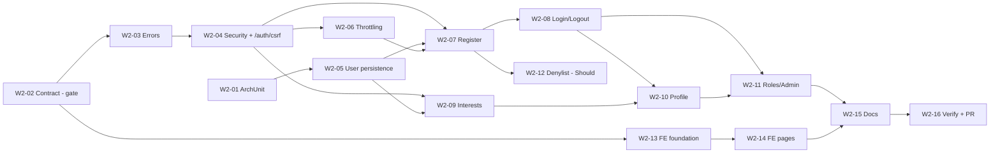

# Week 2 Plan — Authentication & User Management

- **Status:** Revision 3 (simplified), awaiting final review.
- **Stage:** 1 — Project foundation (Weeks 1–2)
- **Source:** Implementation plan v1.1 (`docs/OnlineCasinoSimulator_ImplementationPlan_v1.1.pdf`), §4 (Week 2), §5 (database), §6 (API), §7 (acceptance criteria)
- **Architecture:** modular monolith ([ADR-0001](../decisions/0001-modular-monolith.md)), layered
  packages and design-first API ([ADR-0004](../decisions/0004-design-first-api.md)), ArchUnit
  ([ADR-0005](../decisions/0005-architecture-rules-archunit.md)), security approach
  ([ADR-0006](../decisions/0006-session-authentication-security.md), Proposed)
- **Expected result (plan):** users can register, sign in securely and manage their profiles.

| Revision | Date | Change |
|---|---|---|
| 1 | 2026-10-27 | Initial plan |
| 2 | 2026-10-29 | Aligned with ADR-0004; contract-first ordering; security refinements; ArchUnit renumbered to ADR-0005 |
| 3 | 2026-10-29 | **Simplified for delivery:** standard Spring Security and Spring Session mechanisms only. Device cookies, the `security_version` trigger and per-request database checks removed. Throttling reduced to fixed-window limits. Proxy handling is configuration plus a deployment checklist. |

---

## 0. Current state vs. this plan

**Implemented (on `main`, Week 1 + PR #1):**
- `GET /api/v1/system/status` and Actuator health/info;
- `openapi.yaml` (contract, v0.1.0) with `OpenApiContractTest`/`OpenApiContractIT`;
- `common.exception.GlobalExceptionHandler` (Problem Details for 404/405/500);
- `common.config` (CORS, OpenAPI, clock);
- Flyway V1 (`set_updated_at()`);
- frontend status page with a typed API client;
- CI.

**Planned in this document (Week 2):** everything below. Nothing of it exists in the code yet.

### Changes from revision 2

| Area | Revision 2 | Revision 3 | Why |
|---|---|---|---|
| Device cookies | Must (W2-11) | **Deferred** (future enhancement, §12) | Extra secret management and code without an established need for an MVP |
| Session invalidation | `security_version` trigger + DB query on every request | **Spring Security / Spring Session only.** Disabled users cannot log in. Sessions end by idle (30 min) and absolute (12 h) timeout. Explicit revocation via Spring Session's principal index when admin features arrive (Week 10). | No trigger, no extra query per request; the limitation is documented (§7.5) |
| Throttling | 5 scopes, exponential backoff, device classification | **3 fixed-window limits:** account + IP, IP, registration per IP | Same protection goals with a simple algorithm |
| Proxies | Start-up validator, real-HTTP proxy tests in Week 2 | Configuration only, safe default (`none`) + **deployment checklist** (§7.8) | No custom infrastructure before deployment |
| Cookie validation | Custom start-up validator for `__Host-` rules | Configuration + `CookieAttributesIT` with production-like properties | Fewer moving parts |
| CSRF cookie | Customised repository with `__Host-XSRF-TOKEN` | `csrf.spa()` defaults (`XSRF-TOKEN`) | No customisation of the SPA handler needed |
| CSRF renewal | Server issues the new token in the same response | Spring rotates and clears the token; the SPA fetches a new one via `GET /auth/csrf` | Standard Spring behaviour; simpler client logic |
| Session principal | Custom `AuthenticatedUser` + `@CurrentUserId` resolver | Spring's `User` (username = user id), controllers use `java.security.Principal` | No custom principal or argument resolver |
| Request id, method security, eager revocation | Should | **Deferred** to the week that needs them | No callers in Week 2 |
| Password denylist | Should | Should **only if** source and licence are verified, otherwise deferred | — |
| Tasks | 19 | **16**, endpoint tasks follow contract → DTO → controller → service → repository → tests | Smaller, vertical slices |

---

## 1. Scope

### 1.1 Plan tasks → deliverables

| # | Plan task (Week 2) | Deliverable | Task (§11) |
|---|---|---|---|
| — | Design-first prerequisite | Week 2 operations in `openapi.yaml`, marked `planned` until implemented | W2-02 |
| 1 | User data model | `users`, `interests`, `user_interests`; `UserAccount`, `Interest` entities | W2-05 |
| 2 | Registration | `POST /api/v1/auth/register` with 18+ confirmation and automatic sign-in | W2-07 |
| 3 | Secure password hashing | BCrypt cost 12; password policy | W2-04, W2-07 |
| 4 | Login/logout with secure session cookies | `POST /auth/login`, `POST /auth/logout`, Spring Session JDBC | W2-04, W2-08 |
| 5 | Spring Security authN/authZ | Deny-by-default filter chain, CSRF, JSON 401/403 | W2-04 |
| 6 | Roles PLAYER and ADMIN | `users.role`, `/api/v1/admin/**` → ADMIN, admin bootstrap | W2-11 |
| 7 | User profile | `GET/PATCH /api/v1/users/me` | W2-10 |
| 8 | Interests | `GET /api/v1/interests`, interests in the profile | W2-09, W2-10 |
| 9 | Validation & standard errors | Bean Validation, Problem Details with stable `code` and field errors | W2-03 |
| 10 | Authentication tests | Unit, slice, integration, security, contract, frontend tests (§10) | all |
| — | Agreed additions | Login/registration throttling, ArchUnit | W2-01, W2-06 |
| — | User-facing outcome | Register, login and profile pages, auth state, protected routes | W2-13, W2-14 |

### 1.2 Out of scope (Week 2)

| Item | Where it belongs |
|---|---|
| Starting virtual balance on registration | Week 3. Registration publishes `UserRegistered` for the wallet module. |
| Disabling users, changing roles, revoking their sessions | Week 10 (admin), using Spring Session's principal index (§7.5) |
| Audit events | Week 10 |
| `user_sessions` (play-session history) | Week 9 |
| `user_preferences` (UI settings) | Week 6 |
| Email verification, password reset, MFA, social login | Post-MVP |
| Account deletion / data export | Before the public beta (Week 11 privacy review) |
| Trusted-proxy configuration and same-site routing | Week 12 deployment (requirements in §7.8 and §7.10) |
| Device cookies, request-id correlation | Future enhancements (§12) |
| Playwright E2E | Week 11 |

### 1.3 Priorities

Everything is **Must** unless marked **Should** (may move into the Week 3 buffer without blocking
Week 3).

---

## 2. Approved decisions

| # | Decision | Approved |
|---|---|---|
| A1 | Modular architecture, dependency direction `auth → user` | 2026-10-28 |
| A2 | Spring Session JDBC with PostgreSQL | 2026-10-28 |
| A3 | Spring Security with secure session cookies | 2026-10-28 |
| A4 | BCrypt cost 12; passwords longer than 72 UTF-8 bytes rejected | 2026-10-28 |
| A5 | Spring Security SPA CSRF configuration (`csrf.spa()`) | 2026-10-28 |
| A6 | ArchUnit (ADR-0005) | 2026-10-28 |
| A7 | React Router 8 in Week 2 | 2026-10-28 |
| A8 | Roles PLAYER and ADMIN | 2026-10-28 |
| A9 | Flyway is the only schema owner | 2026-10-28 |
| P1 | Automatic sign-in after registration (session-id rotation, CSRF renewal) | 2026-10-28 |
| P2 | `409` for duplicate registration email, with registration rate limiting | 2026-10-28 |
| P3 | Common-password denylist, if its licence is verified | 2026-10-28 |
| P4 | Branch `feature/week-02-auth`, pull request with passing CI | 2026-10-28 |
| D1 | Design-first contract and layered packages (ADR-0004) | 2026-10-29 (PR #1) |

---

## 3. Functional requirements & acceptance criteria

### FR-0 API contract (design-first)

| ID | Acceptance criterion |
|---|---|
| AC-0.1 | All Week 2 operations, schemas, error responses and security requirements are in `openapi.yaml`, marked `x-implementation-status: planned`, and reviewed before implementation starts (W2-02). |
| AC-0.2 | While an operation is `planned`, `./mvnw verify` stays green. A planned operation that is already implemented fails the build (the marker must be removed). |
| AC-0.3 | `OpenApiContractIT` reports zero differences for `/api/**`, including the operation `security` requirements and request bodies. |
| AC-0.4 | No Week 2 operation is still `planned` at the end of the week. |
| AC-0.5 | Every operation has runtime contract checks for its success response and each documented error status. |
| AC-0.6 | `AccessRulesContractIT` proves the contract's `security` matches runtime access. Operations without `sessionCookie` are reachable without a session (with a CSRF token for unsafe methods); all others return `401`. |
| AC-0.7 | Frontend types in `frontend/src/types/` match the contract schemas (reviewed in the same pull request). |

### FR-1 Registration

| ID | Acceptance criterion |
|---|---|
| AC-1.1 | Valid request → `201` with `UserProfile`, user signed in, session id newly issued. |
| AC-1.2 | `adultConfirmed` must be `true`, otherwise `400 VALIDATION_FAILED`. `adult_confirmed_at` comes from the server clock. |
| AC-1.3 | Email trimmed and lower-cased before the uniqueness check and storage. |
| AC-1.4 | Existing email → `409 EMAIL_ALREADY_REGISTERED`. |
| AC-1.5 | Password policy: 12 characters to 72 UTF-8 bytes, not equal to the email or display name → otherwise `400` with a field error. |
| AC-1.6 | The password is stored only as a BCrypt hash (`{bcrypt}$2a$12$…`), never in logs or responses. |
| AC-1.7 | Registration always creates a `PLAYER`; extra request properties such as `role` have no effect. |
| AC-1.8 | More than 10 registration attempts per client IP per hour, including attempts that end in `409`, → `429 TOO_MANY_ATTEMPTS` with `Retry-After`. |
| AC-1.9 | Without a valid CSRF token → `403 CSRF_TOKEN_INVALID`. |

**Implemented in W2-07 (pending review):** automatic sign-in kept as approved (P1; confirmed
2026-11-03, although the W2-07 task text excluded "authenticated user sessions"; login and logout
stay in W2-08).
- `auth.controller.AuthController.register` → `auth.service.RegistrationService` (`acquire` of
  `REGISTER_IP` first, then BCrypt, then `user.service.UserAccountService.createAccount`) →
  `auth.service.SessionSignInService` (`ChangeSessionIdAuthenticationStrategy` +
  `CsrfAuthenticationStrategy`, context saved in the session). The CSRF token repository and the
  `SecurityContextRepository` are beans in `SecurityConfig`, shared by the filter chain and
  `SessionSignInService`. Only `/api/v1/auth/register` was added to the `permitAll` rules.
- **Password policy as a Bean Validation constraint** (`auth.dto.PasswordPolicy` on `RegisterRequest`,
  `PasswordPolicyValidator`) instead of a service: all field errors arrive in one `400`. Characters are
  counted as code points; the comparisons with email and display name ignore case.
- **Additional input rules** (contract updated): email ASCII only (Java and PostgreSQL lower-case some
  other characters differently, which would violate `ck_users_email_normalized`); display name
  trimmed, without control characters.
- `UserAccountService.normalizeEmail` is the single normalisation (also used by `ThrottleKeys`).
  Duplicates: `existsByEmail`, and a concurrent insert that violates `uq_users_email` is mapped to
  `409` (Hibernate's constraint name), never `500`. Publishes `UserRegistered` (no listener until
  Week 3).
- `user.dto.UserRole` (schema `UserRole`) so that `auth` does not depend on `user.entity.Role` (R3).
- **Every attempt counts (AC-1.8, review 2026-11-03):** `auth.controller.RegistrationAttemptInterceptor`
  (registered by `auth.config.AuthWebConfig`) calls `RegistrationService.countAttempt` (atomic
  `acquire`) before Spring MVC reads and validates the body. So `201`, `400` (also unreadable JSON)
  and `409` count, and a throttled client gets `429` even for an invalid body. The interceptor runs
  after the security filter chain: CSRF failures (`403`) are not counted, so a foreign page cannot use
  up its visitor's limit. Order: `403` → `429` → `400` → `409`. The first W2-07 version did not count
  `400`s, which the approved criteria do not allow.
- **CSRF after sign-in:** the response deletes the `XSRF-TOKEN` cookie and sets no new one; the SPA
  calls `GET /auth/csrf` and gets a new value (tested over real HTTP with a cookie store). The tokens
  are stateless double-submit values (ADR-0006, `csrf.spa()`): the server compares cookie and header
  and keeps no token, so the old value is not invalidated on the server. A client that still sends
  it in both places is accepted (tested). A foreign site can neither read the cookie nor set the
  header. **For W2-08 (resolved there: AC-4.4 revised):** the `CsrfIT` case "token before login/logout rejected afterwards" cannot hold
  with this design. Either the expectation changes to "the response deletes the cookie", or tokens
  become session-bound (`HttpSessionCsrfTokenRepository`), which would change ADR-0006 point 4 and
  needs approval.
- **Log hygiene:** `spring.datasource.hikari.data-source-properties.logServerErrorDetail=false`.
  PostgreSQL's error details (`Key (email)=(…)`, `Failing row contains (…)` with the password hash)
  were logged by Hibernate on constraint violations.
- Tests: `RegisterRequestValidationTest` (incl. the policy), `UserAccountServiceTest`,
  `RegistrationServiceTest`, `SessionSignInServiceTest`, `RegistrationIT` (13 cases: sign-in and
  session contents, normalisation, duplicates and a concurrent race, all validation rules, ignored
  properties, CSRF, token rotation, session-id rotation, throttling, logs), `OpenApiContractIT`
  (201/400/403/409/429), `UserAccountRepositoryIT` (no row values in logs). ITs use a real token from
  `GET /auth/csrf` (`RealCsrfToken`): spring-security-test's `csrf()` replaces the repository of the
  shared `CsrfFilter` for the rest of the cached context.

### FR-2 Login

| ID | Acceptance criterion |
|---|---|
| AC-2.1 | Correct credentials → `200` with `UserProfile`; session id changed (fixation protection); CSRF token rotated. |
| AC-2.2 | Wrong password, unknown email and disabled account → identical `401 INVALID_CREDENTIALS` body. Spring's `DaoAuthenticationProvider` hashes a dummy password for unknown users, which keeps response times comparable. |
| AC-2.3 | The session is stored in PostgreSQL and survives a backend restart. |
| AC-2.4 | `last_login_at` updated on success. |

### FR-3 Logout

| ID | Acceptance criterion |
|---|---|
| AC-3.1 | `POST /auth/logout` → `204`; session row deleted, session cookie expired, CSRF token cleared. |
| AC-3.2 | The old session cookie → `401` afterwards. |
| AC-3.3 | Requires a CSRF token. Without a session it still returns `204` (idempotent). |

**Implemented in W2-08 (pending review):**
- **Login:** `AuthController.login` → `auth.service.LoginService` → `SessionSignInService.signIn`.
  1. `LoginService` normalises the email (`UserAccountService.normalizeEmail`).
  2. `AuthThrottleService.checkAllowed(LOGIN_ACCOUNT_IP, LOGIN_IP)` runs before the password is
     verified.
  3. `AuthenticationManager` (`auth.config.AuthenticationConfig`: `DaoAuthenticationProvider` +
     `AccountUserDetailsService` + the BCrypt encoder) verifies the password.
  4. Every `AuthenticationException` → `recordFailure` of both keys + `401 INVALID_CREDENTIALS`
     (`auth.exception.InvalidCredentialsException`).
  5. On success: `reset(LOGIN_ACCOUNT_IP)` and `UserAccountService.recordLogin` (`last_login_at`).
- **Credentials:** `AccountUserDetailsService` loads `user.dto.UserCredentials` (R8: `user` and `auth`
  only); the `User`'s username is the user id. **Account status is checked after the password**
  (`setPreAuthenticationChecks` no-op, `AccountStatusUserDetailsChecker` as post-check), so a
  disabled account is not recognisable by a faster answer; unknown emails get Spring's dummy hash.
  Passwords over 72 UTF-8 bytes fail without hashing (BCrypt would reject or truncate them);
  `InternalAuthenticationServiceException` (e.g. database down) → `500`, not a counted failure.
- **`last_login_at`:** written with a JPQL update that does not increment `version`, so concurrent
  logins of one user cannot fail with an optimistic-locking conflict.
- **Logout:** `SessionSignInService.signOut`: `CsrfLogoutHandler` (deletes `XSRF-TOKEN`) +
  `SecurityContextLogoutHandler` (invalidates the session; Spring Session deletes the row and
  expires the cookie). Idempotent; creates no session. `/login` and `/logout` were added to the
  `permitAll` rules (CSRF still enforced).
- **Absolute lifetime (AC-5.3):** `SessionSignInService` stores `AUTHENTICATED_AT` (application
  `Clock`); `auth.config.AbsoluteSessionTimeoutFilter` (before `SecurityContextHolderFilter`) ends an
  older session (`app.security.session.absolute-timeout`, `APP_SESSION_ABSOLUTE_TIMEOUT`, 12 h). A
  signed-in session without the attribute is treated as expired. Since Spring Session does not
  reliably report an id that was invalidated during the same request, the filter marks the request
  (`ProblemAuthenticationEntryPoint.SESSION_ENDED`), so the answer is `401 SESSION_EXPIRED`. The
  30-minute inactivity timeout is Spring Session's (unchanged).
- **CSRF:** AC-4.4 revised to the stateless double-submit mechanism (no server-side revocation of the
  previous value; see ADR-0006 limitations).
- `UserDetailsServiceAutoConfiguration` **stays excluded** (deviation from the plan): without it, web
  test slices created the in-memory user and logged its generated password.
- Tests: `LoginServiceTest`, `AccountUserDetailsServiceTest`, `AbsoluteSessionTimeoutFilterTest`,
  `SessionSignInServiceTest`, `UserAccountServiceTest`, `LoginLogoutIT`, `ThrottleIT`,
  `SessionLifetimeIT`, `CsrfIT`, `OpenApiContractIT` (200/400/401/403/429, 204/403).
  `CookieAttributesIT` is covered by `WebSecurityIT` and `LoginLogoutIT`. AC-2.3 (survives a
  restart) is verified by `SessionRestartIT`: a second application instance against the same
  database accepts the original cookie, keeps the original `AUTHENTICATED_AT`, and ends the session
  12 h after the original sign-in.

### FR-4 CSRF

| ID | Acceptance criterion |
|---|---|
| AC-4.1 | `GET /api/v1/auth/csrf` (public) → `204` and sets the `XSRF-TOKEN` cookie; `Cache-Control: no-store`. |
| AC-4.2 | Every `POST/PUT/PATCH/DELETE` requires `X-XSRF-TOKEN`, including login and registration (prevents login CSRF). |
| AC-4.3 | The SPA fetches a token before its first unsafe request and again after registration, login and logout. A fresh browser can register on the first attempt. |
| AC-4.4 | *Revised in W2-08:* registration, login and logout delete the `XSRF-TOKEN` cookie in their response, so the browser drops the previous token and the SPA must fetch a new one. The tokens are stateless double-submit values (`csrf.spa()`, ADR-0006): the server keeps no token and does **not** revoke the previous value; a request that presents the same value in cookie and header is accepted. A foreign page can neither read the cookie nor set the header. (Originally: "The token from before login/registration/logout is rejected afterwards (`403`)", which this mechanism cannot provide.) |
| AC-4.5 | On `403 CSRF_TOKEN_INVALID` the client refreshes the token and retries **once**. |

### FR-5 Sessions and cookies

| ID | Acceptance criterion |
|---|---|
| AC-5.1 | Session cookie: `HttpOnly`, `SameSite=Lax`, `Path=/`, no `Domain`. With production properties: name `__Host-SESSION` and `Secure` (verified by `CookieAttributesIT`). |
| AC-5.2 | Inactivity timeout 30 min (configurable): afterwards the session no longer exists → `401 SESSION_EXPIRED`. |
| AC-5.3 | Absolute lifetime 12 h (configurable): a session older than this is invalidated on its next request → `401 SESSION_EXPIRED`, even if it was active. |
| AC-5.4 | A `DISABLED` user cannot log in (`401 INVALID_CREDENTIALS`). |
| AC-5.5 | The session contains no password hash (Spring erases credentials after authentication). |

### FR-6 Login and registration throttling

| ID | Acceptance criterion |
|---|---|
| AC-6.1 | 5 failed logins for the same account from the same IP within 15 min → further attempts from that pair → `429 TOO_MANY_ATTEMPTS` with `Retry-After` until the window ends. |
| AC-6.2 | **No trivial lockout:** failures from one IP do not block the same account from another IP. |
| AC-6.3 | 50 failed logins from one IP within 15 min (any accounts) → login from that IP blocked until the window ends (credential stuffing from a single source). |
| AC-6.4 | Throttled responses are identical for existing and unknown accounts. |
| AC-6.5 | The throttle check happens **before** password verification. |
| AC-6.6 | A successful login resets the account + IP counter. |
| AC-6.7 | Registration limit: see AC-1.8. |

### FR-7 Profile

| ID | Acceptance criterion |
|---|---|
| AC-7.1 | `GET /users/me` returns the signed-in user's profile; anonymous → `401 AUTHENTICATION_REQUIRED`. |
| AC-7.2 | `PATCH /users/me` updates `displayName` and/or `interests`; omitted fields unchanged. |
| AC-7.3 | `email`, `role`, `status` and `adultConfirmedAt` cannot be changed (mass-assignment protection). |
| AC-7.4 | Invalid values → `400 VALIDATION_FAILED`; concurrent update → `409 CONCURRENT_MODIFICATION`. |

### FR-8 Interests

| ID | Acceptance criterion |
|---|---|
| AC-8.1 | `GET /api/v1/interests` (public) lists active interests in display order. |
| AC-8.2 | 0–8 distinct interests per user; unknown or inactive codes → `400 VALIDATION_FAILED`. |
| AC-8.3 | Saving replaces the whole selection. |

**Implemented in W2-09 (pending review):** AC-8.1.
- **V5** exactly as in §6 (`interests` with the 8 seeded entries, `user_interests`). The selection is
  not mapped or used yet: AC-8.2/AC-8.3 and the `interests` of `UserProfile` follow in W2-10.
- `user.entity.Interest` (read-only, `@Immutable`: the catalogue is maintained by migrations),
  `InterestRepository` (active only, ordered by `sort_order`, then `code`, so the order is stable even
  for equal orders), `InterestService`, `InterestResponse` (schema `Interest`: `code`, `name`,
  `description`), `InterestController`.
- `GET /api/v1/interests` is `permitAll` (§7.2): the same response with, without or with an ended
  session, and no session is created. Unsafe methods: `403 CSRF_TOKEN_INVALID`, then `405`.
- Contract: `planned` marker removed, `500` added (as on every operation).
- Tests: `InterestServiceTest`, `MigrationsIT` (seed, constraints of both tables, cascade and
  restrict, upgrade from V4 with an existing account, session and counter), `InterestIT`,
  `OpenApiContractIT`, `WebSecurityIT`, `CasinoSimulatorApplicationIT` (schema version 5).

**Implemented in W2-10 (pending review):** AC-7.1–AC-7.4, AC-8.2, AC-8.3, AC-9.3 for `/users/me`.
- `GET/PATCH /api/v1/users/me` (`UserProfileController`, `UserProfileService`,
  `UpdateProfileRequest`): the user id is the session principal's name, never a request value; no
  path or property addresses another user. Protected by the existing `/api/**` rule; `PATCH` needs
  the CSRF token like every unsafe method. No new migration: `UserAccount.interests` maps V5's
  `user_interests` (`@ManyToMany` to the read-only `Interest`).
- `PATCH`: `displayName` trimmed, 3–30 characters, no control characters (as at registration);
  `interests` 0–8 distinct codes in the code format (Bean Validation), then unknown or inactive
  codes → `400 VALIDATION_FAILED` per position (`interests[2]`), without echoing the code
  (`UnknownInterestException`). Omitted or `null` properties stay unchanged; `[]` clears the
  selection. Other properties are ignored. One transaction: a rejected request saves nothing.
- Optimistic locking: every change, also one of the interests only, increments `users.version`; an
  update that overlaps with another change → `409 CONCURRENT_MODIFICATION`
  (`ConcurrentModificationException`, the flush is inside the service). The contract has no client
  version (`If-Match`), so updates that do not overlap are applied in order (last one wins).
- `UserProfile.interests` lists only active interests, in catalogue order, so the client can send
  the listed selection back. A deactivated selected interest stays stored until the next change of
  the selection. Login and registration return the same profile (with the interests).
- Decisions found during implementation, reflected in the contract:
  - `500` documented on both operations, as on every implemented one;
  - `null` = unchanged: a Java record cannot tell an omitted property from an explicit `null`;
  - `UserAccount` is `@DynamicUpdate`: a full-row update would write back a `last_login_at` that a
    concurrent login set (that query does not increment `version`), a lost update;
  - `updatedAt` is read back only at insert: with `UPDATE … RETURNING`, Hibernate 7 reports a
    version conflict as a generic error instead of an optimistic-locking failure;
  - `ApiException` can carry field violations, so services report `VALIDATION_FAILED` like Bean
    Validation;
  - the implementation view adds `csrfHeader` to every unsafe operation's security requirement
    (`OpenApiConfig`); the annotations cannot combine two schemes;
  - a session whose account no longer exists (manual deletion only) →
    `401 AUTHENTICATION_REQUIRED` (`AccountNotFoundException`).
- Contract: `planned` markers removed; no planned operation is left. `OpenApiContractTest` checks
  the marker with a minimal specification.
- Tests: `UserProfileServiceTest`, `UserProfileControllerTest`, `UserAccountTest`,
  `GlobalExceptionHandlerTest`, `UserProfileServiceIT` (what is written, unchanged profiles are not
  written, atomicity, deterministic version conflicts, `last_login_at` kept), `ProfileIT` (end to end:
  restore after registration, 401/`SESSION_EXPIRED`, mass assignment, all 8 interests, invalid and
  inactive codes, own profile only, CSRF, 8 concurrent updates: only `200`/`409`, never a mix of two
  requests), `OpenApiContractIT`, `CsrfIT`.

### FR-9 Roles & authorization

| ID | Acceptance criterion |
|---|---|
| AC-9.1 | Deny by default: unmapped paths are denied. An unmapped `/api/**` path returns `401` when anonymous. |
| AC-9.2 | `/api/v1/admin/**` → `401` anonymous, `403 ACCESS_DENIED` for `PLAYER`, allowed for `ADMIN`. Verified with a test-only endpoint in test sources. |
| AC-9.3 | Self-service endpoints use only the user id from the session (`/users/me`), never one from the request. |
| AC-9.4 | The first admin is created at start-up only when `APP_BOOTSTRAP_ADMIN_EMAIL` and `APP_BOOTSTRAP_ADMIN_PASSWORD` are set. The operation is idempotent, never promotes an existing account and never logs the password. |

**Implemented in W2-11 (pending review):** AC-9.1–AC-9.4, AC-0.6.
- `SecurityConfig`: `/api/v1/admin/**` → `hasRole("ADMIN")` before `/api/**` → `authenticated()`;
  everything else stays `denyAll()`. Anonymous → `401` (`SESSION_EXPIRED` for an ended session),
  signed in without the role → `403 ACCESS_DENIED`, for every path below `/api/v1/admin`, also
  unknown ones, so their existence is not revealed. URL rules only: method security is deferred to
  the Week 10 admin services (§12). Week 2 has no PLAYER-only operation: `/api/**` operations are for
  every signed-in user, administrators included; the roles are exclusive and have no hierarchy.
- The role comes only from `users.role`: read at sign-in (`AccountUserDetailsService`, the profile
  of registration/login) and stored as the session's authority. No request type has a role
  property; client values (`role`, `roles`, `authorities`, headers, parameters) are ignored.
- Existing sessions keep the role they were signed in with until they end (≤ 30 min idle, ≤ 12 h);
  a role change in the database applies from the next sign-in. Revocation on role changes stays
  required in Week 10 (§7.5); the behaviour is pinned by `AdminAuthorizationIT`.
- `AdminBootstrapRunner` (`auth.config`, `BootstrapAdminProperties`, `app.bootstrap.admin.*`):
  disabled when both values are empty; only one value → start-up fails. The values must pass the
  registration rules (`RegisterRequest` validation; the error names the rule, never the value).
  Creates an `ACTIVE` `ADMIN` account (`UserAccountService.createAdministrator`, display name
  "Administrator", no `UserRegistered` event) or, when the email exists, changes nothing and logs
  whether it is an administrator; it never promotes. Hashes only when it creates; never logs the
  password. Concurrent starts: the unique email decides.
- Contract: description of the roles and the admin rule in `info.description`; no new operation
  (the admin test endpoint lives in `AdminAuthorizationIT` only).
- Tests: `AdminBootstrapRunnerTest`, `UserAccountServiceTest`, `UserAccountTest`,
  `AdminAuthorizationIT` (bootstrap admin: login, `200`, CSRF, `404` for unknown paths; anonymous
  `401` and `SESSION_EXPIRED`; players `403` despite client-supplied roles at registration, login and
  profile update; path variants such as an encoded `a`, `..`, `;`, `//`, a trailing slash or another
  case do not bypass the rule; players keep their operations; role changes apply from the next
  sign-in), `AccessRulesContractIT` (every contract operation: anonymous, with a session, without a
  CSRF token), `ErrorHandlingIT` (401/403 Problem Details over real HTTP). A temporary removal of
  the rule makes `AdminAuthorizationIT` fail.

### FR-10 Secure error handling

| ID | Acceptance criterion |
|---|---|
| AC-10.1 | All errors (MVC, Spring Security 401/403, `/error` fallback) are `application/problem+json` with a stable `code` that matches the contract. Documented exception: Spring's plain-text `403` for a disallowed CORS origin (§7.2). |
| AC-10.2 | No stack traces, exception messages, SQL or class names in responses. |
| AC-10.3 | Error responses carry `Cache-Control: no-store`. |
| AC-10.4 | Passwords, session ids, CSRF tokens and request bodies are never logged. |

### FR-11 Frontend

| ID | Acceptance criterion |
|---|---|
| AC-11.1 | Register, login and profile pages work on desktop and mobile widths, are keyboard accessible and show server validation errors next to the fields. |
| AC-11.2 | Protected pages redirect anonymous users to login and back afterwards (internal paths only). |
| AC-11.3 | The header shows the display name and a logout action when signed in. |
| AC-11.4 | Registration requires the 18+ checkbox and shows the "virtual coins have no monetary value" notice. |
| AC-11.5 | `401 SESSION_EXPIRED` clears the auth state and shows the login page with an explanation. |

**Early frontend authentication slice (2026-11-03, pending review), brought forward from W2-13/W2-14**
so that registration and login can be used in the browser before W2-10. Done:
- W2-13 parts: `react-router` 8.5.0 (decision A7, declarative `BrowserRouter`); `apiClient`
  (`apiPost`, CSRF header on unsafe methods, token fetched when missing, one retry on
  `403 CSRF_TOKEN_INVALID`, Problem Details and `Retry-After` in `ApiError`, `onSessionExpired`);
  `csrf.ts`; `types/` `auth.ts`, `user.ts`, `problem.ts`; `authApi.ts` (a new token is fetched after
  register, login and logout); `AuthProvider`/`useAuth`.
- W2-14 parts: `RegisterPage`, `LoginPage`, header user menu, account panel on the home page;
  `components/form` (`TextField`, `PasswordField`, `CheckboxField`, `FormAlert`).
- AC-11.1 for register and login, AC-11.3, AC-11.4, AC-11.5 (mechanism; no current request can
  return `SESSION_EXPIRED`, because every implemented operation is public).
- Tests (Vitest + RTL, `fetch` stubbed with the real contract shapes): `csrf.test.ts`,
  `apiClient.test.ts`, `authApi.test.ts`, `RegisterForm.test.tsx`, `LoginForm.test.tsx`,
  `AuthProvider.test.tsx`.

**Deviation until W2-10 (resolved in W2-10):** without `GET /users/me`, the state started as
`unknown` after every page load.

**Session restoration (W2-10, pending review):** `userApi.ts` (`getCurrentUser`); `AuthProvider`
starts in `checking` and calls `GET /users/me` once per page load: the profile → `authenticated`;
`401` → `anonymous` (`session-expired` for `SESSION_EXPIRED`, shown with an explanation, without
leaving a public page; during use a `SESSION_EXPIRED` still opens `/login`); a network or server
error → `unknown` with "Try again", never "signed out". A sign-in or sign-out that finishes before a
slow check is not overwritten by it. The header and the account panel show "Checking…" meanwhile;
the login and registration forms stay usable. Tests: `userApi.test.ts`, `AuthProvider.test.tsx`
(valid, missing, ended and unavailable sessions, loading, retry, reload, the race with a sign-in).

**Protected routes (W2-13, 2026-11-05, pending review):** AC-11.2, and AC-11.5 extended to protected pages.
- `features/auth/RequireAuth.tsx` is a layout route (`<Route element={<RequireAuth />}>` + `<Outlet />`):
  - `authenticated`: the page.
  - `anonymous`: `<Navigate replace>` to `/login?returnTo=<path?query#hash>`. After
    `SESSION_EXPIRED` the login page explains why; otherwise it shows "Please sign in to open this
    page."
  - `checking`: a status card, neither the page nor a redirect, so a reload with a valid session
    goes straight to the page.
  - `unknown`: a status card with "Try again", "Sign in" (keeping the page) and "Sign out". The user
    is never treated as signed out.

  The "checking" and "unavailable" views are shared with the account panel (`SessionStatus.tsx`,
  moved from `AccountPanel`).
- **Return path** (`features/auth/returnPath.ts`, S17): `?returnTo=` instead of router state, so the
  page survives a reload of the login page and is kept when switching to registration (registration
  signs in, too). Anyone can set the parameter, so `safeReturnPath` accepts only paths of this
  application. It rejects absolute and protocol-relative URLs, backslashes, whitespace and control
  characters (browsers drop tabs and line breaks, so `/<tab>/host` would become `//host`), and the
  sign-in pages. It then resolves the value against a placeholder origin and requires that the
  origin is unchanged. Anything else goes to `/`. A signed-in user who opens `/login?returnTo=…`
  goes straight to that page.
- **Session ends during use:** `AuthProvider` opens `/login?returnTo=<current page>`; after signing in
  again the user is back on the page.
- **Two races fixed:**
  1. A slow start-up check that answered `SESSION_EXPIRED` after a fresh sign-in triggered the
     global `onSessionExpired` listener and signed the new session out. `apiClient` now remembers
     the session generation a request was sent with (`sessionChanged()`, called by `authApi` after
     register, login and logout) and reports `SESSION_EXPIRED` only for the current one.
  2. React Router 8 navigates in transitions, while the auth state update was urgent. Signing out on
     a protected page therefore rendered it as signed out first, and `RequireAuth` sent the user to
     the login page. `AuthProvider.logout` now changes the state and navigates to `/` in one
     `startTransition`; `useSignOut` no longer navigates itself. The session-expiry path does the same.
- No protected page exists yet. The first one, `/profile`, comes with W2-14 as a child of the
  `RequireAuth` route in `App.tsx`. Until then the tests use a test-only page with the real
  provider, layout and pages. No role-aware routes: there is no admin page in Week 2. The guard
  is not a security boundary, because the backend checks session and role on every request.
- Tests: `RequireAuth.test.tsx` (11 cases):
  - anonymous redirect without rendering the page;
  - return with query and fragment after login and after registration;
  - foreign `returnTo` ignored;
  - reload with a valid session without a detour, checked through every visited location;
  - ended session;
  - network and server errors with retry;
  - expiry during use, and return afterwards;
  - sign-out on a protected page ends on `/`;
  - signed-in user on `/login?returnTo=`.

  Also `returnPath.test.ts`, and `apiClient.test.ts` and `AuthProvider.test.tsx` for the late
  `SESSION_EXPIRED` (both fail without the fix).

**Profile page (W2-14, 2026-11-05, pending review):** AC-11.1 for the profile; the frontend side of
AC-7.2–AC-7.4 and AC-8.2–AC-8.3. No backend change.
- **Route:** `/profile` (`pages/ProfilePage.tsx`) is the first child of the `RequireAuth` route in
  `App.tsx`. The page contains no authentication logic. The header shows "My profile" for signed-in
  users (`NavLink`, `aria-current="page"`), and the account panel shows "Edit profile".
- **Account details** (read-only): display name, email, role, member since, 18+ confirmation, and
  the saved interests by name (by code while the catalogue is unavailable). The page states that
  email, role and the 18+ confirmation cannot be changed. There are no inputs for them.
- **Shared state:** `AuthProvider.updateProfile` (`PATCH /users/me` through `userApi.updateCurrentUser`
  and the new `apiPatch`, cookies and CSRF header as for every unsafe request) and
  `AuthProvider.reloadProfile` (`GET /users/me` without passing through `checking`, so the page
  stays mounted). Both apply the server's profile only while the same user is still signed in. A
  late answer never signs a user back in. A `401` other than `SESSION_EXPIRED` ends the signed-in
  state, and `RequireAuth` then opens the login page with `returnTo=/profile`. `SESSION_EXPIRED`
  keeps its existing handling. The header, the account panel and the page show a saved display
  name immediately.
- **`ProfileForm`** (`features/profile`):
  - **Draft:** starts from the saved profile and sends only what differs (`profileChanges`: the name
    trimmed, the interests compared as a set). So the interests are never sent while their
    catalogue could not be loaded. After a save, form and details show the server's answer.
  - **Controls:** a success message, "Discard changes", "You have unsaved changes". Inputs and buttons
    are disabled while saving, and a synchronous guard allows only one request per save.
  - **Client checks:** the display-name check is shared with registration (`validateDisplayName`).
    The server's field errors are shown next to the fields; `interests[n]` are reported on the
    picker. Focus moves to the first invalid field.
- **`409 CONCURRENT_MODIFICATION`:** nothing is retried automatically, and the edits stay. "Load the
  latest saved version" updates the details, the header and every field the user did not edit; the
  edited fields stay as typed. Saving then sends only the edited fields, so the other change is not
  undone through an untouched field. This bug was found while writing the tests and is covered by
  them. The contract has no client version (`If-Match`), so changes that do not overlap still
  follow "last one wins" (W2-10).
- **Other failures** (edits always kept):
  - network error and `5xx`: an explanation and "Try again";
  - `403 CSRF_TOKEN_INVALID`: the existing single retry with a new token, then an explanation and
    "Try again" (never without a token);
  - `MALFORMED_REQUEST`: reload hint.
- **`InterestPicker`:**
  - one labelled checkbox per catalogue entry (`GET /api/v1/interests` via `services/interestApi.ts`
    and `useInterests`), in a `fieldset`/`legend`, with selected entries highlighted;
  - "n of 8 selected" (live region) and the maximum rule explained; when it is reached, the
    unselected entries are disabled;
  - catalogue order, no duplicates;
  - loading, empty and failed states; on failure the selection stays unchanged and is shown by code,
    with "Load interests again".

  The selection is saved only with the profile.
- **Refactoring kept small:** `DetailRow`, `formatDate` and `roleLabel` moved out of `AccountPanel`
  for reuse; `serverFieldErrors` is exported.
- **Tests:** `ProfileForm.test.tsx` (20 cases, whole application through `renderApp('/profile')`):
  - access, reload, navigation, logout and login redirect, ended and missing session;
  - details and read-only fields;
  - saving the name (header and account panel updated without a new request) and the interests
    (full replacement, also to `[]`);
  - discard, client and server validation, double submit, catalogue failure;
  - `409` with reload, network error, `500`, CSRF retry.

  Also `InterestPicker.test.tsx` (order, keyboard, maximum with a 9-entry catalogue, loading, empty
  and failed states), `profileChanges.test.ts`, `userApi.test.ts` (`PATCH`) and
  `interestApi.test.ts`. The `409` test fails without the untouched-field fix.
- **Test stability:** `asyncUtilTimeout` raised to 3 s in `test/setup.ts`. A whole-app test exceeded
  the 1 s default once under parallel load. In `RequireAuth.test.tsx` the current location is now
  read from the rendered page, not from an effect that may run after `findBy…` returns. No
  expectation changed.

**Manual browser tests (open, W2-16 walkthrough), against the real backend:**
1. Open `/profile` signed out: login, then back on `/profile`.
2. Change the display name: header and home page updated.
3. Select and deselect interests, save, reload the page: selection kept.
4. Edit in two tabs and save in both: the second shows the conflict message; "Load the latest saved
   version" keeps its edits.
5. Stop the backend while editing: error, edits kept, "Try again" after the restart.
6. Keyboard only (Tab, Space, Enter) and a 375 px wide window: every control reachable, no
   horizontal scrolling.
7. Let the session expire (30 min idle) on `/profile`, then save: login with the explanation,
   then back.

Leaving the page with unsaved changes is not intercepted: `useBlocker` needs a data router, and
the app uses the declarative `BrowserRouter` (A7).

### FR-12 Architecture

| ID | Acceptance criterion |
|---|---|
| AC-12.1 | ArchUnit rules (§9) run in `./mvnw test` and fail the build on violations. |

---

## 4. Module design

```
com.casino
├── common                      (existing)
│   ├── config/      CorsProperties, WebConfig, TimeConfig, OpenApiConfig, + SchedulingConfig
│   └── exception/   GlobalExceptionHandler (extended), + ApiException, ProblemCode, ProblemDetailFactory
│
├── auth             depends on: user (service, dto, exception), common
│   ├── controller/  AuthController — GET /auth/csrf, POST /auth/register, /auth/login, /auth/logout
│   ├── service/     RegistrationService, LoginService, SessionSignInService, AuthThrottleService
│   │                (+ ThrottleKeys, ThrottleKey, ThrottleScope),
│   │                AccountUserDetailsService (Spring UserDetailsService), PasswordPolicy
│   ├── repository/  AuthThrottleRepository (JdbcClient, atomic upsert), ThrottleWindow
│   ├── dto/         RegisterRequest, LoginRequest
│   ├── config/      SecurityConfig, SecurityProperties, ThrottleProperties, ForwardedHeadersCheck,
│   │                AbsoluteSessionTimeoutFilter,
│   │                AdminBootstrapRunner
│   └── exception/   InvalidCredentialsException, TooManyAttemptsException,
│                    ProblemAuthenticationEntryPoint, ProblemAccessDeniedHandler
│
└── user             depends on: common only
    ├── controller/  UserProfileController (/users/me), InterestController (/interests)
    ├── service/     UserAccountService, UserProfileService, InterestService
    ├── repository/  UserAccountRepository, InterestRepository (Spring Data JPA)
    ├── entity/      UserAccount, Interest, Role, UserStatus
    ├── dto/         UserProfileResponse, UpdateProfileRequest, InterestResponse,
    │                NewAccount, UserCredentials (auth only), UserRegistered (event)
    └── exception/   EmailAlreadyRegisteredException, UnknownInterestException, ConcurrentModificationException
```

How the layers work together, using registration as the example:

```
AuthController.register(RegisterRequest)            controller: validation (@Valid), HTTP status, cookies
 └─ RegistrationService.register(...)                service: throttle, password policy, hashing
     ├─ AuthThrottleService ─ AuthThrottleRepository repository: auth_throttle (JDBC)
     └─ UserAccountService.createAccount(NewAccount) service (user module): duplicate check, event
         └─ UserAccountRepository.save(UserAccount)  repository → entity → users table
 └─ SessionSignInService.signIn(...)                 session-id rotation, SecurityContext, CSRF rotation
```

Rules (enforced by ArchUnit, §9):
- **`auth → user` only.** `user` never imports `auth`.
- **Current user:** controllers take a `java.security.Principal` parameter. The principal is
  Spring's `User` whose username is the **user id**, so `UUID.fromString(principal.getName())`
  works in any module without a custom principal class.
- **`UserCredentials`** (contains the password hash) is used only by `user` and `auth`.
- Module exceptions extend `common.exception.ApiException` (code + status). The single
  `GlobalExceptionHandler` maps all of them.
- `auth` has no `entity` package; throttling uses plain JDBC.
- `SessionSignInService` is the only service that touches the servlet API (session, CSRF). It wraps
  Spring Security's standard components and is shared by login and registration.

---

## 5. API contract (design-first)

### 5.1 Workflow

1. **W2-02** adds every Week 2 operation to `openapi.yaml` with `x-implementation-status: planned`
   and a summary suffix "(planned)", so Swagger UI shows what is not implemented yet. The full
   contract is reviewed once (gate).
2. Each endpoint task follows the order: **contract (already approved) → DTO records → controller →
   service → repository → tests**. The `planned` marker is removed in the same change as the
   implementation.
3. Contract changes found during implementation are made explicitly in `openapi.yaml` and reviewed.
4. `info.version` becomes `0.2.0`.

**Compatibility with the existing contract tests:** today `OpenApiContractIT` would fail for a
documented but unimplemented path. W2-02 adds these rules to the test code (`OpenApiContract`):
- `differencesTo` skips operations marked `planned`, but reports an error if the implementation
  already has them;
- `everyDocumentedOperationIsVerifiedByThisTest` ignores planned operations;
- `validateResponse` rejects planned operations.

`OpenApiContractTest` gets cases for all three. swagger-core already parses `x-…` extensions
(`Operation.getExtensions()`), so no new dependency is needed.

**Implemented in W2-02 (pending review):**
- The same marker is also allowed on **schema properties**. This is needed for the extended
  `ProblemDetail`: its new properties `code` and `errors` are shared with the implemented
  `/system/status` operation and are planned until W2-03. A planned property must not be required.
- Only the value `planned` is accepted; any other value fails when the contract is loaded.
- `differencesTo` also compares the effective `security` requirements and `requestBody.required`,
  and resolves `$ref` responses (`components/responses`).
- Every operation declares `security` explicitly (`[]` = public), checked by `OpenApiContractTest`.

### 5.2 Operations

Security schemes: `sessionCookie` (`apiKey`, cookie `SESSION`; `__Host-SESSION` in production) and
`csrfHeader` (`apiKey`, header `X-XSRF-TOKEN`).

| Method | Path | operationId | Security | Success | Documented errors |
|---|---|---|---|---|---|
| GET | `/api/v1/auth/csrf` | `getCsrfToken` | none | `204` | — |
| POST | `/api/v1/auth/register` | `register` | `csrfHeader` | `201` `UserProfile` | 400, 403, 409, 429 |
| POST | `/api/v1/auth/login` | `login` | `csrfHeader` | `200` `UserProfile` | 400, 401, 403, 429 |
| POST | `/api/v1/auth/logout` | `logout` | `csrfHeader` | `204` | 403 |
| GET | `/api/v1/users/me` | `getCurrentUser` | `sessionCookie` | `200` `UserProfile` | 401 |
| PATCH | `/api/v1/users/me` | `updateCurrentUser` | `sessionCookie` + `csrfHeader` | `200` `UserProfile` | 400, 401, 403, 409 |
| GET | `/api/v1/interests` | `listInterests` | none | `200` `Interest[]` | — |

`401` responses on protected operations use `AUTHENTICATION_REQUIRED` or `SESSION_EXPIRED`. Existing
operations are unchanged. The admin test endpoint lives in test sources and is not in the contract.

### 5.3 Schemas

| Schema | Fields |
|---|---|
| `RegisterRequest` | `email` (email, ≤ 254), `password` (12 chars … 72 UTF-8 bytes), `displayName` (3–30), `adultConfirmed` (boolean, must be `true`) |
| `LoginRequest` | `email`, `password` |
| `UpdateProfileRequest` | `displayName?`, `interests?` (0–8 unique codes) |
| `UserProfile` | `id` (uuid), `email`, `displayName`, `role` (`PLAYER`/`ADMIN`), `interests` (codes), `adultConfirmedAt`, `createdAt` (date-time) |
| `Interest` | `code`, `name`, `description` |
| `ProblemDetail` (extended) | existing fields + `code` (enum §5.4) + `errors` (array of `{field, message}`, only for `VALIDATION_FAILED`) |

```json
{
  "id": "0b8f0c2e-5f3a-4c55-9d8e-2f6c1a7e9b10",
  "email": "alice@example.com",
  "displayName": "Alice",
  "role": "PLAYER",
  "interests": ["PROBABILITY", "MATHEMATICS"],
  "adultConfirmedAt": "2026-11-02T09:15:00Z",
  "createdAt": "2026-11-02T09:15:00Z"
}
```

### 5.4 Error codes

| `code` | Status | When |
|---|---|---|
| `VALIDATION_FAILED` | 400 | Bean Validation or password-policy failures (`errors[]`) |
| `MALFORMED_REQUEST` | 400 | Unreadable JSON, wrong types, rejected request |
| `AUTHENTICATION_REQUIRED` | 401 | No session on a protected operation |
| `SESSION_EXPIRED` | 401 | The request carried a session cookie, but the session expired (idle or absolute) or was removed |
| `INVALID_CREDENTIALS` | 401 | Any login failure (non-specific) |
| `ACCESS_DENIED` | 403 | Insufficient role |
| `CSRF_TOKEN_INVALID` | 403 | Missing or invalid CSRF token |
| `NOT_FOUND` | 404 | Unknown resource (authenticated) |
| `METHOD_NOT_ALLOWED` | 405 | Unsupported method |
| `EMAIL_ALREADY_REGISTERED` | 409 | Duplicate registration |
| `CONCURRENT_MODIFICATION` | 409 | Optimistic-locking conflict |
| `TOO_MANY_ATTEMPTS` | 429 | Throttled; `Retry-After` in seconds |
| `INTERNAL_ERROR` | 500 | Unexpected error, generic message |
| `NOT_ACCEPTABLE` | 406 | No representation matches `Accept` *(added in W2-03)* |
| `CONFLICT` | 409 | Generic conflict, e.g. a framework `409` *(added in W2-03)* |
| `CONTENT_TOO_LARGE` | 413 | Request too large *(added in W2-03)* |
| `UNSUPPORTED_MEDIA_TYPE` | 415 | Unsupported request `Content-Type` *(added in W2-03)* |
| `SERVICE_UNAVAILABLE` | 503 | Temporarily unavailable, e.g. a request timeout *(added in W2-03)* |
| `CLIENT_ERROR` / `SERVER_ERROR` | other 4xx / 5xx | Generic fallbacks that keep the status *(added in W2-03)* |

**Implemented in W2-03 (pending review):** `ProblemCode`, `ProblemDetailFactory`, `ApiException`,
field errors (`FieldViolation`) and `no-store` in `GlobalExceptionHandler`; `code` is required in the
contract and its `planned` marker is removed, as for `errors`. Every code has one fixed status except
`CLIENT_ERROR`/`SERVER_ERROR`; the HTTP status of an error is never changed, and `ApiException`
accepts only codes with a fixed status. The `/error` fallback
(`common.exception.controller.ErrorFallbackController`) answers errors outside the controllers with
the same Problem Details; a direct request to `/error` returns `404 NOT_FOUND`. **For W2-04:**
`/error` must be permitted for all dispatcher types, and `AuthenticationException`/`AccessDeniedException`
must not reach the `Exception` catch-all of `GlobalExceptionHandler`.

---

## 6. Database design

Four Flyway migrations, following [`docs/database.md`](../database.md).

**Numbered in implementation order (approved 2026-11-02):** Flyway rejects a migration whose version
is lower than one already applied (`outOfOrder=false`). The Spring Session schema is needed first
(W2-04), so it is **V2**; users (V3), throttling (V4) and interests (V5) follow. Revision 3 had
V2 users, V3 interests, V4 sessions. Every migration only adds objects; none changes existing data.

**Throttling and interests swapped (approved 2026-11-02, W2-06):** the order approved first (V4
interests, V5 throttling) no longer matched the implementation order once interests moved to W2-09:
with V5 applied, Flyway would reject a later V4. Throttling therefore became **V4** and interests
**V5**. Neither had been applied anywhere, so nothing else changed.

| Version | File | Task |
|---|---|---|
| V2 | `V2__create_spring_session.sql` | W2-04 (implemented) |
| V3 | `V3__create_users.sql` | W2-05 (implemented) |
| V4 | `V4__create_auth_throttle.sql` | W2-06 (implemented) |
| V5 | `V5__create_interests.sql` | W2-09 (moved from W2-05; implemented) |

### V2 — `V2__create_spring_session.sql` *(implemented in W2-04)*

The official Spring Session JDBC 4.1.1 PostgreSQL schema
(`org/springframework/session/jdbc/schema-postgresql.sql`), copied verbatim. It defines tables
`SPRING_SESSION` (with indexes on `SESSION_ID`, `EXPIRY_TIME`, `PRINCIPAL_NAME`) and
`SPRING_SESSION_ATTRIBUTES` (foreign key with `ON DELETE CASCADE`).

```sql
CREATE TABLE SPRING_SESSION (
    PRIMARY_ID            CHAR(36) NOT NULL,
    SESSION_ID            CHAR(36) NOT NULL,
    CREATION_TIME         BIGINT   NOT NULL,
    LAST_ACCESS_TIME      BIGINT   NOT NULL,
    MAX_INACTIVE_INTERVAL INT      NOT NULL,
    EXPIRY_TIME           BIGINT   NOT NULL,
    PRINCIPAL_NAME        VARCHAR(100),
    CONSTRAINT SPRING_SESSION_PK PRIMARY KEY (PRIMARY_ID)
);
CREATE UNIQUE INDEX SPRING_SESSION_IX1 ON SPRING_SESSION (SESSION_ID);
CREATE INDEX SPRING_SESSION_IX2 ON SPRING_SESSION (EXPIRY_TIME);
CREATE INDEX SPRING_SESSION_IX3 ON SPRING_SESSION (PRINCIPAL_NAME);

CREATE TABLE SPRING_SESSION_ATTRIBUTES (
    SESSION_PRIMARY_ID CHAR(36)     NOT NULL,
    ATTRIBUTE_NAME     VARCHAR(200) NOT NULL,
    ATTRIBUTE_BYTES    BYTEA        NOT NULL,
    CONSTRAINT SPRING_SESSION_ATTRIBUTES_PK PRIMARY KEY (SESSION_PRIMARY_ID, ATTRIBUTE_NAME),
    CONSTRAINT SPRING_SESSION_ATTRIBUTES_FK FOREIGN KEY (SESSION_PRIMARY_ID)
        REFERENCES SPRING_SESSION (PRIMARY_ID) ON DELETE CASCADE
);
```

- `spring.session.jdbc.initialize-schema=never`, so Flyway owns the schema.
- Spring Session's cleanup job removes expired sessions (default every minute).
- `PRINCIPAL_NAME` = user id, which allows "find all sessions of a user" for Week 10 revocation.

### V3 — `V3__create_users.sql`

```sql
CREATE TABLE users (
    id                 UUID         PRIMARY KEY DEFAULT gen_random_uuid(),
    email              VARCHAR(254) NOT NULL,
    password_hash      VARCHAR(100) NOT NULL,
    display_name       VARCHAR(30)  NOT NULL,
    role               VARCHAR(20)  NOT NULL DEFAULT 'PLAYER',
    status             VARCHAR(20)  NOT NULL DEFAULT 'ACTIVE',
    adult_confirmed_at TIMESTAMPTZ  NOT NULL,
    last_login_at      TIMESTAMPTZ,
    created_at         TIMESTAMPTZ  NOT NULL DEFAULT now(),
    updated_at         TIMESTAMPTZ  NOT NULL DEFAULT now(),
    version            BIGINT       NOT NULL DEFAULT 0,
    CONSTRAINT uq_users_email            UNIQUE (email),
    CONSTRAINT ck_users_email_normalized CHECK (email = lower(btrim(email))),
    CONSTRAINT ck_users_role             CHECK (role IN ('PLAYER', 'ADMIN')),
    CONSTRAINT ck_users_status           CHECK (status IN ('ACTIVE', 'DISABLED'))
);

CREATE TRIGGER trg_users_updated_at BEFORE UPDATE ON users
    FOR EACH ROW EXECUTE FUNCTION set_updated_at();
```

- UUID ids (not enumerable); one `role` column (two exclusive roles); `version` for optimistic
  locking; no date of birth or IP address (data minimisation).
- The only trigger is the existing `set_updated_at()` from V1.

**Implemented in W2-05 (pending review):** as above, plus one constraint
`ck_users_password_hash_encoded CHECK (password_hash ~ '^\{[^{}]+\}.+$')`: the `{id}` prefix of
`DelegatingPasswordEncoder` is required, so a plain-text password cannot be stored by mistake.
`user.entity.UserAccount` (with `Role`, `UserStatus`) and `user.repository.UserAccountRepository`
(`findByEmail`):
- id generated by Hibernate (UUID); `created_at`/`updated_at` are set by the database (default and
  trigger) and read back (`@Generated`), so they stay correct for non-JPA updates too;
- new accounts are `PLAYER`/`ACTIVE` in the entity and by database default;
- the entity takes only the encoded hash and an already normalised email (normalisation is
  `UserAccountService`, W2-07; the database rejects anything else); no setters until the services
  that change an account exist (W2-08, W2-10).

Tests: `UserAccountTest`, `UserAccountRepositoryIT`, `MigrationsIT` (defaults, NOT NULL, constraints,
trigger, migration of a V2 database with existing data in a separate schema).

### V4 — `V4__create_auth_throttle.sql`

```sql
CREATE TABLE auth_throttle (
    throttle_key      VARCHAR(90) PRIMARY KEY,  -- '<scope>:<sha-256 hex>'
    attempt_count     INTEGER     NOT NULL,
    window_started_at TIMESTAMPTZ NOT NULL
);
CREATE INDEX ix_auth_throttle_window_started_at ON auth_throttle (window_started_at);
```

- **Fixed window.** One row per key. An attempt either starts a new window (when the old one has
  ended) or increments the counter. Both happen in a single atomic
  `INSERT … ON CONFLICT … DO UPDATE` statement, which is safe for concurrent requests.
- The key is blocked while `attempt_count >= limit` and the window has not ended.
  `Retry-After` = end of the window − now.
- Keys are SHA-256 hashes of the normalised email and/or IP; no raw personal data is stored.
  *Implemented as HMAC-SHA-256 with a secret, see below.*
- An hourly job deletes rows whose window ended more than one day ago.
- PostgreSQL rather than memory, so limits survive restarts and work with more than one instance;
  no new infrastructure.

**Implemented in W2-06 (pending review):** as above, plus two constraints:
`ck_auth_throttle_key_hashed CHECK (throttle_key ~ '^[A-Z][A-Z_]*:[0-9a-f]{64}$')` (only hashed keys,
never an email or IP by mistake) and `ck_auth_throttle_attempt_count CHECK (attempt_count > 0)`.
- `auth.repository.AuthThrottleRepository` (`JdbcClient`): `recordAttempt` (the atomic upsert,
  `RETURNING` the window), `find`, `delete`, `deleteWindowsStartedBefore`. The current time comes from
  the service's `Clock`, not from `now()`, so tests control when windows end. The counter stops at
  limit + 1, so it is bounded however many attempts are made.
- `auth.service.ThrottleKeys` builds the `ThrottleKey`s and normalises the email itself (trim,
  lower case), so case variants and unknown emails share one counter.
- **Keys are HMAC-SHA-256, not plain SHA-256 (security review, 2026-11-02):** a plain hash of an IPv4
  address can be reversed by trying all 2³² addresses. The key is
  `<scope>:<hex HMAC-SHA-256(secret, scope NUL email NUL ip)>`; the scope is part of the message, so the
  same IP gives unrelated keys in different scopes. Same format (64 hex digits), so V4 is unchanged.
  - Secret: `app.security.throttle.secret` = `APP_SECURITY_THROTTLE_SECRET`, Base64, at least 32 bytes
    (`openssl rand -base64 32`). The application does not start if it is missing, not Base64 or too
    short; the value never appears in errors, logs or `ThrottleProperties.toString()`.
  - Tests only: `src/test/resources/config/application.yml` sets `ephemeral-secret: true` (random key
    per application context), so no secret is stored in the repository. A configured secret always wins.
  - Changing the secret makes every existing row unreachable: all counters start again at zero, once.
    The orphaned rows are removed by the cleanup job. Rotation procedure: `docs/database.md`.
- Client IP (§7.8): `auth.config.ForwardedHeadersCheck` refuses to start with
  `server.forward-headers-strategy=framework` (trusts every client's headers) or with `native` without
  an explicit `server.tomcat.remoteip.internal-proxies`. `ClientAddressIT` proves over real HTTP that a
  forged `X-Forwarded-For` is ignored by default and from untrusted peers, and that behind a trusted
  proxy the right-most untrusted entry is used.
- `auth.service.AuthThrottleService` (scopes in `ThrottleScope`, limits in
  `auth.config.ThrottleProperties`, `app.security.throttle.*`):
  - `checkAllowed(keys…)`: read-only check before the password is verified (login);
  - `recordFailure(keys…)`: counts a failed login;
  - `reset(key)`: after a successful login;
  - `acquire(key)`: counts and checks in one atomic step (registration: every attempt counts, exact
    under concurrency);
  - `deleteEndedWindows()`: `@Scheduled` hourly (`common.config.SchedulingConfig`). It deletes rows
    whose window started more than the longest configured window + 1 day ago.
- `auth.exception.TooManyAttemptsException` → `429 TOO_MANY_ATTEMPTS` with `Retry-After` (whole
  seconds, rounded up, at least 1). `ApiException.headers()` lets `GlobalExceptionHandler` send it.
- Login and registration call these methods in W2-07/W2-08; no endpoint uses them yet.

Tests: `ThrottleKeyTest` (HMAC known answer, deterministic per secret, different per secret, no
plaintext, secret validation and start-up failure), `AuthThrottleServiceTest`,
`TooManyAttemptsExceptionTest`, `GlobalExceptionHandlerTest` (429 + `Retry-After`),
`ForwardedHeadersCheckTest`, `AuthThrottleRepositoryIT`, `AuthThrottleServiceIT` (limits per scope,
expiration, concurrency, cleanup, no raw data in keys), `ClientAddressIT`, `MigrationsIT`.

### V5 — `V5__create_interests.sql` *(implemented in W2-09)*

```sql
CREATE TABLE interests (
    code        VARCHAR(40)  PRIMARY KEY,
    name        VARCHAR(80)  NOT NULL,
    description VARCHAR(255) NOT NULL,
    sort_order  SMALLINT     NOT NULL,
    active      BOOLEAN      NOT NULL DEFAULT TRUE,
    CONSTRAINT ck_interests_code CHECK (code ~ '^[A-Z][A-Z0-9_]*$')
);

CREATE TABLE user_interests (
    user_id       UUID        NOT NULL REFERENCES users (id) ON DELETE CASCADE,
    interest_code VARCHAR(40) NOT NULL REFERENCES interests (code),
    created_at    TIMESTAMPTZ NOT NULL DEFAULT now(),
    PRIMARY KEY (user_id, interest_code)
);

INSERT INTO interests (code, name, description, sort_order) VALUES
    ('PROBABILITY',        'Probability & odds',      'How likely outcomes are and how odds are expressed',                      10),
    ('MATHEMATICS',        'Mathematics of games',    'Expected value, house edge and variance',                                 20),
    ('STATISTICS',         'Statistics & data',       'Reading results, randomness and the law of large numbers',                30),
    ('GAME_THEORY',        'Game theory & strategy',  'Decision-making under uncertainty',                                       40),
    ('PSYCHOLOGY',         'Psychology of decisions', 'Cognitive biases such as the gambler''s fallacy',                         50),
    ('FINANCIAL_LITERACY', 'Financial literacy',      'Budgeting, risk and personal finance basics',                             60),
    ('HISTORY',            'History of games',        'Origins and evolution of casino games',                                   70),
    ('RESPONSIBLE_PLAY',   'Responsible play',        'Healthy habits, limits and self-awareness (informational, not clinical)', 80);
```

The implementation plan uses `user_preferences` for interests. Interests get `user_interests`
(many-to-many), and `user_preferences` stays reserved for UI settings in Week 6. See
[change proposal 0001](../proposals/0001-implementation-plan-alignment.md).

---

## 7. Security architecture

Details and rationale: [ADR-0006](../decisions/0006-session-authentication-security.md) (Proposed).

### 7.1 Filter chain (`auth.config.SecurityConfig`)

```
CorsFilter → SessionRepositoryFilter (Spring Session) → SecurityContextHolderFilter
  → AbsoluteSessionTimeoutFilter → CsrfFilter → AuthorizationFilter (deny by default) → controllers
```

- `formLogin`, `httpBasic`, `rememberMe` and the default logout filter are disabled. Login, logout
  and registration are controller endpoints (contract-testable).
- JSON errors: `ProblemAuthenticationEntryPoint` (401) and `ProblemAccessDeniedHandler` (403 with
  `CSRF_TOKEN_INVALID` or `ACCESS_DENIED`). Both use `ProblemDetailFactory`.
- CORS via a `CorsConfigurationSource` bean, replacing the Week 1 `WebMvcConfigurer` mapping, with
  `X-XSRF-TOKEN` allowed and credentials enabled.
- Spring Security's default security headers (`X-Content-Type-Options`, `X-Frame-Options`,
  `Cache-Control: no-store`, HSTS on HTTPS) plus `Referrer-Policy: no-referrer`.

### 7.2 Authorization rules

| Matcher | Rule |
|---|---|
| `GET /api/v1/system/status`, `/actuator/health/**`, `/actuator/info` | permitAll |
| `GET /api/v1/auth/csrf`, `POST /api/v1/auth/register`, `/login`, `/logout` | permitAll (CSRF still enforced) |
| `GET /api/v1/interests` | permitAll |
| `/openapi.yaml`, `/swagger-ui.html`, `/swagger-ui/**`, `/v3/api-docs/**` | permitAll (development; disabled in production in Week 12) |
| `/error` | permitAll (errors must not turn into 401) |
| `/api/v1/admin/**` | `hasRole("ADMIN")` |
| `/api/**` | `authenticated()` |
| everything else | `denyAll()` |

**Implemented in W2-04 (pending review):** `auth.config.SecurityConfig` with the rules above for the
operations that exist. The `permitAll` rules for register (W2-07), login and logout (W2-08) and
interests (W2-09) were added with those endpoints; the `/admin/**` rule was added in W2-11 (see the
note after FR-9). Details:
- Public paths are permitted for **every method** (the table above lists the documented `GET`s):
  `HEAD` works wherever `GET` does, and an unsupported method answers `405` instead of `401`
  (unsafe methods need a CSRF token first).
- A request from a disallowed origin gets Spring's plain-text `403 Invalid CORS request` (no CORS
  headers). It is the documented exception to AC-10.1: the browser does not expose it to the foreign
  page, and standardizing it would require replacing Spring Security's CORS filter.
- The entry point and the access-denied handler (`auth.exception`) resolve their error through
  Spring MVC's `HandlerExceptionResolver`, so `GlobalExceptionHandler` renders them like every other
  error. `GlobalExceptionHandler` rethrows `AuthenticationException`/`AccessDeniedException` from
  controllers to Spring Security instead of turning them into `500`.
- The request cache is disabled: an anonymous `401` creates no session.
- `csrf.spa()` (Spring Security 7) renders the `XSRF-TOKEN` cookie on every response; `GET /auth/csrf`
  guarantees it explicitly (contract, SPA start-up).
- Spring Boot's in-memory default user (`UserDetailsServiceAutoConfiguration`, generated and logged
  password) stays excluded (W2-08): accounts come from `AccountUserDetailsService`, and contexts without it (web test slices) would otherwise create the user and log its password.
- Spring Boot applies `server.servlet.session.cookie.*` to the Spring Session cookie only with the
  embedded server, so `WebSecurityIT` runs with `RANDOM_PORT`.

### 7.3 Passwords

- `DelegatingPasswordEncoder` with `BCryptPasswordEncoder(12)` → `{bcrypt}$2a$12$…`. Cost is
  configurable (minimum 10). Tests use a low cost, except one test that asserts the production prefix.
- Policy (`PasswordPolicy`): 12 characters minimum and 72 UTF-8 bytes maximum (never truncate), not
  equal to the email or display name.
- **Should:** common-password denylist, only after its source and licence are verified (W2-12).
  Otherwise it is deferred and recorded as a residual risk.

**Implemented in W2-12 (2026-11-04, pending review):** O3 resolved, the source and licence were verified.
- **Source:** Mark Burnett's "Ten Million Passwords" dataset (2015), which its author released "to
  the public domain". The copy is `xato-net-10-million-passwords-dup.txt` from SecLists (MIT): the
  755,995 passwords that occur more than once. Candidates that were rejected: Django's list and
  Royce Williams' Pwned Passwords top 20k, because neither the gist nor the Django ticket states a
  licence for the plaintext list; the HIBP range API, because it is a runtime dependency on an
  external service, which this task does not include.
- **Derived list** `backend/src/main/resources/auth/common-passwords.txt`: trimmed and lower-cased;
  only 12–72 printable ASCII characters, because other entries could never pass the remaining rules.
  15,535 entries (218 KB). `common-passwords-NOTICE.md` next to it holds the source, both
  hashes, the MIT notice (also packaged in the jar) and the shell pipeline that reproduces the file
  byte for byte.
- **Check:** `auth.dto.CommonPasswords` loads the list into an unmodifiable set on first use. A
  missing or empty list fails, so the policy is never silently weakened. `PasswordPolicyValidator`
  reports `password: must not be a commonly used password` as one more field error in the same
  `400`, comparing like the other rules (case and surrounding whitespace ignored). The bootstrap
  administrator is validated with the same rules, so a common `APP_BOOTSTRAP_ADMIN_PASSWORD` stops
  the start-up without naming the value. Login is unchanged: existing accounts can still sign in.
- **Frontend:** the list is not shipped to the browser, so the server stays authoritative. The
  password hint mentions the rule, and the server's field error is shown next to the field.
- Tests: `CommonPasswordsTest` (bundled list and notice, every entry within the policy limits,
  lookups), `RegisterRequestValidationTest` (rejection ignoring case and whitespace, combined with
  other rules), `RegistrationIT` (`400` case, value not echoed), `AdminBootstrapRunnerTest`,
  `RegisterForm.test.tsx`. Test passwords that are now on the list (`"a".repeat(12)`) were replaced.

### 7.4 Sessions and cookies

| | Development | Production | Property / env var |
|---|---|---|---|
| Store | PostgreSQL | PostgreSQL | `spring-boot-starter-session-jdbc` |
| Session cookie name | `SESSION` | `__Host-SESSION` | `server.servlet.session.cookie.name` / `APP_SESSION_COOKIE_NAME` |
| `Secure` | `false` (http://localhost) | `true` | `APP_SESSION_COOKIE_SECURE` |
| `HttpOnly` / `SameSite` / `Path` | `true` / `Lax` / `/` | same | fixed / `APP_SESSION_COOKIE_SAME_SITE` |
| `Domain` | not set | not set (required for `__Host-`) | — |
| Inactivity timeout | 30 min | 30 min | `spring.session.timeout` / `APP_SESSION_TIMEOUT` |
| Absolute lifetime | 12 h | 12 h | `app.security.session.absolute-timeout` / `APP_SESSION_ABSOLUTE_TIMEOUT` |

- **Principal:** Spring's `User`, with the user id as username and `ROLE_PLAYER`/`ROLE_ADMIN` as
  authorities. Spring erases the password after authentication, so the session never contains the
  hash. `PRINCIPAL_NAME` in `spring_session` = user id.
- **Session fixation:** on login and registration, `SessionSignInService` applies Spring's
  `ChangeSessionIdAuthenticationStrategy` and `CsrfAuthenticationStrategy`, then saves the context
  with `HttpSessionSecurityContextRepository`.
- **Absolute lifetime:** at sign-in the session gets the attribute `AUTHENTICATED_AT` (from `Clock`).
  `AbsoluteSessionTimeoutFilter` compares it with the configured lifetime. It reads only the session
  that Spring Session has already loaded, so there is **no extra database query**. An expired
  session is invalidated, and the request continues as anonymous.
- **`SESSION_EXPIRED` vs `AUTHENTICATION_REQUIRED`:** the entry point returns `SESSION_EXPIRED` when
  the request carried a session id that is no longer valid
  (`request.getRequestedSessionId() != null && !request.isRequestedSessionIdValid()`).
- **`__Host-` requirements:** `Secure`, `Path=/`, no `Domain`, set over HTTPS. Spring Session sets no
  domain and uses the root path by default, so production only needs the name and `Secure` from
  environment variables. This is verified by `CookieAttributesIT` with production-like properties.
  Over plain-HTTP development the prefix cannot be used.
- **CSRF cookie:** `csrf.spa()` defaults (`XSRF-TOKEN`, readable by JavaScript, `Secure` when
  `request.isSecure()`). In production that depends on correct `X-Forwarded-Proto` handling (§7.8).

### 7.5 Session revocation — standard mechanisms and limitations

| Situation | Mechanism (Week 2) | Effect |
|---|---|---|
| Logout | Session invalidated, row deleted | immediate |
| Inactivity | Spring Session `MAX_INACTIVE_INTERVAL` | after 30 min |
| Long-lived session | `AbsoluteSessionTimeoutFilter` | after 12 h |
| Account disabled | `DaoAuthenticationProvider` rejects disabled accounts at login | new logins blocked immediately |
| Existing sessions of a disabled or demoted user | **not revoked automatically in Week 2** | until the session ends (≤ 30 min idle, ≤ 12 h absolute) |

**Limitation and plan:** Week 2 has no feature that disables users or changes roles. The bootstrap
only creates new admins. So there is nothing to revoke yet. Before such features exist, the
following applies:

- **Week 10 (admin features), required:** every operation that disables a user, changes a role or
  changes a password deletes all of the user's sessions with Spring Session's
  `FindByIndexNameSessionRepository.findByPrincipalName(userId)`. That is an existing Spring Session
  API on the indexed `PRINCIPAL_NAME` column, and it gets an integration test.
- **Operations until then:** a manual change in the database must also run
  `DELETE FROM spring_session WHERE principal_name = '<user id>';`. This is documented in
  `docs/database.md`.
- Before the public release (Week 11 security review) we confirm that no code path changes
  role, status or password without revocation.

### 7.6 CSRF lifecycle

| Moment | Server | SPA |
|---|---|---|
| Start-up | `GET /auth/csrf` → `204` + `XSRF-TOKEN` cookie | `ensureCsrfToken()` (single-flight) before the first unsafe request |
| Unsafe request | `CsrfFilter` compares `X-XSRF-TOKEN` with the cookie | reads the cookie, sends the header |
| After register/login | `CsrfAuthenticationStrategy` deletes the `XSRF-TOKEN` cookie (no new token in the same response) | calls `ensureCsrfToken({ refresh: true })` |
| After logout | `CsrfLogoutHandler` deletes the `XSRF-TOKEN` cookie | calls `ensureCsrfToken({ refresh: true })` |
| `403 CSRF_TOKEN_INVALID` | — | refreshes and retries once |

Swagger UI (development): `springdoc.swagger-ui.csrf.enabled=true`.

### 7.7 Login and registration throttling

| Scope | Key | Limit | Window | Purpose |
|---|---|---|---|---|
| `LOGIN_ACCOUNT_IP` | email + IP | 5 failures | 15 min | Online guessing from one source. Only that source is blocked (no account lockout). |
| `LOGIN_IP` | IP | 50 failures | 15 min | Credential stuffing across many accounts from one source |
| `REGISTER_IP` | IP | 10 registration attempts | 1 h | Mass registration and email enumeration via `409` |

- The check runs before the password is verified; blocked requests cost no BCrypt work.
- The same responses and timing apply to unknown emails.
- Success deletes the `LOGIN_ACCOUNT_IP` row.
- Limits and windows are configurable (`app.security.throttle.*`). The IP limit is generous because
  of shared networks (NAT).
- Stored keys are HMAC-SHA-256 with the required secret `APP_SECURITY_THROTTLE_SECRET` (§6, V4).
- **Not covered (residual risk):** slow guessing against one account from many different IPs. It is
  mitigated by the password policy and BCrypt. Possible later measures are device cookies or an edge
  rate limit (§12).

### 7.8 Client IP and trusted proxies

- The application uses `request.getRemoteAddr()` (passed from the controller to `AuthThrottleService`)
  and never parses `X-Forwarded-For` itself.
- **Default:** `server.forward-headers-strategy=none`. Forwarding headers are ignored, so they cannot
  be spoofed. Tested: a request with a forged `X-Forwarded-For` is throttled by its real address.
- **Deployment checklist (Week 12, before public access):**
  1. Set `SERVER_FORWARD_HEADERS_STRATEGY=native`, so Tomcat's `RemoteIpValve` handles
     `X-Forwarded-For`/`-Proto`.
  2. Set `SERVER_TOMCAT_REMOTEIP_INTERNAL_PROXIES` **explicitly** (a regular expression, e.g.
     `10[.]0[.]0[.]1`) to the hosting platform's proxy addresses, plus `…TRUSTED_PROXIES` if needed.
     Spring Boot's default trusts *all private address ranges*.
  3. Verify that the right-most untrusted `X-Forwarded-For` entry is used and that
     `request.isSecure()` is `true` (`Secure` cookies, HSTS).
  4. Add a smoke test for the cookie attributes over HTTPS.
  5. Set `APP_SECURITY_THROTTLE_SECRET` (production value, secret store only).
- No custom proxy code or additional infrastructure in Week 2.
- **Added in W2-06 (security review):** `auth.config.ForwardedHeadersCheck` enforces step 2 at
  start-up (`native` without `server.tomcat.remoteip.internal-proxies` → no start) and rejects
  `framework`, whose `ForwardedHeaderFilter` would trust the headers of every client. `ClientAddressIT`
  covers the default, `native` from an untrusted peer and `native` behind a trusted proxy.

### 7.9 Secure error handling

- `ProblemDetailFactory` builds every error body. It is used by `GlobalExceptionHandler`, the
  security entry point and access-denied handler, and the `/error` fallback.
- `500`: generic detail, the exception only in the log.
- Validation errors name the field and use the application's own messages, never rejected values
  of password fields.
- `Cache-Control: no-store` on all error responses.
- No logging of passwords, tokens, cookies or request bodies.

### 7.10 Production routing (designed now, decided in Week 12)

The frontend on Cloudflare Pages and the backend on Render are different sites, so a session cookie
would be a third-party cookie and blocked by Safari and Firefox.

- **Preferred (A):** serve `/api/*` from the frontend's site through a reverse proxy, so cookies are
  first-party.
- **Fallback (B):** a shared custom domain (`app.` + `api.`), with CORS enabled.

The code supports both: the relative `/api` path by default, and cookie, CORS and proxy settings
from environment variables. The decision goes into ADR-0007 in Week 12.

---

## 8. Frontend design

React Router 8; no form or state library.

```
src/
├── services/  apiClient.ts (post/patch, CSRF header, ProblemDetails → ApiError, one CSRF retry),
│              csrf.ts (read XSRF-TOKEN, ensureCsrfToken), authApi.ts, userApi.ts
├── features/  auth/ (AuthProvider, useAuth, RequireAuth, LoginForm, RegisterForm)
│              profile/ (ProfileForm, InterestPicker)
├── components/form/  TextField, CheckboxField, FormAlert
├── pages/     LoginPage, RegisterPage, ProfilePage (+ HomePage)
└── types/     auth.ts, user.ts, problem.ts — mirror openapi.yaml
```

- Auth state from `GET /users/me` at start-up (`401` = anonymous, not an error; other failures =
  unknown with a retry). Implemented in W2-10, see the note after FR-11.
- `401 SESSION_EXPIRED` → clear the state, go to `/login` with a message.
- Redirect after login only to internal paths (starts with `/`, not `//`).
- Accessible forms: labels, `aria-invalid`, `aria-describedby`, focus on the first error.

---

## 9. Architecture rules (ArchUnit, ADR-0005)

`archunit-junit5:1.5.1` (test scope), `backend/src/test/java/com/casino/architecture/ModuleArchitectureTest.java`:

| Rule | Description |
|---|---|
| R1 | `common` does not depend on business modules |
| R2 | Business modules are free of cycles |
| R3 | Cross-module access only to another module's `service`, `dto`, `exception` packages |
| R4 | `controller → service → repository → entity`, with no reverse dependencies |
| R5 | `@RestController` in `controller`, `@RestControllerAdvice` in `exception`, `@Entity` in `entity`, Spring Data repositories in `repository`, `@Configuration` in `config` |
| R6 | Controllers do not use repositories or entities |
| R7 | DTOs do not depend on `@Entity` classes (enums allowed) |
| R8 | `user.dto.UserCredentials` used only by `user` and `auth` |
| R9 | `org.springframework.security.config..` only in `auth.config` |
| R10 | No field injection |
| R11 | Every top-level package is `common` or a listed business module (so R1–R10 cover new modules) |
| R12 | Every class resides in a layer package (`<module>.<layer>`; in `common` also `common.<feature>.<layer>`) |

The existing `common.system` code already complies. **Implemented in W2-01:** the rules are in
`architecture/ArchitectureRules.java` (test sources), applied by `ModuleArchitectureTest`.
`ArchitectureRulesTest` proves each rule against a fixture (package `archfixture`, outside
`com.casino` so it is never component-scanned). R9 has no fixture until Spring Security is added
(W2-04). R11 and R12 were added during implementation (pending review).

---

## 10. Test plan

### 10.1 Contract and architecture

| Test | Covers |
|---|---|
| `OpenApiContractTest` (extended) | `planned` marker rules, `security` comparison, request bodies, extended `ProblemDetail` |
| `OpenApiContractIT` (extended) | zero diffs for `/api/**`; success and documented error responses validated for every implemented operation |
| `AccessRulesContractIT` (new) | contract `security` = runtime access (AC-0.6) |
| `ModuleArchitectureTest` (new) | R1–R10 |

### 10.2 Unit tests (JUnit + Mockito)

| Test class | Covers |
|---|---|
| `UserAccountServiceTest` | email normalisation, duplicate → exception, hash stored, 18+ timestamp from `Clock`, `UserRegistered` published |
| `UserProfileServiceTest` | partial update, interest replacement, unknown/inactive codes |
| `PasswordPolicyTest` | 12 chars, 72 bytes incl. multi-byte characters, equals email/display name; denylist (Should). *Implemented as `RegisterRequestValidationTest` and `CommonPasswordsTest`.* |
| `AuthThrottleServiceTest` | limits per scope, window reset, `Retry-After`, reset on success (fixed `Clock`) |
| `AbsoluteSessionTimeoutFilterTest` | within/over the lifetime, missing attribute |
| `AdminBootstrapRunnerTest` | disabled without env, creates once, idempotent, never promotes, no password in logs |
| `ProblemDetailFactoryTest` | codes, field errors, no internals |

### 10.3 Web slice tests (`@WebMvcTest` + `spring-security-test`)

| Test class | Covers |
|---|---|
| `AuthControllerTest` | validation errors, malformed JSON, 401/409/429 mapping |
| `UserProfileControllerTest` | PATCH semantics, unknown properties ignored, 401 anonymous |
| `SystemStatusControllerTest` (adapted) | still green with the security filter chain (public, CORS) |

### 10.4 Integration and security tests (Testcontainers PostgreSQL)

| Test class | Covers |
|---|---|
| `MigrationsIT` | V3 (W2-05), V4 (W2-06), V5 interests seeded (W2-09): defaults, constraints, triggers, migration of existing data (V2 is checked by `CasinoSimulatorApplicationIT`) |
| `RegistrationIT` | 201 + signed in + new session id; hash prefix; case-variant duplicate → 409; `REGISTER_IP` → 429; `"role":"ADMIN"` ignored |
| `LoginLogoutIT` | login → me → logout → me = 401; session row created and deleted; disabled user → 401; identical body for unknown email / wrong password / disabled; `last_login_at` |
| `CsrfIT` | missing/invalid token and cookie without header → 403 on every unsafe operation (register, login, logout, a planned protected one); login and logout delete the cookie and a new token works; the previous token is not revoked on the server (documented, AC-4.4 revised). Registration flow: `RegistrationIT` |
| `SessionLifetimeIT` | idle timeout (short test value) → `SESSION_EXPIRED`; absolute lifetime (fixed `Clock`) → `SESSION_EXPIRED`; session store contains no password hash |
| `SessionRestartIT` | AC-2.3: a second application instance against the same database accepts the original session cookie; `AUTHENTICATED_AT` unchanged, so the 12 h lifetime still counts from the original sign-in |
| `CookieAttributesIT` | *Covered by `WebSecurityIT` (production properties: `__Host-SESSION` + `Secure`) and `LoginLogoutIT`/`RegistrationIT` (`HttpOnly`, `SameSite=Lax`, `Path=/`, no `Domain` on the cookie of a real sign-in); no separate class.* |
| `ThrottleIT` | account + IP limit → 429 + `Retry-After`; other IP for the same account still works; IP limit; forged `X-Forwarded-For` ignored; parallel failures counted exactly |
| `ProfileIT` | profile and interests end to end; optimistic locking → 409; `"role":"ADMIN"` ignored |
| `AdminAuthorizationIT` | test-only admin endpoint: 401 / 403 / 200; bootstrap admin can log in |
| `ErrorHandlingIT` | Problem Details incl. security errors and `/error`; no internals; `no-store` |

### 10.5 Frontend (Vitest + React Testing Library)

`csrf.test.ts`, `apiClient.test.ts` (CSRF header only on unsafe methods, ProblemDetails parsing, one
retry), `AuthProvider.test.tsx`, `RequireAuth.test.tsx` (open-redirect protection),
`RegisterForm.test.tsx`, `LoginForm.test.tsx`, `ProfileForm.test.tsx`.

Coverage target: ≥ 80 % lines for the `auth` and `user` service packages (measured in Week 11).

---

## 11. Task breakdown (implementation order)

Branch `feature/week-02-auth`. Each task is one or a few commits that keep all checks green.
Size: **S** ≤ 2 h, **M** ≈ ½ day, **L** ≈ 1 day.

**Endpoint tasks always follow:** ① contract (approved in W2-02, remove `planned`) → ② DTO records →
③ controller → ④ service → ⑤ repository usage → ⑥ tests (slice, integration, contract).

| # | Task | Size | Depends on |
|---|---|---|---|
| W2-01 | ArchUnit `ModuleArchitectureTest` (R1–R10) | S | — |
| W2-02 | **Contract:** all Week 2 operations and schemas in `openapi.yaml` as `planned`, security schemes, extended `ProblemDetail`; `planned`/`security` support in `OpenApiContract` + tests. **Review gate.** | M | — |
| W2-03 | Error model: `ApiException`, `ProblemCode`, `ProblemDetailFactory`, field errors and `no-store` in `GlobalExceptionHandler` | S | W2-02 |
| W2-04 | Security foundation: dependencies, `SecurityConfig` (§7.1–7.2), entry point and denied handler, CORS source, Spring Session JDBC + **V2**, cookie properties, `PasswordEncoder`; **endpoint `GET /auth/csrf`** (①–⑥); adapt existing tests | L | W2-02, W2-03 |
| W2-05 | Persistence foundation for `user`: **V3**, entity `UserAccount` (`Role`, `UserStatus`), `UserAccountRepository`, `MigrationsIT` (shared by W2-06…W2-10). *Interests migration and `Interest` moved to W2-09 (2026-11-02).* | M | W2-01 |
| W2-06 | Throttling: **V4** (renumbered from V5, 2026-11-02), `AuthThrottleRepository` (atomic upsert), `AuthThrottleService`, cleanup job, unit tests, `AuthThrottleRepositoryIT`/`AuthThrottleServiceIT` | M | W2-04 |
| W2-07 | **Endpoint `POST /auth/register`** (①–⑥): `RegisterRequest`, `UserProfileResponse`; `AuthController`; `RegistrationService`, `UserAccountService`, `PasswordPolicy`, `SessionSignInService`; `REGISTER_IP`; `RegistrationIT`, `CsrfIT` (part). *Implemented 2026-11-03 (pending review); the registration CSRF cases are in `RegistrationIT`, `CsrfIT` for every operation follows in W2-08.* | L | W2-04, W2-05, W2-06 |
| W2-08 | **Endpoints `POST /auth/login` and `/auth/logout`** (①–⑥): `LoginRequest`; `AccountUserDetailsService`, `LoginService`; `AbsoluteSessionTimeoutFilter`; login limits; `LoginLogoutIT`, `CsrfIT`, `SessionLifetimeIT`, `SessionRestartIT`, `CookieAttributesIT`, `ThrottleIT`. *Implemented 2026-11-03 (pending review), see the note after FR-3.* | L | W2-07 |
| W2-09 | **Endpoint `GET /interests`** (①–⑥): **V5** (moved from W2-05, renumbered from V4), entity `Interest`, `InterestRepository`, `InterestResponse`, `InterestController`, `InterestService`. *Implemented 2026-11-03 (pending review), see the note after FR-8.* | M | W2-04, W2-05 |
| W2-10 | **Endpoints `GET/PATCH /users/me`** (①–⑥): `UpdateProfileRequest`; `UserProfileController`; `UserProfileService`; `ProfileIT`. *Implemented 2026-11-04 (pending review) with the frontend session restoration, see the notes after FR-8 and FR-11.* | M | W2-08, W2-09 |
| W2-11 | Roles: `/admin/**` rule, `AdminBootstrapRunner`, test-only admin endpoint, `AdminAuthorizationIT`, `AccessRulesContractIT`, `ErrorHandlingIT`. *Implemented 2026-11-04 (pending review), see the note after FR-9.* | M | W2-08, W2-10 |
| W2-12 | **Should:** password denylist (only with a verified licence; otherwise record as deferred). *Implemented 2026-11-04 (pending review) with a public-domain source, see the note in §7.3.* | S | W2-07 |
| W2-13 | Frontend foundation: React Router, `apiClient` (methods, CSRF, ProblemDetails), `csrf.ts`, types from the contract, `AuthProvider`, `RequireAuth`. *All but `RequireAuth` done early (2026-11-03); the `/users/me` start-up check with W2-10 (2026-11-04); `RequireAuth` and the return path implemented 2026-11-05 (pending review), see the notes after FR-11.* | L | W2-02 (parallel with mocks) |
| W2-14 | Frontend pages: Register, Login, Profile with InterestPicker, header user menu. *Register, Login and the header user menu done early (2026-11-03); Profile, `ProfileForm` and `InterestPicker` implemented 2026-11-05 with passing automated tests (pending review). The manual browser walkthrough is part of W2-16, see the note after FR-11.* | L | W2-13 (+ W2-07/08/10 for the manual walkthrough) |
| W2-15 | Docs & config: `api.md`, `database.md` (revocation runbook), `architecture.md`, README, `.env.example` | S | W2-04…W2-14 |
| W2-16 | Verification: all suites, manual walkthrough, CI green, pull request | M | all |



**Checkpoints** (backend and frontend builds verified at each):
1. W2-02 contract review;
2. W2-04 security foundation with existing tests green;
3. W2-08 authentication end to end;
4. W2-11 backend complete;
5. W2-14 frontend complete.

---

## 12. Deferred enhancements (not part of Week 2)

| Enhancement | Trigger for adding it |
|---|---|
| Device cookies (OWASP) | Evidence of distributed attacks on individual accounts, or a public release with real users |
| Automatic session revocation on role/status/password change | **Required in Week 10** together with the admin features (§7.5) |
| Per-request verification of role/status | Only if Week 10 revocation proves insufficient |
| `__Host-` prefix for the CSRF cookie | Only with routing option B (shared subdomains) |
| Request-id correlation (`X-Request-Id`) | Week 12 monitoring |
| Edge rate limiting (e.g. CDN rules) | Week 12 deployment review |
| Method security (`@PreAuthorize`) | Week 10 admin services |

---

## 13. Configuration additions

| Variable | Default (dev) | Production |
|---|---|---|
| `APP_SESSION_COOKIE_NAME` | `SESSION` | `__Host-SESSION` |
| `APP_SESSION_COOKIE_SECURE` | `false` | `true` |
| `APP_SESSION_COOKIE_SAME_SITE` | `lax` | `lax` |
| `APP_SESSION_TIMEOUT` | `30m` | `30m` |
| `APP_SESSION_ABSOLUTE_TIMEOUT` | `12h` | `12h` |
| `APP_SECURITY_BCRYPT_STRENGTH` | `12` | `12` |
| `APP_BOOTSTRAP_ADMIN_EMAIL` / `APP_BOOTSTRAP_ADMIN_PASSWORD` | *(empty — disabled)* | secret store, removed after first start |
| `SERVER_FORWARD_HEADERS_STRATEGY` | `none` | `native` (with the checklist §7.8) |
| `SERVER_TOMCAT_REMOTEIP_INTERNAL_PROXIES` | *(not used)* | explicit proxy addresses (Week 12) |

New dependencies: `spring-boot-starter-security`, `spring-boot-starter-session-jdbc`,
`spring-boot-starter-security-test` (test), `archunit-junit5` (test), `react-router` (frontend).

---

## 14. Security risks

| # | Risk | Mitigation | Verified by |
|---|---|---|---|
| S1 | Password guessing / credential stuffing | Account + IP and IP limits, BCrypt 12, password policy | `ThrottleIT` |
| S2 | Lockout abuse | No account lockout; limits keyed on account + IP | `ThrottleIT` (other IP succeeds) |
| S3 | Distributed slow guessing of one account | **Residual:** password policy (incl. common-password denylist, W2-12) + BCrypt; device cookies / edge limits later | documented, `RegistrationIT` |
| S4 | Enumeration via login | Identical 401 and timing; identical throttling | `LoginLogoutIT` |
| S5 | Enumeration via registration (409) | Accepted (P2); `REGISTER_IP` limit | `RegistrationIT` |
| S6 | Session fixation | Session id changed on register/login | `RegistrationIT`, `LoginLogoutIT` |
| S7 | Session theft via XSS | `HttpOnly`, React escaping, no `dangerouslySetInnerHTML`; CSP in Week 12 | review, `CookieAttributesIT` |
| S8 | CSRF incl. login CSRF and forced logout | Token on all unsafe methods, cookie deleted on sign-in/out (AC-4.4), `SameSite=Lax`, strict CORS | `CsrfIT` |
| S9 | Privilege escalation / mass assignment | DTOs without `role`/`email`; bootstrap never promotes | `RegistrationIT`, `ProfileIT` |
| S10 | Sessions outliving a disable/role change | **Limitation:** ≤ 30 min idle / ≤ 12 h; no such feature in Week 2; mandatory revocation in Week 10; manual runbook | §7.5, Week 10 test |
| S11 | Password hash in session or logs | Credentials erased by Spring; no body logging | `SessionLifetimeIT`, review |
| S12 | Spoofed `X-Forwarded-For` | Forwarded headers ignored by default; checklist before deployment | `ThrottleIT`, Week 12 |
| S13 | BCrypt CPU exhaustion | Throttle before hashing | `ThrottleIT` |
| S14 | Information leakage in errors | Central factory, generic 500, `no-store` | `ErrorHandlingIT` |
| S15 | Third-party cookie blocking in production | Same-site routing (§7.10) | Week 12 |
| S16 | Hard-coded admin credentials | Environment-only bootstrap | `AdminBootstrapRunnerTest` |
| S17 | Open redirect after login | Internal paths only (`safeReturnPath`) | `RequireAuth.test.tsx`, `returnPath.test.ts` |
| S18 | Contract drift | Contract-first tasks, contract tests | FR-0 |

---

## 15. Definition of Done

- All Must acceptance criteria (§3) are covered by passing automated tests, locally and in CI.
- `openapi.yaml` (v0.2.0) has no `planned` Week 2 operations. Contract tests and ArchUnit are green.
- `./mvnw verify` and `npm run lint && npm run typecheck && npm test && npm run build` pass without
  new warnings.
- No secrets in the repository; `.env.example` documents every new variable.
- Docs updated, including the revocation runbook (§7.5) and the deployment checklist (§7.8).
- Manual walkthrough: fresh browser → register → logout → login → edit profile/interests → throttled
  login → admin bootstrap.
- Pull request `feature/week-02-auth` → `main`, CI green, merged after approval.

---

## 16. Open decisions

| # | Decision | Recommendation |
|---|---|---|
| O1 | Accept the revocation limitation for Week 2 (§7.5) with mandatory revocation in Week 10 | Yes |
| O2 | Throttle limits (5 / 15 min per account + IP, 50 / 15 min per IP, 10 / h registrations) | Yes, configurable |
| O3 | Denylist source and licence | Verify in W2-12, otherwise defer. *Resolved 2026-11-04: public-domain dataset (Mark Burnett), SecLists copy under MIT (§7.3).* |
| O4 | Production routing A or B | A; ADR-0007 in Week 12 |
| O5 | Approve ADR-0006 | After this review |
