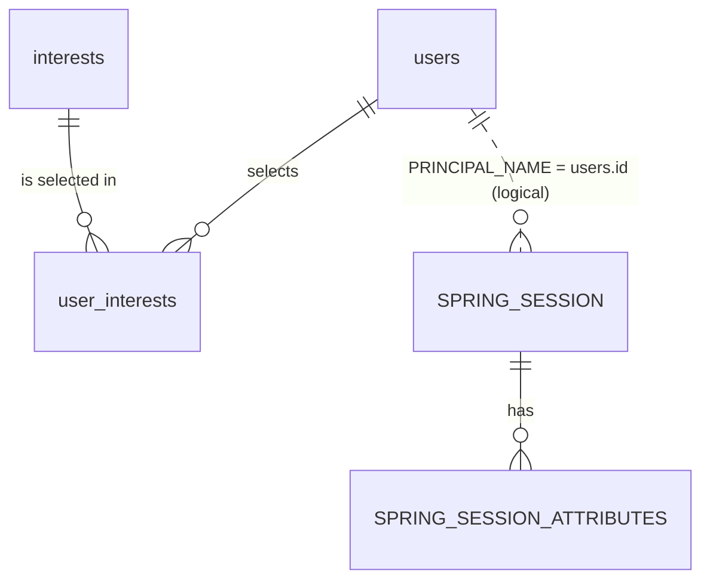
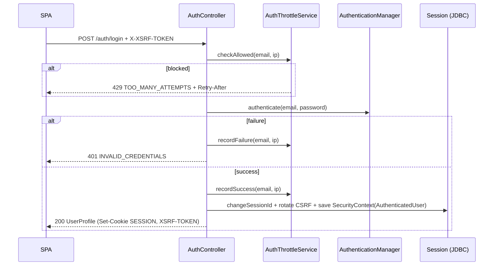
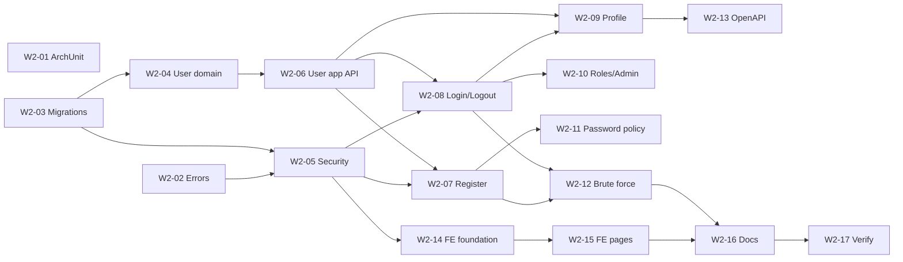

# Week 2 Plan — Authentication & User Management

- **Status:** Proposed — awaiting review
- **Stage:** 1 — Project foundation (Weeks 1–2)
- **Source:** Implementation plan §4 (Week 2), §5 (database), §6 (API), §7 (acceptance criteria)
- **Expected result (plan):** users can register, sign in securely and manage their profiles.

---

## 1. Scope

### 1.1 Plan tasks → deliverables

| # | Plan task (Week 2) | Deliverable | Tasks (§10) |
|---|---|---|---|
| 1 | Design the user data model | `users`, `interests`, `user_interests` tables; `UserAccount` aggregate | W2-03, W2-04 |
| 2 | Registration | `POST /api/v1/auth/register` with 18+ confirmation | W2-07 |
| 3 | Secure password hashing | BCrypt (cost 12) via `DelegatingPasswordEncoder`; password policy | W2-05, W2-11 |
| 4 | Login/logout with secure session cookies | `POST /auth/login`, `POST /auth/logout`; Spring Session JDBC | W2-05, W2-08 |
| 5 | Spring Security authentication & authorization | Deny-by-default filter chain, CSRF, JSON 401/403 | W2-05 |
| 6 | Roles PLAYER and ADMIN | `users.role`; `/api/v1/admin/**` requires ADMIN; admin bootstrap | W2-10 |
| 7 | User profile | `GET/PATCH /api/v1/users/me` | W2-09 |
| 8 | Selecting and editing interests | `GET /api/v1/interests`; interests in profile | W2-09 |
| 9 | Input validation and standardised API errors | Bean Validation + RFC 9457 Problem Details with stable error codes | W2-02 |
| 10 | Authentication tests | Unit, slice, integration, security and frontend tests (§9) | all |
| — | Agreed additions | Brute-force protection, ArchUnit rules, production-compatible cookies/routing | W2-01, W2-05, W2-12 |
| — | User-facing outcome | Register / login / profile pages, auth state, protected routes | W2-14, W2-15 |

### 1.2 Out of scope (Week 2)

| Item | Where it belongs |
|---|---|
| Starting virtual balance on registration | Week 3 (wallet) — registration will publish a `UserRegistered` event |
| Audit events (logins, role changes) | Week 10 (`audit_events`) |
| Admin user management UI / disabling users | Week 10 |
| `user_sessions` (play-session history and duration) | Week 9 — unrelated to HTTP session storage |
| `user_preferences` (sound, reduced motion, …) | Week 6 |
| Email verification, password reset by email, MFA, social login | Post-MVP (no email infrastructure in the plan) |
| Account deletion / data export | To be scheduled before the public beta (Week 11 privacy review) |
| Production deployment of the routing described in §6.7 | Week 12 |
| Playwright E2E | Week 11 |

### 1.3 Priorities (MoSCoW)

Everything in this plan is **Must** unless marked **Should** (planned, may slip to Week 3 without
blocking it) or **Could** (only if time allows).

---

## 2. Functional requirements & acceptance criteria

### FR-1 Registration

A visitor creates a `PLAYER` account with email, display name, password and an explicit 18+
confirmation, and is signed in immediately.

| ID | Acceptance criterion |
|---|---|
| AC-1.1 | Valid request → `201 Created`, profile in body, session cookie set (user signed in). |
| AC-1.2 | `adultConfirmed` must be `true`; otherwise `400` with a field error. The server stores `adult_confirmed_at` from its own clock — never a client timestamp. |
| AC-1.3 | Email is trimmed and lower-cased before uniqueness check and storage. `Alice@Example.com` and `alice@example.com` are the same account. |
| AC-1.4 | Already registered email → `409 EMAIL_ALREADY_REGISTERED`. |
| AC-1.5 | Password stored only as a BCrypt hash (`{bcrypt}$2a$12$…`); the plaintext never appears in the database, logs or responses. |
| AC-1.6 | Registration cannot create an `ADMIN`; any `role` field in the request is ignored. |
| AC-1.7 | More than the allowed registrations per client IP per hour → `429 TOO_MANY_ATTEMPTS`. |
| AC-1.8 | Request without a valid CSRF token → `403 CSRF_TOKEN_INVALID`. |

### FR-2 Login

| ID | Acceptance criterion |
|---|---|
| AC-2.1 | Correct credentials → `200 OK` with profile; a **new** session id is issued (session fixation protection) and the CSRF token is rotated. |
| AC-2.2 | Wrong password, unknown email and disabled account all return the identical `401 INVALID_CREDENTIALS` body, with comparable timing. |
| AC-2.3 | The session is stored in PostgreSQL (`spring_session`) and survives a backend restart. |
| AC-2.4 | Session cookie: `HttpOnly`, `SameSite=Lax`, `Path=/`; `Secure` and the `__Host-` name prefix in production. |
| AC-2.5 | Session expires after 30 minutes of inactivity (configurable). |
| AC-2.6 | `last_login_at` is updated on successful login. |

### FR-3 Logout

| ID | Acceptance criterion |
|---|---|
| AC-3.1 | `POST /api/v1/auth/logout` → `204`; the session row is deleted and the cookie is cleared. |
| AC-3.2 | Reusing the old session cookie afterwards → `401`. |
| AC-3.3 | Logout requires a CSRF token (prevents forced logout). |

### FR-4 Brute-force protection

| ID | Acceptance criterion |
|---|---|
| AC-4.1 | After 5 consecutive failures for the same *account + client IP*, further attempts from that pair are delayed with exponential backoff (30 s, 1 min, 2 min, … max 15 min) → `429` with `Retry-After`. |
| AC-4.2 | **No easy lockout abuse:** failures from an attacker's IP do **not** block the legitimate user signing in from another IP. |
| AC-4.3 | Many failures for one account from many IPs → the account is *rate-limited* (max 1 attempt / 10 s), never locked. |
| AC-4.4 | Many failures from one IP across accounts → that IP is blocked from logging in for 15 min. |
| AC-4.5 | Throttled responses are identical for existing and non-existing accounts. |
| AC-4.6 | Throttle checks run **before** password verification, so blocked attempts cost no BCrypt work. |
| AC-4.7 | A successful login resets the account + IP counter. |

### FR-5 Profile

| ID | Acceptance criterion |
|---|---|
| AC-5.1 | `GET /api/v1/users/me` returns the signed-in user's profile; anonymous → `401 AUTHENTICATION_REQUIRED`. |
| AC-5.2 | `PATCH /api/v1/users/me` updates `displayName` and/or `interests`; omitted fields are unchanged. |
| AC-5.3 | `email`, `role`, `status`, `adultConfirmedAt` cannot be changed through this endpoint (mass-assignment protection). |
| AC-5.4 | Invalid values → `400 VALIDATION_FAILED` with per-field errors. |

### FR-6 Interests

| ID | Acceptance criterion |
|---|---|
| AC-6.1 | `GET /api/v1/interests` (public) lists active interests in display order. |
| AC-6.2 | A user can select 0–8 interests; unknown or inactive codes → `400`. |
| AC-6.3 | Saving replaces the whole selection (idempotent `PATCH`). |

### FR-7 Roles & authorization

| ID | Acceptance criterion |
|---|---|
| AC-7.1 | Every endpoint is denied unless explicitly configured (deny by default). |
| AC-7.2 | `/api/v1/admin/**` → `403` for `PLAYER`, allowed for `ADMIN`, `401` when anonymous. |
| AC-7.3 | The first administrator is created at start-up **only** when `APP_BOOTSTRAP_ADMIN_EMAIL` and `APP_BOOTSTRAP_ADMIN_PASSWORD` are set; the operation is idempotent and never logs the password. No credentials in code or migrations. |

### FR-8 Errors

| ID | Acceptance criterion |
|---|---|
| AC-8.1 | All errors — including Spring Security 401/403 and framework errors — are `application/problem+json` with a stable `code`. |
| AC-8.2 | No stack traces, SQL or internal class names in responses. |

### FR-9 Frontend

| ID | Acceptance criterion |
|---|---|
| AC-9.1 | Register, login and profile pages work on desktop and mobile widths, are keyboard accessible and show server validation errors next to the fields. |
| AC-9.2 | Protected pages redirect anonymous users to login and return them afterwards (only to internal paths). |
| AC-9.3 | Header shows the signed-in display name and a logout action. |
| AC-9.4 | The registration form requires the 18+ checkbox and shows the "virtual coins have no monetary value" notice. |

### FR-10 Architecture

| ID | Acceptance criterion |
|---|---|
| AC-10.1 | ArchUnit tests (§8) run in `./mvnw test` and fail the build on module-boundary violations. |

---

## 3. Module design

```
com.casino
├── common
│   ├── security/   AuthenticatedUser (session principal), CurrentUser helper
│   └── web/        GlobalExceptionHandler, ProblemCodes, ProblemDetailFactory
├── auth            depends on: user (application API), common
│   ├── api/            AuthController (csrf, register, login), DTOs
│   ├── application/    RegistrationService, LoginService, AuthThrottleService, AuthThrottleStore (port)
│   └── infrastructure/ SecurityConfig, ProblemAuthenticationEntryPoint, ProblemAccessDeniedHandler,
│                       UserAccountUserDetailsService, JdbcAuthThrottleStore, AdminBootstrapRunner
└── user            depends on: common only
    ├── api/            UserProfileController (/users/me), InterestController (/interests), DTOs
    ├── application/    UserAccountService, UserProfileService, UserCredentialsQuery,
    │                   commands/views (NewAccount, UserProfileView, UserCredentials)
    └── domain/         UserAccount, Role, UserStatus, EmailAddress, Interest,
                        UserAccountRepository, InterestRepository
```

Key points:

- **Direction `auth → user`, never the reverse.** `user` owns account data and its invariants
  (unique email, interest validation). `auth` owns credentials checking, sessions, throttling and
  the security configuration. The session principal lives in `common.security`, so `user`
  controllers can read the current user without depending on `auth`.
- **`UserCredentials` (contains the password hash) is read only by `auth`** — enforced by an
  ArchUnit rule.
- **Spring Data repository interfaces live in `domain`.** They are the persistence port and Spring
  generates the adapter. Hand-written adapters such as `JdbcAuthThrottleStore` live in
  `infrastructure`.
- **Domain events for later weeks:** `UserAccountService.createAccount` publishes
  `UserRegistered(userId)` inside the registration transaction. Nobody listens in Week 2; the
  wallet module will listen in Week 3 to credit the starting balance atomically.

---

## 4. Database design

Four new Flyway migrations. Conventions follow [`docs/database.md`](../database.md).

### V2 — `V2__create_users.sql`

```sql
CREATE TABLE users (
    id                 UUID         PRIMARY KEY DEFAULT gen_random_uuid(),
    email              VARCHAR(254) NOT NULL,
    password_hash      VARCHAR(100) NOT NULL,
    display_name       VARCHAR(30)  NOT NULL,
    role               VARCHAR(20)  NOT NULL DEFAULT 'PLAYER',
    status             VARCHAR(20)  NOT NULL DEFAULT 'ACTIVE',
    adult_confirmed_at TIMESTAMPTZ  NOT NULL,
    last_login_at      TIMESTAMPTZ,
    created_at         TIMESTAMPTZ  NOT NULL DEFAULT now(),
    updated_at         TIMESTAMPTZ  NOT NULL DEFAULT now(),
    version            BIGINT       NOT NULL DEFAULT 0,
    CONSTRAINT uq_users_email            UNIQUE (email),
    CONSTRAINT ck_users_email_normalized CHECK (email = lower(btrim(email))),
    CONSTRAINT ck_users_role             CHECK (role IN ('PLAYER', 'ADMIN')),
    CONSTRAINT ck_users_status           CHECK (status IN ('ACTIVE', 'DISABLED'))
);

CREATE TRIGGER trg_users_updated_at
    BEFORE UPDATE ON users
    FOR EACH ROW EXECUTE FUNCTION set_updated_at();
```

- `UUID` ids so user ids exposed in APIs cannot be enumerated.
- A single `role` column: the plan defines exactly two mutually exclusive roles. A `user_roles` join
  table would add complexity without a use case.
- The normalised-email `CHECK` makes the database itself reject case-variant duplicates.
- `version` enables optimistic locking for concurrent profile updates.
- Only necessary personal data: no date of birth (the 18+ confirmation timestamp is enough), no IP
  address.

### V3 — `V3__create_interests.sql`

```sql
CREATE TABLE interests (
    code        VARCHAR(40)  PRIMARY KEY,
    name        VARCHAR(80)  NOT NULL,
    description VARCHAR(255) NOT NULL,
    sort_order  SMALLINT     NOT NULL,
    active      BOOLEAN      NOT NULL DEFAULT TRUE,
    CONSTRAINT ck_interests_code CHECK (code ~ '^[A-Z][A-Z0-9_]*$')
);

CREATE TABLE user_interests (
    user_id       UUID        NOT NULL REFERENCES users (id) ON DELETE CASCADE,
    interest_code VARCHAR(40) NOT NULL REFERENCES interests (code),
    created_at    TIMESTAMPTZ NOT NULL DEFAULT now(),
    PRIMARY KEY (user_id, interest_code)
);

INSERT INTO interests (code, name, description, sort_order) VALUES
    ('PROBABILITY',        'Probability & odds',          'How likely outcomes are and how odds are expressed', 10),
    ('MATHEMATICS',        'Mathematics of games',        'Expected value, house edge and variance',            20),
    ('STATISTICS',         'Statistics & data',           'Reading results, randomness and the law of large numbers', 30),
    ('GAME_THEORY',        'Game theory & strategy',      'Decision-making under uncertainty',                  40),
    ('PSYCHOLOGY',         'Psychology of decisions',     'Cognitive biases such as the gambler''s fallacy',   50),
    ('FINANCIAL_LITERACY', 'Financial literacy',          'Budgeting, risk and personal finance basics',        60),
    ('HISTORY',            'History of games',            'Origins and evolution of casino games',              70),
    ('RESPONSIBLE_PLAY',   'Responsible play',            'Healthy habits, limits and self-awareness (informational, not clinical)', 80);
```

- The interest catalogue is reference data managed by migrations (admin management could follow in
  Week 10). The learning module will map its categories to these codes in Week 7.
- **Naming note:** the plan lists `user_preferences` for "interests and preferences". Interests are a
  many-to-many relation and get their own `user_interests` table now. `user_preferences` stays
  reserved for UI settings (Week 6). `docs/database.md` will be updated accordingly.

### V4 — `V4__create_spring_session.sql`

The official Spring Session JDBC 4.1.1 PostgreSQL schema
(`org/springframework/session/jdbc/schema-postgresql.sql`), copied verbatim so that Flyway owns it:

```sql
CREATE TABLE SPRING_SESSION (
    PRIMARY_ID            CHAR(36) NOT NULL,
    SESSION_ID            CHAR(36) NOT NULL,
    CREATION_TIME         BIGINT   NOT NULL,
    LAST_ACCESS_TIME      BIGINT   NOT NULL,
    MAX_INACTIVE_INTERVAL INT      NOT NULL,
    EXPIRY_TIME           BIGINT   NOT NULL,
    PRINCIPAL_NAME        VARCHAR(100),
    CONSTRAINT SPRING_SESSION_PK PRIMARY KEY (PRIMARY_ID)
);
CREATE UNIQUE INDEX SPRING_SESSION_IX1 ON SPRING_SESSION (SESSION_ID);
CREATE INDEX SPRING_SESSION_IX2 ON SPRING_SESSION (EXPIRY_TIME);
CREATE INDEX SPRING_SESSION_IX3 ON SPRING_SESSION (PRINCIPAL_NAME);

CREATE TABLE SPRING_SESSION_ATTRIBUTES (
    SESSION_PRIMARY_ID CHAR(36)     NOT NULL,
    ATTRIBUTE_NAME     VARCHAR(200) NOT NULL,
    ATTRIBUTE_BYTES    BYTEA        NOT NULL,
    CONSTRAINT SPRING_SESSION_ATTRIBUTES_PK PRIMARY KEY (SESSION_PRIMARY_ID, ATTRIBUTE_NAME),
    CONSTRAINT SPRING_SESSION_ATTRIBUTES_FK FOREIGN KEY (SESSION_PRIMARY_ID)
        REFERENCES SPRING_SESSION (PRIMARY_ID) ON DELETE CASCADE
);
```

Configuration: `spring.session.jdbc.initialize-schema=never` (Flyway is the only schema owner).
Expired sessions are removed by Spring Session's built-in cleanup job
(`spring.session.jdbc.cleanup-cron`, default every minute).

`PRINCIPAL_NAME` will contain the **user id** (not the email): it is stable if the email changes in
the future, and it enables "sign out all sessions of user X" via
`FindByIndexNameSessionRepository` (needed when an admin disables an account in Week 10).

### V5 — `V5__create_auth_throttle.sql`

```sql
CREATE TABLE auth_throttle (
    throttle_key      VARCHAR(80) PRIMARY KEY,  -- '<scope>:<sha-256 hex>'
    scope             VARCHAR(20) NOT NULL,
    failure_count     INTEGER     NOT NULL,
    window_started_at TIMESTAMPTZ NOT NULL,
    blocked_until     TIMESTAMPTZ,
    updated_at        TIMESTAMPTZ NOT NULL DEFAULT now(),
    CONSTRAINT ck_auth_throttle_scope CHECK (scope IN ('ACCOUNT_IP', 'ACCOUNT', 'IP', 'REGISTER_IP'))
);
CREATE INDEX ix_auth_throttle_updated_at ON auth_throttle (updated_at);
```

- Keys are SHA-256 hashes of the normalised email and/or IP. Raw emails and IPs are not stored.
- Counters are updated with a single atomic `INSERT … ON CONFLICT … DO UPDATE` statement, which is
  safe under concurrent attempts without application-level locks.
- An hourly `@Scheduled` job deletes rows not updated for 24 hours.
- Stored in PostgreSQL rather than in memory, so limits survive restarts and work with more than one
  backend instance. No new infrastructure (Redis) is needed.

### ER overview



---

## 5. REST API

Base path `/api/v1`. JSON request and response bodies. All state-changing requests require the
`X-XSRF-TOKEN` header (§6.4).

### 5.1 Endpoint overview

| Method | Path | Access | Success | Errors |
|---|---|---|---|---|
| GET | `/auth/csrf` | public | `204` + `XSRF-TOKEN` cookie | — |
| POST | `/auth/register` | public | `201` `UserProfile` + session | 400, 403, 409, 429 |
| POST | `/auth/login` | public | `200` `UserProfile` + new session | 400, 401, 403, 429 |
| POST | `/auth/logout` | authenticated | `204` | 401, 403 |
| GET | `/users/me` | authenticated | `200` `UserProfile` | 401 |
| PATCH | `/users/me` | authenticated | `200` `UserProfile` | 400, 401, 403, 409 (concurrent update) |
| GET | `/interests` | public | `200` `Interest[]` | — |
| * | `/admin/**` | ADMIN | — | 401, 403 |

Existing public endpoints stay public: `GET /system/status`, `/actuator/health/**`, OpenAPI and
Swagger UI (the latter two are disabled in production in Week 12).

### 5.2 Request and response structures

**`POST /api/v1/auth/register`**

```json
{
  "email": "alice@example.com",
  "password": "correct horse battery staple",
  "displayName": "Alice",
  "adultConfirmed": true
}
```

| Field | Rules |
|---|---|
| `email` | required, valid email, ≤ 254 chars; trimmed and lower-cased |
| `password` | required, 12 characters to 72 UTF-8 bytes; must not equal the email or display name; not in the common-password list (W2-11, **Should**) |
| `displayName` | required, 3–30 chars after trimming; letters, digits, spaces and `. _ -` |
| `adultConfirmed` | required, must be `true` |

**`POST /api/v1/auth/login`**

```json
{ "email": "alice@example.com", "password": "correct horse battery staple" }
```

**`UserProfile`** (response of register, login, `GET/PATCH /users/me`)

```json
{
  "id": "0b8f0c2e-5f3a-4c55-9d8e-2f6c1a7e9b10",
  "email": "alice@example.com",
  "displayName": "Alice",
  "role": "PLAYER",
  "interests": ["PROBABILITY", "MATHEMATICS"],
  "adultConfirmedAt": "2026-11-02T09:15:00Z",
  "createdAt": "2026-11-02T09:15:00Z"
}
```

**`PATCH /api/v1/users/me`** — all fields optional, omitted fields stay unchanged:

```json
{ "displayName": "Alice S.", "interests": ["PROBABILITY", "PSYCHOLOGY"] }
```

`interests`: 0–8 distinct, active codes; replaces the whole selection. Any other property
(`email`, `role`, …) is not part of the DTO and therefore can never be applied.

**`GET /api/v1/interests`**

```json
[
  { "code": "PROBABILITY", "name": "Probability & odds", "description": "How likely outcomes are and how odds are expressed" }
]
```

### 5.3 Error format (RFC 9457 Problem Details)

```json
{
  "type": "urn:casino:problem:validation-failed",
  "title": "Validation failed",
  "status": 400,
  "detail": "The request contains invalid fields.",
  "instance": "/api/v1/auth/register",
  "code": "VALIDATION_FAILED",
  "errors": [
    { "field": "password", "message": "must be at least 12 characters" },
    { "field": "adultConfirmed", "message": "you must confirm that you are 18 or older" }
  ]
}
```

| `code` | Status | When |
|---|---|---|
| `VALIDATION_FAILED` | 400 | Bean Validation failures (`errors[]` present) |
| `MALFORMED_REQUEST` | 400 | Unreadable JSON, wrong types |
| `AUTHENTICATION_REQUIRED` | 401 | Anonymous access to a protected endpoint |
| `INVALID_CREDENTIALS` | 401 | Any login failure (deliberately non-specific) |
| `ACCESS_DENIED` | 403 | Authenticated but insufficient role |
| `CSRF_TOKEN_INVALID` | 403 | Missing or invalid CSRF token — the client refreshes the token and retries once |
| `NOT_FOUND` | 404 | Unknown resource |
| `EMAIL_ALREADY_REGISTERED` | 409 | Registration with an existing email |
| `CONCURRENT_MODIFICATION` | 409 | Optimistic-locking conflict |
| `TOO_MANY_ATTEMPTS` | 429 | Throttled; `Retry-After` header in seconds |
| `INTERNAL_ERROR` | 500 | Unexpected error (logged with a correlation id, generic message) |

---

## 6. Security architecture

### 6.1 Request pipeline

```
Request ─► CorsFilter ─► SessionRepositoryFilter (Spring Session, loads session from PostgreSQL)
        ─► SecurityContextHolderFilter ─► CsrfFilter ─► LogoutFilter (/api/v1/auth/logout)
        ─► AuthorizationFilter (deny by default) ─► DispatcherServlet ─► controllers
```

`SecurityConfig` (in `auth.infrastructure`):

- `authorizeHttpRequests`: explicit public matchers (§5.1). `/api/v1/admin/**` → `hasRole("ADMIN")`.
  Other `/api/**` → `authenticated()`. Everything else → `denyAll()`.
- `formLogin`, `httpBasic`, `rememberMe` and anonymous redirects disabled. JSON 401/403 come from
  `ProblemAuthenticationEntryPoint` and `ProblemAccessDeniedHandler`.
- `csrf(csrf -> csrf.spa())` (§6.4).
- `cors(...)` uses an explicit `CorsConfigurationSource` bean, which replaces the Week 1
  `WebMvcConfigurer` mapping so that preflight requests are handled before authentication.
- `logout`: `POST /api/v1/auth/logout`, invalidates the session, deletes the session cookie and
  returns `204`.
- Headers: Spring Security defaults (`X-Content-Type-Options`, `X-Frame-Options: DENY`,
  `Cache-Control: no-store` on API responses, HSTS over HTTPS) plus `Referrer-Policy: no-referrer`.
  The frontend Content-Security-Policy is configured at the hosting layer in Week 12.

### 6.2 Password hashing

- `DelegatingPasswordEncoder` with `bcrypt` as default id and `BCryptPasswordEncoder(12)`.
  Stored format: `{bcrypt}$2a$12$…`. The `{id}` prefix allows a later move to Argon2 with
  transparent re-hashing on login, without a migration.
- Cost 12 ≈ 200–300 ms per hash on typical server CPUs. This is acceptable for login and
  registration, and expensive enough to slow down offline cracking. Configurable as
  `app.security.bcrypt-strength` (minimum 10). Tests use a lower cost for speed, except the test
  that asserts the production prefix.
- BCrypt only uses the first 72 bytes of input. The API therefore rejects passwords longer than
  72 UTF-8 bytes instead of silently truncating them.
- Unknown-user timing: `DaoAuthenticationProvider` performs a dummy hash comparison when the user
  does not exist, so response times do not reveal registered emails.
- The password hash never enters the session. After successful authentication the session stores a
  slim `AuthenticatedUser(id, email, role)` principal (`Serializable`, implements
  `java.security.Principal` with `getName()` = user id), not the `UserDetails` object.

### 6.3 Session management (Spring Session JDBC)

| Setting | Development | Production | Property / env var |
|---|---|---|---|
| Store | PostgreSQL | PostgreSQL | `spring-boot-starter-session-jdbc` |
| Cookie name | `SESSION` | `__Host-SESSION` | `server.servlet.session.cookie.name` / `APP_SESSION_COOKIE_NAME` |
| `Secure` | `false` (http://localhost) | `true` | `…cookie.secure` / `APP_SESSION_COOKIE_SECURE` |
| `HttpOnly` | `true` | `true` | fixed |
| `SameSite` | `Lax` | `Lax` | `…cookie.same-site` / `APP_SESSION_COOKIE_SAME_SITE` |
| Idle timeout | 30 min | 30 min | `spring.session.timeout` / `APP_SESSION_TIMEOUT` |
| Fixation protection | change session id on login | same | done in `LoginService` |

Why Spring Session JDBC: sessions survive restarts and redeploys. This matters on Render, where free
instances sleep when idle, and in-memory sessions would sign everybody out. It also allows more than
one instance later and server-side revocation by user id. It reuses the existing PostgreSQL, so no
new infrastructure is needed.

Known trade-off: session attributes are JDK-serialised. Changing the principal class in an
incompatible way invalidates existing sessions (users must sign in again). The principal is kept
minimal, stable and has an explicit `serialVersionUID`.

Stale authorisation: role and status are cached in the session. Until Week 10 adds "revoke all
sessions of a user", a role change takes effect at the next login. This is documented and covered
by the Week 10 plan.

### 6.4 CSRF protection

- `csrf.spa()` (Spring Security 7.1) configures a `CookieCsrfTokenRepository` (`XSRF-TOKEN` cookie,
  readable by JavaScript) and a SPA-aware request handler. The frontend sends the raw cookie value
  in the `X-XSRF-TOKEN` header on every `POST/PUT/PATCH/DELETE`.
- `GET /api/v1/auth/csrf` lets the SPA obtain the cookie explicitly on start-up.
- Login and registration are CSRF-protected too, which prevents login CSRF.
- The token is rotated after authentication (Spring's `CsrfAuthenticationStrategy`, invoked by
  `LoginService` together with the session-id change). The SPA reads the new cookie value
  automatically.
- On `403 CSRF_TOKEN_INVALID` the API client refreshes the token and retries the request once.
- Defence in depth: `SameSite=Lax` session cookie and a strict CORS origin list.
- Swagger UI: `springdoc.swagger-ui.csrf.enabled=true`, so "Try it out" works for POST requests in
  development (to be verified during W2-12).

### 6.5 Login flow



Implemented as a custom JSON endpoint, following Spring Security's documented approach for custom
authentication endpoints: `AuthenticationManager` plus explicit `SecurityContextRepository.saveContext`
plus `SessionAuthenticationStrategy`.

### 6.6 Brute-force protection design

Goal: slow down online guessing and credential stuffing **without** letting an attacker lock real
users out. Thresholds are configurable under `app.security.throttle.*`.

| Scope (key) | Counts | Threshold | Effect |
|---|---|---|---|
| `ACCOUNT_IP` (email + IP) | failed logins | 5 failures | exponential backoff 30 s → 15 min for this pair only |
| `ACCOUNT` (email, any IP) | failed logins | 100 / hour | rate limit: 1 attempt / 10 s for this account — **no lockout** |
| `IP` (any account) | failed logins | 50 / hour | IP blocked from logging in for 15 min |
| `REGISTER_IP` | registrations | 10 / hour | further registrations from the IP → 429 |

- **Why not lock the account?** A hard lockout lets anyone deny service to a known user just by
  typing wrong passwords. Keying the strict limit on *account + IP* means the attacker only blocks
  themselves. The account-wide limit only slows guessing down: a legitimate user waits at most
  10 seconds.
- **IP threshold and shared networks:** many users behind one NAT (e.g. a university) share an IP,
  so the IP threshold is deliberately higher and configurable.
- **Client IP behind proxies:** `request.getRemoteAddr()`. In production (Render, possibly behind
  Cloudflare), `server.forward-headers-strategy=native` lets Tomcat's `RemoteIpValve` resolve the
  client IP from `X-Forwarded-For`, trusting only the configured proxies. It is **off** by default
  so that `X-Forwarded-For` cannot be spoofed locally.
- **Unknown emails** are counted exactly like existing ones, so throttling reveals nothing.

### 6.7 Production cookie and API routing (designed now, deployed in Week 12)

Problem: the frontend on Cloudflare Pages (`*.pages.dev`) and the backend on Render
(`*.onrender.com`) are different *sites*. A session cookie from the API would be a **third-party
cookie**, which Safari and Firefox block by default and Chrome increasingly restricts. Login would
then fail in those browsers.

| Option | Description | Cookies | CORS | Decision |
|---|---|---|---|---|
| **A — Same-origin reverse proxy** | A Cloudflare Pages Function proxies `https://<app>/api/*` to the Render backend | first-party, `__Host-` prefix, `SameSite=Lax` | not needed | **Recommended** |
| B — Shared custom domain | `app.example.org` + `api.example.org` | same-site, first-party | required (credentials) | Fallback (needs a domain) |
| C — Cross-site with `SameSite=None` | different sites | third-party → blocked by browsers | required | Rejected |

Week 2 makes the code work with both A and B without changes:

- The frontend calls the relative path `/api` by default. `VITE_API_BASE_URL` only exists for option B.
- All cookie attributes and forward-header handling come from environment variables (§11).
- CORS stays configurable through `APP_CORS_ALLOWED_ORIGINS` (allowed headers include `X-XSRF-TOKEN`).

The final choice is recorded as an ADR in Week 12.

---

## 7. Frontend design

New dependency: **React Router 8** (`react-router`). Routing is required for the auth pages. It is
introduced earlier than the plan's Week 5 navigation work and is already part of the React
ecosystem. No form or state-management library is added: forms use controlled components with
validation that mirrors the server rules, and the server remains authoritative.

```
src/
├── services/
│   ├── apiClient.ts      + post/patch/put, CSRF header for unsafe methods, ProblemDetails parsing,
│   │                       single retry on CSRF_TOKEN_INVALID
│   ├── csrf.ts           read XSRF-TOKEN cookie, ensureCsrfToken() via GET /auth/csrf
│   ├── authApi.ts        register, login, logout
│   └── userApi.ts        getMe, updateMe, listInterests
├── features/
│   ├── auth/             AuthProvider (context: user, status, login, register, logout),
│   │                     useAuth, RequireAuth, LoginForm, RegisterForm
│   └── profile/          ProfileForm, InterestPicker
├── components/form/      TextField, CheckboxField, FormAlert (accessible error wiring)
├── pages/                LoginPage, RegisterPage, ProfilePage (+ existing HomePage)
└── types/                auth.ts, user.ts, problem.ts
```

- **Auth state:** on start-up `AuthProvider` calls `GET /users/me`. `200` means authenticated, and
  `401` means anonymous; `401` is not treated as an error.
- **Redirects:** `RequireAuth` sends anonymous users to `/login?next=<path>`. After login only
  internal paths are accepted (starts with `/`, not `//`), which prevents open redirects.
- **Accessibility:** labelled inputs, errors linked with `aria-describedby`, focus moves to the first
  invalid field, `role="alert"` for form-level errors, full keyboard support.
- **Header:** shows the display name and a Logout button when signed in, Login/Register when anonymous.

---

## 8. Architecture rules (ArchUnit)

Test dependency `com.tngtech.archunit:archunit-junit5:1.5.1` (test scope only). Rules live in
`backend/src/test/java/com/casino/architecture/ModuleArchitectureTest.java`:

| Rule | Description |
|---|---|
| R1 | `common` does not depend on any business module. |
| R2 | Business modules (`com.casino.(*)..`) are free of cycles. |
| R3 | A module accesses another module only through that module's `..application..` package. |
| R4 | Within a module: `domain` depends on no other layer; `application` does not depend on `api`; `api` does not depend on `infrastructure`. |
| R5 | `@RestController` classes live in `..api..`; `@Entity` classes and Spring Data repositories live in `..domain..`. |
| R6 | `UserCredentialsQuery` (exposes password hashes) is accessed only from `com.casino.auth..`. |
| R7 | `org.springframework.security.config..` is used only in `com.casino.auth..`. |
| R8 | No field injection (`@Autowired` fields) in production code. |
| R9 | `domain` packages do not depend on Spring Web or Jackson. |

Recorded as **ADR-0004 — Architecture rules with ArchUnit**. Spring Modulith is reconsidered if we
need module-scoped integration tests or event publication guarantees (Week 10 audit events).

---

## 9. Test plan

### 9.1 Backend unit tests (JUnit + Mockito, no Spring context)

| Test class | Covers |
|---|---|
| `EmailAddressTest` | trimming, lower-casing, invalid formats |
| `UserAccountTest` | creation invariants, profile updates, interest replacement, role immutability |
| `RegistrationServiceTest` | password hashed before persistence, duplicate email → exception, 18+ timestamp from `Clock`, event published |
| `PasswordPolicyTest` | length bounds incl. multi-byte 72-byte limit, equals email/display name, common-password list (**Should**) |
| `AuthThrottleServiceTest` | thresholds, exponential backoff sequence, reset on success, account rate limit is not a lockout, retry-after calculation (fixed `Clock`) |
| `UserProfileServiceTest` | partial update semantics, unknown/inactive interest codes rejected |
| `AdminBootstrapRunnerTest` | no env → no-op; creates once; idempotent; password never logged |

### 9.2 Web slice tests (`@WebMvcTest` + `spring-security-test`)

| Test class | Covers |
|---|---|
| `AuthControllerTest` | request validation → `VALIDATION_FAILED` with field errors; malformed JSON; mapping of service exceptions to 401/409/429 |
| `UserProfileControllerTest` | PATCH partial semantics, unknown properties ignored (no mass assignment), 401 when anonymous |
| `GlobalExceptionHandlerTest` | every error code renders `application/problem+json` without internals |

### 9.3 Integration tests (Testcontainers PostgreSQL, full context)

| Test class | Covers |
|---|---|
| `MigrationsIT` | V2–V5 apply; constraints reject non-normalised email, invalid role/status; interests seeded |
| `RegistrationIT` | register → 201 + session; stored hash prefix `{bcrypt}$2a$12$`; case-variant duplicate → 409 |
| `LoginLogoutIT` | login → me → logout → me = 401; session row created in `spring_session` and deleted on logout; `last_login_at` set |
| `ProfileIT` | get/patch profile and interests end to end; optimistic locking conflict → 409 |
| `AuthThrottleIT` | 429 + `Retry-After` after threshold; legitimate user from another IP still logs in; concurrent failures counted correctly (parallel requests) |
| `AdminBootstrapIT` | admin created from properties; can access a test-only `/api/v1/admin/test` endpoint |

### 9.4 Security tests (integration, focused on attack scenarios)

| Scenario | Expected |
|---|---|
| Anonymous request to `/users/me`, `/admin/**`, an unmapped `/api/**` path | 401 / 401 / 401 (deny by default) |
| `PLAYER` → `/api/v1/admin/test` | 403 `ACCESS_DENIED` |
| POST register / login / logout / PATCH profile without CSRF token | 403 `CSRF_TOKEN_INVALID` |
| Session fixation: session cookie value before vs. after login | different |
| CSRF token before vs. after login | rotated |
| Session cookie attributes (default and with production properties) | `HttpOnly`, `SameSite=Lax`, `Path=/`; `Secure` + `__Host-` in prod config |
| Reuse of session cookie after logout | 401 |
| `PATCH /users/me` with `"role":"ADMIN"` | role unchanged |
| Login with unknown email vs. wrong password vs. disabled account | identical status and body |
| Registration with `"role":"ADMIN"` | account is `PLAYER` |
| Spoofed `X-Forwarded-For` with forward headers disabled | ignored for throttling |
| Error responses | no stack traces, SQL or class names |
| Password hash in session store | absent (deserialise the `spring_session_attributes` principal) |

### 9.5 Architecture tests

`ModuleArchitectureTest` (R1–R9) runs with the unit tests.

### 9.6 Frontend tests (Vitest + React Testing Library)

| Test | Covers |
|---|---|
| `apiClient.test.ts` | CSRF header only on unsafe methods; ProblemDetails parsed into `ApiError` (`code`, field errors); single retry on `CSRF_TOKEN_INVALID` |
| `csrf.test.ts` | cookie parsing, `ensureCsrfToken` |
| `AuthProvider.test.tsx` | initial `/users/me` 200 vs 401; login/logout update state |
| `RequireAuth.test.tsx` | redirect to `/login?next=…`; open-redirect protection |
| `RegisterForm.test.tsx` | client validation, 18+ checkbox required, server field errors shown next to inputs, 409 message |
| `LoginForm.test.tsx` | generic error on 401, retry-after message on 429, submit disabled while pending |
| `ProfileForm.test.tsx` | loads profile, edits display name and interests, shows success and errors |
| Accessibility assertions | labels, `aria-invalid`, `aria-describedby`, focus on first error |

### 9.7 Coverage target

At least 80 % line coverage for `auth` and `user` application/domain packages. Measured in Week 11
(JaCoCo); reported informally this week.

---

## 10. Task breakdown

Each task is a small, reviewable commit (or a few) on branch `feature/week-02-auth` and keeps
`./mvnw verify` and the frontend checks green. Size: **S** ≤ 2 h, **M** ≈ ½ day, **L** ≈ 1 day.

| ID | Task | Size | Depends on | Output |
|---|---|---|---|---|
| W2-01 | ArchUnit setup + rules R1–R9 (R6/R7 activate once classes exist) + ADR-0004 | S | — | `ModuleArchitectureTest`, ADR |
| W2-02 | Standard API errors: `GlobalExceptionHandler`, problem codes, field errors | M | — | `common.web`, tests |
| W2-03 | Migrations V2–V5 + `MigrationsIT` | M | — | SQL, IT |
| W2-04 | `user` domain: `UserAccount`, `EmailAddress`, `Role`, `UserStatus`, `Interest`, repositories | M | W2-03 | entities, unit tests |
| W2-05 | Security foundation: dependencies (security, session-jdbc, security-test), `SecurityConfig`, JSON entry point/denied handler, CSRF SPA + `/auth/csrf`, `CorsConfigurationSource`, cookie & session properties, `PasswordEncoder` | L | W2-02, W2-03 | config, security tests for existing endpoints |
| W2-06 | `user` application API: `UserAccountService` (create, duplicate check, `UserRegistered` event), `UserCredentialsQuery`, `UserProfileView` | M | W2-04 | services, unit tests |
| W2-07 | Registration endpoint (+ auto sign-in, `REGISTER_IP` throttle hook) | M | W2-05, W2-06 | `AuthController`, `RegistrationIT` |
| W2-08 | Login & logout: `UserDetailsService` adapter, `LoginService` (fixation, CSRF rotation, principal), `last_login_at`, logout config | L | W2-05, W2-06 | `LoginLogoutIT`, security tests |
| W2-09 | Profile & interests: `GET/PATCH /users/me`, `GET /interests`, optimistic locking | M | W2-06, W2-08 | controllers, `ProfileIT` |
| W2-10 | Roles & admin: `/admin/**` rule, `AdminBootstrapRunner`, test-only admin endpoint | S | W2-08 | `AdminBootstrapIT` |
| W2-11 | **Should:** password policy with a bundled common-password list (licence attribution) | S | W2-07 | `PasswordPolicy`, tests |
| W2-12 | Brute-force protection: `AuthThrottleService`, `JdbcAuthThrottleStore`, 429 + `Retry-After`, forward-headers config, cleanup job | L | W2-07, W2-08 | `AuthThrottleIT` |
| W2-13 | OpenAPI: cookie security scheme, CSRF header documentation, Swagger CSRF support | S | W2-09 | updated spec |
| W2-14 | Frontend foundation: React Router, layout navigation, `apiClient` (methods, CSRF, ProblemDetails), `csrf.ts`, `AuthProvider`, `RequireAuth` | L | API contract (§5) — can start in parallel with mocked API after W2-05 | tests |
| W2-15 | Frontend pages: Register, Login, Profile (InterestPicker), header user menu | L | W2-14 (+ W2-07/08/09 for manual E2E) | tests |
| W2-16 | Docs & configuration: `api.md`, `database.md`, `architecture.md` (security section), README, `.env.example` | S | W2-07…W2-15 | docs |
| W2-17 | Verification: full test suites, manual walkthrough of FR-1…FR-9 on Docker PostgreSQL, CI green, PR review | M | all | PR ready for review |

Optional (**Could**): change password (`POST /users/me/password`, re-authentication, revoke other
sessions).



Critical path: W2-03 → W2-04 → W2-06 → W2-08 → W2-12 → W2-17.

---

## 11. Configuration additions

New entries in `.env.example` and `application.yml` (no secrets have defaults):

| Variable | Default (dev) | Production |
|---|---|---|
| `APP_SESSION_COOKIE_NAME` | `SESSION` | `__Host-SESSION` |
| `APP_SESSION_COOKIE_SECURE` | `false` | `true` |
| `APP_SESSION_COOKIE_SAME_SITE` | `lax` | `lax` |
| `APP_SESSION_TIMEOUT` | `30m` | `30m` |
| `APP_SECURITY_BCRYPT_STRENGTH` | `12` | `12` |
| `APP_BOOTSTRAP_ADMIN_EMAIL` | *(empty — disabled)* | set once, then removed |
| `APP_BOOTSTRAP_ADMIN_PASSWORD` | *(empty — disabled)* | secret store only |
| `SERVER_FORWARD_HEADERS_STRATEGY` | `none` | `native` (behind trusted proxy) |

New backend dependencies (all managed by the Spring Boot BOM except ArchUnit):
`spring-boot-starter-security`, `spring-boot-starter-session-jdbc`, `spring-boot-starter-security-test`
(test), `archunit-junit5` (test). New frontend dependency: `react-router`.

---

## 12. Security risks

| # | Risk | Mitigation | Verified by |
|---|---|---|---|
| S1 | Online password guessing / credential stuffing | Account + IP backoff, IP block, account rate limit, BCrypt cost 12, password policy | `AuthThrottleIT`, unit tests |
| S2 | Lockout abuse (attacker blocks a real user) | No account lockout; strict limits keyed on account + IP | `AuthThrottleIT` (other-IP login succeeds) |
| S3 | User enumeration via login | Identical 401 body; dummy hash for unknown users; identical throttling | security tests |
| S4 | User enumeration via registration (409) | **Accepted trade-off** for usability (no email verification in scope); mitigated by `REGISTER_IP` throttle | `RegistrationIT` |
| S5 | Session fixation | Session id changed on login | security test |
| S6 | Session theft via XSS | `HttpOnly` cookie; React escaping; no `dangerouslySetInnerHTML`; CSP in Week 12 | review, cookie test |
| S7 | CSRF (incl. login CSRF, forced logout) | CSRF token on all unsafe methods, `SameSite=Lax`, strict CORS | security tests |
| S8 | Privilege escalation / mass assignment | Explicit DTOs without `role`/`email`; role only via bootstrap/admin | security tests |
| S9 | Weak password storage | BCrypt 12 with algorithm prefix; 72-byte limit enforced | `RegistrationIT` |
| S10 | Password hash leaking into the session store or logs | Slim session principal; credentials erased; no request-body logging | security test, review |
| S11 | Spoofed `X-Forwarded-For` bypassing IP limits | Forward headers off by default; only trusted proxies in production | security test |
| S12 | Stale role/status in existing sessions | Documented; principal-name index enables revocation in Week 10 | Week 10 |
| S13 | BCrypt CPU exhaustion (DoS) via many logins | Throttle checked before hashing; IP limits | `AuthThrottleIT` |
| S14 | Third-party cookie blocking breaks production login | Same-origin routing design (§6.7) | Week 12 smoke test |
| S15 | Hard-coded or leaked admin credentials | Admin only via env-provided bootstrap; nothing in code/migrations | `AdminBootstrapRunnerTest`, review |
| S16 | Open redirect after login | `next` limited to internal paths | `RequireAuth.test.tsx` |
| S17 | Unbounded growth of session / throttle tables | Spring Session cleanup cron; hourly throttle cleanup | `AuthThrottleServiceTest` |
| S18 | Incompatible session deserialisation after deploy | Minimal principal with `serialVersionUID`; worst case is forced re-login | documented |

---

## 13. Definition of Done

- All Must acceptance criteria (§2) are covered by automated tests and pass locally and in CI.
- `./mvnw verify` and `npm run lint && npm run typecheck && npm test && npm run build` are green.
- ArchUnit rules pass; no new compiler, lint or test warnings.
- No secrets in the repository; `.env.example` documents every new variable.
- Docs updated (`api.md`, `database.md`, `architecture.md`, README, ADR-0004).
- Manual walkthrough done: register → logout → login → edit profile/interests → throttling → admin bootstrap.
- Pull request `feature/week-02-auth` → `main` reviewed and merged (push only after approval).

---

## 14. Decisions requested from the reviewer

1. Sign the user in automatically after registration (recommended: yes).
2. Accept the registration-enumeration trade-off S4 (recommended: yes, revisit if email verification is added).
3. Include W2-11 (common-password list as a bundled data file with licence attribution) as **Should**.
4. Introduce React Router 8 now for the auth pages.
5. Work on branch `feature/week-02-auth` and merge via pull request with CI.
