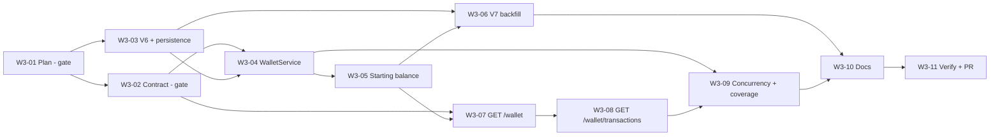

# Week 3 Plan — Virtual Wallet

- **Status:** Revision 5. Decisions reviewed 2026-11-09 (§2.2, §5.6). W3-02 contract approved (§5.5).
  W3-03 persistence approved (§6.2, §6.5). W3-04 wallet service reviewed (§7.8).
  **W3-05 wallet opening at registration implemented, pending review** (§7.9). Nothing else is implemented.
  Decisions still marked *Proposed* need approval before the task that depends on them starts.
- **Stage:** 2 — Virtual currency and game logic (Weeks 3–4)
- **Source:** Implementation plan v1.1 (`docs/OnlineCasinoSimulator_ImplementationPlan_v1.1.pdf`), §4 (Week 3),
  §5 (database: `wallets`, `wallet_transactions`), §6 (API: `GET /wallet`, `GET /wallet/transactions`),
  §7 (acceptance criteria and quality targets), §10 (risk 2), §14 (Weeks 3–4 are the key technical
  milestone)
- **Architecture:** modular monolith ([ADR-0001](../decisions/0001-modular-monolith.md)),
  server-authoritative wallet ([ADR-0003](../decisions/0003-server-authoritative-game-logic.md)),
  design-first API and layered packages ([ADR-0004](../decisions/0004-design-first-api.md)), ArchUnit
  ([ADR-0005](../decisions/0005-architecture-rules-archunit.md)), session security unchanged
  ([ADR-0006](../decisions/0006-session-authentication-security.md))
- **Expected result (plan):** every player has a virtual wallet with a starting balance; balance
  changes are atomic, idempotent, never negative and recorded in an immutable ledger; balance and
  history are available through the API. There is no graphical interface yet (Week 5).
- **Branch:** `feature/week-03-wallet`

| Revision | Date | Change |
|---|---|---|
| 1 | 2026-11-09 | Initial plan (W3-01) |
| 2 | 2026-11-09 | Review of W3-01 recorded (§2.2); test-cleanup guard against non-test databases (§6.5); AC-3.2 aligned with the existing `MALFORMED_REQUEST` convention; W3-02 contract (§5.5) |
| 3 | 2026-11-09 | W3-02 review (C1–C7 approved, C8 reviewed, §5.6); W3-03 persistence (§6.2) and guarded cleanup with its deviations (§6.5) |
| 4 | 2026-11-09 | W3-04 wallet service (§7.8): verified lock timeout, test-only types (P-W3-16), R13 and R15 |

---

## 0. Current state vs. this plan

**On `main` (after Week 2 and the deployment foundation, PR #5–#8):**
- Flyway V1–V5 (`set_updated_at()`, Spring Session, `users`, `auth_throttle`, interests); contract
  `openapi.yaml` 0.3.0; ArchUnit R1–R12 with `wallet` already listed in
  `ArchitectureRules.BUSINESS_MODULES`, but no `com.casino.wallet` package.
- `user.service.UserAccountService.createAccount` publishes `user.dto.UserRegistered(userId)` inside
  its transaction, after `saveAndFlush` of the new `users` row. **There is no listener yet.** The
  administrator bootstrap (`createAdministrator`) publishes no event.
- Registration (`auth.service.RegistrationService.register`) is not transactional itself; the
  transaction is `UserAccountService.createAccount` (`@Transactional`), so a synchronous listener
  joins it.
- Tests: Testcontainers `postgres:17.11-alpine` only (same as Docker Compose). Neon runs PostgreSQL
  18.6. About 18 integration test classes clean up with `DELETE FROM users` (directly or through
  `TestAccounts.deleteAll()`).
- `Concurrency.outcomes/runTogether` (test helper) exists for parallel tests.
- No JaCoCo. The Surefire/Failsafe `@{argLine}` placeholder in `pom.xml` is prepared for it.
- Deployments: Render (Auto-Deploy **Off**, Flyway runs at start-up against **Neon staging**),
  Vercel (deploys `main` automatically; the frontend is not changed by this plan), registration on
  staging closed (`APP_REGISTRATION_ENABLED=false`). Staging already contains `PLAYER` accounts.

**Not on `main`:** wallet tables, wallet module, wallet endpoints, starting balance.

**Documentation inconsistencies found during W3-01** (not blocking; see §16, Q13):
- `docs/plans/week-02.md` still says "awaiting final review" and "W2-16 … not complete until the pull
  request is approved and merged", and README "Limitations" says Week 2 is in review. PR #5 is merged.
- README status row says the Vercel frontend is "prepared, not deployed"; it is deployed.
- Implementation plan v1.1 is a snapshot (Week 2 "planned", only V1 implemented, Cloudflare Pages).
  It is not changed by this plan; a v1.2 would need a proposal (`docs/sources/README.md`).
- `docs/database.md` describes `wallets` with "row version (optimistic locking)"; ADR-0003 allows
  "row locking / optimistic versioning". This plan proposes pessimistic locking (P-W3-5).

---

## 1. Scope

### 1.1 Plan tasks → deliverables

| # | Plan task (Week 3) | Deliverable | Task (§11) |
|---|---|---|---|
| — | Design-first prerequisite | Both wallet operations, schemas and new error codes in `openapi.yaml`, marked `planned` until implemented | W3-02 |
| 1 | Wallet and Transaction entities | V6 `wallets`, `wallet_transactions`; entities `Wallet`, `WalletTransaction`; repositories | W3-03 |
| 2 | Starting balance for every new user | Synchronous `UserRegistered` listener in the registration transaction; 1,000 coins (configurable) | W3-05 |
| — | Existing accounts (not in the plan; needed because accounts exist) | Deterministic, idempotent backfill for existing `PLAYER` accounts (V7, proposed) | W3-06 |
| 3 | Retrieve the current balance | `GET /api/v1/wallet` | W3-07 |
| 4 | Add and subtract virtual currency | `WalletService.credit/debit` — internal module API, **no public endpoint** | W3-04 |
| 5 | Immutable ledger | Append-only `wallet_transactions` (trigger), immutable entity | W3-03, W3-04 |
| 6 | No negative balances | `CHECK` in the database + check in the service (`INSUFFICIENT_FUNDS`) | W3-03, W3-04 |
| 7 | Database transactions and row locking | One transaction per operation, `SELECT … FOR UPDATE` on the wallet row | W3-04 |
| 8 | Idempotency keys | Unique `(wallet_id, idempotency_key)`; replay returns the original result | W3-03, W3-04 |
| 9 | Tests for concurrent requests and correctness | `WalletConcurrencyIT`, integrity and immutability tests | W3-09 |
| — | Plan §6 | `GET /api/v1/wallet/transactions` with keyset pagination | W3-08 |
| — | Plan §4 note | Balances are integer coins (`BIGINT` / `long` / `int64`) | all |

### 1.2 Out of scope (Week 3)

| Item | Where it belongs |
|---|---|
| Bets, rounds, payouts; the HTTP `Idempotency-Key` header of game requests | Week 4 (`game → wallet`) |
| Showing the balance in the UI, chips, bet confirmation | Week 5 |
| Game history | Week 6 |
| Learning rewards, daily reward limit, free balance restore | Week 8 (`learning → wallet`) |
| Transaction history and statistics on the dashboard | Week 9 |
| Admin view of wallets, manual adjustments, audit events | Week 10 (needs its own decision and audit) |
| Wallet for an account whose role changes ADMIN → PLAYER | Week 10 (role changes; `WalletService.openWallet` is idempotent for that) |
| Account deletion / data export | Week 11 privacy review (constraints prepared here, §6.5) |
| Applying V6/V7 to Neon staging or production | **Separate, approval-gated rollout after Week 3** (§13) |
| Transfers between users, purchases, real money | Never (plan §1.4) |

### 1.3 Priorities

Everything is **Must** unless marked **Should**. Should items may move to the Week 4 buffer without
blocking Week 4.

---

## 2. Decisions

### 2.1 Already approved (inherited)

| # | Decision | Source |
|---|---|---|
| A1 | Modular monolith, modules talk through `service`/`dto`/`exception` only | ADR-0001, ADR-0005 |
| A2 | Backend alone changes balances; integer coins; immutable ledger; balance and ledger in one transaction; idempotency key with a unique constraint | ADR-0003 |
| A3 | Contract first: operations are added to `openapi.yaml` (`planned`) and reviewed before implementation | ADR-0004 |
| A4 | Flyway is the only schema owner; applied migrations are never edited | `docs/database.md`, Week 2 A9 |
| A5 | Session authentication, CSRF, throttling and error format unchanged | ADR-0006 |
| A6 | Starting balance is granted when a player registers; registration publishes `UserRegistered` | Week 2 plan §1.2 |

### 2.2 Week 3 decisions (review of 2026-11-09)

**Approved** = confirmed in the review of W3-01. **Required** = stated as a requirement in the W3-01
task. **Proposed** = still pending; the task that depends on it does not start before approval.

| # | Decision | Status | Section |
|---|---|---|---|
| P-W3-1 | Starting balance **1,000 coins**, configurable on the backend (`app.wallet.starting-balance`, `APP_WALLET_STARTING_BALANCE`), validated at start-up; credited **exactly once** | Approved | §7.1 |
| P-W3-2 | Coins are `BIGINT` / `long` / `int64`; never floating point; balances capped at 2⁵³ − 1 | Approved | §6.2 |
| P-W3-3 | Exactly one wallet per **PLAYER**, none for ADMIN; `/api/v1/wallet/**` requires role `PLAYER`, ADMIN gets `403` | Approved | §7.2 |
| P-W3-4 | Wallet creation is atomic with registration (required); mechanism: synchronous `@EventListener` in the registration transaction | Atomicity required; mechanism **Proposed**, implemented in W3-05 (pending review) | §7.3, §7.9 |
| P-W3-5 | Pessimistic row lock for every balance change (Hibernate: `SELECT … FOR NO KEY UPDATE`, bounded wait); no optimistic `@Version` | Approved; implemented in W3-04 | §7.4, §7.8 |
| P-W3-6 | Immutable ledger: `BEFORE UPDATE OR DELETE` trigger, `@Immutable` entity, `ON DELETE RESTRICT` foreign keys | Immutability approved; trigger/FK design implemented in W3-03, pending review | §6.4 |
| P-W3-7 | Non-negative balance in the database (`CHECK`) and in the service (`INSUFFICIENT_FUNDS`) | Required | §7.5 |
| P-W3-8 | Server-side idempotency keys per wallet; same key + same parameters → original result; different parameters → `IDEMPOTENCY_KEY_REUSED` | Approved | §7.6 |
| P-W3-9 | No public credit/debit endpoint; credit/debit only through `wallet.service.WalletService` | Approved | §4 |
| P-W3-10 | `GET /api/v1/wallet` and `GET /api/v1/wallet/transactions` | Endpoints required; contract details **Proposed** (§5.6) | §5 |
| P-W3-11 | Existing players: Flyway **V7** data migration, no duplicate credits | **Conditionally approved** as the approach; **no execution against any shared database** (Neon staging/production) is authorized | §6.6 |
| P-W3-12 | Test cleanup through one guarded `TestDatabase` helper using `TRUNCATE` (explicit table list, no `CASCADE`); no `TRUNCATE` trigger | Guards G1–G5 approved; implemented in W3-03, pending review (§6.5) | §6.5 |
| P-W3-13 | Dependency direction `wallet → user` (event only); ArchUnit R13–R14 | **Proposed**; R13 in W3-04, R14 in W3-05 (pending review) | §9 |
| P-W3-14 | JaCoCo: **80 % line, 70 % branch** for the wallet business logic (`com.casino.wallet.service`) | Approved | §10.6 |
| P-W3-15 | Automated migration test on PostgreSQL 17 **and** 18 | Required | §10.5 |
| — | Initial transaction type `STARTING_BALANCE` only (Q6) | Approved | §6.2 |
| P-W3-16 | Test-only types `TEST_CREDIT`/`TEST_DEBIT`, allowed only in test databases (test Flyway callback), forbidden in production code (ArchUnit R15) | **Proposed** (W3-04) | §7.8 |
| — | Error codes `INSUFFICIENT_FUNDS`, `IDEMPOTENCY_KEY_REUSED`, `BALANCE_LIMIT_EXCEEDED` in Week 3 (Q7) | Approved (status `409` **Proposed**, §5.6) | §5.4 |
| — | Account-deletion policy (Q4) | Deferred to Week 11 | §6.5 |
| — | Existing PLAYER accounts never receive a duplicate credit | Required | §6.6, AC-9.2, AC-9.3 |

---

## 3. Functional requirements & acceptance criteria

### FR-0 API contract (design-first)

| ID | Acceptance criterion |
|---|---|
| AC-0.1 | `GET /api/v1/wallet` and `GET /api/v1/wallet/transactions`, their schemas and the new error codes are in `openapi.yaml` with `x-implementation-status: planned`, reviewed before implementation (W3-02 gate). `info.version` becomes `0.4.0`. |
| AC-0.2 | While planned, `./mvnw verify` stays green; an implemented planned operation fails the build (existing `OpenApiContract` rules). |
| AC-0.3 | `OpenApiContractIT` reports zero differences for `/api/**`; success and every documented error status of both operations are validated at runtime. |
| AC-0.4 | `OpenApiContractTest` passes: the contract's `code` enum equals `ProblemCode` (new codes added to both in the same change). |
| AC-0.5 | `AccessRulesContractIT` passes: both operations require a session (`401` without). |
| AC-0.6 | No operation that credits or debits a wallet exists in the contract or at runtime. |
| AC-0.7 | No Week 3 operation is still `planned` at the end of the week. |

### FR-1 Wallet creation at registration

| ID | Acceptance criterion |
|---|---|
| AC-1.1 | A successful `POST /api/v1/auth/register` creates exactly **one** wallet for the new user with balance = `app.wallet.starting-balance` (default 1,000) and exactly **one** ledger entry: type `STARTING_BALANCE`, amount = balance, `balance_after` = balance, idempotency key `starting-balance`. |
| AC-1.2 | Atomicity: if creating the wallet or its entry fails, the registration fails and **no** `users`, `wallets` or `wallet_transactions` row remains; the client gets `500 INTERNAL_ERROR` without internals; no session is created. |
| AC-1.3 | If the registration itself fails (validation, duplicate email, registration closed, throttling, CSRF), no wallet is created. |
| AC-1.4 | The administrator bootstrap creates **no** wallet. |
| AC-1.5 | Processing `UserRegistered` twice for the same user leaves one wallet and one starting entry. |
| AC-1.6 | The response of `register` is unchanged (contract `UserProfile`); registration throttling, CSRF and `REGISTRATION_DISABLED` behave exactly as before (existing tests unchanged and green). |
| AC-1.7 | An invalid starting balance (≤ 0, above the cap, not a number) stops the application at start-up with a clear message. |

### FR-2 Balance retrieval

| ID | Acceptance criterion |
|---|---|
| AC-2.1 | `GET /api/v1/wallet` with a player session → `200` `Wallet` with the stored balance (integer) of the **session's** user. No request value selects the wallet. |
| AC-2.2 | Without a session → `401 AUTHENTICATION_REQUIRED`; expired session → `401 SESSION_EXPIRED`. |
| AC-2.3 | Admin session → `403 ACCESS_DENIED` (P-W3-3). |
| AC-2.4 | Responses carry `Cache-Control: no-store`. |
| AC-2.5 | Two players: each sees only their own balance (tested with interleaved changes). |
| AC-2.6 | A player without a wallet (data inconsistency) → `500 INTERNAL_ERROR`, logged with the user id only; no wallet is created by a read. |

### FR-3 Transaction history

| ID | Acceptance criterion |
|---|---|
| AC-3.1 | `GET /api/v1/wallet/transactions` returns only the session user's entries, newest first (descending ledger id). |
| AC-3.2 | `limit` 1–100, default 20; outside the range → `400 VALIDATION_FAILED` with a field error `limit`; not an integer → `400 MALFORMED_REQUEST` (the existing convention for unconvertible parameters, `docs/api.md`; revised in W3-02). |
| AC-3.3 | `nextCursor` is present only when more entries exist; following it returns the next page with no duplicates and no gaps, also when new entries are added between page requests (new entries appear on the first page only). |
| AC-3.4 | A malformed or foreign cursor → `400 VALIDATION_FAILED` (`cursor`); a cursor never reveals another wallet's entries. |
| AC-3.5 | Entries expose `id`, `type`, `amount` (signed), `balanceAfter`, `createdAt`; never the idempotency key, the wallet id or the user id. |
| AC-3.6 | Same authentication, authorization and `no-store` rules as AC-2.2–AC-2.4. |

### FR-4 Credit and debit (internal API)

| ID | Acceptance criterion |
|---|---|
| AC-4.1 | `WalletService.credit` and `debit` change the balance and append exactly one ledger entry in **one** database transaction; `balance_after` = previous balance ± amount. |
| AC-4.2 | Amounts must be positive (`> 0`) and the resulting balance at most 2⁵³ − 1; otherwise `IllegalArgumentException` / `BalanceLimitExceededException`, nothing changes. |
| AC-4.3 | The transaction type must be allowed for the direction (credit types only for credit, debit types only for debit). |
| AC-4.4 | If the caller's transaction rolls back after a credit/debit, neither the balance change nor the entry remains. |
| AC-4.5 | No HTTP endpoint and no other module except the allowed callers (§9, R13) can call `credit`/`debit`. |

### FR-5 Non-negative balances

| ID | Acceptance criterion |
|---|---|
| AC-5.1 | A debit larger than the balance → `InsufficientFundsException` (`INSUFFICIENT_FUNDS`, 409); balance unchanged; no ledger entry. |
| AC-5.2 | A debit of exactly the balance succeeds and leaves `0`. |
| AC-5.3 | The database rejects `balance < 0` and `balance_after < 0` even when the service is bypassed (direct SQL in a test). |

### FR-6 Idempotency

| ID | Acceptance criterion |
|---|---|
| AC-6.1 | A second operation with the same `(wallet, idempotency key)` and the same type, amount and reference returns the **original** result (same entry id and `balance_after`, `replayed = true`) and changes nothing. |
| AC-6.2 | The same key with a different type, amount, direction or reference → `IdempotencyKeyReusedException` (`IDEMPOTENCY_KEY_REUSED`, 409); nothing changes. |
| AC-6.3 | Two concurrent operations with the same key produce exactly one entry; both callers get the same result (one of them as a replay). |
| AC-6.4 | The same key on different wallets is independent. |
| AC-6.5 | A failed operation (e.g. insufficient funds) records nothing, so a later retry with the same key is evaluated again. |
| AC-6.6 | Keys are validated (`^[a-z0-9][a-z0-9:._-]{0,99}$`); invalid keys are rejected before any change. |

### FR-7 Concurrency and locking

| ID | Acceptance criterion |
|---|---|
| AC-7.1 | N = 50 concurrent debits of amount *a* on a wallet with balance *B*: exactly ⌊B / a⌋ succeed, the others fail with `INSUFFICIENT_FUNDS`, the final balance is `B − ⌊B / a⌋ · a` ≥ 0, and there are exactly ⌊B / a⌋ new entries. |
| AC-7.2 | Concurrent credits and debits on one wallet: final balance = start + Σ credits − Σ successful debits; no lost update. |
| AC-7.3 | Operations on different wallets do not block each other (measured: parallel operations on two wallets finish without waiting for each other's lock). |
| AC-7.4 | Reads (`GET /wallet`, history) take no lock. |
| AC-7.5 | A lock wait longer than the configured timeout fails the operation without changes (verified in W3-04; §7.4). |

### FR-8 Ledger integrity and immutability

| ID | Acceptance criterion |
|---|---|
| AC-8.1 | `UPDATE` or `DELETE` of any `wallet_transactions` row fails in the database, whichever role or client issues it (except a superuser disabling triggers, which no application role is). |
| AC-8.2 | For every wallet after any test sequence: `balance = Σ amount` of its entries **and** `balance = balance_after` of its newest entry. |
| AC-8.3 | Every wallet has a `STARTING_BALANCE` entry as its first entry. |
| AC-8.4 | A rolled-back transaction leaves no entry (MVCC); gaps in ledger ids are expected and are not treated as tampering. |
| AC-8.5 | `DELETE` of a user, wallet or entry that has ledger entries fails (`ON DELETE RESTRICT` / trigger); account deletion is not implemented in Week 3 (§6.5). |

### FR-9 Existing accounts

| ID | Acceptance criterion |
|---|---|
| AC-9.1 | After migrating a database with existing users (test: schema at V5 with players, a disabled player and an admin), every `PLAYER` (active or disabled) has exactly one wallet with 1,000 coins and one `STARTING_BALANCE` entry; admins have none; `users` rows are unchanged. |
| AC-9.2 | Re-running the backfill statements on the migrated schema changes nothing (idempotent). |
| AC-9.3 | Players who already have a wallet (registered after V6, before V7, e.g. in a developer database) keep their wallet and entries unchanged. |
| AC-9.4 | A read-only verification query (players without wallet, wallets whose balance ≠ Σ entries) returns zero rows; documented for the staging rollout. |

### FR-10 Architecture

| ID | Acceptance criterion |
|---|---|
| AC-10.1 | `com.casino.wallet` uses the layer packages (R12) and depends only on `common` and `user.dto` (event). |
| AC-10.2 | `user` and `auth` do not depend on `wallet`; no cycles (R2). |
| AC-10.3 | New rules R13 and R14 (§9) are green and proven by `ArchitectureRulesTest` fixtures. |

### FR-11 Migration compatibility and deployment safety

| ID | Acceptance criterion |
|---|---|
| AC-11.1 | V1–V7 apply cleanly on `postgres:17.11-alpine` and on a pinned PostgreSQL 18 image; constraint and trigger checks pass on both. |
| AC-11.2 | V6 and V7 only add objects and rows; no existing row or object changes (tested against a V5 schema with data). |
| AC-11.3 | Week 2 code keeps working on a database at V7 (additive schema) — reviewed, so a failed rollout can keep the previous instance running. |
| AC-11.4 | Nothing in Week 3 applies migrations to Neon staging or production, or changes Render, Vercel, Neon or their variables. |

---

## 4. Module design

```
com.casino
├── common
│   └── exception/   ProblemCode (+ INSUFFICIENT_FUNDS, IDEMPOTENCY_KEY_REUSED, BALANCE_LIMIT_EXCEEDED — Q7)
│
├── user             unchanged; publishes UserRegistered (no dependency on wallet)
│
├── auth             unchanged; + one authorization rule: /api/v1/wallet/** → hasRole PLAYER
│
└── wallet           depends on: common, user (dto only: UserRegistered)
    ├── controller/  WalletController — GET /wallet, GET /wallet/transactions
    ├── service/     WalletService (public module API), WalletOpener (UserRegistered listener),
    │                TransactionCursor (encode/decode)
    ├── repository/  WalletRepository (Spring Data JPA, findByUserIdForUpdate), WalletTransactionRepository
    ├── entity/      Wallet, WalletTransaction (@Immutable), TransactionType
    ├── dto/         WalletResponse, WalletTransactionResponse, WalletTransactionPage,
    │                WalletOperation (command), WalletOperationResult
    ├── config/      WalletProperties (app.wallet.*)
    └── exception/   InsufficientFundsException, IdempotencyKeyReusedException,
                     BalanceLimitExceededException, WalletNotFoundException (→ 500, see AC-2.6)
```

`WalletService` (public API of the module):

| Method | Purpose | Callers |
|---|---|---|
| `WalletResponse getWallet(UUID userId)` | Balance of a user's wallet (read, no lock) | `wallet.controller` |
| `WalletTransactionPage listTransactions(UUID userId, String cursor, int limit)` | History (read, no lock) | `wallet.controller` |
| `WalletOperationResult credit(UUID userId, WalletOperation op)` | Locked credit + entry, idempotent | `wallet` (starting balance), `game` (Week 4 payouts), `learning` (Week 8) |
| `WalletOperationResult debit(UUID userId, WalletOperation op)` | Locked debit + entry, idempotent | `game` (Week 4 stakes) |
| `void openWallet(UUID userId)` | Creates the wallet (balance 0) and credits the starting balance with key `starting-balance`; idempotent | `WalletOpener`, Week 10 role change |

`WalletOperation(TransactionType type, long amount, String idempotencyKey, String reference)`;
`WalletOperationResult(long transactionId, long balanceAfter, boolean replayed)`.

Rules:
- **Current user:** controllers take `java.security.Principal`; the user id is
  `UUID.fromString(principal.getName())` (as in `UserProfileController`). There is no wallet id in any
  URL, so there is nothing to guess (no IDOR surface).
- **Transactions:** `credit`, `debit` and `openWallet` are `@Transactional` (propagation `REQUIRED`):
  they join the caller's transaction, so a Week 4 round can debit the stake, credit the payout and
  store the round atomically. `WalletOpener` requires an existing transaction (`MANDATORY`), which
  makes a missing registration transaction a programming error instead of a silent non-atomic write.
- **One wallet per transaction (deadlock rule):** an operation locks at most one wallet. If a later
  feature must lock several, it locks them in ascending wallet id order. Documented in
  `architecture.md`.
- `WalletTransaction` has no setters and is `@Immutable`, so Hibernate never issues an `UPDATE` for it
  (the trigger would reject it, §6.4).
- Errors are `ApiException`s with stable codes, mapped by the existing `GlobalExceptionHandler`.
  `INSUFFICIENT_FUNDS` and `IDEMPOTENCY_KEY_REUSED` reach clients only from Week 4 operations.

How the layers work together, using registration as the example:

```
UserAccountService.createAccount(NewAccount)     user module, @Transactional (existing)
 ├─ UserAccountRepository.saveAndFlush(...)       users row inserted and flushed (existing)
 └─ events.publishEvent(UserRegistered(id))       synchronous, same thread and transaction
     └─ WalletOpener.onUserRegistered(event)      wallet.service, @EventListener, MANDATORY
         └─ WalletService.openWallet(userId)
             ├─ WalletRepository: INSERT wallets (balance 0) … ON CONFLICT (user_id) DO NOTHING
             └─ credit(STARTING_BALANCE, 1000, "starting-balance")
                 ├─ WalletRepository.findByUserIdForUpdate   SELECT … FOR UPDATE
                 ├─ WalletTransactionRepository.findByWalletIdAndIdempotencyKey
                 ├─ INSERT wallet_transactions
                 └─ UPDATE wallets SET balance = …
```

The flush of the `users` row before the event (existing `saveAndFlush`) is required: the wallet's
foreign key needs the row. `UserAccountServiceTest`/`RegistrationIT` keep that order covered.

---

## 5. API contract (design-first, proposal for W3-02)

### 5.1 Workflow

1. **W3-02** adds both operations with `x-implementation-status: planned` and summary suffix
   "(planned)", the schemas and the new error codes (in `ProblemCode` and the contract enum in the
   same change, AC-0.4). `info.version` → `0.4.0`. **Review gate.**
2. Each endpoint task follows ① contract (approved) → ② DTOs → ③ controller → ④ service →
   ⑤ repository → ⑥ tests; the `planned` marker is removed with the implementation.
3. Tag `Wallet`.

### 5.2 Operations

| Method | Path | operationId | Security | Success | Documented errors |
|---|---|---|---|---|---|
| GET | `/api/v1/wallet` | `getWallet` | `sessionCookie` | `200` `Wallet` | 401, 403, 500 |
| GET | `/api/v1/wallet/transactions` | `listWalletTransactions` | `sessionCookie` | `200` `WalletTransactionPage` | 400, 401, 403, 500 |

Query parameters of `listWalletTransactions`:

| Name | Type | Rules |
|---|---|---|
| `limit` | integer (int32) | 1–100, default 20 |
| `cursor` | string | Opaque value from `nextCursor`; at most 64 characters; absent = first page |

Both are safe methods: no CSRF token. Both carry `Cache-Control: no-store` (Spring Security
default for all responses, asserted in tests). No operation changes a wallet (P-W3-9).

### 5.3 Schemas

| Schema | Fields |
|---|---|
| `Wallet` | `balance` (integer, int64, ≥ 0, ≤ 9007199254740991), `updatedAt` (date-time) |
| `WalletTransaction` | `id` (integer, int64), `type` (`WalletTransactionType`), `amount` (integer, int64, signed, ≠ 0), `balanceAfter` (integer, int64, ≥ 0), `createdAt` (date-time) |
| `WalletTransactionType` | enum `STARTING_BALANCE` (Week 3; later weeks add values in their contract change — Q6) |
| `WalletTransactionPage` | `items` (`WalletTransaction[]`, at most `limit`), `nextCursor` (string or `null`) |

```json
{ "balance": 1000, "updatedAt": "2026-11-12T09:15:00Z" }
```

```json
{
  "items": [
    { "id": 1, "type": "STARTING_BALANCE", "amount": 1000, "balanceAfter": 1000, "createdAt": "2026-11-12T09:15:00Z" }
  ],
  "nextCursor": null
}
```

- Coins are JSON integers. The cap 2⁵³ − 1 keeps every value exact in JavaScript
  (`Number.MAX_SAFE_INTEGER`).
- No currency field: the only unit is the virtual coin (plan §1.1). Adding one later is a compatible
  change.
- Clients treat unknown `type` values as a generic entry (documented), because later weeks add types.

### 5.4 Error codes

| `code` | Status | When | Reaches clients |
|---|---|---|---|
| `AUTHENTICATION_REQUIRED` / `SESSION_EXPIRED` | 401 | No or ended session (existing) | Week 3 |
| `ACCESS_DENIED` | 403 | Signed in without role `PLAYER` (existing code, new use) | Week 3 |
| `VALIDATION_FAILED` | 400 | `limit` or `cursor` invalid (existing) | Week 3 |
| `INTERNAL_ERROR` | 500 | Unexpected error, including a player without a wallet (existing) | Week 3 |
| **`INSUFFICIENT_FUNDS`** | 409 | Debit larger than the balance | Week 4 (spins) |
| **`IDEMPOTENCY_KEY_REUSED`** | 409 | Same idempotency key with different parameters | Week 4 (spins) |
| **`BALANCE_LIMIT_EXCEEDED`** | 409 | Credit would exceed 2⁵³ − 1 | Week 4/8 (practically unreachable) |

Why 409 for insufficient funds: the request is well-formed, but conflicts with the current state of
the wallet (RFC 9110 §15.5.10); `422` is reserved for semantically invalid content in this API's
conventions. Alternative and timing: Q7.

### 5.5 Implemented in W3-02 (pending review)

- `openapi.yaml` **0.4.0**:
  - `getWallet` and `listWalletTransactions` as `planned` operations (tag `Wallet`), with
    `sessionCookie` security, no request body and no path or id parameters;
  - schemas `Wallet`, `WalletTransaction`, `WalletTransactionType`, `WalletTransactionPage`;
  - the three wallet codes in `ProblemDetail.code`;
  - new sections "Virtual wallet" and the integer-coin convention in `info.description`, and the
    `PLAYER` rule in its role paragraph.
- **Responses:** two new reusable responses. `PlayerRoleRequired` is the `403 ACCESS_DENIED` for
  administrators. `WalletInternalError` is a `500` whose description covers a player without a wallet
  (AC-2.6). The `400` of the history is documented inline, with examples for `limit`, `cursor` and a
  non-integer `limit`. `200` responses document `Cache-Control` (`NoStore` header).
- **`common.exception.ProblemCode`:** `INSUFFICIENT_FUNDS`, `IDEMPOTENCY_KEY_REUSED`,
  `BALANCE_LIMIT_EXCEEDED` (all `409`). `OpenApiContractTest` requires the contract enum to equal
  `ProblemCode`, so both changed together (AC-0.4). Nothing throws them yet.
- `frontend/src/types/problem.ts` mirrors the three codes. This is a type-only change; there is no
  wallet UI.
- **Contract tests:**
  - `OpenApiContractTest`:
    - version 0.4.0;
    - the planned set equals the two wallet operations;
    - wallet paths are GET-only, without bodies, path parameters or id parameters, with
      `sessionCookie` security and `403 PlayerRoleRequired`;
    - coin values are within 0 … 2⁵³ − 1 and integers;
    - pages, cursor format, `maxItems`, no internal fields, only documented types;
    - the codes are `409`;
    - the new value constraints are validated.
  - `OpenApiContractIT`: the planned set.
  - `AccessRulesContractIT` needs no change: without a session the planned paths answer `401`
    (deny by default); with a session they answer `404` until W3-07 and W3-08.
- **`OpenApiContract` (test-side validator) extended:** it now checks `minimum`/`maximum`, `int64`,
  `minLength`/`maxLength` (in characters), `pattern` and `minItems`/`maxItems`. These keywords carry
  the coin guarantees, so the runtime checks of W3-07 and W3-08 validate them. Every existing
  operation still passes.
- **For W3-08:** the implementation must produce exactly these parameter names (`limit`, `cursor`)
  and the nullable `nextCursor` (`type: [string, 'null']`, generated from
  `@Schema(requiredMode = REQUIRED, nullable = true)` as for `DatabaseStatus.schemaVersion`), or
  `OpenApiContractIT` reports the difference. Bean Validation on `@RequestParam` (`@Min`/`@Max`) must
  map to `VALIDATION_FAILED` with field `limit`; this is the first validated query parameter in the API.

### 5.6 Contract decisions (W3-02 review)

**Reviewed 2026-11-09:** C1–C7 approved, with two clarifications. A missing wallet of an
authenticated player is an unexpected data-integrity error; a GET never initializes a wallet. The
three wallet conflict codes use `409`, without introducing any public balance-changing operation.
C8 was reviewed in W3-03 (see below the table).

| # | Contract detail | As designed | Alternative |
|---|---|---|---|
| C1 | Page size | `limit` 1–100, default 20 | Other bounds |
| C2 | Cursor | Opaque, URL-safe Base64, ≤ 64 characters; `nextCursor` required and `null` on the last page; order `id` descending | Offset/page number (unstable while entries are added) |
| C3 | Entry id | `int64`, visible to the owner, may have gaps (Q8) | UUID |
| C4 | `Wallet` fields | `balance`, `updatedAt`; no currency field | Add `currency: VIRTUAL_COIN` |
| C5 | Player without a wallet | `500 INTERNAL_ERROR` (data error; reads never create) | `404`/lazy creation (rejected in §6.6) |
| C6 | `400` split | `VALIDATION_FAILED` for range/cursor, `MALFORMED_REQUEST` for a non-integer `limit` | `VALIDATION_FAILED` for both (would change the existing convention) |
| C7 | Status of the wallet codes | `409` for all three | `422` for `INSUFFICIENT_FUNDS` |
| C8 | Default details of the new codes | See below (revised in W3-03) | Other wording |

**C8 review (W3-03).** The existing details are short, neutral, user-facing sentences without
internal information (e.g. "An account with this email already exists."). RFC 9457 §3.1.4 asks that
`detail` explain the occurrence without repeating `title` (here `Conflict`) and without debugging
information. Final texts:

| `code` | Default `detail` |
|---|---|
| `INSUFFICIENT_FUNDS` | "The virtual balance is too low for this action." (no "your": neutral like the other details) |
| `IDEMPOTENCY_KEY_REUSED` | "This request was already processed with different values." (unchanged) |
| `BALANCE_LIMIT_EXCEEDED` | "The virtual balance would exceed its maximum." (states that nothing was applied) |

None of them shows an amount, a balance, a key or an id. The contract is unchanged: it documents
codes and statuses, and details are free text by definition.

---

## 6. Database design

### 6.1 Migrations

| Version | File | Task | Content |
|---|---|---|---|
| V6 | `V6__create_wallets.sql` | W3-03 | `wallets`, `wallet_transactions`, constraints, indexes, triggers (schema only) |
| V7 | `V7__backfill_player_wallets.sql` | W3-06 | Wallets and starting entries for existing `PLAYER` accounts (data only; P-W3-11) |

Both only **add** objects or rows. Schema and data are separate migrations so that the schema can be
reviewed and tested alone, and so that V7's data change is visible in `flyway_schema_history`. Flyway
runs each in its own transaction (PostgreSQL has transactional DDL): if V7 fails, V6 stays applied,
the application does not start, and the previous version keeps running on V6 tables it does not use.

### 6.2 V6 — `V6__create_wallets.sql` (proposal)

```sql
-- Wallets (one per PLAYER) and their append-only ledger (ADR-0003).
-- Coins are BIGINT; the cap 2^53 - 1 keeps every value exact in JavaScript clients.

CREATE TABLE wallets (
    id         UUID        PRIMARY KEY DEFAULT gen_random_uuid(),
    user_id    UUID        NOT NULL,
    balance    BIGINT      NOT NULL,
    created_at TIMESTAMPTZ NOT NULL DEFAULT now(),
    updated_at TIMESTAMPTZ NOT NULL DEFAULT now(),
    CONSTRAINT uq_wallets_user_id      UNIQUE (user_id),
    CONSTRAINT fk_wallets_user         FOREIGN KEY (user_id) REFERENCES users (id) ON DELETE RESTRICT,
    CONSTRAINT ck_wallets_balance      CHECK (balance BETWEEN 0 AND 9007199254740991)
);

CREATE TRIGGER trg_wallets_updated_at BEFORE UPDATE ON wallets
    FOR EACH ROW EXECUTE FUNCTION set_updated_at();

CREATE TABLE wallet_transactions (
    id              BIGINT       GENERATED ALWAYS AS IDENTITY PRIMARY KEY,
    wallet_id       UUID         NOT NULL,
    type            VARCHAR(30)  NOT NULL,
    amount          BIGINT       NOT NULL,
    balance_after   BIGINT       NOT NULL,
    idempotency_key VARCHAR(100) NOT NULL,
    reference       VARCHAR(100),
    created_at      TIMESTAMPTZ  NOT NULL DEFAULT now(),
    CONSTRAINT fk_wallet_transactions_wallet      FOREIGN KEY (wallet_id) REFERENCES wallets (id) ON DELETE RESTRICT,
    CONSTRAINT uq_wallet_transactions_idempotency UNIQUE (wallet_id, idempotency_key),
    CONSTRAINT ck_wallet_transactions_amount      CHECK (amount <> 0 AND abs(amount) <= 9007199254740991),
    CONSTRAINT ck_wallet_transactions_balance     CHECK (balance_after BETWEEN 0 AND 9007199254740991),
    CONSTRAINT ck_wallet_transactions_type        CHECK (type IN ('STARTING_BALANCE')),
    CONSTRAINT ck_wallet_transactions_direction   CHECK (type <> 'STARTING_BALANCE' OR amount > 0),
    CONSTRAINT ck_wallet_transactions_key         CHECK (idempotency_key ~ '^[a-z0-9][a-z0-9:._-]{0,99}$')
);

-- History: newest first per wallet (keyset pagination on id).
CREATE INDEX ix_wallet_transactions_wallet_id_id ON wallet_transactions (wallet_id, id DESC);

CREATE FUNCTION reject_ledger_change()
    RETURNS TRIGGER
    LANGUAGE plpgsql
AS
$$
BEGIN
    RAISE EXCEPTION 'wallet_transactions is append-only: % rejected', TG_OP
        USING ERRCODE = 'integrity_constraint_violation';
END;
$$;

CREATE TRIGGER trg_wallet_transactions_append_only BEFORE UPDATE OR DELETE ON wallet_transactions
    FOR EACH ROW EXECUTE FUNCTION reject_ledger_change();

-- A wallet always belongs to the same user.
CREATE FUNCTION reject_wallet_owner_change()
    RETURNS TRIGGER
    LANGUAGE plpgsql
AS
$$
BEGIN
    IF NEW.user_id <> OLD.user_id THEN
        RAISE EXCEPTION 'wallets.user_id cannot change' USING ERRCODE = 'integrity_constraint_violation';
    END IF;
    RETURN NEW;
END;
$$;

CREATE TRIGGER trg_wallets_owner_fixed BEFORE UPDATE OF user_id ON wallets
    FOR EACH ROW EXECUTE FUNCTION reject_wallet_owner_change();
```

Notes:
- **IDs:** wallets use UUIDs like `users`. Ledger entries use `BIGINT IDENTITY`: compact, ordered,
  and the key for history pagination (§6.3). The ledger id is visible to the owner only, so its
  sequential nature reveals nothing about other users beyond the global entry count (acceptable;
  Q8 lists the UUID alternative).
- **Timestamps:** `created_at DEFAULT now()` is the transaction start, as for `users`. Entries of one
  transaction share it, so ordering uses `id`, not `created_at`.
- **No `version` column on `wallets`:** the row lock serializes changes (P-W3-5). This deviates from
  the wording "row version (optimistic locking)" in `docs/database.md`, which W3-10 updates.
- **Type list:** only `STARTING_BALANCE` until Week 4 adds its types with their direction rules in a
  new migration (Q6). `reference` is free for later weeks (e.g. a round id); `NULL` in Week 3.
- **`users.role` is not checked by the database** (a `CHECK` cannot read another table): only the
  application creates wallets, and only for players. W3-06's verification query reports wallets of
  non-players.
- `ON DELETE RESTRICT` instead of the default `NO ACTION`: it states the intent (never cascade) and is
  checked immediately, even if the constraint were ever made deferrable.

**Proposal checked (W3-01, 2026-11-09):** V1–V5 plus this V6 and the V7 sketch (§6.6) were applied in
throwaway local containers `postgres:17.11-alpine` and `postgres:18-alpine` (18.6). Nothing was added to
the repository or applied anywhere else. Results were identical on both:
- V7 run twice: 2 wallets for an active and a disabled player, none for the admin, 2 entries, balance =
  Σ entries;
- `UPDATE`/`DELETE` of entries rejected by the trigger; `balance = -1`, owner change, a negative
  `STARTING_BALANCE`, an invalid key and a duplicate key rejected; deleting a user with a wallet rejected;
- a rolled-back insert left no entry, but consumed identity values (gaps, §6.3);
- `TRUNCATE … CASCADE` emptied the tables (§6.5).

One difference matters for tests: PostgreSQL 18 words the foreign-key error differently ("violates
RESTRICT setting of foreign key constraint …"). Tests assert **constraint names**, never message
texts.

**Implemented in W3-03 (pending review):** `V6__create_wallets.sql` exactly as above, plus `COMMENT ON
FUNCTION` for both trigger functions.
- **Entities:** `wallet.entity.Wallet`, with `MAX_BALANCE` = 2⁵³ − 1. It has no setters yet; the balance
  changes from W3-04. `wallet.entity.WalletTransaction` is `@Immutable`, has no setters, uses an
  identity id, and maps every column as non-updatable. `wallet.entity.TransactionType` holds
  `STARTING_BALANCE` (credit).
- **Repositories:** they extend Spring Data's plain `Repository` and declare only what the wallet
  needs, so there is **no** `delete…`/`update…` method:
  - `WalletRepository`: `save`, `findByUserId` (no lock), `findByUserIdForUpdate`
    (`@Lock(PESSIMISTIC_WRITE)`, JPQL, requires a transaction);
  - `WalletTransactionRepository`: `save`, `findByWalletIdAndIdempotencyKey`,
    `findByWalletIdOrderByIdDesc(…, Limit)`, `findByWalletIdAndIdLessThanOrderByIdDesc(…, Limit)`.
- **Lock timeout (Q11):** not configured yet. It is part of W3-04 together with the service that holds
  the lock (verification of Hibernate's `jakarta.persistence.lock.timeout` on PostgreSQL, fallback
  `SET LOCAL lock_timeout`).
- **Where the V6 schema tests live:** in `MigrationCompatibilityIT`, not in `MigrationsIT`, so that
  every constraint and trigger check runs on **both** PostgreSQL 17.11 and 18.6. `MigrationsIT` only
  extends its existing-data test (V1–V6 applied, new tables empty). `CasinoSimulatorApplicationIT`
  expects schema version 6.

### 6.3 Ledger ordering and pagination

- Entries of one wallet are only inserted while that wallet's row lock is held (§7.4), so their
  identity values increase in commit order **per wallet**. Descending `id` is therefore a stable
  order, and a keyset query `WHERE wallet_id = ? AND id < :cursorId ORDER BY id DESC LIMIT :limit + 1`
  never skips or repeats entries, even when new entries are added between page requests.
- Rolled-back inserts consume identity values: **gaps are normal** (AC-8.4) and never a signal of
  deleted entries.
- The cursor is the Base64url of `"<id>"` (versioned, e.g. `v1:<id>`), decoded and validated by
  `TransactionCursor`. It is opaque so that the encoding can change; it is bound to the session's
  wallet by the query itself (`wallet_id = ?`), so a cursor from another wallet returns nothing of
  that wallet.

### 6.4 Immutable ledger — analysis

**Goal:** a committed entry can never be changed or removed by the application or by an ad-hoc SQL
statement, while transactions that roll back simply leave nothing.

| Option | Protects against | Weakness | Verdict |
|---|---|---|---|
| A. Application only (no update/delete methods, `@Immutable`) | Accidental updates through JPA | Any SQL client or bug in native SQL can change rows | Necessary, not sufficient |
| B. `REVOKE UPDATE, DELETE` from the application role | Everything the application role does | Neon staging uses one owner role for Flyway and the application; an owner can re-grant itself. Needs separate migration/runtime roles (infrastructure change, not approved) | Deferred (Week 12 hardening candidate) |
| C. `BEFORE UPDATE OR DELETE` row trigger raising an error | Every role except a superuser/owner who first runs `ALTER TABLE … DISABLE TRIGGER` (a deliberate, visible act) | Does not cover `TRUNCATE` (statement-level, row triggers do not fire); owner can disable | **Proposed (with A)** |
| D. C + `BEFORE TRUNCATE` statement trigger | Also `TRUNCATE` | Test cleanup by `TRUNCATE` becomes impossible (see §6.5) | Not proposed for Week 3 (Q5) |
| E. Balance maintained by an `AFTER INSERT` trigger from the ledger | Balance changes without an entry | Business logic in PL/pgSQL, stale JPA state, harder to test; the service already writes both under one lock | Rejected |

**Transaction rollback.** PostgreSQL inserts are MVCC: rows of a rolled-back transaction are never
visible and are removed by vacuum. No `DELETE` happens, so the trigger is not involved and a failed
registration or a failed Week 4 round leaves no entry (AC-1.2, AC-4.4). Tests assert this explicitly.

**Updates through Hibernate.** `WalletTransaction` is `@Immutable` with no setters; a dirty-checking
bug therefore cannot even try an `UPDATE`. If it did, the trigger error would roll back the whole
transaction (safe failure).

**Error mapping.** The trigger raises SQLSTATE `23000`; Spring maps it to
`DataIntegrityViolationException` → `500 INTERNAL_ERROR`. It indicates a bug, never a user error.

**Residual risk.** The owner role can `TRUNCATE` or disable the trigger. Mitigation: credentials only
in the hosting secret stores, Neon point-in-time restore, and (Week 12) separate roles (option B).

### 6.5 Test cleanup and future account deletion — analysis

**The conflict.** About 18 integration test classes delete users with `DELETE FROM users` after each
test. With wallets:
- `fk_wallets_user … ON DELETE RESTRICT` rejects deleting a user that has a wallet;
- even with `CASCADE`, deleting the wallet would cascade to `wallet_transactions`, where the trigger
  rejects the delete — the effective result is the same, only with a less clear error.

So existing cleanup breaks as soon as any test registers a player. Options:

| Option | How | Safety | Verdict |
|---|---|---|---|
| 1. `TRUNCATE` in a shared helper | `TestDatabase.reset(jdbc)`: `TRUNCATE wallet_transactions, wallets, user_interests, spring_session_attributes, spring_session, auth_throttle, users RESTART IDENTITY CASCADE` (catalogue tables `interests`, `flyway_schema_history` untouched) | Row triggers do not fire on `TRUNCATE`, so the immutability trigger stays strict for `DELETE`; only test code calls it, against Testcontainers | **Proposed** |
| 2. Trigger bypass via a session setting (`SET LOCAL app.ledger_maintenance = on`) | Trigger allows `DELETE` when set | Any client that can run SQL can set it: weakens AC-8.1 in every environment | Rejected |
| 3. `@Transactional` tests (rollback) | Spring test-managed transaction | Does not work for real-HTTP tests (`RANDOM_PORT`), concurrency tests or code with its own transactions | Not sufficient |
| 4. Unique data per test, no cleanup | New emails each time | Leaks state between tests (throttling, counts), slower over time | Rejected |
| 5. Drop/recreate schema per class | Flyway clean + migrate | Slow; Flyway `clean` must stay disabled in application configuration | Rejected |

**Guard: cleanup can never run against a shared database (required, 2026-11-09).** `TRUNCATE` erases
every account, wallet and ledger entry. `TestDatabase.reset` must therefore refuse to run unless
**all** of these hold. Each check is cheap, and any single one would already have stopped an accident:

| # | Check | Why |
|---|---|---|
| G1 | The class lives in `src/test/java` only | Test classes are never part of the application jar or the Docker image, so production code cannot call it. A test in W3-03 asserts that no `TRUNCATE` appears in `src/main` (Java or SQL) |
| G2 | The connection's database is `test` (`SELECT current_database()`) | The Testcontainers default. Docker Compose uses `casino`, which holds the developer's own data and must be protected too. Neon uses `neondb` |
| G3 | The server address is a loopback or Docker-local address (`inet_server_addr()` is `NULL` for a socket, or loopback/private), **and** the JDBC URL host is `localhost`/`127.0.0.1`/`::1` | Neon and every other hosted database are reached through a public host name |
| G4 | The JDBC URL host does not end in `.neon.tech`, and the active Spring profiles contain neither `neon` nor `render` | An explicit deny-list for the known shared environments |
| G5 | The data source was provided by Testcontainers (`@ServiceConnection` bean present in the context) | Ties the helper to the container started by the test itself |

- On failure, the helper throws without executing anything. The message names the failed check,
  never the URL or credentials.
- `TestDatabaseGuardTest` proves that each check alone rejects a Neon-like, Compose-like and
  `render`-profile configuration (without connecting anywhere).
- The existing per-class `DELETE FROM …` statements are replaced by the guarded helper, so there is
  only one place that empties tables.

W3-03 introduces `TestDatabase` and replaces the existing `DELETE FROM users` / `TestAccounts.deleteAll()`
cleanup in every affected test class in the same change (mechanical, no behaviour change). Tests that
need a specific `DELETE` behaviour (e.g. `MigrationsIT` asserting cascades of `user_interests`) keep it
for users **without** wallets.

**Implemented in W3-03 (pending review), with two deviations from the paragraph above:**
- `com.casino.TestDatabase` (bean of `TestcontainersConfiguration`) and `TestDatabaseGuard` (pure
  checks G2–G5). G1 is a structural fact (test sources) plus a test that production Java and SQL
  contain no `TRUNCATE` outside comments.
- **No `CASCADE`:** the statement lists every table it empties
  (`TRUNCATE wallet_transactions, wallets, user_interests, spring_session_attributes, spring_session,
  auth_throttle, users RESTART IDENTITY`). A table added later that references one of them makes the
  statement fail instead of being emptied silently. `interests` and `flyway_schema_history` are kept.
- **Only the new wallet tests use it in W3-03** (the task allowed the helper "only as necessary").
  No test outside `WalletRepositoryIT` creates wallets yet, so the existing `DELETE FROM users`
  cleanups still work. If one ever meets a wallet, `fk_wallets_user` makes it **fail loudly**, never
  delete silently. The mass replacement moves to **W3-05**, when registration starts creating wallets.
- **Done in W3-05:** every integration test that cleaned up with `DELETE FROM users` (directly or via
  `TestAccounts.deleteAll()`) now calls `TestDatabase.reset()` (15 classes), except the two `render`
  profile classes below. `TestAccounts.deleteAll()` is documented as `render`-profile-only.
- **G4 and the `render` profile:** `RenderProxyIT` and `VercelProxyIT` run with the `render` profile
  against Testcontainers, so `reset()` refuses there by design (proven in `RenderProxyIT`:
  `G4` refusal, no row removed). These tests create users with `TestAccounts.active(...)` (no wallet)
  and registration is closed under `render`, so their existing `DELETE` cleanup keeps working after
  W3-05 too. G4 is **not** weakened. If a `render`-profile test ever needs wallets, it needs a
  separate decision (for example a dedicated test-only profile that is not named `render`).

**Test accounts without wallets.** `TestAccounts.active(...)` inserts users directly with SQL,
bypassing registration, so those players have **no** wallet, and `GET /wallet` answers `500` for them
(AC-2.6). A helper `TestAccounts.activePlayerWithWallet(...)` (calls `WalletService.openWallet`)
for tests that call wallet operations, including `AccessRulesContractIT` and `OpenApiContractIT`,
follows in W3-07 with the first such operation (W3-05 has no caller for it).
Existing tests that never touch the wallet keep using `active(...)`.

**Future account deletion (Week 11 privacy review).** The ledger is append-only and references the
wallet, which references the user. With `RESTRICT`, a user with a wallet cannot be hard-deleted.
Options for Week 11 (not decided here — Q4):

| Option | Effect | Considerations |
|---|---|---|
| a. Pseudonymise the account | Keep `users.id`, wallet and ledger; replace email/display name/password hash, set a `DELETED` status, end sessions | Ledger holds no personal data (no email, no IP, no names); keeps integrity and statistics; needs a status and email-constraint change in a later migration |
| b. Controlled purge procedure | A `SECURITY DEFINER` function, owned by the migration role, that deletes a user's ledger, wallet and user in one transaction, with an audit event (Week 10) | Needs separate database roles (Week 12) to be meaningfully restricted; erases history |
| c. Retain until a retention period ends, then purge (b) | Combination | Needs a documented retention policy |

The Week 3 constraints (`RESTRICT` + trigger) keep all three possible and prevent accidental deletion
until the decision is made.

### 6.6 Existing accounts — strategy comparison (P-W3-11)

Existing `PLAYER` accounts (local developer databases and **Neon staging**) have no wallet, and
`UserRegistered` is only published for new registrations.

| Option | Mechanism | Deterministic / idempotent | Safety implications | Verdict |
|---|---|---|---|---|
| A. Flyway data migration V7 | SQL inserts guarded by `NOT EXISTS`, literal amount 1,000 | Yes: runs once per database (Flyway history), statements are idempotent by themselves | Reviewed SQL in Git; atomic per migration; tested on PG 17/18 and on a V5 schema with data; runs automatically wherever V7 is deployed (**staging needs approval**, §13) | **Proposed** |
| B. Application start-up reconciliation (`ApplicationRunner`) | `openWallet` for players without a wallet on every start | Idempotent; runs on every start | Same code path as registration and the configured amount; catches stragglers; but data changes outside Flyway history, runs on every instance start, adds start-up time on Render Free | Fallback / complement only |
| C. Lazy creation on first access | `GET /wallet` creates the wallet | Idempotent with the unique constraint | A GET with side effects; "every player has a wallet" never holds in the database; Week 4 debits would also need it; starting entries dated at first access | Rejected |
| D. Manual SQL by an operator | Runbook | Error-prone, not repeatable, not tested | Rejected |

**Proposed V7 (sketch):**

```sql
-- Wallets and starting entries for PLAYER accounts that existed before V6 (or registered before
-- V7 on a developer database). The amount is a literal on purpose: the migration must give the
-- same result wherever it runs, whatever app.wallet.starting-balance is set to.
INSERT INTO wallets (user_id, balance)
SELECT u.id, 1000
FROM users u
WHERE u.role = 'PLAYER'
  AND NOT EXISTS (SELECT 1 FROM wallets w WHERE w.user_id = u.id);

INSERT INTO wallet_transactions (wallet_id, type, amount, balance_after, idempotency_key)
SELECT w.id, 'STARTING_BALANCE', 1000, 1000, 'starting-balance'
FROM wallets w
WHERE w.balance = 1000
  AND NOT EXISTS (SELECT 1 FROM wallet_transactions t WHERE t.wallet_id = w.id);
```

- Both statements run in V7's transaction; a wallet without an entry can only come from the first
  statement, so the second statement completes exactly those (a wallet created by the listener
  always has its entry already).
- Disabled players are included: one wallet per player, kept for a possible re-activation.
- `created_at` of backfilled entries is the migration time, not the registration time (documented).

**Rolling-deploy gap.** With Render's zero-downtime deploys, the old instance normally keeps serving
until the new one passes its health check (to be confirmed for the Free instance before the rollout).
A player registered by the **old** code after V7 commits would have no wallet. Mitigations, in order:
1. Deploy with registration **closed** (the staging default, `APP_REGISTRATION_ENABLED=false`);
2. run the read-only verification query after the deploy (AC-9.4);
3. if it reports players without wallets, the fix is option B's `openWallet` (one-off, approved
   separately), not a manual insert.

### 6.7 Verification queries (read-only, for tests and the rollout runbook)

```sql
-- Players without a wallet, wallets of non-players
SELECT count(*) FROM users u WHERE u.role = 'PLAYER' AND NOT EXISTS (SELECT 1 FROM wallets w WHERE w.user_id = u.id);
SELECT count(*) FROM wallets w JOIN users u ON u.id = w.user_id WHERE u.role <> 'PLAYER';
-- Balance equals the ledger sum and the newest balance_after
SELECT count(*) FROM wallets w
WHERE w.balance <> (SELECT coalesce(sum(t.amount), 0) FROM wallet_transactions t WHERE t.wallet_id = w.id)
   OR w.balance <> (SELECT t.balance_after FROM wallet_transactions t WHERE t.wallet_id = w.id ORDER BY t.id DESC LIMIT 1);
```

All three must return `0`. They become `infrastructure/neon/verify-wallets.sql` for
`readonly-query.sh` (W3-10), used only in the approved rollout.

---

## 7. Business rules and service design

### 7.1 Starting balance (P-W3-1)

- `app.wallet.starting-balance: ${APP_WALLET_STARTING_BALANCE:1000}`, bound to `WalletProperties`
  (`@Validated`, `@Min(1)`, `@Max(9007199254740991)`): an invalid value stops the start-up (AC-1.7).
- The amount is copied into the entry when the wallet is opened. Changing the setting later affects
  only new wallets; existing balances never change because of configuration.
- Render staging needs **no** new variable (default 1,000); none is added there in Week 3.

### 7.2 Who has a wallet (P-W3-3)

- One wallet per `PLAYER` (`uq_wallets_user_id`). Admins have none: the plan's wallet is a player
  feature, and an admin playing with coins would mix administration and play.
- `SecurityConfig`: `/api/v1/wallet/**` → `hasRole("PLAYER")`, placed before the generic
  `/api/**` `authenticated()` rule. Anonymous → `401` (entry point), admin → `403 ACCESS_DENIED`
  (existing denied handler). Alternative considered: `404 NOT_FOUND` for admins (hides the feature);
  rejected because the role rule is explicit and testable (Q2).
- Week 10 role changes must call `openWallet` when an account becomes a player (noted in §1.2).

### 7.3 Atomic creation with registration (P-W3-4)

| Option | Atomic | Module coupling | Verdict |
|---|---|---|---|
| Synchronous `@EventListener` in `wallet` (joins the registration transaction) | Yes | `wallet → user.dto` (event) | **Proposed** |
| `@TransactionalEventListener(AFTER_COMMIT)` | No: the user can exist without a wallet if the listener fails | same | Rejected |
| `@Async` listener | No | same | Rejected |
| `UserAccountService` calls `WalletService` | Yes | `user → wallet`: wallet-specific logic in the account module; with `wallet → user` later this is a cycle | Rejected |
| `RegistrationService` (auth) calls both in one transaction | Yes | `auth → wallet`; registration becomes transactional across modules in `auth` | Rejected (more coupling) |
| Spring Modulith event publication registry (outbox) | Eventually | New dependency, extra table | Rejected for MVP |

Failure handling: any exception in the listener propagates out of `createAccount`, the transaction
rolls back, and `RegistrationService` returns `500 INTERNAL_ERROR` (no session is created because
sign-in happens after `createAccount` returns). The registration attempt has already been counted for
throttling, as for every attempt today.

### 7.4 Locking (P-W3-5)

- `WalletRepository.findByUserIdForUpdate(UUID)`: `@Lock(PESSIMISTIC_WRITE)` → `SELECT … FOR UPDATE`.
  Under PostgreSQL's default `READ COMMITTED`, a waiting transaction reads the **latest committed**
  balance after it gets the lock, so no update is lost.
- The idempotency lookup happens **after** the lock (§7.6), so concurrent duplicates are serialized
  by the lock, not by the unique constraint (which stays as the last line of defence).
- **Lock timeout:** a bounded wait (proposed 5 s) so a stuck transaction cannot hold requests
  forever. Hibernate's support for `jakarta.persistence.lock.timeout` on PostgreSQL is verified in
  W3-04; the fallback is `SET LOCAL lock_timeout = '5s'` in the same transaction. A timeout
  (`55P03`) → `SERVICE_UNAVAILABLE` (503, existing code) without changes (Q11).
- Alternative considered: a single conditional `UPDATE wallets SET balance = balance - :a WHERE id = :id
  AND balance >= :a RETURNING balance`. It is also safe for the balance alone, but the idempotency
  check, the entry and the balance must be serialized together; the explicit lock keeps that simple.
- Optimistic locking (`@Version`) was the alternative in `database.md`: under contention it turns
  correct concurrent debits into retries or `409`s; for a balance that every bet touches, waiting
  briefly is the better behaviour.

### 7.5 Non-negative balance (P-W3-7)

Service: `debit` compares the locked balance with the amount and throws `InsufficientFundsException`
before writing anything. Database: `ck_wallets_balance` and `ck_wallet_transactions_balance`. If the
database check ever fires, it is a bug (`500`), never a user error. Arithmetic uses
`Math.addExact`/`subtractExact` and the cap check (`BalanceLimitExceededException`).

### 7.6 Idempotency (P-W3-8)

- Keys are chosen by the **calling module**, not by end users, and are namespaced and deterministic:
  `starting-balance` (Week 3), e.g. `roulette-round:<roundId>:stake` / `…:payout` (Week 4, to be
  designed there). The Week 4 HTTP `Idempotency-Key` header is mapped to a round by the game module;
  raw client keys are never stored in the ledger.
- Scope: per wallet (`UNIQUE (wallet_id, idempotency_key)`). Keys of different users can never
  collide or reveal each other.
- Algorithm (inside the transaction, after the lock):
  1. look up `(wallet_id, key)`;
  2. found and equal (type, signed amount, reference) → return the stored result with `replayed = true`;
  3. found and different → `IdempotencyKeyReusedException`;
  4. not found → validate (funds, cap), insert the entry, update the balance.
- If the unique constraint fires anyway (it should not, because of the lock), the operation fails
  with `500` and is logged: it indicates a missing lock.
- Failed operations record nothing (AC-6.5).

### 7.7 What is deliberately not offered

- No endpoint to credit or debit, no "add coins" admin endpoint, no transfers (P-W3-9).
- No balance or ledger data in logs beyond ids; no amounts in exception messages returned to clients.

### 7.8 Implemented in W3-04 (pending review)

**`wallet.service.WalletService`** (public module API; `@Transactional`, propagation `REQUIRED`, so it
joins a caller's transaction):

| Method | Behaviour |
|---|---|
| `long getBalance(UUID userId)` | Last committed balance, no lock (read-only transaction); `WalletNotFoundException` if there is no wallet |
| `WalletOperationResult credit(UUID userId, WalletOperation op)` | Adds `op.amount()` coins; credit types only |
| `WalletOperationResult debit(UUID userId, WalletOperation op)` | Removes `op.amount()` coins; debit types only; the ledger stores `-amount` |

`wallet.dto.WalletOperation(type, amount, idempotencyKey, reference)` and
`wallet.dto.WalletOperationResult(transactionId, balanceAfter, replayed)`. `openWallet` follows in W3-05,
`getWallet`/`listTransactions` (DTOs for the endpoints) in W3-07/W3-08.

**Order of one operation** (as required by the W3-04 task):
1. **Validate the input.** The type must match the method's direction; the amount must be > 0; the key
   must match `^[a-z0-9][a-z0-9:._-]{0,99}$`; the reference, if any, must have 1–100 characters.
   These are programming errors of the calling module (`IllegalArgumentException` →
   `500`), checked before anything is locked or written.
2. Lock the wallet (`findByUserIdForUpdate(userId, app.wallet.lock-timeout)`).
3. Look up `(wallet, key)`. If an entry exists:
   - same type, signed amount and reference → the stored result with `replayed = true`, also when the
     operation would fail today (it is not judged again);
   - otherwise → `IdempotencyKeyReusedException`.
4. Business rules, in integer arithmetic only (`Math.addExact`):
   - result < 0 → `InsufficientFundsException`;
   - result > 2⁵³ − 1, or a credit overflow → `BalanceLimitExceededException`;
   - a debit "overflow" (e.g. `Long.MAX_VALUE`) is insufficient funds.
5. Insert exactly one entry (`balance_after` = new balance) and set the balance (`Wallet.changeBalanceTo`,
   whose bound check only guards the entity). Both commit together. A failure in any step writes
   nothing; a rolled-back caller transaction undoes both.

**Lock timeout (Q11), verified instead of assumed.** A temporary experiment, then a permanent test
(`WalletLockTimeoutIT`), showed that Hibernate 7.4 on PostgreSQL turns the JPA hint
`jakarta.persistence.lock.timeout`, for `find` and for JPQL queries, into:

```
select current_setting('lock_timeout', true)
set local lock_timeout = <ms>
select … for no key update of w1_0
set local lock_timeout = 0      -- previous value restored after a successful lock
```

A wait beyond the timeout fails with SQLSTATE `55P03`. Spring reports it as a
`PessimisticLockingFailureException`, and the service turns it into `WalletBusyException` (`503
SERVICE_UNAVAILABLE`); nothing is changed, and PostgreSQL has aborted the transaction anyway.

- **Configurable:** `app.wallet.lock-timeout` (`APP_WALLET_LOCK_TIMEOUT`), default **5 s**, validated to
  100 ms – 1 min (`WalletProperties`).
- **Repository change:** `@QueryHints` takes only constants, so the locking query moved from an
  annotated method to the Spring Data fragment `WalletLocking`/`WalletLockingImpl` (`EntityManager`,
  lock mode and hint). The signature is now `findByUserIdForUpdate(UUID, Duration)`.
- **Row lock mode:** Hibernate's `PESSIMISTIC_WRITE` on PostgreSQL is `FOR NO KEY UPDATE`, not the
  `FOR UPDATE` named in §7.4. It conflicts with every other writer of the row, so balance changes are
  serialized exactly as planned. It does not conflict with the key-share locks of foreign-key checks,
  so inserting ledger rows that reference the wallet is never blocked by the lock.

**Transaction types: the V6 limitation and its resolution (pending review, P-W3-16).**
- **The problem.** V6 allows only `STARTING_BALANCE`, a credit. Plan tasks 4 and 9 and AC-5.x/AC-7.x
  nevertheless require debits and concurrent debits to be tested against the real schema in Week 3.
  The first real debit type is a game stake (Week 4).
- **Options considered:**

  | Option | Verdict |
  |---|---|
  | Add Week 4's stake/payout types now | Premature game semantics, contract change; rejected (task constraint) |
  | Drop or loosen the type or direction `CHECK` in production | Weakens integrity; rejected |
  | Test debits with mocks only | Leaves locking, constraints and concurrency of debits untested on PostgreSQL; rejected |
  | **Two test-only types `TEST_CREDIT`/`TEST_DEBIT`**, allowed in test databases only | **Chosen** |

- **How it is safe:**
  - The production schema (V6) is unchanged and rejects both types: `MigrationCompatibilityIT`, on
    PostgreSQL 17 and 18, migrates without the test callback and asserts it.
  - Test databases get them from a Flyway `afterMigrate` callback on the **test** classpath
    (`src/test/resources/db/test-callbacks/afterMigrate.sql`, added to `spring.flyway.locations` only in
    `src/test/resources/config/application.yml`). Callbacks create no Flyway version, so the schema
    version stays 6. The callback widens `ck_wallet_transactions_type` and adds
    `ck_wallet_transactions_test_direction`; every other constraint and both triggers stay as in
    production.
  - **ArchUnit R15** (new) forbids production code from using the two values, so a production use
    cannot pass the tests and fail only in production.
- **Public type vs stored type:** other modules need to name the type without touching
  `wallet.entity` (R3). So `wallet.dto.WalletTransactionType` (public, matches the contract schema
  name) mirrors `wallet.entity.TransactionType`, as `user.dto.UserRole` mirrors `user.entity.Role`.
  `WalletModelTest` keeps the constants and directions aligned.
- **For W3-08:** the API must never show `TEST_*`. The response DTO's `type` must be documented with
  exactly the contract values (e.g. a DTO enum or `@Schema(allowableValues = "STARTING_BALANCE")`).
  Otherwise springdoc would generate the Java enum's test values, and `OpenApiContractIT` would
  report an enum difference.
- **Removal:** when Week 4 adds the stake/payout types, the tests can move to them. The test types and
  the callback are then removed in the same change.

**Tests (W3-04):**
- Unit: `WalletServiceTest` (14), `WalletModelTest`, `WalletExceptionsTest`, `WalletPropertiesTest`.
- Integration: `WalletServiceIT` (10), `WalletConcurrencyIT` (5), `WalletLockTimeoutIT` (2);
  `MigrationCompatibilityIT` extended; `WalletRepositoryIT` adapted to the new locking signature.
- ArchUnit: R13 and R15 with fixtures. R14 followed in W3-05 (§7.9), when `wallet` started to depend
  on `user` (the listener).

### 7.9 Implemented in W3-05 (pending review)

**Flow.** `RegistrationService.register` (not transactional) → `UserAccountService.createAccount`
(`@Transactional`): `saveAndFlush` of the `users` row, then `publishEvent(UserRegistered(id))` →
`WalletOpener.onUserRegistered` (plain synchronous `@EventListener`, `@Transactional(MANDATORY)`) →
`WalletService.openWallet(userId)`:
1. `WalletRepository.insertIfAbsent`: `INSERT INTO wallets (user_id, balance) VALUES (:userId, 0)
   ON CONFLICT (user_id) DO NOTHING` (native; a repeat or a concurrent insert never fails);
2. lock the wallet (`findByUserIdForUpdate`, bounded wait, §7.8);
3. look up the key `starting-balance`: an existing `STARTING_BALANCE` entry → nothing changes, that
   entry is returned with `replayed = true`, **whatever `app.wallet.starting-balance` is now**
   (recognised by its entry, not by the amount or the balance); the key on another type →
   `IDEMPOTENCY_KEY_REUSED`;
4. otherwise append `STARTING_BALANCE`, amount = `app.wallet.starting-balance`, and set the balance.

**Decisions taken in the implementation (pending review):**
- `credit`/`debit` reject `STARTING_BALANCE` (`IllegalArgumentException`): only `openWallet` grants it,
  so no other module can add a second starting credit under another key.
- `WalletOpener` turns a wallet `ApiException` into `IllegalStateException`, so a failed wallet
  opening answers `500 INTERNAL_ERROR` (AC-1.2), never a wallet code (`409`/`503`) for a registration
  request. In practice none can occur for a new wallet (balance 0, starting balance ≤ cap, no lock
  holder for a row of an uncommitted user).
- The listener does not re-check the role: `UserRegistered` is published for players only
  (`createAdministrator` publishes nothing). Re-checking would need `user.service` (forbidden by R14)
  or a read of `users` from the wallet module.
- `WalletProperties.startingBalance`: `@DefaultValue("1000") @Min(1) @Max(Wallet.MAX_BALANCE)`;
  `APP_WALLET_STARTING_BALANCE` in `application.yml`. Zero, negative, above 2⁵³ − 1, beyond `long`,
  a decimal, text or an empty value stop the start-up (AC-1.7).
- ArchUnit **R14** `walletUsesUserOnlyThroughDtos`: no class in `wallet` depends on a `user` class
  outside `user.dto` (fixture `archfixture.wallet.service.AccountManagementFromWallet`).

**Verified, not assumed:**
- *Same physical transaction:* after a registration, `xmin` of the `users` row, the latest `wallets`
  row version and the entry is one transaction id (`RegistrationIT`).
- *Atomicity:* a failure injected after `openWallet` wrote both rows (spy) → `500 INTERNAL_ERROR`, no
  session; inside the transaction the test saw "1 users, 1 wallets, 1 entries", afterwards zero of each.
  A caller transaction rolled back after `createAccount` leaves no row (`WalletOpeningIT`).
- *Idempotency:* the event delivered again (later transaction, twice in one transaction), a direct
  `openWallet`, and 10 concurrent `openWallet` calls → one wallet, one entry; a repeat after the coins
  were spent credits nothing.
- *MANDATORY:* publishing `UserRegistered` outside a transaction → `IllegalTransactionStateException`,
  nothing written.
- *No production leak of test types:* the packaged jar contains `db/migration/V1…V6` only and
  `spring.flyway.locations: classpath:db/migration`; `TestLedgerTypesStayInTestsTest` keeps
  `db/test-callbacks`, `TEST_CREDIT` and `TEST_DEBIT` out of `src/main/resources`; R15 covers Java.
- *PostgreSQL 17 and 18:* the `insertIfAbsent` statement (`MigrationCompatibilityIT`).

**Tests (W3-05):** unit `WalletServiceTest` (+6), `WalletOpenerTest` (3), `WalletPropertiesTest` (+3),
`TestLedgerTypesStayInTestsTest` (2), `ArchitectureRulesTest`/`ModuleArchitectureTest` (R14);
integration `RegistrationIT` (+3, existing tests extended), `WalletOpeningIT` (8, starting balance 250),
`MigrationCompatibilityIT` (+1 per version), `AdminAuthorizationIT` and `RegistrationDisabledIT` (no wallet).

**Note for W3-07:** `RegistrationIT` and `SessionRestartIT` use `GET /api/v1/wallet` as an *unknown*
protected path (expecting `404`); they must switch to another path when the endpoint exists.

---

## 8. Frontend

None in Week 3. The plan shows the balance in Week 5 and the history in Week 9; the frontend does not
call the wallet endpoints yet. Consequences:
- Vercel deploys `main` automatically, but the frontend bundle is unchanged by this week.
- Contract types for the frontend (`frontend/src/types/wallet.ts`) are added in Week 5 with the first
  caller (Q12).

---

## 9. Architecture rules (ArchUnit, ADR-0005)

Existing R1–R12 apply to `wallet` automatically (it is already in `BUSINESS_MODULES`):
R3 keeps its repositories and entities private, R12 enforces the layer packages, R2 forbids cycles.

**Dependency direction** (to be added to `architecture.md`): `auth → user`, **`wallet → user`**
(only `user.dto.UserRegistered`), later `game → wallet`, `learning → wallet`, `admin → wallet`.
`user` and `auth` never depend on `wallet`.

| Rule | Description | Proposed |
|---|---|---|
| R13 | `wallet.service.WalletService` is used only by `wallet`, `game`, `learning` and `admin` (the modules the architecture allows to change balances) | W3-04 (implemented) |
| R14 | `wallet` depends on `user` only through `user.dto` (no `user.service`), so wallet logic cannot reach account management | W3-05 (implemented) |
| R15 | The test-only ledger types `TEST_CREDIT`/`TEST_DEBIT` are not used by production code (P-W3-16) | W3-04 (new) |

Both get fixtures in `ArchitectureRulesTest` (a forbidden caller in another module; `wallet` using
`user.service`). R13 can only be proven against a fixture until `game` exists.

---

## 10. Test plan

### 10.1 Contract and architecture

| Test | Covers |
|---|---|
| `OpenApiContractTest` | New operations planned/unplanned rules, `code` enum = `ProblemCode` (AC-0.4) |
| `OpenApiContractIT` (extended) | Zero diffs; `200`/`401`/`403` of `getWallet`, `200`/`400`/`401`/`403` of `listWalletTransactions` validated at runtime |
| `AccessRulesContractIT` | Both operations require a session (player session in the test) |
| `ModuleArchitectureTest` / `ArchitectureRulesTest` | R1–R14, fixtures for R13 and R14 |

### 10.2 Unit tests (JUnit + Mockito)

| Test class | Covers |
|---|---|
| `WalletTest` (entity) | credit/debit arithmetic, cap, `Math.addExact`, no negative balance |
| `WalletServiceTest` | credit/debit order (lock → lookup → validate → write), replay, key reuse, insufficient funds, cap, amount ≤ 0, direction/type rules, key format |
| `WalletOpenerTest` | listener calls `openWallet` once per event; requires a transaction (`MANDATORY`) |
| `TransactionCursorTest` | round trip, malformed, too long, wrong version, negative/zero id |
| `WalletPropertiesTest` | default 1,000; invalid values stop the context (AC-1.7) |
| `GlobalExceptionHandlerTest` (extended) | new codes → 409 Problem Details, `no-store` |

### 10.3 Web slice tests (`@WebMvcTest` + `spring-security-test`)

| Test class | Covers |
|---|---|
| `WalletControllerTest` | `limit`/`cursor` validation → 400 with field errors; principal → user id; no request value selects a wallet |

### 10.4 Integration tests (Testcontainers PostgreSQL)

| Test class | Covers |
|---|---|
| `MigrationsIT` (extended) | V6: defaults, NOT NULL, every `CHECK`, unique keys, `RESTRICT`, owner trigger, append-only trigger (UPDATE/DELETE rejected); V7: backfill of a V5 schema with players, a disabled player and an admin (AC-9.1–9.3), statements re-run without effect |
| `WalletRepositoryIT` | `findByUserIdForUpdate` blocks a second locker until commit; history query order and limit |
| `WalletServiceIT` | credit/debit end to end; rollback of the caller's transaction leaves nothing (AC-4.4); replay and key reuse on real rows; insufficient funds; exact-balance debit |
| `WalletConcurrencyIT` | AC-7.1 (50 parallel debits), AC-7.2 (mixed), AC-6.3 (same key in parallel), AC-7.3 (two wallets) using `Concurrency.outcomes` |
| `LedgerIntegrityIT` | AC-8.1–8.5 including a forced rollback and the verification queries of §6.7 after a random operation sequence |
| `RegistrationIT` (extended) | AC-1.1, AC-1.3, AC-1.5, AC-1.6; **AC-1.2**: a test-only failure in the listener (`@MockitoSpyBean` on `WalletService.openWallet` throwing) → `500`, no `users`/`wallets`/`wallet_transactions` row, no session cookie |
| `AdminBootstrapRunnerTest`/`AdminAuthorizationIT` (extended) | AC-1.4: bootstrap admin has no wallet; admin gets `403` on both wallet operations |
| `WalletIT` | `GET /wallet`: 200 for a player, 401 anonymous/expired, 403 admin, two players isolated, `no-store`, inconsistent player without wallet → 500 |
| `WalletTransactionsIT` | ordering, page sizes, `nextCursor` traversal with entries added between pages (AC-3.3), invalid `limit`/`cursor`, foreign cursor (AC-3.4), no internal fields (AC-3.5) |
| `CsrfIT`, `ThrottleIT`, `LoginLogoutIT`, `RenderProxyIT`, `VercelProxyIT` | Unchanged and green (regression of ADR-0006 protections) |

### 10.5 PostgreSQL 17 and 18

`MigrationCompatibilityIT` (new, no Spring context): for each image — `postgres:17.11-alpine`
(local/CI) and a pinned `postgres:18.<minor>-alpine` matching Neon's major version (exact tag pinned
in W3-03) — start a container, run Flyway V1–V7, and assert the V6/V7 constraints, triggers and the
backfill on sample data. Runs in `./mvnw verify` (two extra containers, ~10–20 s). The rest of the
suite stays on 17 (unchanged). Rationale: Neon staging runs 18.6 and Render applies migrations at
start-up, so a migration that only works on 17 would break the next staging deploy.

### 10.6 Coverage (P-W3-14)

Plan §7 asks for at least 80 % unit-test coverage of the wallet and game engine. There is no coverage
tool today. Proposal:
- add `jacoco-maven-plugin` using the prepared `@{argLine}` (version from the Spring Boot parent's
  plugin management if it provides one, otherwise pinned to a current release; checked in W3-09);
- merge unit and integration coverage; report in `target/site/jacoco`, uploaded with the CI test
  reports;
- `check` goal: **line ≥ 80 %, branch ≥ 70 % for `com.casino.wallet.service`** (and later
  `com.casino.game.service`); the build fails below it. Other packages are reported, not enforced.

If JaCoCo is not approved, coverage is reviewed manually from IDE runs and the gap is recorded as
a residual risk.

---

## 11. Task breakdown (implementation order)

Branch `feature/week-03-wallet`. Each task is one or a few commits that keep all checks green.
Size: **S** ≤ 2 h, **M** ≈ ½ day, **L** ≈ 1 day.

**Endpoint tasks always follow:** ① contract (approved in W3-02, remove `planned`) → ② DTO records →
③ controller → ④ service → ⑤ repository usage → ⑥ tests (slice, integration, contract).

| # | Task | Size | Depends on |
|---|---|---|---|
| W3-01 | **This plan.** Scope, decisions, schema, contract proposal, tests, rollout safety. **Review gate.** | M | — |
| W3-02 | **Contract:** `getWallet`, `listWalletTransactions` (`planned`), schemas `Wallet`, `WalletTransaction`, `WalletTransactionType`, `WalletTransactionPage`, parameters, `403` response for players-only operations; new codes in `ProblemCode` + contract enum (AC-0.4); `info.version` 0.4.0. **Review gate.** | M | W3-01 |
| W3-03 | **Persistence:** V6; entities `Wallet`, `WalletTransaction` (`@Immutable`), `TransactionType`; repositories (`findByUserIdForUpdate`, history query); `TestDatabase.reset` replacing `DELETE FROM users` cleanup in all affected tests; `MigrationsIT` (V6); `MigrationCompatibilityIT` (PG 17/18); `WalletRepositoryIT` | L | W3-01 (W3-02 for names) |
| W3-04 | **Wallet service:** `WalletService.credit/debit` (lock, idempotency, cap, insufficient funds), exceptions and codes, lock timeout, R13; `WalletTest`, `WalletServiceTest`, `WalletServiceIT`, `GlobalExceptionHandlerTest` | L | W3-02, W3-03 |
| W3-05 | **Starting balance:** `WalletProperties`, `openWallet`, `WalletOpener` (`@EventListener`, `MANDATORY`), R14; `WalletOpenerTest`, `WalletPropertiesTest`, `RegistrationIT` (AC-1.1–1.6), bootstrap admin without wallet | M | W3-04 |
| W3-06 | **Existing accounts:** V7 backfill (P-W3-11); `MigrationsIT` (AC-9.1–9.3 on a V5 schema with data, PG 17/18 via `MigrationCompatibilityIT`); `infrastructure/neon/verify-wallets.sql` (read-only) | M | W3-03, W3-05 |
| W3-07 | **Endpoint `GET /wallet`** (①–⑥): `WalletResponse`, `WalletController.getWallet`, `getWallet` in the service, `SecurityConfig` rule `hasRole("PLAYER")`; `WalletIT`, `OpenApiContractIT`, `AccessRulesContractIT`, `AdminAuthorizationIT` | M | W3-02, W3-05 |
| W3-08 | **Endpoint `GET /wallet/transactions`** (①–⑥): `WalletTransactionResponse`, `WalletTransactionPage`, `TransactionCursor`, keyset query; `TransactionCursorTest`, `WalletControllerTest`, `WalletTransactionsIT`, `OpenApiContractIT` | M | W3-07 |
| W3-09 | **Integrity and concurrency:** `WalletConcurrencyIT`, `LedgerIntegrityIT`; JaCoCo with the coverage check (if P-W3-14 approved) | M | W3-04…W3-08 |
| W3-10 | **Docs:** `api.md` (wallet operations, codes), `database.md` (V6/V7, ER diagram, locking, immutability, verification queries), `architecture.md` (dependency direction, R13–R14, deadlock rule), README (status, `APP_WALLET_STARTING_BALANCE`), `infrastructure/render` rollout notes; Week 2 status lines (Q13) | S | W3-03…W3-09 |
| W3-11 | **Verification:** `./mvnw verify` (incl. PG 18), frontend checks unchanged, CI green, real-HTTP check against a local stack (register → balance → history), pull request. **No staging rollout** (§13). | M | all |



**Checkpoints** (all suites green at each):
1. W3-02 contract review;
2. W3-03 schema on PG 17 and 18, existing tests green with the new cleanup;
3. W3-05 registration grants the starting balance atomically;
4. W3-08 both endpoints implemented, no `planned` operation left;
5. W3-09 concurrency, integrity and coverage targets met.

---

## 12. Configuration additions

| Variable | Default | Staging / production |
|---|---|---|
| `APP_WALLET_STARTING_BALANCE` | `1000` | Not set (default). Changing it affects only wallets opened afterwards. |
| `APP_WALLET_LOCK_TIMEOUT` | `5s` (100 ms – 1 min) | Not set (default). Longest wait for a wallet row lock; then `503`, nothing changed (W3-04). |

No new secrets. New dependency (if P-W3-14 is approved): `jacoco-maven-plugin` (build only).
Docker image, Render and Vercel configuration are unchanged.

---

## 13. Deployment safety and staging rollout

**During Week 3 (this branch):**
- Migrations run only against Docker Compose PostgreSQL and Testcontainers.
- No change to Render, Vercel, Neon or any environment variable; no staging or production writes.
- Render Auto-Deploy is Off, so merging to `main` does **not** deploy the backend. Vercel deploys
  `main`, but the frontend is unchanged.

**Rollout to Neon staging (separate task after Week 3, each step needs explicit approval):**
1. Read-only preflight with `infrastructure/neon/readonly-query.sh`: Flyway version is 5; counts of
   players and admins (expected wallets after V7).
2. Restore point: a Neon branch/snapshot of `staging` before the deploy (creating it is a Neon
   change → approval).
3. Confirm `APP_REGISTRATION_ENABLED=false` on Render (no change, just a check) — closes the
   rolling-deploy gap (§6.6).
4. Manual deploy on Render; the new instance applies V6 and V7 at start-up. Expected log:
   `Successfully applied 2 migrations … now at version v7`.
5. Read-only verification (`verify-wallets.sql`, §6.7) → all zero; `GET /api/v1/system/status` →
   `schemaVersion` 7; a player sees 1,000 coins through `GET /api/v1/wallet` via Vercel.
6. **Rollback:** Flyway has no undo. The previous backend version works with V6/V7 present (additive),
   so a code rollback needs no database change. A data rollback means restoring the Neon branch from
   step 2 (approval required).

Neon production is not touched by any of this.

---

## 14. Risks

| # | Risk | Mitigation | Verified by |
|---|---|---|---|
| R1 | Starting balance granted twice (listener + backfill, retries) | Key `starting-balance` unique per wallet; `NOT EXISTS` guards in V7 | `RegistrationIT`, `MigrationsIT`, AC-1.5, AC-9.2 |
| R2 | User without wallet after registration | Synchronous listener in the same transaction; `MANDATORY` | AC-1.2 |
| R3 | Lost update / negative balance under concurrency | Row lock, `CHECK`, exact arithmetic | `WalletConcurrencyIT` |
| R4 | Duplicate operation on retry | Lock-then-lookup idempotency + unique constraint | AC-6.1–6.3 |
| R5 | Ledger tampering or silent edits | Append-only trigger, `@Immutable`, `RESTRICT`; residual: owner `TRUNCATE`/disable trigger | `LedgerIntegrityIT`, §6.4 |
| R6 | Reading another player's wallet (IDOR) | User id only from the session; no ids in URLs; cursor bound by query | `WalletIT`, `WalletTransactionsIT` |
| R7 | Coins created through the API | No credit/debit endpoint; R13 limits callers | AC-0.6, AC-4.5 |
| R8 | Precision loss in JavaScript | Cap 2⁵³ − 1 in database and service | `MigrationsIT`, `WalletTest` |
| R9 | Migration fails on Neon (PostgreSQL 18) during a Render start | `MigrationCompatibilityIT` on 17 and 18; additive migrations; approval-gated rollout | AC-11.1–11.3 |
| R10 | Rolling deploy registers a player without wallet | Registration closed during rollout; verification query; `openWallet` fallback | §6.6, §13 |
| R11 | Test suite breaks on cleanup | `TestDatabase.reset` with `TRUNCATE` in W3-03 | checkpoint 2 |
| R12 | Lock waits pile up (slow Free instance) | Short transactions, lock timeout, reads without locks | AC-7.4, AC-7.5 |
| R13 | Account deletion blocked by the ledger | Decision in Week 11 (§6.5, Q4); `RESTRICT` prevents accidental loss meanwhile | documented |
| R14 | Weakening existing security | No change to CSRF, sessions, throttling; one added authorization rule | existing suites, `AccessRulesContractIT` |

---

## 15. Definition of Done

- All Must acceptance criteria (§3) are covered by passing automated tests, locally and in CI.
- `openapi.yaml` 0.4.0 has no `planned` Week 3 operation; contract tests and ArchUnit R1–R14 green.
- `./mvnw verify` (including PostgreSQL 18 compatibility) and the unchanged frontend checks pass
  without new warnings.
- Coverage target met for `com.casino.wallet.service` (or the documented alternative, P-W3-14).
- Docs updated (§11 W3-10); `APP_WALLET_STARTING_BALANCE` documented; no secrets.
- No migration applied to Neon staging or production; Render, Vercel and Neon settings unchanged.
- Pull request `feature/week-03-wallet` → `main`, CI green, merged after approval.

---

## 16. Open decisions

| # | Question | Recommendation |
|---|---|---|
| Q1 | Starting balance amount | **Resolved 2026-11-09:** 1,000 coins, configurable (P-W3-1) |
| Q2 | Admin calling wallet endpoints: `403 ACCESS_DENIED` or `404 NOT_FOUND` | **Resolved 2026-11-09:** `403` |
| Q3 | Existing accounts: V7 migration, start-up reconciliation, or lazy creation | **Conditionally approved 2026-11-09:** V7 (option A) + verification query; no execution against shared databases authorized (§6.6) |
| Q4 | Account deletion vs. append-only ledger | **Deferred to Week 11 (2026-11-09):** pseudonymisation (a) preferred; Week 3 uses `RESTRICT` + trigger |
| Q5 | Protect against `TRUNCATE` with a statement trigger | No in Week 3 (keeps test cleanup simple); revisit with separate database roles in Week 12 |
| Q6 | Transaction types in V6: only `STARTING_BALANCE`, or also Week 4/8 types now | **Resolved 2026-11-09:** Only `STARTING_BALANCE`; each week adds its types and direction rules with its own migration and contract change |
| Q7 | Add `INSUFFICIENT_FUNDS`, `IDEMPOTENCY_KEY_REUSED`, `BALANCE_LIMIT_EXCEEDED` in Week 3 (service exceptions exist now) or in Week 4 (first operation that returns them) | **Resolved 2026-11-09:** Week 3 (added in W3-02); the `409` status is part of C7 (§5.6) |
| Q8 | Ledger entry id: `BIGINT IDENTITY` (exposed to the owner) or UUID | Pending with the W3-02 review (C3): `BIGINT` (ordering and pagination); revisit if entry counts must stay private |
| Q9 | JaCoCo with a failing coverage check | **Resolved 2026-11-09:** 80 % line, 70 % branch for `wallet.service` (P-W3-14) |
| Q10 | Balance cap 2⁵³ − 1 | **Resolved 2026-11-09:** yes |
| Q11 | Lock timeout value and mapping | **Implemented in W3-04:** 5 s (configurable) → `503 SERVICE_UNAVAILABLE`; behaviour verified on PostgreSQL (§7.8) |
| Q12 | Frontend wallet types/client in Week 3 | No; Week 5 with the first caller |
| Q13 | Update stale Week 2 status lines (README, `week-02.md`) in W3-10 | Yes, status lines only; implementation plan v1.1 unchanged |
| Q14 | Staging rollout of V6/V7 | After Week 3, separately approved, following §13 |
