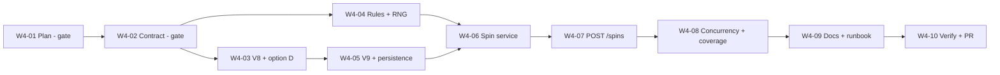

# Week 4 Plan — European Roulette Engine

- **Status:** Revision 8. W4-01 reviewed 2026-11-15: direction approved; Q2–Q6, Q10 and Q14
  approved with corrections (§13.1). W4-02 contract 0.5.0 approved (Q1a, Q13, Q16, Q18). W4-03 (V8,
  production ledger types) approved. W4-04 rules and secure wheel approved 2026-11-16 (§4.7; Q7,
  Q7a, Q9, R16); checkpoint pushed (`058dcb3`). W4-05 persistence approved (§5.7; Q8, Q11, Q19).
  W4-06 atomic spin service (§7.6; Q17 and the §5.7 approach approved 2026-11-16); checkpoint pushed
  (`c570b51`). W4-07 endpoint `POST /api/v1/games/roulette/spins` approved 2026-11-19 (§6.6; Q10
  approved). **W4-08 concurrency, ledger integrity and coverage done, pending review** (§5.8; Q18 scope
  reviewed). V8 and V9 are applied to Testcontainers only, **not to any Neon branch** (staging stays
  at V7); `verify-roulette.sql` has not been run against Neon.
  Decisions still marked *Proposed* need approval before the task that depends on them starts (§13).
- **Stage:** 2 — Virtual currency and game logic (Weeks 3–4)
- **Source:** Implementation plan v1.1 (`docs/OnlineCasinoSimulator_ImplementationPlan_v1.1.pdf`), §4 (Week 4),
  §5 (database: `roulette_rounds`, `roulette_bets`; integrity requirement "a round cannot be
  processed and paid out twice"), §6 (API: `POST /api/v1/games/roulette/spins`), §7 (acceptance
  criteria: equal probability of all 37 results, standard payouts, atomic round and balance update;
  80 % coverage of the game engine; statistical check of randomness separate from unit tests),
  §10 (risks 1, 2, 5), §14 (the end of Week 4 is the key technical milestone)
- **Inherited follow-up:** Week 3 decision P-W3-16 / Q15, **option D** (approved 2026-11-13): the
  test-only ledger types are removed together with the first real game types; release gate
  (`week-03.md` §7.13).
- **Architecture:** modular monolith ([ADR-0001](../decisions/0001-modular-monolith.md)),
  server-authoritative game logic and wallet ([ADR-0003](../decisions/0003-server-authoritative-game-logic.md)),
  design-first API ([ADR-0004](../decisions/0004-design-first-api.md)), ArchUnit
  ([ADR-0005](../decisions/0005-architecture-rules-archunit.md)), session security unchanged
  ([ADR-0006](../decisions/0006-session-authentication-security.md))
- **Expected result (plan):** a fully working backend that accepts virtual bets, generates roulette
  results, calculates payouts and records the transactions securely. No graphical interface
  (Week 5), no animations (Week 6), no game history endpoint (Week 6).
- **Branch:** `feature/week-04-roulette` (from `main` at `b07e656`)

| Revision | Date | Change |
|---|---|---|
| 1 | 2026-11-15 | Initial plan (W4-01); Week 3 deployment status recorded in the project documentation |
| 2 | 2026-11-15 | W4-01 review applied: approved decisions (§13.1); five bet categories distinguished from their options (§4.2); house edge 1/37 ≈ 2.7027 % and RTP 36/37 ≈ 97.2973 % derived from net payouts (§4.3); normalized idempotency comparison (§8.3); strict integers (§4.5). W4-02 contract 0.5.0 (§6, §6.5) |
| 3 | 2026-11-15 | W4-02 approved; W4-03: V8 (file `V8__add_roulette_wallet_transaction_types.sql`), real ledger types, option D cleanup (§5.6) |
| 4 | 2026-11-16 | W4-03 approved; W4-04: `game.model` rules and enums, secure wheel, R16, R17, opt-in chi-square diagnostic, JaCoCo for the game packages (§3, §4.6, §4.7, §10.5, §10.6) |
| 5 | 2026-11-16 | W4-04 approved, Q7a in ADR-0004; W4-05: V9, `RouletteRound`/`RouletteBet`, `RouletteRoundRepository`, cleanup list, ledger-consistency gap analysis (§5.7) |
| 6 | 2026-11-16 | W4-05 approved; W4-06: `WalletService.lockWallet`, `RouletteService.spin`, `PlayedRound`, Q17 replay, failure and ownership tests (§7.6) |
| 7 | 2026-11-18 | W4-07: `RouletteController`, request and response DTOs, strict JSON values (Q10), canonical `Idempotency-Key` (Q18), `PLAYER` rule for `/api/v1/games/**`, planned marker removed (§6.6) |
| 8 | 2026-11-19 | W4-07 approved; W4-08: `RouletteConcurrencyIT`, `RoundLedgerIntegrityIT`, `verify-roulette.sql`, `verify-migrations.sql` with round counts, JaCoCo rule proven for `game.service`, Q18 scope review (§5.8) |

---

## 0. Current state vs. this plan

**On `main` (`b07e656`, after Week 3, PR #9):**
- Flyway V1–V7; contract `openapi.yaml` **0.4.0** with no `planned` operation; ArchUnit R1–R15;
  JaCoCo check on `com.casino.wallet.service` (80 % lines / 70 % branches, measured 100 %/100 %).
- `com.casino.game` exists only as `package-info.java` ("planned for Week 4"); `game` is already in
  `ArchitectureRules.BUSINESS_MODULES`, and R13 already allows `game` to call `WalletService`.
- `wallet.service.WalletService`: `credit`/`debit` (`@Transactional`, propagation `REQUIRED`, row lock
  `FOR NO KEY UPDATE` with `app.wallet.lock-timeout`, lock-then-lookup idempotency, no negative
  balance, cap 2⁵³ − 1), `openWallet`, `getWallet`, `listTransactions`, `getBalance`.
- Ledger types: `STARTING_BALANCE` (production) and the test-only `TEST_CREDIT`/`TEST_DEBIT`
  (constants in the production enums `wallet.dto.WalletTransactionType` and
  `wallet.entity.TransactionType`, allowed in test databases by
  `src/test/resources/db/test-callbacks/afterMigrate.sql`, forbidden in production code by R15).
- Error codes `INSUFFICIENT_FUNDS`, `IDEMPOTENCY_KEY_REUSED`, `BALANCE_LIMIT_EXCEEDED` (all `409`)
  exist but no operation returns them yet. `SERVICE_UNAVAILABLE` (`503`) is the wallet lock timeout.
- `spring.jpa.open-in-view: false`; CORS allows all request headers for the configured origins.

**Deployed (staging, verified on November 15, 2026 — date confirmed in the W4-01 review):** Render runs `main`; Neon `staging` is at **V7**; the one
existing player has 1,000 coins and one `STARTING_BALANCE` entry; integrity checks 0 violations;
registration closed; Render Auto-Deploy Off; Neon backup branch `staging-before-week-03` kept;
Neon production untouched ([rollout record](../../infrastructure/wallet-rollout.md#rollout-record-2026-11-15)).

**Not on `main`:** roulette rules, random number generation, bets, rounds, the spin endpoint, real
game ledger types.

**Documentation updated in W4-01** (status only, history kept): README, `architecture.md`,
`database.md`, `api.md`, `infrastructure/README.md`, `infrastructure/render/README.md`,
`infrastructure/wallet-rollout.md` (rollout record), `week-03.md` (status and §13).

---

## 1. Objectives and scope

### 1.1 Plan tasks → deliverables

| # | Plan task (Week 4) | Deliverable | Task (§11) |
|---|---|---|---|
| — | Design-first prerequisite | `spinRoulette` operation, schemas and the two new ledger types in `openapi.yaml` 0.5.0, marked planned until implemented | W4-02 (done, pending review) |
| 1 | European roulette rules | `RouletteRules`: numbers 0–36, colors, which numbers each bet covers, payouts (§4) | W4-04 |
| 2 | 37 possible results 0–36 | `RouletteWheel` returns 0–36, all equally likely | W4-04 |
| 3 | Cryptographically secure RNG on the server | `SecureRandomRouletteWheel` (`SecureRandom.nextInt(37)`), injectable for tests | W4-04 |
| 4 | Bet types: single number, red/black, even/odd, low/high, dozens | Exactly these **five bet categories**, each with its own options (§4.2), nothing else | W4-04, W4-07 |
| 5 | Check the available balance and the bet limits | Bet limits validated before anything is written (§4.5); balance checked by `WalletService.debit` under the row lock (`409 INSUFFICIENT_FUNDS`) | W4-06, W4-07 |
| 6 | Payouts according to the standard rules | 35:1, 1:1, 2:1; zero loses every outside bet (§4.3) | W4-04 |
| 7 | Record game rounds and individual bets | V9 `roulette_rounds`, `roulette_bets` (append-only) | W4-05 |
| 8 | Integrate roulette with the wallet | One database transaction per spin: stake debit, result, payout credit, round and bets (§7) | W4-06 |
| 9 | Unit tests for payouts and special cases | Table tests over all 37 results × every selection of the five categories, expected value from net payouts, zero, limits | W4-04, W4-06 |
| — | Plan §6 | `POST /api/v1/games/roulette/spins` with an idempotency key | W4-07 |
| — | Plan §5 integrity requirement 2 | A round cannot be processed or paid twice (unique keys, links to the ledger) | W4-05, W4-06, W4-08 |
| — | Plan §7 quality targets | Statistical randomness check (separate from unit tests); JaCoCo ≥ 80 % lines for `com.casino.game.service`; concurrency tests | W4-04, W4-08 |
| — | Week 3 option D (release gate) | V8 with real ledger types `ROULETTE_STAKE`/`ROULETTE_PAYOUT`; `TEST_CREDIT`/`TEST_DEBIT`, the test callback and R15 removed | W4-03 |

### 1.2 Out of scope (Week 4)

| Item | Where it belongs |
|---|---|
| Column bets, split, street, corner, six-line, "neighbours", call bets, *la partage* / *en prison* | Not in the approved plan; post-MVP ("additional roulette variants", plan §11) |
| Roulette UI, chips, bet confirmation, showing the balance | Week 5 |
| Animations, sound, `GET /api/v1/games/roulette/history`, statistics panel | Week 6 |
| Frontend types for the spin API (`frontend/src/types/…`) | Week 5, with the first caller |
| Play limits, breaks, self-exclusion, play-time tracking (the check before every game action, ADR-0003 §6) | Week 9 (`game → responsibleplay`); §9.3 names the single place where the check goes |
| Probability / house-edge information in the UI and dashboard | Week 9 (Week 4 documents payouts and probabilities in the contract and `api.md`, §9.4) |
| Configurable game limits through the admin panel | Week 10 |
| Other games (blackjack, poker, slots), multiplayer, live dealer | Out of MVP (plan §1.4) |
| Autoplay, "repeat bet", streaks, bonuses, leaderboards or any engagement mechanic | Never in the MVP (plan §1.4, responsible play) |
| Applying V8/V9 to Neon staging | **Separate, approval-gated rollout after Week 4** (§15) |
| Real money, purchases, cash-equivalent rewards | Never (plan §1.4) |

### 1.3 Priorities

Everything is **Must** unless marked **Should**. Should items may move to the Week 5 buffer without
blocking Week 5.

---

## 2. Existing architecture and dependencies

### 2.1 Inherited decisions (approved)

| # | Decision | Source |
|---|---|---|
| A1 | Modules talk through `service`/`dto`/`exception` only; no cycles | ADR-0001, ADR-0005 (R2, R3) |
| A2 | The backend alone generates outcomes with `SecureRandom`, all 37 outcomes equally likely; it alone validates bets, calculates payouts and changes balances; the frontend renders server-confirmed results | ADR-0003 §1, §2 |
| A3 | Integer coins (`BIGINT`/`long`/`int64`), cap 2⁵³ − 1; immutable ledger; balance and ledger in one transaction | ADR-0003 §3, §4; P-W3-2 |
| A4 | State-changing game requests carry an idempotency key; a unique constraint guarantees a round is processed at most once | ADR-0003 §5; `week-03.md` §1.2 |
| A5 | Contract first: new operations are added `planned` and reviewed before implementation | ADR-0004 |
| A6 | Flyway owns the schema; applied migrations (V1–V7) are never edited | `database.md` |
| A7 | Pessimistic wallet row lock with a bounded wait; one wallet per operation (deadlock rule); lock-then-lookup idempotency | P-W3-5, `week-03.md` §7.4, §7.8 |
| A8 | Wallet idempotency keys are chosen by the calling module and are deterministic for it; raw client keys are never stored in the ledger | `week-03.md` §7.6 |
| A9 | `credit`/`debit` join the caller's transaction (`REQUIRED`), so a round can debit, credit and store itself atomically | `week-03.md` §4 |
| A10 | Each week adds its ledger types with its own migration and contract change | Q6 (Week 3) |
| A11 | Option D: remove `TEST_CREDIT`/`TEST_DEBIT`, the callback and R15 with the first real game types; `ProductionArtifactIT` fails on any packaged occurrence; V6/V7 unchanged | P-W3-16, Q15 |
| A12 | Players only: the wallet is a `PLAYER` feature; administrators have no wallet (`403`) | P-W3-3 |
| A13 | Session authentication, CSRF, throttling and error format unchanged | ADR-0006 |

### 2.2 What Week 4 reuses

| Existing | Used for |
|---|---|
| `WalletService.debit` / `credit` | Stake and payout, including insufficient funds, cap, locking, ledger entry, idempotency |
| `WalletBusyException` (`503`), `InsufficientFundsException`, `IdempotencyKeyReusedException`, `BalanceLimitExceededException` (`409`), `WalletNotFoundException` (`500`) | Error mapping of a spin, without new codes |
| `GlobalExceptionHandler`, `ProblemDetailFactory`, `DecimalIntegerParameters` | Problem Details, field errors (`bets[1].number`), no new error code |
| `SecurityConfig` rule pattern of `/api/v1/wallet/**` | `/api/v1/games/**` → `hasRole("PLAYER")` |
| `TestDatabase.reset` (guarded `TRUNCATE`, explicit table list) | Extended by the two roulette tables |
| `MigrationCompatibilityIT` (PostgreSQL 17.11 and 18.6) | V8 and V9 constraints and triggers on both versions |
| `WalletTestData.ledgerViolations()`, `Concurrency` helpers, `TestAccounts.activePlayerWithWallet` | Integrity and concurrency tests of rounds |
| JaCoCo setup (merged unit + integration data) | Second check for `com.casino.game.service` |
| `readonly-query.sh`, `verify-migrations.sql`, `verify-wallets.sql`, `wallet-rollout.md` | Read-only checks and the template of the Week 4 rollout runbook |

### 2.3 New dependency direction

`game → wallet` (only `wallet.service.WalletService`, `wallet.dto`, `wallet.exception`), already
listed in `architecture.md`. `game` does not depend on `user` or `auth`: the user id comes from the
session principal in the controller. `wallet` never depends on `game`.

---

## 3. Module structure (implemented in W4-04 to W4-07)

```
com.casino.game                 depends on: common, wallet (service, dto, exception)
├── model/       (W4-04, implemented; plain Java, R17)
│                RouletteBetCategory (net odds, payout multiplier), RouletteBetColor, RouletteParity,
│                RouletteRange, RouletteDozen, RouletteNumberColor (names = contract schemas, §6.3),
│                RouletteSelection (sealed: Straight, RedBlack, EvenOdd, LowHigh, Dozen),
│                RouletteWager, RouletteSettlement,
│                RouletteRules — pure functions: color, coverage, payout, settlement
├── service/     RouletteWheel       — interface: int spin() → 0…36 (W4-04)
│                SecureRandomRouletteWheel — @Component, SecureRandom.nextInt(37) (W4-04)
│                RouletteService     — spin(): the transaction of one round (§7, W4-06)
├── repository/  RouletteRoundRepository — save, findByUserIdAndRequestId (W4-05)
├── entity/      RouletteRound, RouletteBet (@Immutable, no setters; W4-05)
├── dto/         RouletteSpinRequest, RouletteBetRequest (schema RouletteBet), RouletteSpinResult,
│                RouletteSettledBet, constraints OneOptionPerCategory and DistinctSelections,
│                StrictJson deserializers (Q10) (W4-07); they use the model enums directly
└── controller/  RouletteController — POST /api/v1/games/roulette/spins (W4-07)
```

- **No `config` and no `exception` package** in Week 4: limits are contract constants (§4.5), and
  every failure is an existing exception (§6.4). Packages are only created with content.
- **One set of category and option enums in `game.model`** (Q7, approved 2026-11-16), used by the
  rules now and by the DTOs (W4-07) and the entities (W4-05) later. Neither entities nor DTOs depend on
  each other; no duplicated enums and no mapping layer. `model` is a new layer package
  (`ArchitectureRules.LAYERS`, R12), not part of the module's public API (R3), and may depend on no
  framework and no other layer (R17). The wallet's split into a public and a stored enum (needed there
  because of R3) is not repeated.
- **The wheel is an interface** so that tests choose the winning number; production has exactly one
  implementation. No "seed" or "fixed number" switch exists in production code or configuration.
- **Thin controller:** HTTP mapping, the principal's user id, the `Idempotency-Key` header and
  delegation. Validation of the body: Bean Validation on the DTOs. Business rules: the service.

`WalletService` gains **one** method (decision Q4, §13):

| Method | Purpose | Callers |
|---|---|---|
| `void lockWallet(UUID userId)` | Locks the player's wallet row for the rest of the caller's transaction (`MANDATORY`), with the existing bounded wait; `WalletNotFoundException`/`WalletBusyException` as for `debit` | `game` (before the round's idempotency lookup, §8.2) |

Nothing else in the wallet API changes; `credit`/`debit` signatures and behaviour stay as they are.

---

## 4. Roulette rules and payout calculations

### 4.1 Wheel

- European single-zero wheel: **37 numbers, 0–36**, each with probability exactly **1/37**.
- **Colors** (fixed table in `RouletteRules`, verified by a test against the standard rule "in 1–10
  and 19–28 odd numbers are red, in 11–18 and 29–36 even numbers are red"):
  - **Red (18):** 1, 3, 5, 7, 9, 12, 14, 16, 18, 19, 21, 23, 25, 27, 30, 32, 34, 36
  - **Black (18):** 2, 4, 6, 8, 10, 11, 13, 15, 17, 20, 22, 24, 26, 28, 29, 31, 33, 35
  - **Green (1):** 0
- The wheel layout (physical order of pockets) is a presentation concern of Week 6 and does not
  influence any result.

### 4.2 Bet categories and their options (exactly the plan's list)

The plan names **five bet categories**. A category is the kind of bet; an **option** is the choice
inside it. A bet always has one category and exactly one option.

| # | Category (`category`) | Plan wording | Option property | Options | Covers |
|---|---|---|---|---|---|
| 1 | `STRAIGHT` | Single number | `number` | 37 options: the integers 0–36 | the chosen number |
| 2 | `RED_BLACK` | Red or black | `color` | `RED`, `BLACK` | the 18 red / 18 black numbers |
| 3 | `EVEN_ODD` | Even or odd | `parity` | `EVEN`, `ODD` | 2, 4, …, 36 / 1, 3, …, 35 |
| 4 | `LOW_HIGH` | Low or high | `range` | `LOW`, `HIGH` | 1–18 / 19–36 |
| 5 | `DOZEN` | Dozens | `dozen` | `FIRST`, `SECOND`, `THIRD` | 1–12 / 13–24 / 25–36 |

- The option property of the category is required; the other four option properties must be
  omitted (`null` counts as omitted). This keeps the request schema flat (one object type, no
  `oneOf`, which the project's contract tooling does not compare) while every option property still
  has an exact enum or range in the schema (§6.3, Q16).
- **Zero** is green, neither even nor odd, neither low nor high and in no dozen: it loses every
  category except `STRAIGHT` with `number` 0.
- A *selection* is a category together with its option (e.g. `RED_BLACK`/`RED`, `STRAIGHT`/17); a
  selection appears at most once per spin.

### 4.3 Payouts (standard European rules)

Odds are quoted as **net winnings**: the coins won *in addition to* the returned stake. The
**payout** of a bet is what the wallet credits back for it: stake plus net winnings on a win, `0` on
a loss.

| Category | Numbers covered | P(win) | Net winnings (odds) | Payout on a win | Payout on a loss |
|---|---|---|---|---|---|
| `STRAIGHT` | 1 | 1/37 ≈ 2.7027 % | 35:1 | 36 × amount | 0 |
| `RED_BLACK`, `EVEN_ODD`, `LOW_HIGH` | 18 | 18/37 ≈ 48.6486 % | 1:1 | 2 × amount | 0 |
| `DOZEN` | 12 | 12/37 ≈ 32.4324 % | 2:1 | 3 × amount | 0 |

**Expected value, from the net payouts** (per coin staked; a loss is −1):

| Category | Expected net result |
|---|---|
| `STRAIGHT` | 35 × 1/37 − 1 × 36/37 = (35 − 36)/37 = **−1/37** |
| even-money (`RED_BLACK`, `EVEN_ODD`, `LOW_HIGH`) | 1 × 18/37 − 1 × 19/37 = (18 − 19)/37 = **−1/37** |
| `DOZEN` | 2 × 12/37 − 1 × 25/37 = (24 − 25)/37 = **−1/37** |

- **House edge** = 1/37 ≈ **2.7027 %** of the amount staked, for every bet.
- **Theoretical RTP** (return to player) = 1 − 1/37 = **36/37 ≈ 97.2973 %**. Cross-check with the
  total returned payout: straight 36 × 1/37, even-money 2 × 18/37, dozen 3 × 12/37 — each is 36/37.
- These are long-run averages; single rounds vary widely (shown, not hidden: §9.4).
- **Unit test (AC-W4-04.3):** for every category and option, and amount *a*, the sum over the 37
  results of the net result (`payout − a`) is exactly −*a*; equivalently Σ payout = 36 × *a*.
- **Zero:** no *la partage*, no *en prison* (optional variants that the plan does not list).
- **Integer arithmetic only:** `Math.multiplyExact`/`addExact`. With the limits of §4.5 a bet pays
  at most 36 × 1,000 = 36,000 and a spin at most 360,000 coins (a loose bound), far below 2⁵³ − 1;
  the wallet's cap check still applies (`BALANCE_LIMIT_EXCEEDED`).

### 4.4 Settlement of one spin

For a spin with bets *b₁ … bₙ* and winning number *w*:
- `totalStake = Σ amount(bᵢ)`; `payout(bᵢ) = covers(bᵢ, w) ? amount(bᵢ) × (netOdds(category(bᵢ)) + 1) : 0`;
  `totalPayout = Σ payout(bᵢ)`.
- Ledger: one `ROULETTE_STAKE` debit of `totalStake`, and one `ROULETTE_PAYOUT` credit of
  `totalPayout` **only if** `totalPayout > 0` (ledger amounts are never 0). Net change =
  `totalPayout − totalStake`.

**Example.** Balance 1,000; bets `STRAIGHT`/17 × 10 and `RED_BLACK`/`RED` × 20; winning number 17
(black): payouts 360 (net winnings 350) and 0 (net −20); `totalStake` 30, `totalPayout` 360, net
change +330; ledger −30 (balance 970) then +360 (balance 1,330). A losing round has the stake entry
only.

### 4.5 Bet limits and validation (approved, Q2 and Q10)

| Rule | Value | Failure |
|---|---|---|
| Bets per spin | 1–10 | `400 VALIDATION_FAILED`, field `bets` |
| Amount per bet | whole coins, 1–1,000 (total stake therefore 1–10,000) | `400 VALIDATION_FAILED`, field `bets[i].amount` |
| Option of the category | required; `number` 0–36 | `400 VALIDATION_FAILED`, e.g. field `bets[i].number`, `bets[i].color` |
| Option property of another category | must be omitted (`null` = omitted) | `400 VALIDATION_FAILED`, e.g. field `bets[i].dozen` |
| Same selection twice in one spin | not allowed | `400 VALIDATION_FAILED`, field `bets` |
| Unknown category or option value, wrong JSON type | not allowed | `400 MALFORMED_REQUEST` (existing convention) |
| **Strict integers:** `amount` and `number` written with a fraction or exponent (`10.5`, `10.0`, `1e1`) or as a string (`"10"`) | rejected, never rounded or converted | `400 MALFORMED_REQUEST`; per-field deserializers, implemented in W4-07 (§6.6) |
| Total stake ≤ current balance | checked under the wallet lock | `409 INSUFFICIENT_FUNDS`, nothing written |

- The limits are **constants** in the contract (`minimum`/`maximum`/`maxItems`) and in the DTO
  annotations, so the published contract states them exactly. They are not environment settings:
  changing them is a reviewed contract change. Configurable limits belong to Week 10.
- Complementary selections in one spin (e.g. `RED_BLACK`/`RED` and `RED_BLACK`/`BLACK`) are
  allowed: they are different selections and legal bets, and the response shows their combined
  effect transparently.
- Validation happens **before** the wallet is locked or anything is written; a rejected spin draws
  no number.

### 4.6 Random number generation

- `RouletteWheel.spin()` → `int` in 0…36. Production: `SecureRandomRouletteWheel` holds one
  `new SecureRandom()` (thread-safe, non-blocking default algorithm; **not**
  `SecureRandom.getInstanceStrong()`, which can block on Linux) and returns `random.nextInt(37)`.
  `nextInt(bound)` uses rejection sampling, so there is **no modulo bias**.
- Not seeded, not reseeded by the application, never logged before the round is committed.
- **Deterministic tests:** unit and integration tests inject a test wheel (fixed number or a
  sequence) through Spring (`@TestConfiguration` / `@MockitoBean`), never through production
  configuration. `SecureRandomRouletteWheel` itself is tested with a controlled `SecureRandom`
  (bound 37 is passed, the value is returned unchanged); its distribution is an opt-in diagnostic
  (§10.5).
- ArchUnit **R16** (approved 2026-11-16): production code uses no weak or predictable randomness
  (`new Random()`/`new Random(seed)`, subclasses of `Random`, `Random.setSeed`, `Math.random()`,
  `StrictMath.random()`, `ThreadLocalRandom`, `SplittableRandom`, `RandomGenerator.getDefault()`/`of(…)`,
  `RandomGeneratorFactory`, `new SecureRandom(seed)`, `SecureRandom.setSeed`). An unseeded
  `new SecureRandom()` and `UUID.randomUUID()` stay allowed: the rule names `Random`'s own
  constructors, not those of its subclass, so `SecureRandom extends Random` is no problem (proven by
  a valid fixture).

### 4.7 Implemented in W4-04 (approved 2026-11-16)

**Decisions applied (review 2026-11-16):** Q7 (enums in a small domain package: `game.model`), Q9
(deterministic tests are the gate; the chi-square test is an opt-in diagnostic), R16.

**`game.model`** (plain Java; R17):
- The six enums with exactly the contract values; `RouletteBetCategory` carries the standard **net
  odds** (35, 1, 1, 1, 2) and `payoutMultiplier() = netOdds + 1` (36, 2, 2, 2, 3).
- `RouletteSelection`: a sealed interface with one record per category (`Straight(int number)`,
  `RedBlack(color)`, `EvenOdd(parity)`, `LowHigh(range)`, `Dozen(dozen)`). A selection without its
  option, or with the option of another category, cannot be constructed (`Straight` rejects numbers
  outside 0–36). Records compare by value, which W4-07 uses to reject a selection placed twice.
- `RouletteWager(selection, amount > 0)`; `RouletteSettlement(winningNumber, winningColor, payouts,
  totalStake, totalPayout)` with `netResult() = totalPayout − totalStake`.
- `RouletteRules` (final, static, no state): `colorOf(n)` (literal red set; 0 green), `wins(selection,
  n)` (an exhaustive `switch` over the sealed selections; zero wins only `Straight(0)`),
  `payout(selection, amount, n)` (`amount × payoutMultiplier` on a win, 0 on a loss,
  `Math.multiplyExact`), `settle(wagers, n)` (payouts in wager order, totals with `Math.addExact`).
  Numbers outside 0–36 and non-positive amounts → `IllegalArgumentException`; an overflow →
  `ArithmeticException`, never a wrapped value.

**`game.service`:** `RouletteWheel` (functional interface, `int spin()`) and the package-private
`@Component SecureRandomRouletteWheel` (`new SecureRandom()`, `nextInt(37)`). It is the only
`RouletteWheel` bean (`CasinoSimulatorApplicationIT`). Nothing injects it yet (W4-06).

**Deviations from the proposal:**
1. `RouletteRules` lives in `game.model`, not `game.service` (§3 of revision 1): with the enums there
   and R17 enforcing purity, the rules are framework-free by construction and the service package keeps
   orchestration (the wheel now, the round in W4-06).
2. `model` is a new layer package (R12) with its own purity rule R17 (new, proposed with Q7).
3. The statistical test is opt-in, not part of `verify` (§10.5, Q9).
4. JaCoCo checks `com.casino.game.model` and `com.casino.game.service` from W4-04 on (planned for
   W4-08).
5. Rules take a `RouletteSelection` (category and option together) instead of a category enum plus a
   separate number, so cross-field validation is not repeated in the rules.

---

## 5. Database design

### 5.1 Migrations

| Version | File | Owner / task | Content |
|---|---|---|---|
| V8 | `V8__add_roulette_ledger_types.sql` | `wallet`, W4-03 | Replaces `ck_wallet_transactions_type` and `ck_wallet_transactions_direction` with the list `STARTING_BALANCE`, `ROULETTE_STAKE`, `ROULETTE_PAYOUT` and a direction rule per type |
| V9 | `V9__create_roulette_rounds.sql` | `game`, W4-05 | `roulette_rounds`, `roulette_bets`, constraints, append-only triggers |

- V1–V7 are **not modified**. Each module introduces its own objects (`database.md` convention), so
  the ledger change (wallet) and the game tables (game) are separate migrations, applied in separate
  Flyway transactions.
- V8 must be applied before V9 (V9's foreign keys reference ledger rows of the new types only
  logically, but the order matches the task order and keeps each change reviewable alone).

### 5.2 V8 — ledger types (proposal; implemented in W4-03 with one deviation, see §5.6)

```sql
-- Week 4 ledger types (docs/plans/week-04.md §5.2): roulette stakes (debit) and payouts (credit).
-- Replaces the V6 type list and direction rule; every existing row (STARTING_BALANCE, amount > 0)
-- satisfies the new rules. One ALTER TABLE: the table lock is taken once, briefly.
ALTER TABLE wallet_transactions
    DROP CONSTRAINT ck_wallet_transactions_type,
    DROP CONSTRAINT ck_wallet_transactions_direction,
    ADD CONSTRAINT ck_wallet_transactions_type
        CHECK (type IN ('STARTING_BALANCE', 'ROULETTE_STAKE', 'ROULETTE_PAYOUT')),
    ADD CONSTRAINT ck_wallet_transactions_direction
        CHECK ((type IN ('STARTING_BALANCE', 'ROULETTE_PAYOUT') AND amount > 0)
            OR (type = 'ROULETTE_STAKE' AND amount < 0));
```

- Constraint names stay the same, so tests and documentation that name them keep working.
- `ADD CONSTRAINT … CHECK` validates the existing rows under an `ACCESS EXCLUSIVE` lock. The ledger
  holds a few rows on staging (one today), so the lock lasts milliseconds; the old instance only
  reads the ledger and briefly waits.
- The direction rule now lists every type with its sign, so an unlisted type fails twice (type list
  and direction).
- `TEST_CREDIT`/`TEST_DEBIT` are still rejected (tested on PostgreSQL 17 and 18, as today).

### 5.3 V9 — rounds and bets (proposal; implemented in W4-05 with three refinements, see §5.7)

```sql
-- Roulette rounds and their bets (docs/plans/week-04.md §5.3). A row is written only in the
-- transaction that also writes the round's ledger entries, so a round always is complete: there is
-- no pending state. Rows never change afterwards (append-only triggers).

CREATE FUNCTION reject_row_change()
    RETURNS TRIGGER
    LANGUAGE plpgsql
AS
$$
BEGIN
    RAISE EXCEPTION '% is append-only: % rejected', TG_TABLE_NAME, TG_OP
        USING ERRCODE = 'integrity_constraint_violation';
END;
$$;

CREATE TABLE roulette_rounds (
    id                    UUID        PRIMARY KEY,            -- generated by the application (§7.2)
    user_id               UUID        NOT NULL,
    request_id            UUID        NOT NULL,               -- the client's Idempotency-Key
    winning_number        SMALLINT    NOT NULL,
    total_stake           BIGINT      NOT NULL,
    total_payout          BIGINT      NOT NULL,
    balance_after         BIGINT      NOT NULL,               -- wallet balance after the round
    stake_transaction_id  BIGINT      NOT NULL,
    payout_transaction_id BIGINT,
    created_at            TIMESTAMPTZ NOT NULL DEFAULT now(),
    CONSTRAINT fk_roulette_rounds_user          FOREIGN KEY (user_id) REFERENCES users (id) ON DELETE RESTRICT,
    CONSTRAINT fk_roulette_rounds_stake_entry   FOREIGN KEY (stake_transaction_id) REFERENCES wallet_transactions (id) ON DELETE RESTRICT,
    CONSTRAINT fk_roulette_rounds_payout_entry  FOREIGN KEY (payout_transaction_id) REFERENCES wallet_transactions (id) ON DELETE RESTRICT,
    CONSTRAINT uq_roulette_rounds_request       UNIQUE (user_id, request_id),
    CONSTRAINT uq_roulette_rounds_stake_entry   UNIQUE (stake_transaction_id),
    CONSTRAINT uq_roulette_rounds_payout_entry  UNIQUE (payout_transaction_id),
    CONSTRAINT ck_roulette_rounds_number        CHECK (winning_number BETWEEN 0 AND 36),
    CONSTRAINT ck_roulette_rounds_stake         CHECK (total_stake BETWEEN 1 AND 9007199254740991),
    CONSTRAINT ck_roulette_rounds_payout        CHECK (total_payout BETWEEN 0 AND 9007199254740991),
    CONSTRAINT ck_roulette_rounds_balance       CHECK (balance_after BETWEEN 0 AND 9007199254740991),
    CONSTRAINT ck_roulette_rounds_payout_entry  CHECK ((total_payout = 0) = (payout_transaction_id IS NULL))
);

CREATE TABLE roulette_bets (
    id        BIGINT      GENERATED ALWAYS AS IDENTITY PRIMARY KEY,  -- order of the bets in the request
    round_id  UUID        NOT NULL,
    category  VARCHAR(10) NOT NULL,
    selection VARCHAR(6),                -- option of RED_BLACK, EVEN_ODD, LOW_HIGH, DOZEN; NULL for STRAIGHT
    number    SMALLINT,                  -- option of STRAIGHT; NULL otherwise
    amount    BIGINT      NOT NULL,
    payout    BIGINT      NOT NULL,
    CONSTRAINT fk_roulette_bets_round     FOREIGN KEY (round_id) REFERENCES roulette_rounds (id) ON DELETE RESTRICT,
    CONSTRAINT uq_roulette_bets_selection UNIQUE NULLS NOT DISTINCT (round_id, category, selection, number),
    CONSTRAINT ck_roulette_bets_option    CHECK (
           (category = 'STRAIGHT'  AND selection IS NULL AND number BETWEEN 0 AND 36)
        OR (category = 'RED_BLACK' AND number IS NULL AND selection IN ('RED', 'BLACK'))
        OR (category = 'EVEN_ODD'  AND number IS NULL AND selection IN ('EVEN', 'ODD'))
        OR (category = 'LOW_HIGH'  AND number IS NULL AND selection IN ('LOW', 'HIGH'))
        OR (category = 'DOZEN'     AND number IS NULL AND selection IN ('FIRST', 'SECOND', 'THIRD'))),
    CONSTRAINT ck_roulette_bets_amount    CHECK (amount BETWEEN 1 AND 9007199254740991),
    CONSTRAINT ck_roulette_bets_payout    CHECK (payout = 0 OR payout = amount * CASE category
                                                     WHEN 'STRAIGHT' THEN 36 WHEN 'DOZEN' THEN 3 ELSE 2 END)
);

CREATE TRIGGER trg_roulette_rounds_append_only BEFORE UPDATE OR DELETE ON roulette_rounds
    FOR EACH ROW EXECUTE FUNCTION reject_row_change();
CREATE TRIGGER trg_roulette_bets_append_only BEFORE UPDATE OR DELETE ON roulette_bets
    FOR EACH ROW EXECUTE FUNCTION reject_row_change();
```

Notes:
- **No status column.** A round is inserted once, complete, in the same transaction as its ledger
  entries (§7). A pending/settled state machine would only be needed if a round could be half
  done; the design makes that impossible.
- **Links to the ledger** (`stake_transaction_id`, `payout_transaction_id`, unique, `RESTRICT`): a
  round can only reference committed entries, no entry can serve two rounds, and the payout entry
  exists exactly when something was won. These are database-level foreign keys into the wallet's
  table; at the Java level `game` holds plain `long` ids (no dependency on `wallet.entity`, R3).
- **`balance_after`** is stored so that a replay returns exactly the original response (§8.3); an
  invariant ties it to the ledger (§5.5).
- **`request_id`** is the client's `Idempotency-Key` (a UUID), unique per player. It stays in the
  game table only; ledger keys use the server's round id (A8).
- **Bet limits are not in the database** (only structural bounds): limits are business rules that
  may change with a contract change; structural rules (category and option pairs, exact payout
  multiple, no duplicate selection) are.
- **Storage of the option:** one `selection` column for the four categories with named options and
  `number` for `STRAIGHT`, instead of five option columns: the API's per-category property names map
  onto it one to one, and `ck_roulette_bets_option` keeps every pair exact.
- `UNIQUE NULLS NOT DISTINCT` (PostgreSQL 15+) treats the `NULL`s as equal, so two
  `RED_BLACK`/`RED` bets in one round are rejected. Verified on 17 and 18 in `MigrationCompatibilityIT`.
- **Indexes:** `uq_roulette_rounds_request` (leading `user_id`) serves the idempotency lookup and
  the user foreign key; `uq_roulette_bets_selection` (leading `round_id`) serves loading a round's
  bets. The Week 6 history adds its own index with its query.
- **Immutability** as for the ledger (`week-03.md` §6.4): `@Immutable` entities without setters plus
  the triggers; rolled-back inserts leave nothing (MVCC); `TRUNCATE` stays possible for the guarded
  test cleanup only. A new generic function is used because `reject_ledger_change()` names
  `wallet_transactions` in its message; V6 stays unchanged.
- **Account deletion** (Week 11, Q4 of Week 3): `RESTRICT` keeps the round history consistent with
  the ledger; the pseudonymisation option keeps working (rounds hold no personal data).
- **Personal data:** none beyond the user id; no IP address, no device data.

### 5.4 Test cleanup

`TestDatabase.TRUNCATE` (explicit list, no `CASCADE`) gets `roulette_bets, roulette_rounds` in front
of `wallet_transactions`. Without them the statement fails loudly ("cannot truncate a table
referenced in a foreign key constraint"), which is the intended guard (`week-03.md` §6.5). The
guards G1–G5 are unchanged.

### 5.5 Integrity invariants (tests and read-only verification)

For every round *r*:
1. `r.total_stake = Σ amount` and `r.total_payout = Σ payout` of its bets; it has 1–10 bets.
2. Each bet's `payout` equals `RouletteRules.payout(bet, r.winning_number)` (checked in Java tests;
   the SQL check verifies the multiple only).
3. The stake entry: type `ROULETTE_STAKE`, `amount = −r.total_stake`, wallet of `r.user_id`,
   `reference = r.id`, key `roulette-round:<r.id>:stake`.
4. The payout entry (if any): type `ROULETTE_PAYOUT`, `amount = r.total_payout`, same wallet,
   `reference = r.id`, key `roulette-round:<r.id>:payout`; it is newer than the stake entry.
5. `r.balance_after` = `balance_after` of the payout entry, or of the stake entry when nothing was
   won.

And globally:
6. **Every `ROULETTE_STAKE` and `ROULETTE_PAYOUT` entry is referenced by exactly one round** — no
   debit without a recorded round, no payout without its round.
7. All Week 3 wallet invariants (`WalletTestData.ledgerViolations()`, `verify-wallets.sql`) still
   hold.

`infrastructure/neon/verify-roulette.sql` (W4-08, read-only) counts violations of 1–6 (2 in full, not only
the multiple: §5.8); it runs in `MigrationCompatibilityIT` under `default_transaction_read_only = on`, like the
Week 3 scripts.
`verify-migrations.sql` learns the V9 state (tables `roulette_rounds`, `roulette_bets`).

### 5.6 Implemented in W4-03 (pending review)

**Migration** `V8__add_roulette_wallet_transaction_types.sql` (the name given in the W4-03 task; V1–V7
unchanged). One `ALTER TABLE` replaces exactly two constraints, keeping their names:

```sql
ALTER TABLE wallet_transactions
    DROP CONSTRAINT ck_wallet_transactions_type,
    DROP CONSTRAINT ck_wallet_transactions_direction,
    ADD CONSTRAINT ck_wallet_transactions_type
        CHECK (type IN ('STARTING_BALANCE', 'ROULETTE_STAKE', 'ROULETTE_PAYOUT')),
    ADD CONSTRAINT ck_wallet_transactions_direction
        CHECK ((type NOT IN ('STARTING_BALANCE', 'ROULETTE_PAYOUT') OR amount > 0)
           AND (type <> 'ROULETTE_STAKE' OR amount < 0));
```

- **Deviation from §5.2:** the direction rule is written as implications instead of an `OR` of
  allowed pairs. PostgreSQL evaluates `CHECK` constraints in name order (`…_direction` before
  `…_type`), so with the §5.2 form an unknown type would be reported as a direction violation. Now
  the type list alone decides which types exist and the direction rule only the sign of the listed
  types; the existing "unknown type → `ck_wallet_transactions_type`" assertions keep their meaning.
- **Preserved:** every row; the amount (never 0, ± 2⁵³ − 1) and balance bounds; the key format; the
  unique key per wallet; all foreign keys (`ON DELETE RESTRICT`); the append-only, owner and
  `updated_at` triggers. `MigrationCompatibilityIT` proves on both versions that after V7 → V8 the
  wallets and ledger rows are byte-for-byte identical, the constraint names are the same, only the two
  definitions differ, and the trigger definitions are identical.

**Production code (wallet module only):**
- `wallet.entity.TransactionType` and `wallet.dto.WalletTransactionType`: `STARTING_BALANCE` (credit),
  `ROULETTE_STAKE` (debit), `ROULETTE_PAYOUT` (credit). `TEST_CREDIT`/`TEST_DEBIT` are gone.
- `wallet.dto.WalletEntryType` (published enum): + `ROULETTE_STAKE`, `ROULETTE_PAYOUT`.
- `WalletService`: two exhaustive `switch` expressions (`publicType`: stored → published; `storedType`:
  command → stored) replace `valueOf` by name. A type added to one enum without the others does not
  compile. The run-time fail-closed branch (`IllegalStateException` for an unpublished stored type)
  is gone because that state can no longer be represented. Validation is unchanged: the type must
  match the direction (`ROULETTE_STAKE` only for `debit`, `ROULETTE_PAYOUT` only for `credit`), and
  `STARTING_BALANCE` only through `openWallet`. No new endpoint; no game code.

**Option D cleanup (approved 2026-11-13, release gate):**
1. `TEST_CREDIT`/`TEST_DEBIT` removed from both production enums; every test uses the real types
   (`ROULETTE_PAYOUT` for credits, `ROULETTE_STAKE` for debits).
2. `src/test/resources/db/test-callbacks/afterMigrate.sql` and the `spring.flyway.locations` override
   in `src/test/resources/config/application.yml` removed: test databases have exactly the production
   schema.
3. ArchUnit R15, its three fixtures and `TestLedgerTypesStayInTestsTest` removed; R15 is documented as
   retired (id not reused).
4. `ProductionArtifactIT` scans **every** packaged application class and resource byte by byte for
   `TEST_CREDIT`, `TEST_DEBIT` and `test-callbacks`; a second test proves the scan finds them in a
   compiled class (the test class itself).
5. V6 and V7 are byte-for-byte unchanged (Flyway checksum validation in every migration test).

**Fail-closed coverage, replaced without weakening the schema.** The W3-08 tests stored a test-only
type and expected a `500`. That needed a widened test schema, which no longer exists. Equivalent
guarantees now hold at three layers, each tested in isolation:
- database: any other type string is rejected (`MigrationCompatibilityIT`, PostgreSQL 17/18, including
  the retired names and a lower-case spelling; `WalletServiceIT` on the test database itself);
- Java: exhaustive mapping (compile time) plus `WalletModelTest` (the three enums have the same names
  and directions) and `WalletServiceTest` (every stored type is published under its own name);
- API: `WalletTransactionsIT` shows real stake and payout entries, validated against the contract
  enum, without keys or references.

**Contract:** the `x-planned-enum-values` listing of `WalletTransactionType` and the "(planned)" notes
of the two types are removed; `OpenApiContractTest` asserts no planned enum value is left, and
`OpenApiContractIT` that the generated documentation has exactly the three values. The spin stays
planned. The `x-planned-enum-values` tooling itself stays (generic, tested with fixtures) for later
weeks.

**Read-only script:** `infrastructure/neon/verify-migrations.sql` recognises
`V8: Week 4 ledger types` (no new table); tested at V5, V7 and V8.

### 5.7 Implemented in W4-05 (approved 2026-11-16)

**Decisions applied (approved 2026-11-16):** Q8 (append-only rounds and bets through the generic
`reject_row_change()`), Q11 (foreign keys to `users` and `wallet_transactions`, `ON DELETE RESTRICT`;
the Java module references them by id only), Q19 (`category` + `selection` + `number`, valid pairs
enforced by `CHECK`, no selection twice per round).

**Migration** `V9__create_roulette_rounds.sql`: the §5.3 design, with three refinements found while
testing it:
1. `ck_roulette_bets_option` tests every option with `IS NOT NULL` before its range or list. A `CHECK`
   passes when its expression is `NULL`, so `number BETWEEN 0 AND 36` alone accepted a `STRAIGHT` bet
   without a number (and `selection IN (…)` a named bet without its option). The tests found it.
2. A separate `ck_roulette_bets_category` lists the five categories, so an unknown category is reported
   under its own name (PostgreSQL evaluates checks in name order: `category` before `option`).
3. `ck_roulette_rounds_distinct_entries`: the payout entry cannot be the stake entry.

`created_at` keeps its database default, but the application provides the value (below).

**Entities and repository** (`game.entity`, `game.repository`; no setters, no relationship into another
module):
- `RouletteRound` (`@Immutable`, `Persistable<UUID>`): the id is generated by the caller before the
  ledger writes; `isNew()` makes Spring Data `persist` it directly (no merge, no extra `SELECT`). The
  player and the ledger entries are plain ids (`userId`, `stakeTransactionId`, `payoutTransactionId`).
  `createdAt` is passed in and truncated to microseconds, the precision of `timestamptz`, so a round
  read back for a replay equals the one returned when it was played. **Deviation:** `@Generated` (as in
  `WalletTransaction`) cannot be used here: Hibernate 7 refuses the post-insert refresh of a read-only
  entity whose insert was delayed (assigned id), so W4-06 passes the injected `Clock`'s instant.
- `RouletteBet` (`@Immutable`, identity id): `of(RouletteSelection, amount, payout)` and `selection()`
  convert between the domain type and the Q19 columns. The round owns its bets through a
  unidirectional `@OneToMany` (`@JoinColumn(round_id, nullable = false, updatable = false)`,
  `CascadeType.PERSIST`, `@OrderBy("id")`, immutable collection): the bet `INSERT` carries `round_id`
  and no `UPDATE` follows (the append-only trigger would reject one, so the passing tests prove it).
  No bidirectional mapping.
- `RouletteRoundRepository` (plain `Repository`): `save` and `findByUserIdAndRequestId` (with the bets
  through an entity graph, in request order). No update or delete method.

**Test cleanup:** `TestDatabase.TRUNCATE` lists `roulette_bets, roulette_rounds` first (explicit, no
`CASCADE`); guards G1–G5 unchanged.

**Read-only script:** `verify-migrations.sql` recognises `V9: Week 4 roulette rounds` and expects the two
tables from V9 on (tested at V5, V7, V8 and V9). `verify-roulette.sql` (the reconciliation) is implemented in W4-08 (§5.8).

**Cross-module ledger consistency — what the database proves and what it does not.** A foreign key proves
that the referenced ledger entry exists and keeps it; it does not prove that the entry is the round's own.

| Invariant (§5.5) | Database (V9) | Application guarantee (W4-06) | Verified by |
|---|---|---|---|
| The entry exists and is never deleted | `fk_roulette_rounds_*_entry` `RESTRICT` + ledger trigger | — | `MigrationCompatibilityIT` |
| One entry serves one round, as stake or as payout | unique per column; stake ≠ payout of the same round | Keys `roulette-round:<id>:stake` / `:payout` are unique per wallet | `MigrationCompatibilityIT`; W4-08 reconciliation (an entry used as stake of one round and payout of another) |
| The entry belongs to the wallet of `user_id` | **not checked** (pinned by `theForeignKeysProveExistenceNotOwnership`) | Debit and credit run for the session's player, and the round stores the ids those calls return, in one transaction | W4-06 `RouletteServiceIT`; W4-08 `verify-roulette.sql`, `RoundLedgerIntegrityIT` |
| Its type is `ROULETTE_STAKE` / `ROULETTE_PAYOUT` | **not checked** | Fixed types in the service | same |
| Its amount is `−total_stake` / `+total_payout` | **not checked** | Amounts come from the same `RouletteSettlement` | same |
| Its `reference` is the round id | **not checked** | The service passes the round id as reference and key | same |
| Bets add up to the round's totals; payouts match the winning number | multiples only (`ck_roulette_bets_payout`) | `RouletteRules.settle` computes both | same |

Why no trigger for the unchecked rows: a cross-table trigger on `roulette_rounds` would read
`wallet_transactions` and `wallets` and copy wallet rules into the game migration (coupling the two
modules' schemas beyond a foreign key), for data that has exactly one writer. Duplicating wallet columns
(type, amount) into the round would need the same trigger to stay correct. The decision is to keep the
single writer, verify it in W4-06, and detect any violation read-only in W4-08 (a gap reported there
would be a bug, not a user error). This can be revisited if a second writer of rounds ever appears.

**Tests (W4-05):**
- `MigrationCompatibilityIT` (PostgreSQL 17.11 and 18.6, 19 tests each): clean V1–V9; V8 → V9 with players,
  wallets and stake/payout entries (rows, constraints and triggers of the wallet tables unchanged; new
  tables empty with exactly the planned constraints and triggers); every round and bet constraint by name;
  append-only triggers and a rolled-back round leaving nothing; the ownership gap pinned; a failed V9
  leaving V8 and applying on the next start; `verify-migrations.sql` at V9. The V8 tests now target V8.
- `RouletteRoundRepositoryIT` (6): a round with five bets of all categories stored with its real stake and
  payout entries and found again (fields, bet order, Q19 columns, ledger references); a losing round
  without payout entry; lookup scoped to player and request; insert-and-read only (no setters, no
  update/delete method, read-only bets list, a read writes nothing, the triggers refuse changes); a
  rejected round (duplicate request, duplicate selection, payout entry without payout) leaves no round
  and rolls back its ledger entries too; a round needs a bet.
- `MigrationsIT`, `CasinoSimulatorApplicationIT` (schema version 9), `ProductionArtifactIT` (V1–V9).

### 5.8 Implemented in W4-08 (pending review)

**Concurrency** (`RouletteConcurrencyIT`, PostgreSQL, deterministic wheel, the production lock timeout of
5 s asserted, threads released together by a latch, more threads than the 10 pooled connections). Every
outcome is either the expected result or the one expected exception; anything else (a lock timeout, a
unique-key violation) fails the test with its cause. None occurred.

| Scenario | Result |
|---|---|
| A — 20 parallel losing spins of 100 coins, different keys, one wallet of 1,000 (AC-W4-08.1) | 10 rounds and 10 `INSUFFICIENT_FUNDS`; balance 0; the committed rounds report the balances 900, 800, … 0 (each saw the previous commit); 10 draws (a rejected spin draws nothing); 10 `ROULETTE_STAKE` entries summing to −1,000, no payout entry, no orphan |
| B — 10 parallel copies of one request (same key and bets: a winning straight bet and a losing red bet) (AC-W4-08.2) | 10 successes with one equal result; one draw, one round, two bets, one stake and one payout entry; balance 1,330 |
| C1 — 20 parallel spins of two players, winning and losing (AC-W4-08.3) | Alice 2,600 and Bob 625, exactly start − Σ stakes + Σ payouts; 10 stake and 5 payout entries each; no entry in the other player's wallet. The wheel always shows 17 and the stakes before any payout stay below 1,000, so the expected state does not depend on the order |
| C2 — independent wallet locks (AC-W4-08.3) | Alice's spin is held inside its draw: her wallet is locked (`FOR UPDATE NOWAIT` from another connection → `55P03`), Bob's is not, and Bob's spin completes meanwhile; then Alice's completes. Asserted by lock state and latches, not by timing |

**Ledger integrity** (`RoundLedgerIntegrityIT`, AC-W4-08.4): 90 seeded steps (fixed seed, fixed list of
winning numbers with four zeros) for three players: 47 rounds with 1–6 bets of every category (7 on zero,
25 without payout), 7 replays with reordered bets, 9 reused keys with another amount, 27 unaffordable spins
and 10 failures injected at the round insert (each retried successfully; 57 numbers drawn in all). After
every step, balances, rounds, bets, ledger entries and draws equal an in-memory model, and
`verify-roulette.sql`, `verify-wallets.sql` and `ledgerViolations()` report 0. At the end every stored round
is checked in Java against §5.5 (totals, each bet's payout via `RouletteRules.payout`, the stake and payout
entries' owner, type, signed amount, reference, key and order, `balance_after`, every roulette entry
referenced exactly once) and equals the result its spin and replays returned. The event counts are asserted
exactly, so a change of the seed, the draws or the service's behaviour is visible.

**`infrastructure/neon/verify-roulette.sql`** (read-only; for `readonly-query.sh` at V9 only; never run
against Neon yet). Statement 1 has eleven counters, each 0 on valid data, also with empty tables:

| Counter | Rule (§5.5) |
|---|---|
| `rounds_without_1_to_10_bets` | 1 |
| `rounds_with_totals_not_matching_bets` | 1 |
| `bets_with_wrong_payout` | 2 in full: the payout for the winning number (36×/2×/3× or 0; zero wins only a straight bet on 0), stronger than the planned "multiple only" |
| `rounds_with_missing_entries` | 3–4 (also made impossible by V9's foreign keys and `ck_roulette_rounds_payout_entry`; kept as a fail-closed check) |
| `entries_of_another_player` | 3–4, ownership |
| `entries_with_wrong_type` | 3–4 |
| `entries_with_wrong_amount` | 3–4 |
| `entries_with_wrong_reference` | 3–4, reference and ledger key |
| `payouts_not_after_their_stake` | 4 |
| `rounds_with_wrong_balance_after` | 5 |
| `roulette_entries_not_in_exactly_one_round` | 6 (an orphan entry, or one entry serving two rounds) |

Statement 2 reports rounds, bets, players with rounds, winning rounds, stake and payout entries (expected:
stake entries = rounds, payout entries = winning rounds). Comparisons are NULL-safe (`IS DISTINCT FROM`,
`IS NOT TRUE`, `LEFT JOIN`), so a missing value counts as a violation. Rule 7 stays with
`verify-wallets.sql`.

**Proof that it detects violations** (`MigrationCompatibilityIT`, PostgreSQL 17.11 and 18.6): a fresh V9
schema, players without rounds and four consistent rounds (a win, zero, a loss, a round where every category
wins) report 0, and `verify-wallets.sql` still reports 0. Then thirteen steps each write rows that V9
accepts but that break a rule (entries in another player's wallet, a payout entry of another type, a wrong
stake amount, a `NULL` reference, another round's key, a payout before its stake, a wrong `balance_after`,
totals not matching the bets, eleven bets, a straight bet paid on another number, a dozen paid on zero, an
orphan stake, a round without bets, one entry used by two rounds). After each step the counters equal the
expected cumulative counts exactly; the last step increments five counters at once.
`rounds_with_missing_entries` cannot be provoked: the schema rejects such rows.

**`verify-migrations.sql`**: statement 6 also counts `roulette_rounds` and `roulette_bets` (`NULL` before V9).
Tested at V5, V7, V8 and V9 (empty) and at V9 with rounds. Every script runs under
`default_transaction_read_only = on` (`ReadOnlyScripts`, extracted from `MigrationCompatibilityIT` and shared
with the two new suites), so no statement can need write permission.

**JaCoCo** (AC-W4-08.5): the `check` execution runs in the `verify` phase on the merged unit and integration
data and fails the build below 80 % lines or 70 % branches for `com.casino.wallet.service`,
`com.casino.game.model` and `com.casino.game.service` (unchanged since W4-04; no threshold lowered, nothing
excluded). Measured on the merged data of the W4-08 `verify`: `game.service` 64/64 lines and 32/32
branches (100 %/100 %), `game.model` 105/105 and 58/58, `wallet.service` 118/118 and 68/68 ("All coverage
checks have been met"). Proof that the rule evaluates `game.service` (not committed): the same `check`
execution with an untracked copy of the POM requiring 65 covered lines in that package failed the build with
"Rule violated for package com.casino.game.service: lines covered count is 64, but expected minimum is 65";
the copy was deleted.

**Q18 scope review.** `CanonicalUuidParameters` registers its editor for every `UUID` that Spring MVC's
data binder converts (header, query, path and cookie values, unannotated simple parameters). The only such
parameter in the application is the spin's `Idempotency-Key`: the other controllers take the user id from
the session principal, JSON bodies are read by Jackson (not by the binder), no handler uses form or
model-attribute binding, and the actuator endpoints do not use the MVC binder. **No existing endpoint's
behaviour changed**, so no correction is needed. `RouletteSpinIT.theIdempotencyKeyIsTheOnlyUuidBoundFromTheRequest`
pins the finding: a new UUID parameter anywhere fails it and must be reviewed.

**Remaining limitations** (unchanged, §5.7): the ownership, type, amount and reference of a round's entries,
the bet totals and the payout for the winning number are guaranteed by the single writer and detected by
`verify-roulette.sql`, not rejected by the schema. The concurrency guarantees rest on the wallet row lock
taken before the round lookup; the unique keys remain the last line of defence (a violation would roll the
spin back as a `500`; none occurred in the tests).

| AC | Proven by |
|---|---|
| AC-W4-08.1 | `RouletteConcurrencyIT.twentyCompetingSpinsOfOnePlayerSpendExactlyTheBalance` |
| AC-W4-08.2 | `RouletteConcurrencyIT.tenParallelCopiesOfOneRequestPlayOneRound` |
| AC-W4-08.3 | `RouletteConcurrencyIT.mixedSpinsOfTwoPlayersInParallelEndWithTheExactBalances`, `…aSpinOfOnePlayerDoesNotWaitForAnotherPlayersLockedWallet` |
| AC-W4-08.4 | `RoundLedgerIntegrityIT` |
| AC-W4-08.5 | JaCoCo `check` in `./mvnw verify` (above) |
| AC-W4-08.6 | `MigrationCompatibilityIT` (both versions), `RouletteConcurrencyIT`, `RoundLedgerIntegrityIT` |

**Unchanged:** all production code, V1–V9, the contract, the frontend, Render, Vercel and Neon.

---

## 6. API contract (design-first; implemented in W4-02 as `openapi.yaml` 0.5.0)

### 6.1 Workflow

1. **W4-02 (done, pending review):** `spinRoulette` with `x-implementation-status: planned` and the
   summary suffix "(planned)", its schemas, the `Idempotency-Key` header and tag `Roulette`;
   `WalletTransactionType` gains `ROULETTE_STAKE`/`ROULETTE_PAYOUT`, listed in the new
   `x-planned-enum-values` (Q16) so that no production enum changes before W4-03.
   `info.version` → **0.5.0**. **Review gate.**
2. **W4-03** adds the two values to `WalletEntryType` (the published response enum) together with V8
   and the real ledger types, and removes the `x-planned-enum-values` listing.
3. **W4-07** implements the operation ①–⑥ and removes the operation's marker (done, §6.6).
4. No new error code: `ProblemCode` and the contract `code` enum stay equal (AC-0.4 of Week 3).

### 6.2 Operation

| Method | Path | operationId | Security | Success | Documented errors |
|---|---|---|---|---|---|
| POST | `/api/v1/games/roulette/spins` | `spinRoulette` | `sessionCookie` + `csrfHeader` | `200` `RouletteSpinResult` | 400, 401, 403, 409, 500, 503 (415, 405 and 406 are the contract's common errors, not repeated per operation) |

**Request**

| Part | Name | Rules |
|---|---|---|
| Header | `Idempotency-Key` | **Required.** Canonical UUID (36 characters, `8-4-4-4-12` hex digits, either case), generated by the client once per spin attempt and reused for every retry of that attempt. Missing or not canonical → `400 MALFORMED_REQUEST` (existing convention for a missing or unconvertible parameter). W4-07 must parse it strictly: `UUID.fromString` alone also accepts non-canonical forms such as `1-1-1-1-1` |
| Header | `X-XSRF-TOKEN` | CSRF token (all unsafe methods) |
| Body | `RouletteSpinRequest` | `bets`: 1–10 `RouletteBet` |

```json
{
  "bets": [
    { "category": "STRAIGHT", "number": 17, "amount": 10 },
    { "category": "RED_BLACK", "color": "RED", "amount": 20 }
  ]
}
```

**Response `200`** (also for a replay of the same key and content, with the same body):

```json
{
  "roundId": "6f1c2a0e-8b3d-4c55-9a7e-2f0d5b1e9c41",
  "winningNumber": 17,
  "winningColor": "BLACK",
  "bets": [
    { "category": "STRAIGHT", "number": 17, "amount": 10, "payout": 360 },
    { "category": "RED_BLACK", "color": "RED", "amount": 20, "payout": 0 }
  ],
  "totalStake": 30,
  "totalPayout": 360,
  "balance": 1330,
  "createdAt": "2026-11-20T10:15:30.123456Z"
}
```

### 6.3 Schemas

| Schema | Fields |
|---|---|
| `RouletteSpinRequest` | `bets` (`RouletteBet[]`, 1–10 items), required. Nothing else |
| `RouletteBet` | `category` (`RouletteBetCategory`, required), `amount` (int64, 1–1000, required), and the option property of the category: `number` (int32, 0–36), `color` (`RouletteBetColor`), `parity` (`RouletteParity`), `range` (`RouletteRange`), `dozen` (`RouletteDozen`) |
| `RouletteBetCategory` | `STRAIGHT`, `RED_BLACK`, `EVEN_ODD`, `LOW_HIGH`, `DOZEN`; the description holds the payout table and the expected-value derivation of §4.3 |
| `RouletteBetColor` / `RouletteParity` / `RouletteRange` / `RouletteDozen` | `RED`, `BLACK` / `EVEN`, `ODD` / `LOW`, `HIGH` / `FIRST`, `SECOND`, `THIRD` |
| `RouletteNumberColor` | `RED`, `BLACK`, `GREEN` (only 0): the color of the winning number; bets cannot choose `GREEN` |
| `RouletteSpinResult` | `roundId` (uuid), `winningNumber` (0–36), `winningColor`, `bets` (`RouletteSettledBet[]`, request order), `totalStake` (1–10,000), `totalPayout` (0–360,000), `balance` (0 … 2⁵³ − 1, right after the round), `createdAt`; all required |
| `RouletteSettledBet` | the bet as requested (`category`, its one option property, `amount`) plus `payout` (0–36,000: stake + net winnings on a win, 0 on a loss); the other option properties are omitted |
| `WalletTransactionType` (existing) | + `ROULETTE_STAKE` (debit), `ROULETTE_PAYOUT` (credit), both in `x-planned-enum-values` until W4-03 |

- **Nothing in the request influences the result or the payout.** There is no property for a
  winning number, seed, payout, odds, balance or user id; unknown properties are ignored (existing
  convention), and W4-07 proves that e.g. `"winningNumber": 17` or `"payout": 1000000` changes
  nothing.
- **Net winnings vs payout:** the schemas quote odds as net winnings (35:1, 1:1, 2:1) and define
  `payout` as the total returned (stake included); `totalPayout − totalStake` is the net change.
- The contract's `info.description` has a new section "European roulette (planned)": server-drawn
  results, the five categories, zero, payouts, house edge 1/37 ≈ 2.7027 %, RTP 36/37 ≈ 97.2973 %,
  one round per request.
- No `Location` header and no `GET` of a single round in Week 4 (history is Week 6); no rules
  endpoint (Q14).

### 6.4 Responses and error handling

| Case (W4-02 review list) | Status | `code` | Field (`errors[].field`) |
|---|---|---|---|
| Missing `Idempotency-Key` | 400 | `MALFORMED_REQUEST` | — |
| `Idempotency-Key` not a canonical UUID | 400 | `MALFORMED_REQUEST` | — |
| Malformed body (unreadable JSON, not an object, missing body, wrong JSON type) | 400 | `MALFORMED_REQUEST` | — |
| Unknown category or option value (e.g. `COLUMN`, color `GREEN`) | 400 | `MALFORMED_REQUEST` | — |
| Fractional, exponent or quoted `amount`/`number` | 400 | `MALFORMED_REQUEST` | — |
| Missing option of the category, `number` outside 0–36, option property of another category | 400 | `VALIDATION_FAILED` | `bets[i].number`, `bets[i].color`, … |
| Invalid bet amount (outside 1–1,000, missing) | 400 | `VALIDATION_FAILED` | `bets[i].amount` |
| No bets, too many bets (more than 10), same selection twice | 400 | `VALIDATION_FAILED` | `bets` |
| Expired or missing authentication | 401 | `SESSION_EXPIRED` / `AUTHENTICATION_REQUIRED` | — |
| Missing or invalid CSRF token (checked first) | 403 | `CSRF_TOKEN_INVALID` | — |
| ADMIN access | 403 | `ACCESS_DENIED` | — |
| Insufficient wallet balance | 409 | `INSUFFICIENT_FUNDS` | — |
| Reused idempotency key with different content | 409 | `IDEMPOTENCY_KEY_REUSED` | — |
| Balance overflow (payout beyond 2⁵³ − 1) | 409 | `BALANCE_LIMIT_EXCEEDED` | — |
| Unexpected internal error (incl. a player without a wallet) | 500 | `INTERNAL_ERROR` | — |
| Wallet lock timeout | 503 | `SERVICE_UNAVAILABLE` | — |

- Why `MALFORMED_REQUEST` for an unknown enum value and for non-integers: the body cannot be bound
  to the request type at all, which is the existing definition ("wrong JSON types", `docs/api.md`);
  `VALIDATION_FAILED` is for values that are readable but break a rule. It is the same split as for
  `limit` in Week 3 (`0x10` → `MALFORMED_REQUEST`, `101` → `VALIDATION_FAILED`).
- Order of checks: CSRF (`403`) → authentication (`401`) → role (`403`) → header and body (`400`) →
  business rules (`409`). All Problem Details; `Cache-Control: no-store` on every response.
- Every failure stores nothing and draws no number; a `500` or `503` leaves the key unused, so a
  retry with the same key plays the round.
- **Status `200`, not `201`, for both a new round and a replay** (Q5, approved).

### 6.5 Implemented in W4-02 (pending review)

- `backend/src/main/resources/static/openapi.yaml` **0.5.0**: operation, parameter, request and
  response examples (straight + color; every category; win, zero and loss results; every error code
  above), seven new schemas, the `Roulette` tag, the roulette section and the `PLAYER` rule for
  `/api/v1/games/**` in `info.description`, `WalletTransactionType` with two planned values, and the
  `ProblemDetail.code` text naming the spin as the operation that returns the wallet codes.
- **Contract tooling** (`OpenApiContract`, test code): `x-planned-enum-values`. A planned value is
  skipped in the comparison with the generated specification while the implementation lacks it;
  once the implementation has it, the listing must be removed (reported as a difference); a planned
  value in a response is reported; a listing that is not a non-empty subset of the enum stops the
  contract from loading.
- **Contract tests** (`OpenApiContractTest`): version 0.5.0 and the planned set is exactly the spin;
  the spin's security, single required UUID header (canonical pattern proven with valid and invalid
  keys), body and response set; request properties are bets only; categories and options are
  exactly the approved ones; limits and strict integers (`10.5`, `10.0`, `"10"` rejected by the
  schema); every request and `200` example is valid and adds up (totals, payout multiples, green ⇔
  0); every error example uses an existing `ProblemCode` with its fixed status, and exactly the codes
  of §6.4; `WalletTransactionType` values, the planned listing, and no `TEST_CREDIT`/`TEST_DEBIT` in
  the contract file; four tests of the planned-enum-value rules. `OpenApiContractIT` expects the
  spin as the only planned operation; `AccessRulesContractIT` checks it unchanged (anonymous `401`,
  CSRF `403`, a player `404` until W4-07).
- **Unchanged:** all production code (no controller, DTO, enum, entity or migration), V1–V7,
  `ProblemCode`, the frontend, Render, Vercel and Neon.

### 6.6 Implemented in W4-07 (approved 2026-11-19)

**Controller.** `game.controller.RouletteController`, `POST /api/v1/games/roulette/spins`
(`spinRoulette`, tag `Roulette`). It reads the player from the session principal, takes the
`Idempotency-Key` header as a `UUID`, validates the body (`@Valid`), maps it to `RouletteWager`s and
calls `RouletteService.spin` (§7.6), whose transaction is unchanged. A new round and a replay both
answer `200` with `RouletteSpinResult.from(PlayedRound)`. The controller has no other logic: no
balance, odds, payout or number is read from the request.

**Security.** `SecurityConfig` gains `/api/v1/games` and `/api/v1/games/**` → `hasRole("PLAYER")`
(anonymous `401`, administrator `403 ACCESS_DENIED`). CSRF is the existing filter for every unsafe
method (`403 CSRF_TOKEN_INVALID`); an ended session is `401 SESSION_EXPIRED`. `Cache-Control: no-store`
comes from the existing header configuration and is asserted on every tested response.

**Request DTOs** (`game.dto`, contract schemas `RouletteSpinRequest` and `RouletteBet`):
- `RouletteSpinRequest(bets)`: `@NotNull`, `@Size(min = 1, max = RouletteService.MAX_BETS)`, every
  element `@NotNull @Valid`; `@DistinctSelections` reports the same `(category, option)` twice on field
  `bets`, whatever the amounts.
- `RouletteBetRequest` (flat, Q1a): `category` required; `number` `@Min(0) @Max(36)`; `color`,
  `parity`, `range`, `dozen` use the `game.model` enums directly (springdoc `enumAsRef`, so the
  generated schemas carry the contract's names); `amount` `@NotNull @Min(1)
  @Max(RouletteService.MAX_AMOUNT)`. `@OneOptionPerCategory` reports a missing option on its own field
  (`bets[i].color`: "must not be null") and the option property of another category on that field
  (`bets[i].dozen`: "must be omitted for this category"). JSON `null` for an option counts as omitted
  (Q17).
- Unknown properties are ignored (existing convention), so `winningNumber`, `payout`, `balance`,
  `userId` or `seed` in the body have no effect (AC-W4-07.5).

**Q10 — strict JSON values (`game.dto.StrictJson`).** Per-field `@JsonDeserialize`, no global Jackson
setting, so no other endpoint changes:
- `amount` and `number` accept only a JSON integer token (`VALUE_NUMBER_INT`): `10.5`, `10.0`, `1e1`,
  `"10"`, booleans, arrays and objects are an input mismatch → `400 MALFORMED_REQUEST`; nothing is
  rounded or converted. A token beyond `int32`/`int64` is also malformed; integers within the type
  but outside the limits reach Bean Validation → `400 VALIDATION_FAILED`.
- `amount: null` is malformed (not an integer token), while a **missing** `amount` is
  `400 VALIDATION_FAILED` on `bets[i].amount` (the deserializer's absent value is `null`, not its
  null value). The contract text states both (wording added, no schema change).
- **Finding:** Jackson 3 binds a JSON number to an enum by position, so `"category": 0` would have been
  read as `STRAIGHT`. Every enum field therefore uses `StrictJson.EnumName`: only a JSON string with the
  exact value name; anything else → `400 MALFORMED_REQUEST`.

**Q18 — canonical `Idempotency-Key` (`common.exception.CanonicalUuidParameters`).** A `@ControllerAdvice`
with an `@InitBinder` that registers a `UUID` editor: the value must match
`^[0-9A-Fa-f]{8}-[0-9A-Fa-f]{4}-[0-9A-Fa-f]{4}-[0-9A-Fa-f]{4}-[0-9A-Fa-f]{12}$` before
`UUID.fromString`; otherwise the conversion fails → `400 MALFORMED_REQUEST` (existing mapping). So
`1-1-1-1-1` is rejected, and upper- and lower-case spellings are the same key (compared as a `UUID`
value). It lives in `common.exception` beside the other web-binding advice (R5). A missing header is
`400 MALFORMED_REQUEST` as before.

**Response DTOs.** `RouletteSpinResult` (all properties required) and `RouletteSettledBet`
(`@JsonInclude(NON_NULL)`: only the bet's own option property, the others omitted), built from
`PlayedRound`/`SettledWager`.

**Contract.** `x-implementation-status: planned` and "(planned)" removed from `spinRoulette`; the
"European roulette" and wallet sections and `ProblemDetail.code` no longer say "planned"; wording for
`amount: null` and a missing amount added. No schema, status or code changed; `ProblemCode` unchanged.
`OpenApiContractTest`: no operation is planned any more. `OpenApiContractIT`: the springdoc document
equals the contract (zero differences, now including the spin) and a new test validates `200`, an
identical replay, `400` ×3, `401`, `403` (CSRF, administrator), `409` (key reuse, insufficient funds)
against the contract at runtime.

**Tests (W4-07):**
- `RouletteControllerTest` (13, `@WebMvcTest` with the real `SecurityConfig`, mocked service): exact
  JSON of a played round; every category and option bound to its selection; ignored extra properties
  and `null` options; ten non-canonical keys and a missing key, case equivalence; strict integers
  (seventeen non-integer or out-of-type values for `amount` and `number`); unknown, lower-case or
  numeric enum values and malformed bodies; no, missing, `null` and eleven bets, a `null` bet; amounts
  0, −5, 1,001 and missing, a missing category; the option rules per category; duplicates (and
  complementary selections allowed); service exceptions → `409` ×3 and `503`, an unexpected one →
  generic `500` without details; anonymous, administrator and CSRF cases. Every response is validated
  against the contract and has `no-store`.
- `RouletteSpinIT` (8, full context, PostgreSQL, real sign-in and CSRF, deterministic wheel): all five
  categories in one spin with exact payouts, balance and history through `GET /api/v1/wallet` and
  `GET /api/v1/wallet/transactions` (`ROULETTE_STAKE`/`ROULETTE_PAYOUT`); identical, reordered and
  upper-case-key replays (identical body, one draw, ledger unchanged); key reuse with other bets → `409`
  and nothing written, the same key for another player plays a round; insufficient funds → `409`, no
  draw; thirteen rejected requests (`400`) change nothing and the key stays unused; client values for the
  result, payout, balance or another user are ignored; anonymous, administrator, missing and forged
  CSRF, ended session; the handler mappings contain the spin as the only game operation and the wallet
  stays read-only.

| AC | Proven by |
|---|---|
| AC-W4-07.1 | `RouletteSpinIT`, `OpenApiContractIT` (zero differences, runtime validation) |
| AC-W4-07.2 | `RouletteSpinIT` (replays, conflict), `OpenApiContractIT` |
| AC-W4-07.3 | `RouletteControllerTest`, `RouletteSpinIT` (Q10, Q18) |
| AC-W4-07.4 | `RouletteControllerTest`, `RouletteSpinIT`, `AccessRulesContractIT` |
| AC-W4-07.5 | `RouletteSpinIT`, `RouletteControllerTest` |
| AC-W4-07.6 | `OpenApiContractTest`, `OpenApiContractIT`, `RouletteSpinIT` (handler mappings) |
| AC-W4-07.7 | `RouletteSpinIT` |

**Unchanged:** `RouletteService`, `RouletteRules`, the wheel, the wallet module, V1–V9, `ProblemCode`,
the frontend, Render, Vercel and Neon.

---

## 7. Wallet integration and transactional boundaries

### 7.1 One spin = one database transaction

`RouletteService.spin(userId, requestId, bets)` is `@Transactional` (propagation `REQUIRED`). The
wallet operations join it. Nothing is committed until every step has succeeded; the response is
built from the committed state after the method returns (open-in-view is off).

```
RouletteController.spin(principal, Idempotency-Key, RouletteSpinRequest) game.controller
└─ RouletteService.spin(userId, requestId, bets)                         game.service, @Transactional
    1. validate business rules (limits, duplicates) ........ before any lock or write
    2. WalletService.lockWallet(userId) .................... SELECT … FOR NO KEY UPDATE, bounded wait
    3. RouletteRoundRepository.findByUserIdAndRequestId
         found, same normalized content  → return its stored result (replay, nothing written)
         found, other content            → IdempotencyKeyReusedException (409)
    4. roundId = UUID.randomUUID()
    5. WalletService.debit(userId, ROULETTE_STAKE, totalStake,
                           key "roulette-round:<roundId>:stake", reference roundId)
         insufficient funds → InsufficientFundsException (409), nothing written
    6. winningNumber = RouletteWheel.spin() ................ only after the stake is accepted
    7. payouts = RouletteRules.settle(bets, winningNumber)
    8. if totalPayout > 0:
         WalletService.credit(userId, ROULETTE_PAYOUT, totalPayout,
                              key "roulette-round:<roundId>:payout", reference roundId)
    9. RouletteRoundRepository.save(round + bets, both entry ids, balanceAfter,
                                   createdAt = clock.instant()); flush
   commit ─► the controller maps the result to RouletteSpinResult (200)
```

### 7.2 Why this order

| Concern | How the design handles it |
|---|---|
| Validate the available balance | `debit` compares the **locked** balance with the total stake (step 5); a parallel spin cannot spend the same coins (§8.4) |
| Deduct the stake | One `ROULETTE_STAKE` entry for the whole spin (step 5) |
| Determine the winning number | Step 6, server only, after the stake is accepted; a rejected spin draws nothing |
| Calculate winnings | Pure `RouletteRules` (step 7), unit-tested over all 37 results |
| Credit payouts | One `ROULETTE_PAYOUT` entry if anything was won (step 8) |
| Immutable ledger | Both entries through `WalletService` only; append-only trigger unchanged |
| Duplicate processing | Lock-then-lookup of the request id (steps 2–3), unique keys in the round table and the ledger (§8) |
| Atomicity | Steps 2–9 are one transaction; any exception rolls back the entries, the balance change and the round together |
| Round id before the insert | Generated in step 4 (UUID from `SecureRandom`), so the ledger keys and references can name the round before it is stored; the round's foreign keys then point at the two entries |

### 7.3 No partial rounds

The critical failure is "a wallet debited without a recorded round". It cannot happen:
- The stake entry, the payout entry, the balance change, the round and its bets commit in **one**
  PostgreSQL transaction. If the process dies, the connection drops, a constraint fails (step 9) or
  any exception is thrown after step 5, PostgreSQL rolls everything back; no entry remains (MVCC,
  verified in Week 3 for the ledger).
- Invariant 6 (§5.5) detects any orphan stake or payout entry; tests assert it after every failure
  scenario, and `verify-roulette.sql` checks it on staging.
- The result is never sent before the commit: the client cannot see an outcome of a round that is
  later rolled back, so there is nothing to "retry until it wins".

### 7.4 Recovery from failures

| Failure | State afterwards | Client action |
|---|---|---|
| Validation or business-rule error (`400`, `409`) | Nothing written | Fix the request |
| Lock timeout (`503`) | Nothing written; the wallet's other transaction continues | Retry with the **same** key |
| Exception, crash or lost connection before commit | Nothing written | Retry with the same key: a new round is played (none was recorded) |
| Commit succeeded, response lost (timeout, proxy `502`, Render cold start) | Round recorded | Retry with the same key: the **original** result is returned (replay); no second debit |
| Retry with the same key but changed bets | Nothing written | `409 IDEMPOTENCY_KEY_REUSED`; use a new key for a new spin |

No background job, outbox or compensation is needed, because nothing outside the single
transaction has to be kept in sync.

### 7.5 Transaction size

A spin runs a handful of statements under one row lock (lock, lookup, two ledger inserts, one or two
wallet updates, one round and up to 10 bet inserts). The RNG call is in-memory. The lock is held for
milliseconds, which keeps lock waits on the Render Free instance short (Week 3 risk R12).

### 7.6 Implemented in W4-06 (pending review)

**Decisions applied (approved 2026-11-16):** Q17 (normalized content = order-independent set of
`(category, option, amount)` of validated bets, compared as domain values rebuilt from the stored bets;
no hash, no serialization, no extra column) and the §5.7 approach with its conditions (no cross-table
trigger; `RouletteService` is the only writer of rounds; wallet operations and the round in one
PostgreSQL transaction; ownership, type, signed amount and reference of every referenced entry verified
by integration tests).

**`WalletService.lockWallet(UUID)`** (`@Transactional(propagation = MANDATORY)`): calls the existing private
`lock(userId)`, i.e. the same `PESSIMISTIC_WRITE` query with the `app.wallet.lock-timeout` hint and the
same exceptions (`WalletNotFoundException`, `WalletBusyException`). No second locking strategy, no new
endpoint. Outside a transaction it fails with `IllegalTransactionStateException`.

**`game.service.RouletteService.spin(userId, requestId, wagers)`** (`@Transactional`) follows §7.1 exactly:
1. validate: 1–`MAX_BETS` (10) wagers, each ≤ `MAX_AMOUNT` (1,000; positive by `RouletteWager`), no
   selection twice (`IllegalArgumentException`; the API layer of W4-07 rejects these first with
   `400`);
2. `walletService.lockWallet(userId)`;
3. `rounds.findByUserIdAndRequestId`: same normalized content → the stored round; other content →
   `IdempotencyKeyReusedException` (`409 IDEMPOTENCY_KEY_REUSED`);
4. `roundId = UUID.randomUUID()`; debit `ROULETTE_STAKE`, key `roulette-round:<roundId>:stake`, reference
   `<roundId>`;
5. `wheel.spin()` only after the debit succeeded; `RouletteRules.settle`;
6. credit `ROULETTE_PAYOUT` (key `…:payout`, same reference) only when the total payout is positive;
7. `rounds.saveAndFlush(round + bets)` with both entry ids, `balance_after` (of the payout entry, else of
   the stake entry) and `createdAt = clock.instant()` (truncated to microseconds by the entity).

The result is `game.model.PlayedRound` (round id, winning number and color, `SettledWager`s in request
order, totals, balance, `createdAt`), built from the stored round for new rounds and replays alike, so a
replay equals the original even after the balance has changed. `PlayedRound` is mapped to the contract's
`RouletteSpinResult` in W4-07.

- **Repository:** `save` became `saveAndFlush`, so a database rule fails inside the spin's transaction.
- **Guard:** a wallet operation reported as `replayed` for a new round id would mean two rounds share an
  id; the spin then fails (`IllegalStateException`) instead of storing such a round.
- **Limits:** `RouletteService.MAX_BETS` and `MAX_AMOUNT` are the constants the W4-07 DTO annotations
  will use (contract `maxItems: 10`, `maximum: 1000`).

**Failure handling — nothing is committed** (each proven in `RouletteServiceIT` by comparing every wallet
and ledger row before and after, and by counting rounds and bets): invalid wagers; insufficient funds
(the wheel is never called); wallet lock timeout (`WalletBusyException`); a failure after the debit (the
wheel throws); a failing payout (`BalanceLimitExceededException` near 2⁵³ − 1); a failing round insert
after the payout and a rejected bet (an injected trigger raising SQLSTATE `23514` in the test's own
container, removed afterwards). After a failure the same request id plays the round normally (nothing
was recorded). There is no manual compensation; the transaction does it.

**Ledger ownership and integrity** (checked after every `RouletteServiceIT` test): for every round, the
stake entry belongs to the wallet of `user_id`, is `ROULETTE_STAKE`, `amount = −total_stake`, key
`roulette-round:<id>:stake`, `reference = id`; the payout entry likewise (`ROULETTE_PAYOUT`,
`+total_payout`, newer than the stake); `balance_after` equals the last entry's; the bets add up to the
totals; and no `ROULETTE_*` entry exists without its round. The W4-05 wallet invariants
(`ledgerViolations`) hold too. The larger concurrency suite and the deployable read-only query
(`verify-roulette.sql`) remain W4-08.

**Residual database-level limitations** (unchanged from §5.7, now covered by the single writer and these
tests): the database alone does not reject a round whose referenced entries belong to another wallet,
have another type or amount, or reference another round, nor an entry used as the stake of one round and
the payout of another. A second writer of rounds, or manual SQL, could create such rows; W4-08's
reconciliation would report them.

**Tests (W4-06):**
- `RouletteServiceTest` (8, unit): the exact order lock → lookup → debit → spin → credit → save; keys and
  references name the server's round id, never the request id; the stored row; a loss without credit;
  replay (reordered) without wallet operation, draw or write; five kinds of different content →
  conflict; insufficient funds before the wheel; every validation rule before any lock (and the largest
  valid spin); an invalid wheel number fails before any credit; a replayed ledger entry for a new round.
- `RouletteServiceIT` (18, PostgreSQL, deterministic wheel, lock timeout 500 ms): winning and losing
  straight bets; red on red and on black; zero with every category; five wagers in request order
  (`finalBalance = initialBalance − totalStake + totalPayout`); ledger types, signed amounts, balances,
  keys and references; no payout entry for a loss; identical and reordered replays (one draw, ledger
  unchanged, microsecond timestamp); replay after the balance changed; conflict with other bets; the same
  request id for two players; the seven failure cases above; the wallet row is locked (`FOR UPDATE NOWAIT`
  → `55P03` from another connection) while the number is drawn; `lockWallet` needs a transaction.
- `RouletteRoundRepositoryIT` adapted to `saveAndFlush`.

---

## 8. Idempotency and concurrency design

### 8.1 Two levels of keys

| Level | Key | Uniqueness | Purpose |
|---|---|---|---|
| HTTP / round | `Idempotency-Key` header (client UUID) → `roulette_rounds.request_id` | `UNIQUE (user_id, request_id)` | One spin attempt = at most one round, whatever the number of retries |
| Wallet | `roulette-round:<roundId>:stake`, `roulette-round:<roundId>:payout` (server-generated, 58 characters, matches `^[a-z0-9][a-z0-9:._-]{0,99}$`) | `UNIQUE (wallet_id, idempotency_key)` | A round's stake and payout are applied at most once each |

Raw client keys never enter the ledger (A8); the ledger `reference` is the round id.

### 8.2 Lock-then-lookup for rounds (Q4)

Without a lock before the round lookup, two concurrent requests with the same key would both miss
the round, both generate a round id, and both debit (each with its own wallet key); the second would
then fail on `uq_roulette_rounds_request` with a `500`. The design therefore locks the wallet
**first** (`WalletService.lockWallet`, step 2), exactly like the wallet locks before its own key
lookup:
- The second request waits for the lock; under `READ COMMITTED` its lookup (a new statement) sees
  the first request's committed round and returns it as a replay.
- The later `debit`/`credit` re-lock the row the transaction already holds (no extra wait).
- `uq_roulette_rounds_request`, `uq_wallet_transactions_idempotency` and the unique entry ids remain
  the last line of defence; if one of them ever fires, the transaction rolls back completely (`500`,
  logged as a missing lock).

### 8.3 Replay semantics (approved requirement; normalization defined here, Q17)

- **Normalized request content** = the validated bets as a **set** of selections with amounts:
  `{(category, option, amount)}`. Independent of JSON whitespace, property order, the order of the
  bets, an option property sent as `null` versus omitted, and ignored unknown properties. The set is
  well defined because a selection may appear only once per spin (§4.5). The key is compared as a
  UUID value (case-insensitive).
- Same user, same key, **same normalized content** → `200` with the stored round: same `roundId`,
  `winningNumber`, bets (in the order of the original request), totals, `balance` (`balance_after`)
  and `createdAt`. **No wallet operation** (no lock-protected debit or credit, no ledger entry), no
  draw, no write; it is returned even if the balance would not cover the spin today (as wallet
  replays, A7). The only database access is the lock and the lookup of step 2–3.
- Same key with different normalized content → `409 IDEMPOTENCY_KEY_REUSED`, nothing written.
- Validation runs before the lookup, so an invalid request is `400` even with a used key.
- The same key of another player is unrelated (`user_id` is part of the key).
- Keys are kept with the round permanently (rounds are never deleted).

### 8.4 Concurrent spins

- All balance-changing work of one player is serialized by the wallet row lock (one wallet per
  operation, deadlock rule respected: `game` never locks a second wallet).
- N parallel spins with different keys: each one sees the balance left by the previous commits;
  exactly as many succeed as the balance covers, the others get `409 INSUFFICIENT_FUNDS`; final
  balance = start − Σ stakes + Σ payouts of the committed rounds (AC-W4-08.1).
- Spins of different players do not block each other.
- Reads (`GET /wallet`, history) take no lock and see either the state before or after a round,
  never in between.
- **Verified in W4-08** (`RouletteConcurrencyIT`, §5.8): competing spins of one player, parallel copies of
  one request, and two players whose wallet locks are proven independent by lock state.

---

## 9. Security considerations

### 9.1 Authentication, authorization, CSRF

- `SecurityConfig`: `.requestMatchers("/api/v1/games/**").hasRole("PLAYER")` before the generic
  `/api/**` rule. Anonymous → `401`; administrators → `403 ACCESS_DENIED` (they have no wallet,
  A12); also for unknown paths below `/api/v1/games/`.
- `POST` requires the CSRF token (existing `csrf.spa()`); no exemption.
- The player is the session principal (`UUID.fromString(principal.getName())`); no user, wallet or
  round id is accepted from the request (no IDOR surface).

### 9.2 Integrity of results and payouts

- Server-authoritative (ADR-0003): outcome from `SecureRandom` only, payouts from `RouletteRules`
  only; the request cannot select a number, seed, payout or odds (§6.3).
- R16 forbids weak randomness in production code (§4.6); `RouletteWheel` has one production
  implementation; tests replace it only through the test context.
- The database rejects an impossible payout (`ck_roulette_bets_payout`), a number outside 0–36,
  duplicate selections, and any change to recorded rounds and bets (triggers).
- No winning number, bet or balance is logged before commit; logs carry round and user ids only.
  Exceptions carry no amounts or balances (Week 3 rule).

### 9.3 Abuse and load

- Bet limits (§4.5) bound the work per request (≤ 10 bets) and the size of a round.
- Request body size: the existing limits apply; a `RouletteSpinRequest` is a few hundred bytes.
- No request rate limit on spins in Week 4: the row lock serializes one player's spins, and play
  limits are Week 9. **Week 9 hook:** the responsible-play check (breaks, self-exclusion, session
  limits) goes into `RouletteService.spin` as step 1a, before the wallet lock, so a blocked player
  draws no number and changes nothing. Week 4 adds no placeholder code for it.

### 9.4 Responsible play and virtual currency

Preserved without change:
- **Virtual coins only.** No deposit, withdrawal, purchase, transfer or cash-equivalent reward
  exists or is added; the only coin sources stay the starting balance (and, later, learning
  rewards, Week 8).
- **Transparency.** Every response shows the winning number and color, each bet's stake and payout,
  the totals and the resulting balance. The contract and `api.md` publish the payout table (net
  winnings and total payout), probabilities, theoretical RTP (36/37 ≈ 97.2973 %) and house edge
  (1/37 ≈ 2.7027 %). Ledger history shows every
  stake and payout as separate entries.
- **No pressure mechanics.** One request plays exactly one round; there is no autoplay, repeat,
  "double up", streak, near-miss feedback, bonus or time-limited offer. The API returns facts only.
- **Fairness is testable** (§10.5), which supports the educational goal ("see how the odds really
  work").

### 9.5 What is deliberately not offered

- No endpoint to choose or preview a result, to change odds, to credit coins or to undo a round.
- No admin endpoint for rounds (Week 10 decides audit views).
- No round history (Week 6).

---

## 10. Test strategy

### 10.1 Unit tests (JUnit, no Spring)

| Test class | Covers |
|---|---|
| `RouletteRulesTest` | Color table (18/18/1 and the standard rule); for **all 37 results × every selection** (37 straight numbers + the 9 named options of the other four categories): covered or not; net odds and payout multiples; `0` loses every category except `STRAIGHT` 0; exact expected value from net payouts: Σ (payout − amount) over 0–36 = −amount for every selection (house edge 1/37); settlement of several bets (totals, order); overflow safety (`multiplyExact`) |
| `SecureRandomRouletteWheelTest` | Calls `nextInt(37)` on its `SecureRandom` (controlled), returns the value unchanged; 100,000 real draws stay within 0–36 |
| `RouletteServiceTest` (Mockito: wallet, repository, wheel) | Order of §7.1 (validation → lock → lookup → debit → spin → credit → save); no credit when nothing is won; replay without debit or draw; key reuse; insufficient funds stops before the draw; exceptions from the wallet propagate unchanged; ledger keys and references |
| DTO validation tests | Exactly the option property of the category; duplicate selections; limits; field paths `bets[i].…`; normalization of the content for the idempotency comparison (order, `null` vs omitted) |
| `WalletServiceTest` (extended) | `lockWallet`: locks with the timeout, `WalletNotFoundException`, `WalletBusyException` |
| `WalletModelTest` (adapted) | Stored and public ledger types match exactly (no test-only exception left) |

### 10.2 Web slice (`@WebMvcTest` + Spring Security Test)

`RouletteControllerTest`: principal → user id; `Idempotency-Key` missing / not a UUID →
`MALFORMED_REQUEST`; every `VALIDATION_FAILED` case with the contract's field paths and messages;
unknown type, fractional amount, quoted number → `MALFORMED_REQUEST`; ignored extra properties;
`401`, `403` (admin, CSRF); exact JSON of `RouletteSpinResult` (only the option property of each bet present).

### 10.3 Integration tests (Testcontainers PostgreSQL)

| Test class | Covers |
|---|---|
| `MigrationCompatibilityIT` (extended, PG 17.11 and 18.6) | V8: new types accepted with the right sign, wrong signs and `TEST_*` rejected, existing rows valid; V9: every constraint, `NULLS NOT DISTINCT`, foreign keys `RESTRICT`, both triggers; V7 → V8 → V9 on a schema with data; `verify-roulette.sql` and `verify-migrations.sql` read-only at V9 |
| `RouletteRoundRepositoryIT` | Save round with bets (bets in id order), lookup by `(user_id, request_id)`, no update/delete method |
| `RouletteServiceIT` (fixed wheel) | Win, loss, zero, mixed bets: balance, two or one ledger entries, round and bets, invariants §5.5; insufficient funds writes nothing; replay and key reuse on real rows; **atomicity**: a failure injected after the debit, after the credit and at the round insert leaves no entry, no round and the original balance, and the same key then succeeds; lock timeout → `WalletBusyException`, nothing written |
| `RouletteSpinIT` (real HTTP) | `200` with the documented body; replay returns the identical body; `409`s; `400`s; `401`/`403`; `no-store`; the wallet history then shows `ROULETTE_STAKE`/`ROULETTE_PAYOUT`; extra properties have no effect; two players isolated |
| `RouletteConcurrencyIT` | AC-W4-08.1–08.3 (parallel spins, same key in parallel, two players) |
| `RoundLedgerIntegrityIT` | A seeded sequence of spins (fixed wheel sequence, random bets, replays, injected failures) compared with an in-memory model after every step; all §5.5 invariants and `ledgerViolations()` 0 |
| Week 3 wallet suites | Unchanged behaviour, now using the real types (W4-03) |
| `OpenApiContractIT`, `AccessRulesContractIT` | Zero differences; runtime validation of `200`/`400`/`401`/`403`/`409`/`503` of `spinRoulette` |

### 10.4 Architecture and artifact tests

- `ModuleArchitectureTest`/`ArchitectureRulesTest`: R1–R14 and **R16** with a fixture
  (`archfixture.game.service` using `java.util.Random`); R15 and its fixtures removed (option D).
- `ProductionArtifactIT`: migrations V1–V9; **no packaged class or resource contains `TEST_CREDIT`
  or `TEST_DEBIT`** (byte scan of every `.class` and text resource); no test callback.
- `WalletIT` handler-mapping check extended: the only state-changing game operation is
  `POST /api/v1/games/roulette/spins`; still no wallet credit/debit endpoint.

### 10.5 Statistical randomness (separate from unit tests) — opt-in diagnostic (Q9, approved 2026-11-16)

**As approved:** deterministic tests are the gate; a probabilistic test must not be one.
- **Gate (every build):** `RouletteRulesTest` proves the rules over the whole domain and the expected
  value exactly; `SecureRandomRouletteWheelTest` proves that the wheel returns
  `SecureRandom.nextInt(37)` unchanged (controlled `SecureRandom`, bound 37 asserted) and that the real
  generator stays within 0–36 (100,000 draws; that a number is never drawn has a probability below
  10⁻¹⁰⁰⁰, so this is a bounds check, not a statistical one). Uniformity itself follows from
  `nextInt(bound)`'s documented contract (rejection sampling).
- **Diagnostic (on demand):** `SecureRandomRouletteWheelStatisticsTest`, skipped unless
  `-Droulette.statistics=true`: 370,000 real draws, Pearson chi-square with 36 degrees of freedom
  against the 10⁻⁶ critical value **91.502** (exact, from the closed-form upper tail for an even number
  of degrees of freedom), and every number drawn. Command:
  `./mvnw test -Dtest=SecureRandomRouletteWheelStatisticsTest -Droulette.statistics=true`.
  Run once in W4-04: chi-square **35.637** (mean under fairness: 36).
- **Trade-off / deviation from revision 1:** the proposal ran the chi-square test in every `verify`
  (false-failure chance 10⁻⁶ per run). As a diagnostic it cannot break CI by chance, but it also does
  not run automatically; a regression in the wheel's delegation is still caught by the deterministic
  test. Plan §7's "statistical check separate from unit tests" is met by the opt-in test.

### 10.6 Coverage

JaCoCo `check` covers **`com.casino.game.model` and `com.casino.game.service`** with the wallet's
thresholds (≥ 80 % lines, ≥ 70 % branches; plan §7, P-W3-14) since W4-04 (earlier than the W4-08 of
revision 1). The wallet rule stays. W4-08 confirms that the rule is enforced in `verify` and proves once
that it evaluates `com.casino.game.service` (§5.8).

### 10.7 Determinism

Every functional test uses a test wheel; only §10.5 uses the real generator. Assertions are on final
states and counts; the only timing assertion stays the existing bounded lock wait.

---

## 11. Implementation tasks

Branch `feature/week-04-roulette`. Each task is one or a few commits that keep all checks green.
Size: **S** ≤ 2 h, **M** ≈ ½ day, **L** ≈ 1 day. **Endpoint tasks follow** ① contract → ② DTOs →
③ controller → ④ service → ⑤ repository → ⑥ tests.

| # | Task | Size | Depends on |
|---|---|---|---|
| W4-01 | **This plan** and the Week 3 deployment status in the documentation. **Review gate.** | M | — |
| W4-02 | **Contract 0.5.0 (done, pending review):** `spinRoulette` (`planned`), `Idempotency-Key`, schemas `RouletteSpinRequest`, `RouletteBet`, `RouletteBetCategory`, `RouletteBetColor`, `RouletteParity`, `RouletteRange`, `RouletteDozen`, `RouletteNumberColor`, `RouletteSpinResult`, `RouletteSettledBet`; tag `Roulette`; payout/probability/RTP text; `WalletTransactionType` + `ROULETTE_STAKE`/`ROULETTE_PAYOUT` in `x-planned-enum-values`; tooling for planned enum values; contract tests. **Review gate.** | M | W4-01 |
| W4-03 | **Ledger types and option D cleanup (done, pending review, §5.6):** V8; `ROULETTE_STAKE`/`ROULETTE_PAYOUT` in `TransactionType`, `WalletTransactionType` and `WalletEntryType`; remove the contract's `x-planned-enum-values` listing; remove `TEST_CREDIT`/`TEST_DEBIT`, the test callback and its Flyway location, R15 with fixtures, `TestLedgerTypesStayInTestsTest`; move every wallet test to the real types; exhaustive stored → public type mapping; `ProductionArtifactIT` class scan; `MigrationCompatibilityIT` V8 | L | W4-02 |
| W4-04 | **Rules and RNG (done, approved, §4.7):** `game.model` (the category and option enums of §6.3, `RouletteSelection`, `RouletteWager`, `RouletteSettlement`, `RouletteRules`), `RouletteWheel`, `SecureRandomRouletteWheel`; R16, R17; JaCoCo for the game packages; `RouletteRulesTest`, `SecureRandomRouletteWheelTest`, opt-in `SecureRandomRouletteWheelStatisticsTest` | M | W4-02 (names) |
| W4-05 | **Persistence (done, pending review, §5.7):** V9; `RouletteRound`, `RouletteBet` (`@Immutable`); `RouletteRoundRepository`; `TestDatabase` table list; `MigrationCompatibilityIT` V9; `RouletteRoundRepositoryIT` | M | W4-03 |
| W4-06 | **Spin service (done, pending review, §7.6):** `WalletService.lockWallet`; `RouletteService.spin` (§7.1), replay and key reuse, `PlayedRound` result (mapped to `RouletteSpinResult` in W4-07); `RouletteServiceTest`, `RouletteServiceIT`, `WalletServiceTest` (+) | L | W4-04, W4-05 |
| W4-07 | **Endpoint `POST /api/v1/games/roulette/spins` (done, approved, §6.6)** (①–⑥): DTOs with validation, `RouletteController`, `SecurityConfig` rule, strict JSON numbers (Q10); `RouletteControllerTest`, `RouletteSpinIT`, `OpenApiContractIT`, `AccessRulesContractIT`; marker removed | M | W4-06 |
| W4-08 | **Integrity, concurrency, coverage (done, pending review, §5.8):** `RouletteConcurrencyIT`, `RoundLedgerIntegrityIT`, JaCoCo rule for `com.casino.game.service`; `verify-roulette.sql`, `verify-migrations.sql` (V9 state), both tested read-only on PG 17/18 | M | W4-07 |
| W4-09 | **Documentation and rollout preparation:** `architecture.md` (game module, R16, R15 retired), `database.md` (V8/V9), `api.md` (spin, 0.5.0, payout table), README, `infrastructure/roulette-rollout.md` (V8/V9 runbook, §15); ADR-0003 needs no change | M | W4-03…W4-08 |
| W4-10 | **Verification and pull request:** `./mvnw verify` (PG 17/18, JaCoCo), frontend checks unchanged, real-HTTP check on a throwaway local stack, option D gate, PR. **No staging rollout.** | M | all |



W4-03 and W4-04 are independent and can be reviewed in either order.

**Checkpoints** (all suites green at each):
1. W4-02 contract review;
2. W4-03 no test-only type left anywhere; wallet suites green on the real types;
3. W4-04 rules proven over all 37 results; statistical test green;
4. W4-06 a spin is atomic (failure injection) and idempotent;
5. W4-07 the endpoint is implemented, no `planned` operation left;
6. W4-08 concurrency, integrity and coverage targets met.

---

## 12. Acceptance criteria per task

### W4-02 Contract

| ID | Acceptance criterion |
|---|---|
| AC-W4-02.1 | `openapi.yaml` 0.5.0 contains `spinRoulette` with `x-implementation-status: planned`, the schemas of §6.3, the required canonical-UUID `Idempotency-Key` header, `sessionCookie` + `csrfHeader` security and the responses of §6.4; tag `Roulette`. |
| AC-W4-02.2 | The request has bets only: no property that selects a result, seed, payout, odds, balance or user (contract test). |
| AC-W4-02.3 | The five categories and their options are exact enums; limits are in the schema: `bets` 1–10 items, `amount` int64 1–1000, `number` int32 0–36; coin values within 0 … 2⁵³ − 1. |
| AC-W4-02.4 | `WalletTransactionType` = `STARTING_BALANCE`, `ROULETTE_STAKE`, `ROULETTE_PAYOUT`, the last two in `x-planned-enum-values`; no production enum changes; `OpenApiContractIT` green (the existing wallet endpoints stay compatible); no `TEST_CREDIT`/`TEST_DEBIT` in the contract. |
| AC-W4-02.5 | `ProblemCode` unchanged and equal to the contract enum; every error example uses an existing code with its status; the planned set is exactly `POST /api/v1/games/roulette/spins`. |
| AC-W4-02.6 | The description documents the categories, zero, net winnings versus payout, probabilities, house edge 1/37 ≈ 2.7027 %, RTP 36/37 ≈ 97.2973 %, normalized idempotency, and that results come from the server only. |

### W4-03 Ledger types and option D cleanup (release gate)

| ID | Acceptance criterion |
|---|---|
| AC-W4-03.1 | V8 applies on PostgreSQL 17.11 and 18.6 from V7 with data; existing entries unchanged; `ROULETTE_STAKE` only negative, `ROULETTE_PAYOUT` only positive, `STARTING_BALANCE` only positive; `TEST_CREDIT`/`TEST_DEBIT` and unknown types rejected. |
| AC-W4-03.2 | `TEST_CREDIT` and `TEST_DEBIT` no longer exist in `wallet.dto.WalletTransactionType` or `wallet.entity.TransactionType`; every test uses the real types. *(option D item 1)* |
| AC-W4-03.3 | `src/test/resources/db/test-callbacks/afterMigrate.sql` and the `db/test-callbacks` Flyway location in `src/test/resources/config/application.yml` are removed; test databases use exactly the production schema. *(item 2)* |
| AC-W4-03.4 | ArchUnit R15, its fixtures and `TestLedgerTypesStayInTestsTest` are removed; `architecture.md` marks R15 as retired (ids are not reused). *(item 3)* |
| AC-W4-03.5 | `ProductionArtifactIT` fails if any packaged class or resource contains `TEST_CREDIT` or `TEST_DEBIT` (proven once with a temporary failing case, not committed). *(item 4)* |
| AC-W4-03.6 | V6 and V7 files are byte-for-byte unchanged (Flyway checksum validation green). *(item 5)* |
| AC-W4-03.7 | `WalletEntryType` gains `ROULETTE_STAKE`/`ROULETTE_PAYOUT` and the contract's `x-planned-enum-values` listing is removed in the same change (`OpenApiContractIT` green). Mapping stored → public ledger type is exhaustive at compile time (`switch` over `TransactionType`); `WalletModelTest` proves the enums have the same values; history shows the new types. |
| AC-W4-03.8 | All Week 3 wallet suites (`WalletServiceTest`, `WalletServiceIT`, `WalletConcurrencyIT`, `LedgerIntegrityIT`, `WalletLockTimeoutIT`, `WalletTransactionsIT`, `WalletOpeningIT`) green with unchanged assertions on behaviour; wallet JaCoCo rule still met. |

### W4-04 Rules and RNG

| ID | Acceptance criterion |
|---|---|
| AC-W4-04.1 | Exactly the five categories and their options of §4.2 exist (names as in the contract); the color table equals §4.1 (18 red, 18 black, 0 green). |
| AC-W4-04.2 | For all 37 results × every selection, coverage and payout match §4.2–§4.3 (table test); `0` wins only `STRAIGHT` 0. |
| AC-W4-04.3 | For every selection and amount *a*, Σ over 0–36 of the net result (`payout − a`) = −*a* (house edge 1/37 ≈ 2.7027 %, RTP 36/37 ≈ 97.2973 %). |
| AC-W4-04.4 | `SecureRandomRouletteWheel` returns `SecureRandom.nextInt(37)` unchanged; values always 0–36. |
| AC-W4-04.5 | *(revised, Q9)* The deterministic wheel test is part of every build; the chi-square diagnostic (§10.5) is skipped by default, runs with `-Droulette.statistics=true` and passed when run (35.637 < 91.502). |
| AC-W4-04.6 | R16 green on production code and proven by fixtures: weak and seeded randomness reported, an unseeded `SecureRandom` not. |
| AC-W4-04.7 | R17 green: `game.model` depends on no framework and no other layer; proven by a fixture. The rules have no Spring, JPA or database dependency. |
| AC-W4-04.8 | Overflow throws `ArithmeticException`; invalid numbers, amounts and incomplete selections are rejected; the largest approved stakes pay exactly. JaCoCo ≥ 80 %/70 % for `com.casino.game.model` and `com.casino.game.service`. |

### W4-05 Persistence

| ID | Acceptance criterion |
|---|---|
| AC-W4-05.1 | V9 applies on PostgreSQL 17.11 and 18.6 after V8; every constraint of §5.3 rejects its violation (tested by constraint name, not message). |
| AC-W4-05.2 | `UPDATE`/`DELETE` of rounds and bets fail (triggers); deleting a user, ledger entry or round referenced by a round fails (`RESTRICT`). |
| AC-W4-05.3 | Entities are `@Immutable` without setters; the repository has no update or delete method; bets load in request (id) order. `createdAt` is provided by the caller with microsecond precision. |
| AC-W4-05.4 | `TestDatabase.reset` empties the roulette tables; guards G1–G5 unchanged; existing suites green. |
| AC-W4-05.5 | Week 3 code paths still work on a V9 schema (additive: no existing column, table or row changes). |
| AC-W4-05.6 | The database-level gaps of cross-module ledger consistency are documented with their application guarantee and the test that will verify them (§5.7); the ownership gap is pinned by a test. |

### W4-06 Spin service

| ID | Acceptance criterion |
|---|---|
| AC-W4-06.1 | A spin writes exactly: one `ROULETTE_STAKE` entry of −total stake, one `ROULETTE_PAYOUT` entry of +total payout if > 0 (none otherwise), one round, one bet row per bet; the balance equals start − stake + payout; invariants §5.5 hold. |
| AC-W4-06.2 | Insufficient funds → `InsufficientFundsException`, no number drawn, nothing written. |
| AC-W4-06.3 | **Atomicity:** an exception injected after the debit, after the credit or at the round insert leaves no ledger entry, no round, no bet and the original balance; the same key then succeeds once. |
| AC-W4-06.4 | Replay (same key, same normalized content, §8.3, also with the bets reordered or an option sent as `null`) returns the stored result and performs **no wallet operation**: no debit, no credit, no ledger entry, no draw, no write; different content → `IdempotencyKeyReusedException`, nothing written. |
| AC-W4-06.5 | `lockWallet` requires a transaction (`MANDATORY`), uses `app.wallet.lock-timeout`, and a timeout aborts the whole spin (`WalletBusyException`), nothing written. |
| AC-W4-06.6 | Ledger keys `roulette-round:<roundId>:stake|payout` and reference `<roundId>`; no client value is stored in the ledger. |

### W4-07 Endpoint

| ID | Acceptance criterion |
|---|---|
| AC-W4-07.1 | `POST /api/v1/games/roulette/spins` with a player session, CSRF token and valid key → `200` `RouletteSpinResult` matching the contract (`OpenApiContractIT` zero differences, runtime validation). |
| AC-W4-07.2 | Repeating the request with the same key and the same normalized content returns an identical body and changes nothing (balance and ledger unchanged); different content with that key → `409 IDEMPOTENCY_KEY_REUSED`. |
| AC-W4-07.3 | Every §6.4 `400` case returns the documented code and field; `10.5`, `10.0`, `1e1` or `"10"` as amount or number is `400 MALFORMED_REQUEST` (Q10); a non-canonical key such as `1-1-1-1-1` is `400 MALFORMED_REQUEST`. |
| AC-W4-07.4 | Anonymous `401`, ended session `401 SESSION_EXPIRED`, missing CSRF `403 CSRF_TOKEN_INVALID`, administrator `403 ACCESS_DENIED`; `no-store` on every response. |
| AC-W4-07.5 | Extra request properties (`winningNumber`, `payout`, `userId`, `balance`) have no effect on the result, the ledger or the round. |
| AC-W4-07.6 | No `planned` operation is left in the contract; the handler mappings contain no other state-changing game or wallet operation. |
| AC-W4-07.7 | `GET /api/v1/wallet/transactions` shows the round's entries with types `ROULETTE_STAKE`/`ROULETTE_PAYOUT`; `GET /api/v1/wallet` shows the new balance. |

### W4-08 Integrity, concurrency, coverage

| ID | Acceptance criterion |
|---|---|
| AC-W4-08.1 | 20 parallel losing spins of 100 coins (different keys) on a 1,000-coin wallet: exactly 10 succeed, 10 get `INSUFFICIENT_FUNDS`, balance 0, 10 rounds, 10 stake entries, no orphan entry. |
| AC-W4-08.2 | 10 parallel requests with the same key: one round, one stake entry, ten identical results. |
| AC-W4-08.3 | Mixed parallel spins with payouts on two wallets: each final balance = start − Σ stakes + Σ payouts of its committed rounds; the two wallets do not wait for each other. |
| AC-W4-08.4 | `RoundLedgerIntegrityIT`: after the seeded sequence every §5.5 invariant and `ledgerViolations()` is 0. |
| AC-W4-08.5 | JaCoCo: `com.casino.game.service` ≥ 80 % lines and ≥ 70 % branches (merged data, rule proven to evaluate the package). |
| AC-W4-08.6 | `verify-roulette.sql` and the extended `verify-migrations.sql` run read-only on PostgreSQL 17 and 18 at V9 and report 0 violations on test data. |

### W4-09 Documentation and runbook

| ID | Acceptance criterion |
|---|---|
| AC-W4-09.1 | `architecture.md`, `database.md`, `api.md` and README describe the implemented game module, V8/V9, the spin operation, R16 (R15 retired) and contract 0.5.0, without stale statements. |
| AC-W4-09.2 | `infrastructure/roulette-rollout.md` covers preconditions, read-only preflight at V7, a new restore point, Flyway V8/V9 behaviour, read-only post-checks, the rollback limits of §15.3, and marks every shared-system step **APPROVAL**. Nothing in it is executed. |

### W4-10 Verification

| ID | Acceptance criterion |
|---|---|
| AC-W4-10.1 | `./mvnw verify` green locally and in CI (PG 17/18 migrations, statistical test, JaCoCo wallet and game rules); frontend checks green and unchanged. |
| AC-W4-10.2 | Option D gate (AC-W4-03.2–03.6) re-checked on the final branch. |
| AC-W4-10.3 | Real-HTTP check on a throwaway local stack: register → spin (win and loss) → replay → wallet and history; `401`/`403`/`409`/`400` probes; no `ERROR` in the log. |
| AC-W4-10.4 | No Neon branch, Render service, Vercel project or environment variable was touched. |

---

## 13. Risks and architectural decisions requiring approval

### 13.1 Decisions

**Approved** = approved in the W4-01 review (2026-11-15) or earlier. **Proposed** = not yet
reviewed; the task named in the last column does not start before approval. Nothing below was
marked approved without an explicit review decision.

| # | Question | Decision / recommendation | Status | Blocks |
|---|---|---|---|---|
| Q1 | Bet scope | Exactly the plan's five categories (§4.2); no columns, splits, streets, corners or call bets | **Approved** (plan v1.1 §4; review: "only the approved categories") | — |
| Q1a | Representation of categories and options | Flat `RouletteBet`: `category` + the one option property of that category (`number`, `color`, `parity`, `range`, `dozen`), exact enums per property; `null` = omitted (§4.2) | **Approved 2026-11-15** (W4-02 review) | — |
| Q2 | Bet limits | 1–10 bets per spin, 1–1,000 coins per bet, constants in contract and code | **Approved 2026-11-15** | — |
| Q3 | Request idempotency | Required UUID `Idempotency-Key` header, unique per player, stored in `roulette_rounds` | **Approved 2026-11-15** | — |
| Q4 | Duplicate-request race | Wallet lock before the round lookup, in the same transaction (`WalletService.lockWallet`, §8.2) | **Approved 2026-11-15**; implemented in W4-06 as `lockWallet(UUID)`, `MANDATORY` (§7.6) | — |
| Q5 | Success status | `200` for new rounds and replays | **Approved 2026-11-15** | — |
| Q6 | Ledger types and shape | `ROULETTE_STAKE` (debit), `ROULETTE_PAYOUT` (credit); one stake entry per spin; a losing round has no payout entry | **Approved 2026-11-15** | — |
| Q7 | Where the shared roulette enums live | `com.casino.game.model` (a small domain package used by rules, DTOs and entities; no duplicated enums, no mapping layer) | **Approved 2026-11-16** (W4-03 review); implemented in W4-04 | — |
| Q7a | `model` as a layer package with purity rule R17 | `model` added to `ArchitectureRules.LAYERS`; R17: no Spring, JPA, Hibernate, servlet or other layer in `..model..`; `RouletteRules` lives there too (§4.7) | **Approved 2026-11-16** (W4-04 review); recorded as Amendment 1 of ADR-0004 | — |
| Q8 | Round immutability | Append-only triggers on both tables, new generic `reject_row_change()` | **Approved 2026-11-16**; implemented in W4-05 | — |
| Q9 | Statistical test | Deterministic tests are the gate; chi-square (370,000 draws, critical value 91.502 at 10⁻⁶) as an opt-in diagnostic, not in CI (§10.5) | **Approved 2026-11-16** (W4-03 review); implemented in W4-04 | — |
| Q10 | Strict integers | `10.5`, `10.0`, `1e1`, `"10"` → `400 MALFORMED_REQUEST`; never rounded or converted. The Jackson mechanism (global coercion settings or per-field deserialization) is verified and chosen in W4-07; no existing endpoint has numeric body fields | **Approved 2026-11-15**; implemented in W4-07 with per-field deserializers, no global setting (`StrictJson`, §6.6); mechanism approved 2026-11-19 | — |
| Q11 | Round tables reference `users` and `wallet_transactions` by foreign key | Yes, `ON DELETE RESTRICT` (database level only; no Java dependency; ids only in the entity) | **Approved 2026-11-16**; implemented in W4-05 | — |
| Q12 | ArchUnit ids | Retire R15 (option D, approved); add R16 (no weak randomness) | R15 removal **approved** (option D, done in W4-03); R16 **approved 2026-11-16**, implemented in W4-04 | — |
| Q13 | Contract version and compatibility | 0.5.0: new planned operation + two planned `WalletTransactionType` values; existing wallet endpoints unchanged (clients treat unknown types generically, documented since 0.4.0) | **Approved 2026-11-15** (W4-02 review) | — |
| Q14 | Rules/transparency endpoint | **No separate endpoint in Week 4**; payouts and probabilities in the contract and `api.md` | **Approved 2026-11-15** | — |
| Q15 | Staging rollout of V8/V9 | After Week 4, separately approved, with `infrastructure/roulette-rollout.md` (§15) | Proposed | rollout only |
| Q16 | Planned enum values in the contract | New marker `x-planned-enum-values` (tooling in `OpenApiContract`), so the ledger types are designed in W4-02 without touching production enums before W4-03 | **Approved 2026-11-15** as temporary (W4-02 review); the listing was removed in W4-03, the tooling stays | — |
| Q17 | Normalization for idempotency | Content = set of (category, option, amount), order-independent, `null` = omitted, unknown properties ignored; key compared as a UUID value (§8.3) | **Approved 2026-11-16**; implemented in W4-06 (domain values rebuilt from the stored bets, no hash or extra column) | — |
| Q18 | Strict canonical UUID for `Idempotency-Key` | 36-character `8-4-4-4-12` form, either case; non-canonical forms → `400 MALFORMED_REQUEST` | **Approved 2026-11-15** (W4-02 review); implemented in W4-07 (`CanonicalUuidParameters`, §6.6); scope reviewed in W4-08: no other endpoint binds a UUID (§5.8) | — |
| Q19 | Round storage of the option | `roulette_bets.category` + `selection` + `number` with one `CHECK` per pair (§5.3) | **Approved 2026-11-16**; implemented in W4-05 | — |
| — | Removal of `TEST_CREDIT`/`TEST_DEBIT` (option D) | Implemented in W4-03 as a release gate | **Approved 2026-11-13** (Week 3 Q15) | — |

**Material blockers.** None left for W4-01 to W4-06 (Q17 and the §5.7 approach approved 2026-11-16). W4-07 is approved (Q10 mechanism included); W4-08 needed no decision. The Q18 scope finding (§5.8) asks for none.
Before **W4-06**: Q17. No blocker concerns the approved scope, the wallet or a cloud resource.

### 13.2 Risks

| # | Risk | Mitigation | Verified by |
|---|---|---|---|
| R1 | Wallet debited without a recorded round | One transaction (§7.3); invariant 6; failure injection | AC-W4-06.3, AC-W4-08.4, `verify-roulette.sql` |
| R2 | Round processed or paid twice | Lock-then-lookup; `uq_roulette_rounds_request`; unique ledger keys and entry ids | AC-W4-06.4, AC-W4-08.2 |
| R3 | Biased or predictable results | `SecureRandom.nextInt(37)`; R16; statistical test; no seed or override in production | AC-W4-04.4–04.6 |
| R4 | Wrong payouts (e.g. zero handling, net versus total payout confused) | Pure rules tested over all 37 results × every selection; expected-value test from net payouts; DB payout check; contract examples checked to add up | AC-W4-04.2, AC-W4-04.3, `OpenApiContractTest` |
| R5 | Client influences the outcome | No such request field; extra properties ignored and tested | AC-W4-02.2, AC-W4-07.5 |
| R6 | Lost update / negative balance under parallel spins | Wallet row lock; `INSUFFICIENT_FUNDS` under the lock; DB `CHECK` | AC-W4-08.1, AC-W4-08.3 |
| R7 | Option D cleanup breaks wallet tests or leaves a trace | One change (W4-03), all suites green, artifact class scan | AC-W4-03.x |
| R8 | V8 constraint swap blocks the ledger during the Render start | One `ALTER TABLE`, tiny table; old instance only reads | `MigrationCompatibilityIT`, runbook |
| R9 | **Application rollback after spins exist**: Week 3 code cannot map `ROULETTE_*` ledger rows (Hibernate enum), so the history of players who played would answer `500` | Prefer roll-forward; rollback to Week 3 code only before the first spin, or together with a database restore (§15.3) | runbook W4-09 |
| R10 | Silent truncation of fractional amounts | Strict number parsing (Q10) | AC-W4-07.3 |
| R11 | Flaky statistical test | Significance 10⁻⁶; deterministic tests everywhere else | §10.5 |
| R12 | Scope creep (extra bet categories, history, UI, limits) | §1.2; review gates W4-01/W4-02 | review |
| R13 | Responsible-play regression (engagement mechanics) | One request = one round; no autoplay/bonus; transparency (§9.4) | review, AC-W4-07.6 |
| R14 | Weakening existing security | Only one new authorization rule; CSRF, sessions, throttling unchanged | existing suites, `AccessRulesContractIT` |

---

## 14. Verification strategy

| Stage | Check |
|---|---|
| Each task | `./mvnw verify` green (unit, ArchUnit, integration on PG 17, migrations on PG 17/18, contract, JaCoCo); `git diff --check`; acceptance criteria of the task demonstrated by named tests |
| Review gates | W4-01 (this plan), W4-02 (contract) before any implementation that depends on them |
| Option D gate | AC-W4-03.2–03.6 at W4-03 and again at W4-10 |
| Proof that checks bite | As in Week 3: the artifact scan, the statistical test and the JaCoCo rule are each shown once to fail on a deliberately broken input (not committed) |
| End of week (W4-10) | Full `verify` locally and in CI; frontend `lint`/`typecheck`/`test`/`build` unchanged; real-HTTP check on a throwaway local stack (packaged jar, new PostgreSQL 17.11 container, no `.env`); report with counts and coverage |
| Never in Week 4 | Any command against Neon, Render or Vercel |

---

## 15. Deployment and migration safety

### 15.1 During Week 4 (this branch)

- Migrations run only against Testcontainers and the local Docker database.
- No change to Render, Vercel, Neon or any environment variable; no staging or production writes.
- Render Auto-Deploy is Off, so the eventual merge does **not** deploy the backend. Vercel deploys
  `main`, but the frontend bundle is unchanged by Week 4.
- No new environment variable or secret. No new runtime dependency.

### 15.2 Migration properties

| Migration | Kind | Old code (Week 3) on the new schema |
|---|---|---|
| V8 | Replaces two `CHECK` constraints with wider ones; validates existing rows; brief `ACCESS EXCLUSIVE` lock on `wallet_transactions` | Works: it never writes the new types |
| V9 | New function, two new tables, two triggers | Works: it does not map the new tables |

V8 and V9 run in separate Flyway transactions at the Render start-up: a V8 failure leaves V7, a V9
failure leaves V8; in both cases the application does not start and the old instance keeps serving.
Both are tested on PostgreSQL 17.11 and 18.6 from a V7 schema with data (the current staging state).

### 15.3 Staging rollout (separate task after Week 4; every step needs explicit approval)

Prepared in W4-09 as `infrastructure/roulette-rollout.md`, following the executed Week 3 runbook:
1. Preconditions: Week 4 PR merged with green CI; registration closed; Auto-Deploy Off; quiet window.
2. Read-only preflight (`verify-migrations.sql`: V7 state, `verify-wallets.sql`: 0 violations;
   record counts).
3. **APPROVAL:** a new Neon restore point `staging-before-week-04`. The existing
   `staging-before-week-03` stays untouched.
4. **APPROVAL:** manual Render deploy; expected log: V8 and V9 applied, now at v9.
5. Read-only post-checks: `verify-migrations.sql` (V9 state), `verify-wallets.sql` and
   `verify-roulette.sql` all 0; `schemaVersion` 9; `POST …/spins` without a CSRF token `403`
   (CSRF is checked first, as in the Week 3 runbook).
6. **APPROVAL:** an authenticated spin by the existing player (it changes that player's balance and
   writes a round; a small stake is enough), then the wallet and history checks.

**Rollback limits (R9):**
- Before the first spin: an application rollback to the Week 3 build is safe (V8/V9 are compatible).
- After spins exist: the Week 3 build cannot read `ROULETTE_*` entries, so roll **forward** with a
  fix; a rollback to Week 3 code needs a Neon restore to `staging-before-week-04` (losing the data
  written since). Never edit `flyway_schema_history` or delete rounds/entries by hand (triggers
  reject it).

Neon production is not touched.

---

## 16. Alignment review (W4-01 verification against plan v1.1)

| Check | Result |
|---|---|
| Scope = plan §4 Week 4 | Every plan task maps to a deliverable (§1.1); the only additions are prerequisites already approved (design-first contract, option D cleanup) or required by plan §5–§7 (endpoint, round integrity, statistical check, coverage) |
| No scope creep | No extra bet categories, no history, no UI, no limits module, no admin features, no rules endpoint (§1.2, Q14) |
| No unnecessary abstractions | One interface (`RouletteWheel`, needed for deterministic tests and required by the task); no strategy classes per bet category, no state machine, no outbox, no config package, no new error codes |
| Reuse of existing modules | Wallet operations, locking, idempotency, exceptions, error handling, test helpers, migration tests, read-only scripts and runbook template reused (§2.2); one small wallet addition (`lockWallet`, Q4) |
| Backward compatibility of wallet APIs | `GET /wallet` unchanged; history adds two enum values (documented as expected since 0.4.0); `credit`/`debit` unchanged; only test-only constants removed |
| Migration safety | V1–V7 unchanged; V8 widens constraints, V9 adds objects; PG 17/18 tested; rollout separately approved with a restore point; rollback limits documented (R9) |
| Testability and determinism | Pure rules; injectable wheel; failure injection; concurrency and integrity tests on PostgreSQL; separate statistical test; coverage rule |
| Responsible play and virtual currency | Unchanged guarantees (§9.4); Week 9 hook identified without placeholder code |

**Revision 2 (W4-02) re-check:** the contract adds exactly the plan's operation and the approved
ledger types; no new error code, no rules endpoint, no extra bet category; the existing wallet
operations are unchanged and `OpenApiContractIT` compares them as before; the only tooling change
(`x-planned-enum-values`) extends the existing planned-element convention instead of changing a
production enum ahead of its migration.
