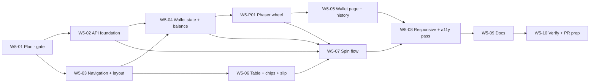

# Week 5 Plan — Roulette and Wallet Frontend

- **Status:** Revision 10. **W5-01 reviewed 2026-11-24: architecture approved; Q1–Q12 approved with
  refinements (§14). W5-02 API foundation approved 2026-11-24 (§7.8). W5-03 navigation, `PlayerOnly`
  and player lobby approved 2026-11-24 (§4.4). First checkpoint (W5-01 to W5-03, `bb9e532`) approved
  and pushed. W5-04 wallet state and balance UI approved 2026-11-24 (§9.4) and pushed (`75d42da`).
  Q13 approved: Phaser starts in Week 5. W5-P01 Phaser integration foundation approved 2026-11-24
  (§3.4) and pushed (`acabd75`). W5-05 wallet transaction history approved 2026-11-25 (§6.3) and
  pushed (`929a6c0`). W5-06 table, chips and bet slip approved 2026-11-25 (§5.9) and committed to the
  feature branch.** Playwright W2-16 regression still pending (no JDK in this environment).
- **Stage:** 3 — Casino user interface (Weeks 5–6)
- **Source:** Implementation plan v1.1 (`docs/OnlineCasinoSimulator_ImplementationPlan_v1.1.pdf`,
  editable source `docs/sources/OnlineCasinoSimulator_ImplementationPlan_v1.1.html`), §4 Week 5; §3.1
  (frontend components), §3.3 (the frontend only sends user actions and renders server-confirmed
  results), §7 (acceptance: "the main features work on a computer and on a mobile device"), §10 risk 5
  (transparent probabilities, user safety); user scenario S3 (`docs/user-scenarios.md`)
- **Architecture:** server-authoritative game logic and wallet
  ([ADR-0003](../decisions/0003-server-authoritative-game-logic.md)), design-first API
  ([ADR-0004](../decisions/0004-design-first-api.md)), session cookies and CSRF unchanged
  ([ADR-0006](../decisions/0006-session-authentication-security.md)), technology baseline
  ([ADR-0002](../decisions/0002-technology-baseline.md))
- **Expected result (plan, Stage 3):** a working roulette with a user interface connected to the
  backend. Week 5 delivers the interface and — since the approved change Q13 — the Phaser wheel:
  W5-P01 draws it, W5-07 turns it to the server-confirmed number. Week 6 refines the animation and adds
  round history, statistics, sound and the in-app reduced-motion setting.
- **Branch:** `feature/week-05-roulette-ui` (from `main` at `94a7305`; pushed to `origin` at the first
  checkpoint `bb9e532`; no pull request, not merged)

| Revision | Date | Change |
|---|---|---|
| 1 | 2026-11-24 | Initial plan (W5-01); Week 4 merge status recorded in the project documentation |
| 2 | 2026-11-24 | W5-01 review applied: Q1–Q12 approved with refinements (§14) — total-stake limit 10,000 (§5.5), pending spins in `sessionStorage` bound to the user (§8.4), odds and rules required (§5.8), V7-backend verification before the merge (§7.7, §16.2); W5-02 implemented (§7.8) |
| 3 | 2026-11-24 | W5-02 approved; W5-03 implemented: `nav "Main"`, `PlayerOnly`, routes `/roulette` and `/wallet` with progress placeholders, player lobby, skip link, `cardStyles`, `PageHeader` (§4.4); W5-03 approved; first checkpoint (W5-01 to W5-03 committed) |
| 4 | 2026-11-24 | First checkpoint approved and pushed (`bb9e532`); W5-04 implemented: `WalletProvider`, `useWallet`, `BalanceBadge`, `BalanceCard`, `Coins`; balance in the header, lobby, roulette and wallet pages (§9.4); W5-04 approved after one test correction (the session-expiry probe uses the implemented `GET /api/v1/wallet/transactions`) |
| 5 | 2026-11-24 | W5-04 committed and pushed (`75d42da`); Q13 approved (Phaser in Week 5); new task W5-P01 between W5-04 and W5-05 (§3.4, §12, §13); Phaser statements reconciled (§2, §3, §5.1, §10.2); the obsolete "start over" of §9.3 removed (Q6); W5-P01 implemented; pre-approval lifecycle review with five fixes and browser verification (§3.4) |
| 6 | 2026-11-24 | W5-P01 approved; checkpoint review before the commit: `WheelPhaserGame` gives `window.onblur`/`onfocus` back their previous values instead of clearing them and leaves no own `addEventListener` property on `document` (§3.4); W5-P01 committed and pushed to the feature branch |
| 7 | 2026-11-24 | W5-P01 checkpoint recorded (`acabd75`); W5-05 implemented: `walletFormat`, `useWalletTransactions`, `TransactionHistory`, wallet page with history, lobby wallet card updated (§6.3) |
| 8 | 2026-11-25 | W5-05 approved; checkpoint review before the commit: a test for a cursor the server rejects (`400`) and the recovery through "Refresh history"; the `MainNav` and `WalletProvider` test backends answer the wallet page's first history page (§6.3); W5-05 committed and pushed to the feature branch |
| 9 | 2026-11-25 | W5-05 checkpoint recorded (`929a6c0`); W5-06 implemented: `rouletteTable`, `betSlipReducer` (renamed from `betSlip.ts`, see §5.9), `ChipSelector`, `RouletteBoard`, `BetSlip`, `BetSummaryBar`, roulette page with table, wheel, balance and slip; lobby roulette card updated (§5.9) |
| 10 | 2026-11-25 | W5-06 approved; checkpoint review before the commit: AC-W5-06.1 to 06.7 re-checked; the disabled cells and "Review bets" (slip and summary bar) refuse activation in their event handlers, not only through `aria-disabled` (proven by the mutations of §5.9); W5-06 committed and pushed to the feature branch |

---

## 0. Current state vs. this plan

### 0.1 Repository

**On `main` (`94a7305`, after Week 4, PR #10):**
- Backend Weeks 1–4: authentication, profile, wallet with immutable ledger, European roulette engine.
  Flyway V1–V9; contract `openapi.yaml` **0.5.0** with no `planned` operation.
- The endpoints Week 5 needs exist and are tested: `GET /api/v1/wallet`,
  `GET /api/v1/wallet/transactions`, `POST /api/v1/games/roulette/spins` (`docs/api.md`).
- Frontend: Weeks 1–2 only (home, sign-in, registration, profile, platform status). It calls no wallet
  or roulette endpoint, and `frontend/src/types/` has no wallet or roulette types yet (deferred to
  "Week 5, with the first caller": `week-03.md` Q12, `week-04.md` §1.2).
- Baseline on the new branch (2026-11-24, Node 24.15.0): `npm run lint` clean, `npm run typecheck`
  clean, `npm test` **15 files, 132 tests passed**.

### 0.2 Deployment (unchanged by Week 5)

| Component | State | Consequence for Week 5 |
|---|---|---|
| Vercel (frontend) | Deploys `main` **automatically**; Week 4 changed no frontend file | A future Week 5 merge reaches the staging frontend immediately (§7.7, Q10) |
| Render (backend) | The **Week 3 build** (manual deploy 2026-11-15), Auto-Deploy Off | Staging has the wallet endpoints but **no roulette endpoint** |
| Neon `staging` | Schema **V7** | V8/V9 only through the separately approved Week 4 rollout (Q15 of `week-04.md`) |

Week 5 development uses only the local Spring Boot backend and the local PostgreSQL database at V9.
Nothing in Week 5 connects to Neon, Render or Vercel, runs `infrastructure/roulette-rollout.md`, or
changes cloud configuration (§16).

### 0.3 Documentation corrected in W5-01 (status only)

The Week 4 merge (PR #10) was not yet reflected everywhere. Corrected on this branch, distinguishing
"merged into `main`" from "deployed": `README.md` (status table, Week 4 section, staging paragraph,
architecture sketch, layout, local start, testing, configuration, milestones, documentation list),
`docs/architecture.md` (module table, game module status, deployment view), `docs/api.md` (access
table, schema version, spin status, contract history), `docs/database.md` (where each version is
applied), `infrastructure/README.md`, `infrastructure/render/README.md`,
`infrastructure/roulette-rollout.md` (status: only the merge precondition P1/A2 has happened),
`docs/plans/week-04.md` (revision 11, status only). Historical records (implementation tables,
rollout records) are unchanged.

---

## 1. Current implementation and reusable frontend infrastructure

### 1.1 Stack

React 19, TypeScript 6, Vite 8, React Router 8 (declarative `BrowserRouter`), Tailwind CSS 4 (Vite
plugin, no config file), Vitest 5 + React Testing Library + user-event, Playwright (local acceptance
tests, `frontend/e2e`). Runtime dependencies: `react`, `react-dom`, `react-router` only. CI runs
lint → typecheck → test → build.

### 1.2 What Week 5 reuses

| Existing | File | Used for |
|---|---|---|
| `apiClient` (`apiGet`, `apiPost`, `ApiError` with `code`, `problem`, `isUnavailable`, `isNetworkError`) | `services/apiClient.ts` | Every wallet and roulette call; error classification decides on `code` only |
| CSRF handling (`ensureCsrfToken`, one retry on `403 CSRF_TOKEN_INVALID`) | `services/apiClient.ts`, `services/csrf.ts` | The spin request (unsafe method); unchanged |
| Session-expiry listener (`onSessionExpired`, session generation guard) | `services/apiClient.ts`, `features/auth/AuthProvider.tsx` | `401 SESSION_EXPIRED` during a spin or a wallet read leads to the login page with `returnTo`, as today |
| `AuthProvider` / `useAuth` (`AuthState`: `checking`, `authenticated`, `anonymous`, `unknown`; `user.role`) | `features/auth/` | Gate for the wallet state; role for player-only navigation |
| `RequireAuth` layout route | `features/auth/RequireAuth.tsx` | Protects `/roulette` and `/wallet` exactly like `/profile` |
| `AppLayout` (header, `nav aria-label="Account"`, footer disclaimer, "Virtual currency only" badge) | `components/layout/AppLayout.tsx` | Extended with the main navigation and the balance badge; the `Account` navigation stays (W2-16 e2e selectors) |
| Button styles (`primaryButton`, `secondaryButton`, `ghostButton`) | `components/buttonStyles.ts` | All new buttons |
| `FormAlert` (`role="alert"` for errors, `role="status"` otherwise) | `components/form/FormAlert.tsx` | Spin and wallet errors, notices |
| `DetailRow` | `components/DetailRow.tsx` | Balance details |
| Loading/error/retry hook pattern (`useSystemStatus`, `useInterests`: discriminated union + `AbortController` + request counter) | `features/system-status/`, `features/profile/` | `useWalletTransactions`, wallet loading |
| Error-message pattern (`describeAuthFailure`, `serverFieldErrors`) | `features/auth/authErrors.ts` | `spinErrors.ts` maps codes to messages the same way |
| Date formatting (`Intl.DateTimeFormat('en-GB')`) | `features/auth/profileFormat.ts` | Same locale for wallet timestamps |
| Test helpers (`stubApi`, `csrfEndpoint`, `jsonResponse`, `problemResponse`, `signedIn`, `noSession`, `renderApp`, fixtures) | `src/test/` | All new component and service tests; `stubApi` records headers, so the `Idempotency-Key` is assertable |
| Reduced-motion CSS (`prefers-reduced-motion`) | `index.css` | Applies to every Week 5 transition |
| W2-16 Playwright stack (isolated PostgreSQL, backend jar, Vite) | `frontend/e2e/` | Optional local W5 scenario and the regression run (W5-10) |

### 1.3 Gaps Week 5 must close

| Gap | Resolution |
|---|---|
| `apiClient` cannot send custom headers (needed for `Idempotency-Key`) | Add `headers` to `RequestOptions` (W5-02). The CSRF retry reuses the same options, so a retry carries the same key |
| No wallet or roulette types / services | `types/wallet.ts`, `types/roulette.ts`, `services/walletApi.ts`, `services/rouletteApi.ts` (W5-02) |
| The card class is repeated in four components | `components/cardStyles.ts` (W5-03), used by new components; existing ones may adopt it without visual change |
| No main navigation (only the account menu) | `components/layout/MainNav.tsx` (W5-03) |
| No role-aware page guard (admins have no wallet) | `features/auth/PlayerOnly.tsx` layout route (W5-03) |
| Vercel CSP: `style-src 'self'`, `font-src 'self'`, `img-src 'self' data:` | Tailwind classes only, no external fonts or images, no inline `<style>`; static class names (Tailwind v4 scans literal strings, so no `col-start-${n}`) |

---

## 2. Week 5 objectives and explicit exclusions

### 2.1 Plan tasks → deliverables

| # | Plan task (Week 5) | Deliverable | Task |
|---|---|---|---|
| 1 | Home page and casino navigation (routing exists since Week 2) | Main navigation (Lobby, Roulette, Wallet), lobby home page for players, routes `/roulette`, `/wallet` | W5-03 |
| 2 | Roulette interface | European table layout with exactly the five supported categories (§5) | W5-06 |
| 3 | Virtual chips and bet selection | Chip selector, bet placement, bet slip with limits and total stake | W5-06 |
| 4 | Show the available virtual balance | Shared wallet state; balance in the header, lobby, roulette page and wallet page | W5-04 |
| 5 | Bet confirmation interface | Review → confirm step before every spin (§5.6) | W5-07 |
| 6 | Connect roulette actions to the backend API | `POST /api/v1/games/roulette/spins` with CSRF and `Idempotency-Key` (§7, §8) | W5-02, W5-07 |
| 7 | Show wins and losses | Result panel with the server's number, colour, payouts, totals and balance (§5.7) | W5-07 |
| 8 | Handle API errors and interrupted connections | Error classification, retry with the same key, replay, session expiry (§7) | W5-07 |
| — | README / project request: wallet transaction history | Wallet page with keyset-paginated history (§6); **approved (Q1)**; roulette *round* history stays in Week 6 | W5-05 |
| — | Plan §7: works on computer and mobile | Responsive layout and accessibility (§10) | W5-08 (and every task) |
| — | Approved change Q13 (plan v1.1 lists Phaser in Week 6) | Phaser wheel on `/roulette` (W5-P01), turned to the server's number by the spin flow (W5-07); refinement stays in Week 6 | W5-P01, W5-07 |

### 2.2 Out of scope (Week 5)

| Item | Where it belongs |
|---|---|
| Refinement of the wheel animation (ball, physics-like easing, polish), sound, in-app reduced-motion setting, `user_preferences` | Week 6 (Phaser itself starts in W5-P01, Q13) |
| Round history (`GET /api/v1/games/roulette/history`), statistics panel | Week 6 |
| Dashboard, house-edge statistics per player, play limits, breaks, self-exclusion | Week 9 |
| Admin UI | Week 10 |
| Any backend, contract or Flyway change | Not needed: Week 5 uses the existing 0.5.0 contract |
| Column bets ("2 to 1"), splits, streets, corners, six-lines, call bets | Not in the approved plan (Week 4 Q1); the table shows no such cells |
| Autoplay, "repeat bet"/"rebet", streaks, bonuses, timers, countdowns, urgency messages, "hot/cold numbers", near-miss effects, celebratory effects that differ from the neutral result display, leaderboards | Never (plan §1.4, `week-04.md` §1.2, responsible play) |
| Client-side random numbers or payout calculation | Never (ADR-0003) |
| New runtime or UI dependencies (component kits, state libraries, data-fetching libraries) | Not needed (Q11) |
| Deployment, staging rollout, cloud configuration | Separate, approval-gated (§16) |

### 2.3 Priorities

Everything is **Must** unless marked **Should**. Should items may move to Week 6 without blocking it.

---

## 3. Proposed React component architecture

### 3.1 Inherited decisions (approved earlier)

| # | Decision | Source |
|---|---|---|
| A1 | The backend alone draws the number, computes payouts and changes balances; the frontend sends bets and renders server-confirmed results | ADR-0003 §1–2, plan §3.3 |
| A2 | Session cookie (`HttpOnly`), CSRF double-submit through `apiClient`; nothing about the session in browser storage | ADR-0006, `architecture.md` §4 |
| A3 | `RequireAuth` shapes the interface only; the backend checks session and role on every request | W2-13 |
| A4 | One `Idempotency-Key` (canonical UUID) per spin attempt, reused for its retries; a new spin uses a new key | `api.md` (roulette spin), Week 4 Q3/Q18 |
| A5 | Exactly five bet categories; 1–10 bets per spin, 1–1,000 coins per bet, each selection at most once | Week 4 Q1, Q2 |
| A6 | Clients decide on the Problem Details `code`, never on `title`/`detail`; unknown ledger types are generic entries using the sign of `amount` | `api.md` conventions, contract 0.4.0 |
| A7 | Frontend types mirror the contract and are added with their first caller | `api.md` workflow step 4, `week-03.md` Q12 |
| A8 | Feature slices: `features/<slice>/` holds hooks and components of one use case; `services/` is the only place that calls `fetch` | `architecture.md` §4 |

### 3.2 Structure (new and changed files)

```
frontend/src
├── components/
│   ├── cardStyles.ts               NEW   shared card class (today repeated in 4 components)
│   ├── Coins.tsx                   NEW   formatted coin amount ("1,330 coins", optional +/− sign)
│   └── layout/
│       ├── AppLayout.tsx           CHANGED  MainNav + BalanceBadge; wider content (max-w-6xl)
│       ├── MainNav.tsx             NEW   Lobby · Roulette · Wallet (players), aria-current
│       └── PageHeader.tsx          NEW   h1 + short description, used by the new pages
├── features/
│   ├── auth/PlayerOnly.tsx         NEW   layout route: players only, notice for administrators
│   ├── wallet/
│   │   ├── walletContext.ts        NEW   WalletState type and context
│   │   ├── WalletProvider.tsx      NEW   balance of the signed-in player; refresh; confirmed balance
│   │   ├── useWallet.ts            NEW
│   │   ├── BalanceBadge.tsx        NEW   header balance, link to /wallet
│   │   ├── BalanceCard.tsx         NEW   balance + "updated at" (lobby, wallet page)
│   │   ├── useWalletTransactions.ts NEW  first page, "load older", refresh (keyset cursor)
│   │   ├── TransactionHistory.tsx  NEW   table/list of ledger entries
│   │   └── walletFormat.ts         NEW   entry type labels, coin and timestamp formatting
│   └── roulette/
│       ├── rouletteTable.ts        NEW   static table model: cells, labels, display colours, odds text
│       ├── betSlipReducer.ts       NEW   pure reducer + selectors + toSpinRequest (client limits; §5.9)
│       ├── useSpin.ts              NEW   spin attempt state machine (idempotency key lifecycle)
│       ├── spinErrors.ts           NEW   error classification (definitive / uncertain) + messages
│       ├── pendingSpinStore.ts     NEW   (W5-07, Q6) sessionStorage record of an unresolved spin, per user
│       ├── RouletteBoard.tsx       NEW   the table (buttons)
│       ├── ChipSelector.tsx        NEW   chip values (radio group)
│       ├── BetSlip.tsx             NEW   selected bets, remove, clear, total stake, review
│       ├── BetSummaryBar.tsx       NEW   (W5-06) sticky "n bets · total · Review bets" below md
│       ├── SpinConfirmation.tsx    NEW   inline confirm step
│       ├── SpinResult.tsx          NEW   server result: number, colour, per-bet outcome, totals
│       └── OddsInfo.tsx            NEW   (Q8) categories, zero, probability, payout, house edge
├── pages/
│   ├── HomePage.tsx                CHANGED  lobby for players; current content for visitors
│   ├── RoulettePage.tsx            NEW   /roulette
│   └── WalletPage.tsx              NEW   /wallet
├── services/
│   ├── apiClient.ts                CHANGED  RequestOptions.headers
│   ├── idempotency.ts              NEW   newIdempotencyKey(): crypto.randomUUID with a getRandomValues fallback
│   ├── walletApi.ts                NEW   getWallet, listWalletTransactions
│   └── rouletteApi.ts              NEW   spinRoulette(request, idempotencyKey)
├── types/
│   ├── wallet.ts                   NEW   Wallet, WalletTransaction, WalletTransactionType, WalletTransactionPage
│   └── roulette.ts                 NEW   RouletteSpinRequest, RouletteBet, categories/options, RouletteSpinResult, RouletteSettledBet
└── App.tsx                         CHANGED  routes /roulette, /wallet; WalletProvider
```

`games/roulette/` holds the Phaser wheel since W5-P01 (Q13, §3.4): `wheelConfig.ts`,
`canvasSupport.ts`, `RouletteScene.ts`, `createWheelGame.ts`; the React side is
`features/roulette/RouletteWheel.tsx` with `rouletteNumbers.ts` and `usePrefersReducedMotion.ts`.

### 3.3 Layering rules

1. **Pages** compose feature components and read hooks; no `fetch`, no business rules.
2. **Feature components** are presentational where possible (props in, callbacks out); state lives
   in hooks (`useSpin`, `useWalletTransactions`) and in the two providers (`AuthProvider`,
   `WalletProvider`).
3. **Pure modules** (`betSlip.ts`, `rouletteTable.ts`, `spinErrors.ts`, `walletFormat.ts`) have no
   React and no I/O, so they are unit-tested directly.
4. **Services** are the only callers of `apiClient`; they take and return contract types.
5. **Wheel seam:** `SpinResult` is a separate component that receives a `RouletteSpinResult`. W5-07
   first calls the wheel's handle (`RouletteWheel` → `spinTo(winningNumber)`, W5-P01) and then reveals
   the result; Week 6 refines the animation without changing `useSpin` or the API layer.
6. **React and Phaser:** React owns state, wallet data and API calls; Phaser (only in `games/`) owns the
   drawing and the animation and never decides a number or a payout (§3.4).

### 3.4 Phaser integration (W5-P01; approved 2026-11-24)

**Version and evaluation.** `phaser@4.2.1`, the current `latest` on npm (published 2026-07-09, MIT),
pinned exactly like the official Phaser + React + TypeScript + Vite template pins its Phaser version.
Evidence: npm metadata (ESM build `dist/phaser.esm.js` with named exports, bundled type declarations,
no peer dependencies, one runtime dependency `eventemitter3`); the official template
(`phaserjs/template-react-ts`) uses Phaser 4 with React 19 and creates/destroys the game in an effect
with `game.destroy(true)` under `React.StrictMode`; the release notes of 4.1.0 (ESM default export
fixed) and 4.2.1 (ScaleManager resizing to the parent fixed). The template still uses Vite 6 and
TypeScript 5.7, so compatibility with **Vite 8 and TypeScript 6** was verified here: `tsc -b`, ESLint,
Vitest and `vite build` are green with the package's own types. `docs.phaser.io` could not be read
(HTTP 403); the Phaser 4 API used (renderer `AUTO` with Canvas fallback, `Scale.RESIZE`, `banner`,
`audio.noAudio`, `autoFocus`, `input`, `Graphics.slice`, `tweens.add`/`killTweensOf`,
`Game.destroy(removeCanvas)`) was checked in the installed `types/phaser.d.ts`. `npm audit`: 0 runtime
vulnerabilities (9 moderate pre-existing findings in ESLint's `minimatch`, dev only, unrelated).

**Architecture**

```
RoulettePage (React)
└─ RouletteWheel  features/roulette        React: lifecycle, accessibility, reduced motion, ref handle
     │  canRenderWheel()  (2D canvas?)  no → notice, description stays; Phaser is not downloaded
     │  loadWheelModule() → dynamic import()   (one shared request; Phaser chunk only on /roulette)
     ▼
   createWheelGame  games/roulette           the only module that imports Phaser
     ├─ canRenderWheel() again (defence)    else WheelUnavailableError
     └─ new WheelPhaserGame({ type: AUTO, parent, transparent, banner: false, autoFocus: false,
                   input: { keyboard/mouse/touch/gamepad/windowEvents: false },
                   audio: { noAudio: true }, scale: { mode: Scale.RESIZE } })
          ├─ removes on destroy what Phaser's VisibilityHandler leaves on document/window
          └─ RouletteScene   draws the wheel once (pointer between two pockets), scales it on
                             resize; spinTo(n) only on request
   wheelConfig (pure)  order, colours, radii, NEUTRAL_ROTATION, restingRotation(n), spinTargetRotation
```

- **Ownership:** React owns state, wallet data and API calls; Phaser draws and animates. The scene has
  no input, no timer, no idle motion and no random source; `spinTo` accepts only 0–36 from its caller
  and computes the end angle deterministically (5 turns, ease-out, 4.5 s).
- **Lifecycle:** one game per mounted component. StrictMode's trial mount is cancelled before the
  chunk arrives (`mounted` flag) and both mounts share one import, so only one game is created; a
  `then` callback is always asynchronous, so even a cached chunk cannot reach a cancelled mount. The
  cleanup calls `destroy()`, which removes the global handlers at once and calls
  `game.destroy(true)`. **Phaser's destroy is asynchronous:** it only sets `pendingDestroy`; the next
  frame of its loop destroys the scenes, the renderer, the canvas and the loop (`runDestroy`). A game
  destroyed before it started still starts its loop once to run that destroy. Every remount creates a
  new host element, so a game still finishing its destroy never shares a host with the new one. The
  scene releases its resize listener and settles a running `spinTo` on `DESTROY` (game destroy) and on
  `SHUTDOWN` (scene stop); the TweenManager removes its own tweens. After `destroy()`, `spinTo` rejects
  ("The wheel is not shown."), also one that was still waiting for the wheel to be drawn.
- **Accessibility:** the canvas host is `aria-hidden`; a `figure` with a caption and a `details` list
  ("Pockets clockwise from zero", each number with its colour in text) describes the wheel. Phaser's
  `autoFocus` is off, so the page keeps the keyboard focus.
- **Reduced motion:** `usePrefersReducedMotion` (`useSyncExternalStore` on the media query) passes the
  preference at creation and on change; under reduced motion `spinTo` jumps to the pocket and a
  running spin ends at once.
- **Fallback:** no 2D canvas (checked before the chunk is loaded, without creating a WebGL context), a
  failing chunk or a throwing game → "The wheel picture cannot be shown in this browser", description
  kept; a failed chunk load is not cached, so a later visit retries. A renderer that cannot be created
  throws synchronously from `new Game` (Phaser boots synchronously in a loaded page) and takes the same
  path; without WebGL, `AUTO` uses the Canvas renderer.
- **No result before the server's:** at rest the pointer sits on the separator between 0 and 26
  (`NEUTRAL_ROTATION`), so the wheel never shows a number as if it had been drawn.
- **Week 5 / Week 6 split:** W5-07 calls `RouletteWheel`'s handle `spinTo(result.winningNumber)` after a
  confirmed spin; Week 6 refines the animation (e.g. ball, polish) and adds sound and the in-app
  reduced-motion setting.

**Files**

| File | Change |
|---|---|
| `package.json`, `package-lock.json` | `"phaser": "4.2.1"` (exact) and its dependency `eventemitter3` 5.0.4 |
| `features/roulette/rouletteNumbers.ts` (new) | `EUROPEAN_WHEEL_ORDER` (frozen), `RED_NUMBERS` (contract list), `numberColor()`; display only, shared with the table of W5-06 |
| `games/roulette/wheelConfig.ts` (new) | Pocket geometry, colours of the dark theme, radii, `NEUTRAL_ROTATION`, `pocketIndex`, `pockets`, `restingRotation`, `spinTargetRotation` |
| `games/roulette/canvasSupport.ts` (new) | `canRenderWheel()` (2D context only; no Phaser import, so the component can call it first) |
| `games/roulette/RouletteScene.ts` (new) | Rim, 37 slices, separators, accent rings, hub with spokes and cap, upright numerals (system font, no assets), fixed amber pointer; neutral rest; `spinTo`, `setReducedMotion`, resize, `DESTROY`/`SHUTDOWN` handling |
| `games/roulette/createWheelGame.ts` (new) | Game configuration (all input managers off), `WheelPhaserGame` (cleans up Phaser's `VisibilityHandler`), `WheelGame` handle (`ready`, `spinTo`, `setReducedMotion`, idempotent `destroy`), `WheelUnavailableError` |
| `features/roulette/usePrefersReducedMotion.ts` (new) | The OS preference, live |
| `features/roulette/RouletteWheel.tsx` (new) | The component (above); `RouletteWheelHandle` via React 19 `ref` prop |
| `pages/RoulettePage.tsx` | "The wheel" card next to the balance and the unchanged progress card ("You cannot place bets yet…"); note "The wheel stands still. It will turn only to show a number drawn by the server." |
| `test/fakeWheelGame.ts` (new), `test/setup.ts` | jsdom has no canvas/WebGL: every test gets a recording fake of `createWheelGame` and a controllable `canRenderWheel` (`vi.mock` in the setup file), so Phaser is never loaded in unit tests; the real modules are tested through `vi.importActual` |

**Tests** (30 files, 325 tests; after W5-04: 24 files, 246 tests):

| File | New tests | Covers |
|---|---|---|
| `features/roulette/rouletteNumbers.test.ts` | 8 | 37 unique pockets 0–36; exact European order; 1 green, 18 red (contract list), 18 black; red/black alternate after zero; invalid numbers rejected |
| `games/roulette/wheelConfig.test.ts` | 42 | Pocket geometry and order; every number 0–36 rests under the pointer; the neutral rest marks no number; spins go clockwise ≥ 5 turns and stop on the requested number; deterministic, `Math.random` never called; invalid numbers rejected |
| `games/roulette/canvasSupport.test.ts` | 3 | 2D context → true without asking for WebGL; null/undefined context or throwing canvas → false |
| `games/roulette/createWheelGame.test.ts` | 13 | The real wrapper with a Phaser stand-in: configuration (all input managers off, no audio, banner or focus, `Scale.RESIZE`); no game without canvas; `spinTo` validates at once and waits for the drawn wheel; destroy once, refuses spins afterwards, settles a spin waiting for a wheel destroyed before it was drawn; reduced motion before drawing; Phaser's `visibilitychange` listener and blur/focus handlers removed on destroy, also for a game destroyed before it started; other `visibilitychange` listeners kept; blur/focus handlers assigned before Phaser restored and ones assigned later kept; `document.addEventListener` restored exactly (no own property left, a patched one kept) |
| `features/roulette/RouletteWheel.test.tsx` | 11 | One game in the `aria-hidden` host; destroyed once on unmount; one game under StrictMode; no game when unmounted before the chunk arrives; destroyed when leaving `/roulette`, one new game on return; caption and the 37 listed pockets with colours, no button; fallback notice with description; no canvas → notice without creating a game; reduced motion at creation and on change (listener removed on unmount); `spinTo` handle forwards and rejects after unmount; source scan: no random source in roulette/game code |
| `features/roulette/RouletteWheel.loadFailure.test.tsx` | 1 | A rejected dynamic import shows the notice and the description; a later mount loads the chunk again |
| `types/contract.test.ts` | 1 | The red numbers equal the contract's `RouletteBetColor` list (the drift test's red-number check, planned for W5-06, added here with the first use) |

**Found while testing:** under StrictMode no game was created: in Vitest the second concurrent
`import()` of the (mocked) module never resolved, so only the cancelled trial mount's callback ran.
The component now loads the module once per page (`loadWheelModule`), which is also the better design
(one request); the StrictMode test passes.

**Lifecycle review before approval (2026-11-24).** The installed Phaser 4.2.1 sources and real Chrome
measurements (Vite dev server, React StrictMode active; DevTools protocol for event listeners; API
mocked in the browser) found five issues, all fixed in W5-P01:

| Finding (evidence) | Fix | Verified by |
|---|---|---|
| `Game.destroy()` emits `DESTROY` to scenes, not `SHUTDOWN` (`Systems#destroy`); the scene only handled `SHUTDOWN`, so a spin running when the game was destroyed never settled (measured: "still pending after 1 s") | Release on `DESTROY` and `SHUTDOWN`; `spinTo` rejects after `destroy()` and when it was waiting for a wheel destroyed before it was drawn | Chrome probe: settles; `createWheelGame.test.ts` |
| Phaser's `VisibilityHandler` (`Game#start`) adds a `document` `visibilitychange` listener and assigns `window.onblur`/`onfocus`, never removed: **16 listeners after 16 visits** of `/roulette` | `WheelPhaserGame` records what `start` adds and removes it on `destroy` (also when `start` runs after an early destroy); Phaser is not modified | Chrome: 0 after 16 rapid visits, `onblur` cleared; `createWheelGame.test.ts` |
| `input: false` does not disable Phaser's input: `Config` reads `input.mouse` etc. with a default of `true`, and the mouse manager's `preventDefault` on `wheel` **blocked page scrolling over the canvas (0 px instead of 250 px)** | Every input manager switched off explicitly | Chrome: page scrolls over the wheel; no `wheel`/`keydown`/`mousedown` listener from the game |
| Without canvas, importing Phaser throws an uncaught `TypeError` in its own feature detection (`CanvasFeatures`, `yellow.onload`) | `canRenderWheel` runs before the chunk is loaded; without canvas Phaser is never downloaded | Chrome with `getContext` → `null`: no error, no chunk request, notice + 37 listed pockets |
| At rest the pointer marked 0, which could read as a drawn result | `NEUTRAL_ROTATION`: the pointer sits on the separator between 0 and 26 | Screenshot; `wheelConfig.test.ts` |

Also confirmed from the sources: a renderer that cannot be created throws from `new Game` (synchronous
boot); `ScaleManager` removes its window/document listeners on destroy; no `ResizeObserver` is used;
the WebGL context is not lost explicitly, but no "too many WebGL contexts" warning appeared after about
20 created games (no change made). In the measurements, everything returned to the lobby baseline
(0 canvases, 0 Phaser listeners) after rapid navigation, including visits left before the chunk arrived.

**Checkpoint review (2026-11-24, before the commit).** The approval asked to confirm that the cleanup
removes only its own listeners and restores global handlers without overwriting other code's changes.
Two gaps were found and fixed: `removeGlobalHandlers` set `window.onblur`/`onfocus` to `null`, which
dropped a handler the page had before Phaser overwrote it; and replacing `document.addEventListener`
during `start` left an own property on `document` that shadowed the inherited method (and any later
patch of `EventTarget.prototype`). `WheelPhaserGame` now records the previous values and puts them back
only while the handlers are still this game's, and deletes the temporary property unless `document`
had its own one, which it then restores. The visibility listener is removed by the exact arguments
Phaser's `start` passed, so other listeners stay. Three tests were added (two fail with the previous
code); the production browser check below was repeated with the same results.

**Browser verification (2026-11-24, local only; final).** The production build (`vite preview`) with the
Vercel Content-Security-Policy header in the installed Google Chrome through Playwright, API mocked in
the browser (a player with 1,000 coins; no backend, no cloud):

| Check | Result |
|---|---|
| Chunk | Not requested on the lobby; requested once per session when `/roulette` opens; not requested without canvas |
| Rapid navigation (12 round trips, a third without waiting for the wheel) | Lobby: 0 canvases, 0 `visibilitychange`/`resize`, `onblur` cleared; back on `/roulette`: exactly 1 canvas |
| Scrolling over the wheel (1280 × 600) | Page scrolls (283 → 368 px, the end of the page) |
| Responsive sizing, horizontal overflow | 320 / 375 / 768 / 1024 / 1280 px: canvas 238 / 293 / 384 / 384 / 384 px, inside the viewport, 0 px overflow |
| WebGL disabled (`--disable-webgl --disable-3d-apis`) | WebGL unavailable; the Canvas renderer draws the same wheel |
| No canvas (`getContext` → `null`) | Notice, 37 listed pockets, no error, no chunk |
| Reduced motion (emulated) | The media query matches; the wheel is drawn and stands still |
| Result claims | No "won"/"winning number"/"result" text; the pointer marks no number |
| Console | No errors, no warnings, no CSP violations |

The real scene with deterministic input (dev server, `createWheelGame` called directly, as W5-07 will):
`spinTo(17)` takes about 4.5 s with full motion and 1–2 ms with reduced motion, and both rest on 17;
`spinTo(37)` is a `RangeError`; the canvas is removed one frame after `destroy()`. The component's
reduced-motion wiring is covered by unit tests; no page calls `spinTo` before W5-07. Playwright W2-16 is
still pending (no JDK).

**Remaining risks:** the Phaser chunk is 1.37 MB (359 kB gzip; Vite's 500 kB warning, accepted for a
lazy chunk that only `/roulette` loads); the `VisibilityHandler` cleanup depends on Phaser 4.2.1
internals (`Game#start`), so a Phaser upgrade must re-run the listener check; in a 375 px header the
balance badge takes its own row (W5-08); no automated visual regression test; one `window`
`mousedown` listener appeared in the production run after Playwright's clicks and did not grow with
further visits (0 in a dedicated dev-server check; the game registers no input listeners).

---

## 4. Page and navigation structure

### 4.1 Routes

| Path | Guard | Page | Content |
|---|---|---|---|
| `/` | — | `HomePage` | Visitors: unchanged hero, account panel, platform status. Signed-in players: **lobby** (balance card, "European roulette" card with house edge and a "Play" link, "Wallet" card, account panel); platform status kept at the bottom |
| `/roulette` | `RequireAuth` → `PlayerOnly` | `RoulettePage` | Chips, table, bet slip, confirmation, result |
| `/wallet` | `RequireAuth` → `PlayerOnly` | `WalletPage` | Balance card, transaction history |
| `/profile` | `RequireAuth` | `ProfilePage` | Unchanged |
| `/login`, `/register`, `*` | — | unchanged | — |

```tsx
<Route element={<RequireAuth />}>
  <Route path="/profile" element={<ProfilePage />} />
  <Route element={<PlayerOnly />}>
    <Route path="/roulette" element={<RoulettePage />} />
    <Route path="/wallet" element={<WalletPage />} />
  </Route>
</Route>
```

`vercel.json` needs no change: its SPA fallback already serves `index.html` for every path outside
`/api` and `/assets` (`vercelConfig.test.ts` gets cases for the two new paths).

### 4.2 Header and navigation

```
┌─────────────────────────────────────────────────────────────────────────────────────┐
│ ◆ Online Casino Simulator  [Virtual currency only]        [◎ 1,330 coins] [Alice ▾] │
│ Lobby · Roulette · Wallet                                                           │
└─────────────────────────────────────────────────────────────────────────────────────┘
```

- `nav aria-label="Main"` (new) with `NavLink`s; `aria-current="page"` styling as in `UserMenu`.
  Shown only for an authenticated `PLAYER`. Visitors see the current header; administrators see no
  Roulette/Wallet links (Q9).
- `nav aria-label="Account"` (existing `UserMenu`) is unchanged, so the W2-16 Playwright selectors
  keep working. "My profile" stays there.
- `BalanceBadge` (players only): the current balance with the word "coins" (no currency symbol, so
  nothing looks like real money), a link to `/wallet`; "…" while loading; "Balance unavailable" with
  no number after a failed load.
- **Mobile (< 640 px):** row 1 brand + account; row 2 main navigation as three equal-width links and
  the balance badge. No hamburger menu: three links fit, and nothing is hidden behind a toggle.
- A "Skip to main content" link as the first focusable element (**Should**).

### 4.3 `PlayerOnly`

A layout route inside `RequireAuth`. For `user.role === 'PLAYER'` it renders `<Outlet />`; for
`ADMIN` a card: "Roulette and the wallet are for player accounts. Administrator accounts have no
wallet." with a link to the home page. Interface only: the backend answers `403 ACCESS_DENIED` to an
administrator anyway.

### 4.4 Implemented in W5-03 (approved 2026-11-24)

**Files**

| File | Change |
|---|---|
| `features/auth/PlayerOnly.tsx` (new) | Layout route nested in `RequireAuth`. `authenticated` + `PLAYER` → `<Outlet />`; `authenticated` + `ADMIN` → card "For player accounts only" (`section` labelled by its `h1`, explanation, link "Back to the home page"); any other state → nothing (defensive; inside `RequireAuth` it never happens). Reads `UserProfile.role` from `useAuth`; no request of its own |
| `components/layout/MainNav.tsx` (new) | `nav aria-label="Main"` with `NavLink`s Lobby (`/`, `end`), Roulette, Wallet in a list; rendered only for `authenticated` + `PLAYER` (not for visitors, administrators, `checking` or `unknown`); current destination `aria-current="page"` (styled through `aria-[current=page]`, so state and look cannot diverge); three equal columns below `sm`, a row from `sm` up; native links, so Tab and Enter work without extra code |
| `components/layout/AppLayout.tsx` | Skip link "Skip to main content" as the first tab stop (visible on focus; moves the focus to `main#main-content` with `tabIndex=-1`, without changing the URL); header row 1: brand + "Virtual currency only" + `nav "Account"` (unchanged `UserMenu`, now inside a wrapper where W5-04 places the balance); row 2: `MainNav`; content, header and footer width `max-w-5xl` → `max-w-6xl` |
| `pages/HomePage.tsx` | `PLAYER` → lobby: `h1` "Welcome back, *name*", "virtual coins with no monetary value", two cards ("European roulette": single zero, house edge 1/37 ≈ 2.70 %, badge **In development**, "you cannot place bets yet", link "Open roulette"; "Wallet": badge **In development**, "the balance and history are not shown yet", link "Open wallet"). Visitors, `checking`/`unknown` and administrators keep the existing welcome page; administrators get one line "The roulette table and the wallet are for player accounts" and no player action. The account panel and the platform status keep their position in the tree in both versions (see "Regression found" below) |
| `pages/RoulettePage.tsx`, `pages/WalletPage.tsx` (new) | Placeholders that state the progress: "The roulette table is being built — you cannot place bets yet, and nothing on this page uses your coins" with the planned features; "Your wallet page is being built — balance and transaction history are not shown here yet". No number, no sample data, no request |
| `App.tsx` | `/roulette` and `/wallet` under `RequireAuth` → `PlayerOnly` (§4.1) |
| `components/cardStyles.ts`, `components/layout/PageHeader.tsx` (new) | Shared card surface and page title (`h1` + description); `ProfilePage` uses `card` instead of its identical local constant (no visual change) |
| `test/fixtures.ts` | `admin` profile (role `ADMIN`) |

**Deviations from the plan text, all within the approved boundaries**
- The header **balance badge** and the lobby **balance card** of §4.1/§4.2 are left to W5-04, which
  loads the real balance; W5-03 shows no balance and no placeholder number (the header has only the
  wrapper where the badge goes). `Coins.tsx` moves to W5-04 with its first use.
- `nav "Main"` is the header's second row, **after** the account menu in the DOM, so the tab order
  matches the visual order on every width (brand → account menu → main navigation).
- Administrators keep the welcome page (rather than a lobby without actions), so the W2-16
  administrator scenario sees the same home page as before.

**Regression found and fixed during W5-03.** The first version rendered the lobby and the welcome
page as separate trees. When `checking` turned into `authenticated`, the account panel and the
platform status were unmounted and mounted again: three `AuthProvider` tests that hold the
"Your account" region across that change failed, and the platform status was requested twice. The
home page now keeps both panels at the same position in the tree and only swaps the introduction;
the existing tests pass unchanged, and a new test proves one platform-status request.

**Tests** (22 files, 218 tests; after W5-02: 19 files, 188 tests):

| File | New tests | Covers |
|---|---|---|
| `components/layout/MainNav.test.tsx` | 11 | Player links and order with the unchanged account menu; `aria-current` on `/`, `/roulette`, `/wallet` (3); none on `/profile`; keyboard: Tab order and Enter; hidden for administrators, visitors, `checking` and `unknown`; disappears on sign-out; skip link first and focusing `main` |
| `features/auth/PlayerOnly.test.tsx` | 14 | For `/roulette` and `/wallet` each: player sees the page with no wallet/roulette request; administrator sees the explanation with a link home and no further request; visitor → login with `returnTo`, back after a player signs in; administrator through the redirect → explanation; `checking` and `unknown` show neither page nor explanation. Placeholders: no betting control, no coin amount, no table |
| `pages/HomePage.test.tsx` | 5 | Welcome page for visitors; lobby for players (progress badges, honest text, links, account panel, status, no coin amount, only the two expected requests); one platform-status request across the switch; lobby → roulette; administrator note without player actions |
| `vercelConfig.test.ts` | — (1 extended) | `/roulette`, `/wallet`, `/wallet/` fall back to `index.html` |

Existing tests were not changed. **Playwright** (W2-16) was not run: the local prerequisites are
incomplete in this environment (no JDK on `PATH` and `JAVA_HOME` unset; Docker, Chrome and a backend
jar from 2026-11-19 are present). The W2-16 selectors (`nav "Account"`, its links and button, the
"Your account" region, the brand link) were kept unchanged and are covered by the unit tests above;
the suite is run in W5-10 at the latest.

---

## 5. Roulette betting UI design

### 5.1 Visual direction

Calm, premium and consistent with the existing pages:
- Base: the existing dark zinc surfaces, `rounded-2xl` cards with a `zinc-800` border; emerald as
  the action colour (existing focus ring and primary button); amber only for the "virtual
  currency" badge and chip accents.
- Table: a deep green felt surface (emerald 900/950) with thin light lines. Red numbers on a dark
  red (`rose-700`), black numbers on `zinc-900`, zero on emerald; white numerals with at least 4.5:1
  contrast on every background.
- Chips: round, each value with its own colour **and** its numeral, so the value never depends on
  colour.
- Typography: the existing system font stack (the CSP allows no external fonts); tabular numerals
  for amounts (`tabular-nums`).
- Motion: short colour transitions, covered by the reduced-motion rule, and the Phaser wheel
  (W5-P01), which stands still and turns only to a number the server returned (W5-07): a few turns
  with an ease-out, or none at all under reduced motion. No confetti, no flashing, no idle motion.
- Wins and losses are shown with the **same layout and weight**; a win is not louder than a loss.

### 5.2 Page layout

```
Desktop (≥ 1024 px)                                   Mobile (< 768 px)
┌──────────────────────────────────┬───────────────┐  ┌───────────────────────┐
│ European roulette  · balance     │  Bet slip     │  │ European roulette     │
│ Chip value: (1)(5)(10)(25)(100)… │  Red    10  ✕ │  │ Chip value (scrolls)  │
│ ┌──┬──────────────────────────┐  │  17     5   ✕ │  │ ┌──┬──┬──┐            │
│ │  │ 3  6  9 … 36             │  │  ───────────  │  │ │   0    │            │
│ │0 │ 2  5  8 … 35             │  │  Total  15    │  │ ├──┼──┼──┤            │
│ │  │ 1  4  7 … 34             │  │  [Review bets]│  │ │1 │2 │3 │  … to 36   │
│ ├──┴──────┬────────┬──────────┤  │  [Clear all]  │  │ └──┴──┴──┘            │
│ │ 1st 12  │ 2nd 12 │ 3rd 12   │  │               │  │ Dozens · Outside bets │
│ │1–18│EVEN│ RED│BLACK│ODD│19–36│ │  Result panel │  │ Bet slip              │
│ └────────────────────────────┘   │               │  │ [sticky: 2 bets · 15 ·│
│ Odds & rules (disclosure)        │               │  │  Review bets]         │
└──────────────────────────────────┴───────────────┘  └───────────────────────┘
```

- **≥ 1024 px:** table and chips left, bet slip and result in a right column (`lg:grid-cols-[minmax(0,1fr)_20rem]`).
  `AppLayout` content width grows from `max-w-5xl` to `max-w-6xl` for all pages (header, main,
  footer aligned).
- **768–1023 px:** the table keeps the horizontal layout at full width; the bet slip goes below it.
- **< 768 px:** the table turns vertical (zero on top, 12 rows × 3 columns), dozens and outside bets
  follow as two compact grids, the bet slip below; a sticky bottom bar shows "n bets · total · Review
  bets" so the main action is always reachable.
- At 320 CSS px wide and at 200 % zoom there is no horizontal page scrolling (WCAG 1.4.10).

### 5.3 The table (`rouletteTable.ts`, `RouletteBoard.tsx`)

`rouletteTable.ts` is a static model of the **37 numbers and the 9 outside cells** (3 dozens, low,
high, even, odd, red, black). Each cell carries its `RouletteBet` selection (category + option), a
visible label, an accessible label and the odds text from the contract (35:1, 1:1, 2:1).

- **Display colours only.** The model contains the red-number list of the contract
  (`RouletteBetColor` description) to colour the cells. It is never used to decide a result: the
  winning colour shown after a spin is `winningColor` from the server.
- **DOM order is ascending in both layouts:** 0, then 1–36, then dozens, then outside bets. The
  desktop layout groups the numbers in 12 columns of three (`1 2 3`, `4 5 6`, …); each group is
  `flex-col-reverse` on desktop (1 at the bottom, 3 on top, as on a real table) and a row on mobile.
  Only static Tailwind class names are used (Tailwind v4 cannot see generated class names).
- Every cell is a native `<button type="button">`. Accessible name, e.g. "17, black. Straight bet,
  pays 35 to 1." and, when a bet is placed, "10 coins placed." Groups: `role="group"` with the
  labels "Numbers", "Dozens", "Outside bets".
- A placed bet shows a small chip marker with the amount on the cell (text, not colour only).
- While a spin is in flight, while the slip is locked (§8.4) or while the confirmation is open, the
  cells are disabled (`aria-disabled` with an explanation, so they stay focusable and announce why).

### 5.4 Chips (`ChipSelector.tsx`)

- Values **1, 5, 10, 25, 100, 500** coins (Q5), as a native radio group (`fieldset` + `legend`
  "Chip value"); arrow keys move the selection, the chosen chip is announced. Default 10.
- Clicking a cell adds the chosen chip's value to that selection.

### 5.5 Bet slip (`betSlip.ts`, `BetSlip.tsx`)

`betSlip.ts` is a pure reducer. The limits mirror the contract **for user feedback only**; the
backend validates every request again and remains authoritative.

| Rule (contract) | Client behaviour |
|---|---|
| A selection at most once per spin | A second chip on the same cell **adds** to the existing bet (one entry per selection) |
| 1–1,000 coins per bet | An addition is capped at 1,000; the slip says "Maximum 1,000 coins per bet" (polite announcement) |
| 1–10 bets | An eleventh selection is refused with "Up to 10 bets per spin" |
| Total stake 1–10,000 (`RouletteSpinRequest`) | Enforced explicitly (Q5), although 10 × 1,000 cannot exceed it today: an addition that would push the total above 10,000 is refused with "Up to 10,000 coins per spin" |
| Total stake ≤ balance (checked by the server under the wallet lock) | If the known balance is lower than the total, "Review bets" is disabled with "Your balance is too low for these bets". If the balance is unknown (load failed), the spin is allowed and the server decides |

Actions: add chip, remove one bet (✕ per row), clear all, **Should:** undo the last chip.
Display: each row shows the selection label, the amount and the odds; the footer shows the number of
bets and the **total stake** (the only sum the client computes before a spin). No "potential win"
figure is shown (Q8): the odds text is enough, and a payout preview would be a client-side payout
calculation.

`toSpinRequest(slip)` builds the contract body: `{ bets: [{ category, <option>, amount }] }` in slip
order, exactly one option property per bet, integers only.

### 5.6 Confirmation (`SpinConfirmation.tsx`)

Every spin is a deliberate two-step action (plan task 5, Q4):

1. **Review bets** opens an inline confirmation in place of the slip actions: the list of bets, the
   total stake, the current balance, and the sentence "The server draws the number. Your stake is
   debited when you confirm." Focus moves to its heading.
2. **Confirm and spin** sends the request; **Back to bets** closes it and returns focus to "Review
   bets".

Inline instead of a modal dialog: no focus-trap code, no `<dialog>` support questions in jsdom, and
it works the same on small screens.

### 5.7 Result (`SpinResult.tsx`)

Rendered only from the server's `RouletteSpinResult`:

- Winning number in a large badge with its colour name from `winningColor` ("17 · Black"; "0 ·
  Green").
- One row per bet in request order: selection, amount, **Won** or **Lost** (from `payout > 0`) and the
  payout.
- Totals: total stake, total payout, **net result** = `totalPayout − totalStake` (the contract defines
  the net change this way; it is arithmetic on two server values, not a payout calculation), and
  "Balance after this round" = `balance`.
- Round time from `createdAt`; **Should:** the first 8 characters of `roundId` as a reference.
- A polite live region announces "Result: 17, black. Staked 30 coins, returned 360 coins, net +330."
  Focus moves to the result heading.
- After a settled round the slip is empty (Q7). There is **no "repeat bet" button**; the player
  places the next bets deliberately.

### 5.8 Odds and rules (`OddsInfo.tsx`, Must, Q8 approved)

A native `<details>` disclosure "Odds and rules" (keyboard and screen-reader accessible): the five
categories with what they cover, probability of a
win, odds and payout, "zero loses every bet except a straight bet on 0", and "every bet has a house
edge of 1/37 ≈ 2.70 % (return to player 36/37 ≈ 97.30 %)". Static text taken from the contract
description. It supports plan risk 5 (transparent probabilities). The per-player statistics stay in
Week 9.

### 5.9 Implemented in W5-06 (2026-11-25; approved 2026-11-25)

**Files**

| File | Change |
|---|---|
| `features/roulette/rouletteTable.ts` (new) | Pure, frozen model of the **46 cells**: 37 numbers (0–36 ascending), 3 dozens, 6 even-money cells (low, even, red, black, odd, high: the order of a real table). Each cell: contract selection, `key` (`STRAIGHT:17`), visible `label`/`detail` ("1st dozen" / "1–12"), slip `name` ("Number 17", "Low (1–18)"), `spoken` part, display `color` (from `rouletteNumbers.RED_NUMBERS`, the contract list), `betType`, `odds` (35 to 1, 2 to 1, 1 to 1 from the contract table). `cellFor` throws for a selection the table does not offer; `cellAccessibleName` ("17, black. Straight bet, pays 35 to 1." + " 50 coins placed."); `formatCoins` |
| `features/roulette/betSlipReducer.ts` (new) | Pure reducer, selectors and `toSpinRequest` (below) |
| `features/roulette/ChipSelector.tsx` (new) | Native radio group (below) |
| `features/roulette/RouletteBoard.tsx` (new) | The table (below) |
| `features/roulette/BetSlip.tsx` (new) | The slip and the read-only review (below) |
| `features/roulette/BetSummaryBar.tsx` (new) | Sticky bar below `md` (below) |
| `pages/RoulettePage.tsx` | Owns chip value, slip (`useReducer`) and the review flag (§9.1) in an inner `RouletteTable` keyed by the player id; composes table card (note, chips, board), wheel card (W5-P01 unchanged), `BalanceCard` and `BetSlip`; the "being built" progress card removed |
| `pages/HomePage.tsx` | Lobby roulette card: "You can place and review bets; spinning is not switched on yet." (it said bets could not be placed) |

**`betSlipReducer`** (`EMPTY_BET_SLIP`; actions `add { selection, amount }`, `remove { key }`, `clear`):

- One entry per selection (`key`), in the order of first placement; a chip on an existing selection adds
  to it. A new selection beyond 10 is refused; an addition is capped at 1,000 ("…, the maximum per bet");
  a chip on a bet already at 1,000 is refused; an addition that would take the total above 10,000 is
  refused (reachable only with smaller limits today, so `createBetSlipReducer(limits)` lets tests show
  it). A refusal leaves `bets` unchanged (same array).
- Every action sets `feedback { id, tone: change | refused, message }`, e.g. "Number 17: 50 coins. 1 bet,
  total 50 coins.", "Not added: up to 10 different bets per spin. Remove a bet to choose Red.", "Red
  removed. No bets left.", "All bets cleared."; the `id` grows with every action, so a repeated refusal is
  announced again. A chip amount outside 1–1,000 or a selection the table does not offer throws (a
  programming error, not user input).
- Selectors: `totalStake` (the only sum the client computes), `knownBalance(wallet)` (the last
  server-confirmed balance, also while refreshing or after a failed refresh; `null` for loading,
  failed, inactive), `reviewBlock(bets, balance)` (`empty`, `insufficient-balance` only for a **known**
  balance below the total, else `null`: an unknown balance is not zero), `blockReason`.
- `toSpinRequest(bets)`: `{ bets: [{ category, <one option property>, amount }] }` in slip order, each bet
  rebuilt property by property from its selection (extra properties of an entry never leak), frozen
  (W5-07 sends one body unchanged on every retry). Throws for 0 or more than 10 bets, a repeated
  selection, an amount outside 1–1,000 or not an integer, a total above 10,000, or a selection outside
  the table. No number, payout, balance, user or key is part of it. **Not called by any page in W5-06.**

**`ChipSelector`:** `fieldset` + `legend` "Chip value", six native radios (`sr-only` inputs, one tab
stop, arrow keys move the choice), names "1 coin" … "500 coins" (the visible numeral is `aria-hidden`,
the hidden text carries the whole name, so no engine joins "10coins"); each chip its own colour **and**
numeral; the chosen chip has a ring and grows (shape, not colour only); the hint "Each choice on the
table adds 10 coins." is the group's description. Default 10. 44 × 44 px.

**`RouletteBoard`:** native `<button type="button">` cells in three `role="group"`s "Numbers", "Dozens",
"Outside bets", each with its visible odds ("straight bet, pays 35 to 1", "pay 2 to 1", "pay 1 to 1"). DOM
order 0, 1–36, dozens, outside bets in **both** layouts: below `md` zero on top and twelve rows of three
(`grid-cols-3`); from `md` zero on the left at full height and twelve columns, each a row of three turned
with `flex-col-reverse` (1 at the bottom, 3 on top). Red `rose-700`, black `zinc-900`, zero
`emerald-700`, other cells felt green, white text (≥ 4.5:1); the colour is also in the accessible name, and
red and black differ clearly in lightness. A placed amount is an amber marker with the number on the
cell. Accessible name = `cellAccessibleName` (starts with the visible label, WCAG 2.5.3). While the
review is open every cell is `aria-disabled` (still focusable) and described by "Your bets are being
reviewed. Choose “Back to bets” in the bet slip to change them."; a click changes nothing. Focus ring
amber-300 with offset, above neighbours.

**`BetSlip`:** "Bet slip" region: rows (name, bet type and odds, amount, ✕ "Remove Red, 10 coins", 44 ×
44 px), "Bets n of 10", "Total stake", "Your balance: 1,000 coins" ("(may be out of date)" after a failed
refresh; "Checking your balance…" while loading; "Your balance is not known right now. The server checks
it when a spin is sent." when failed). "Review bets" is `aria-disabled` with a visible reason that is
also its description: "Place at least one bet to review it." or "Your balance is too low for these
bets: 1,100 coins in bets, 1,000 coins available.". "Clear all bets" while bets exist. One polite
`role="status"` region for every change and refusal. The contract limits in a small note. **No potential
win or payout** anywhere (Q8).

**Read-only review (the W5-06 part of §5.6):** "Review bets" replaces the slip actions with "Review your
bets" (focus moves to it): the bets without remove buttons, the totals, the balance, the note
"Spinning is not switched on yet: it arrives with the next development step (W5-07). Nothing has been
sent to the server and none of your coins have been used." and **only** "Back to bets" (focus returns to
"Review bets"). No "Confirm and spin" control exists; W5-07 adds `SpinConfirmation` there.

**`BetSummaryBar`:** below `md`, while bets exist, sticky at the bottom of the page content: "2 bets · 60
coins" and a second "Review bets" with the same state and description; it repeats the last slip message
as `aria-hidden` text (the slip's live region announces it once). While reviewing it says "Reviewing your
bets". Focusable controls of the table and slip carry `max-md:scroll-mb-24`.

**Layout:** ≥ 1024 px `lg:grid-cols-[minmax(0,1fr)_20rem]`: table card left; wheel, balance and slip in
the right column. Below 1024 px one column: table, wheel, balance, slip (the slip follows the wheel, so
during a W5-07 spin the confirmation and the turning wheel are close together). Cards use `p-4` below
`sm`.

**React and Phaser:** the wheel component and its lifecycle are unchanged; the betting state never reaches
the wheel (no props, no ref call). The wheel stays idle: no `spinTo` call in W5-06.

**Tests** (38 files, 428 tests; after W5-05: 33 files, 364 tests):

| File | New tests | Covers |
|---|---|---|
| `features/roulette/rouletteTable.test.ts` | 10 | AC-W5-06.1: 46 cells, 37 numbers ascending as straight bets, the 3 dozens and 6 even-money selections, only the five categories (no column/split/street/corner), `cellFor` for every cell and refusal of 37/−1. AC-W5-06.2: 18 red, 18 black, zero green against the red/black lists copied from `openapi.yaml`; red/black outside cells; odds per category; accessible names with colour, type, odds and placed amount; every name starts with the visible label |
| `features/roulette/betSlipReducer.test.ts` | 23 | Chips and default; new bet with announcement; accumulation into one entry; cap at 1,000 then refusal; eleventh selection refused (existing bets still grow); total-stake refusal for a new and an existing bet (smaller limit); 10 × 1,000 = 10,000 accepted and nothing more; new feedback id per action; invalid chip or selection throws; purity; remove keeps order; clear; total = sum; review blocked when empty, blocked only by a **known** lower balance, not by an unknown one; last confirmed balance used while refreshing/after a failed refresh. AC-W5-06.6: all five categories with exactly one option property, zero and every option value, slip order and amounts, no other property, extra properties ignored, frozen body, refusal of invalid bodies |
| `features/roulette/ChipSelector.test.tsx` | 4 | AC-W5-06.3: `fieldset` group "Chip value", six radios with names, 10 checked, one `name`, description; arrow keys (right, down, left, up) move the choice and focus; one tab stop; click; no currency |
| `features/roulette/RouletteBoard.test.tsx` | 10 | Groups and counts, no other button; DOM order 0–36, dozens, outside; native buttons; colours of all 37 numbers vs. the contract; names of dozens and outside cells; visible group odds; amount marker and name; click, Enter and Space; Tab order over all 46 cells; lock: `aria-disabled`, focusable, described, nothing placed |
| `pages/RoulettePage.test.tsx` | 17 | Whole app: wheel, table, chips, slip, balance and the W5-07 note; only `GET /users/me` and `GET /wallet` sent; no spin/confirm control. Mouse placement and accumulation (cell and slip); keyboard-only placement; dozens and all even-money cells with odds in order; cap and refusal announced; eleventh selection refused; remove and clear with announcements; review unavailable when empty and for a known balance of 600 below 1,000 (reason visible and as description), available again after a removal; unknown balance (failed read) does not block; no win/payout text. Review: focus on heading, no remove/clear, balance, note, no spin control, cells locked, "Back to bets" restores focus and changes nothing. After every action: no request but the two reads, balance unchanged, one wheel, `spinTo` never called. Summary bar: appears with the first bet, count and total, second "Review bets" with the same reason, message `aria-hidden`. Isolation: Alice's bets are gone for Bob after sign-out/sign-in, and also when the player changes while the page stays mounted (key by player) |

**Changes to existing tests (behaviour changed by W5-06, no assertion weakened)**
- `PlayerOnly.test.tsx`: the roulette page's own content is now "Place your bets" (still no request of its
  own); the placeholder test now asserts the honest "Spinning is not switched on yet" note, no spin or
  confirm control, an empty slip, the server balance in the slip and the card, and no win/payout text
  (it asserted that no button but "Sign out" and "Refresh" existed, which W5-06 changes by design).
- `WalletProvider.test.tsx` (AC-W5-04.2, 2 tests): on the roulette page the same balance is now checked in
  the header, the balance card **and** the slip (three places, all equal); the page also shows chip values
  and stakes, which are not balances.
- `HomePage.test.tsx`: the lobby roulette card's new wording.

**Guards proven** (mutations, not kept): an unknown balance treated as zero (2 failing tests), no cap at
1,000 (1), no 10-bet limit (3), no total-stake check (1), a duplicate entry instead of accumulation (8),
the request built by spreading the selection (1), the lock ignored on click (2), review opened despite a
block (2), focus not moved to the review heading (1), the bar's message not `aria-hidden` (1), the table
not keyed by the player (1).

**Browser check (2026-11-25, local only).** Production build (`vite preview`) with the Vercel CSP header in
Chrome through Playwright, API mocked in the browser (player with 1,000 coins), after placing 25 + 25 on
17 and 10 on red and opening/closing the review, at 320 / 375 / 768 / 1024 / 1280 px: **0 px horizontal
overflow** before, after betting and during the review; vertical table (zero on top, rows 1 2 3 …) at 320
and 375, horizontal (zero on the left at full height, 1 below 3) from 768; slip below the table up to
1023 px, side column from 1024; table cells at least 77 × 44 (320), 95 × 44 (375), 47 × 44 (768), 40 × 44
(1024), 48 × 44 (1280) px; chips and remove buttons 44 × 44 px; the sticky bar at 320/375 sits at the
viewport bottom, and over 50 Tab steps no focused control was fully hidden behind it; Chrome's
accessibility tree has the three groups and 46 buttons at every width; the review focuses "Review your
bets", locks 46 cells and has no spin control, "Back to bets" returns focus to "Review bets"; the Phaser
canvas is drawn at every width; requests: only `GET /api/v1/users/me` and `GET /api/v1/wallet`, no other
method; no console errors, warnings or CSP violations.

**Checkpoint review (2026-11-25, before the commit).** AC-W5-06.1 to AC-W5-06.7 re-checked against the
tests above. Disabled controls are inert in code: a cell's click handler returns while the table is
locked, and both "Review bets" buttons call one handler that opens the review only when `reviewBlock` is
`null`; the mutations "lock ignored on click" and "review opens despite block" each fail tests. No code
changed at the checkpoint.

**Verification:** `npm run lint`, `npm run typecheck`, `npm test` (38 files, 428 tests), `npm run build`
(main chunk 341.70 kB, +15.6 kB; Phaser chunk unchanged at 1,372.20 kB) and `git diff --check` green.
Playwright W2-16: still pending (no JDK).

**Deviations from the plan**
- `betSlip.ts` is named **`betSlipReducer.ts`**: next to `BetSlip.tsx`, the planned name differs only in
  case, and on case-insensitive file systems (Windows, macOS) TypeScript resolved `./BetSlip` to the
  `.ts` file (TS1149/TS1261). The content is as planned.
- **"Undo the last chip" (Should)** is not implemented: the W5-06 task names add, remove and clear only.
- `BetSummaryBar.tsx` is a new file (§3.2 had the bar only in §5.2's layout).
- `OddsInfo` (Q8) stays in W5-08 as planned; W5-06 shows the odds on the groups, the cell names and the
  slip rows.

**Remaining limitations:** no spin (W5-07); the review is read-only. Dozen and outside cells are 40 px wide
at 1024 px (44 px high; above the 24 px minimum, below the 44 × 44 target that §10.1 sets for narrow
screens only). Red/black number cells rely on colour plus lightness and the accessible name; a visible
text marker was not added (W5-08 wording and contrast review). Screen-reader behaviour checked through
Chrome's accessibility tree, not yet with NVDA/Narrator (W5-08). 200 % zoom not yet recorded (W5-08).

---

## 6. Wallet balance and transaction history UI

### 6.1 Balance

- `BalanceCard`: the balance in large tabular numerals with "coins", "Updated" with the
  `updatedAt` timestamp, a "Refresh" button, and the line "Virtual coins have no monetary value."
- The same value appears in the header badge, the lobby and the roulette page, all read from
  `WalletProvider` (§9).

### 6.2 History (`useWalletTransactions`, `TransactionHistory`) — approved (Q1)

- First page `GET /api/v1/wallet/transactions?limit=20`; **Load older entries** appends the next page
  with `cursor=nextCursor`; the button disappears when `nextCursor` is `null`. Keyset pages never
  repeat or skip entries (`api.md`), so appending is safe.
- **Refresh** reloads the first page (new entries appear at the top) and the balance.
- Columns: time, type, amount, balance after. Labels: `STARTING_BALANCE` "Starting balance",
  `ROULETTE_STAKE` "Roulette stake", `ROULETTE_PAYOUT` "Roulette payout"; any other value "Other
  entry" (contract: unknown types are generic, use the sign).
- Amounts with an explicit sign and text, not colour only: "+360", "−30" (emerald / rose as an extra
  cue). Coins formatted with `Intl.NumberFormat('en-GB')`, never as currency.
- Timestamps in the browser's local time zone, `en-GB` medium date and short time (tests pin the
  time zone).
- States: loading (skeleton rows with `aria-busy`), empty ("No entries yet"), error with "Try again",
  and "load older" failure shown under the list without discarding the loaded pages.
- Markup: a `<table>` with `<caption>` on wide screens; on narrow screens each row becomes a stacked
  card through CSS only (one markup, no duplicate content for screen readers).
- Ledger ids and round ids are not shown (the API returns no round id in entries).

### 6.3 Implemented in W5-05 (2026-11-24; approved 2026-11-25)

**Files**

| File | Change |
|---|---|
| `features/wallet/walletFormat.ts` (new) | Pure: `transactionTypeLabel` (the three contract types; any other value, also object property names such as `toString`, is "Other entry"), `formatSignedCoins` ("+360 coins", "−30 coins" with U+2212, "+1 coin"; `en-GB` grouping, never a currency), `formatEntryTime` (`en-GB` medium date + short time in the browser's local zone; a `timeZone` parameter for tests only; "—" for an unreadable value) |
| `features/wallet/useWalletTransactions.ts` (new) | The history state and actions (below) |
| `features/wallet/TransactionHistory.tsx` (new) | Presentational section "Transaction history" (below) |
| `pages/WalletPage.tsx` | Page header with the unchanged disclaimer, `BalanceCard`, `TransactionHistory`; the W5-04 progress card ("being built") and its lobby link removed |
| `pages/HomePage.tsx` | Lobby wallet card: "History available" / "See your transaction history, newest first." (it said the history was not shown yet) |

**`useWalletTransactions`**

- **State:** `inactive` (no player; no request) · `loading` (first page in flight) · `failed { message }` (first
  page failed; nothing shown as history) · `loaded { items, nextCursor, older: idle|loading|failed,
  refresh: idle|refreshing|failed, error }`.
- **First page:** `GET /api/v1/wallet/transactions?limit=20` once per player session (cookies only, no CSRF
  header). **Load older:** the same with `cursor=nextCursor`; the cursor is taken from the last page
  unchanged (`URLSearchParams` encodes it, the server decodes the same string; tested with `+/=`). Older
  entries are appended after the loaded ones; an id already shown is never added twice (defensive; keyset
  pages do not repeat). `nextCursor: null` ends the list.
- **Refresh:** reloads the first page (new entries at the top; older pages are dropped and "Load older"
  starts again from the new cursor) and calls `WalletProvider.refresh()` for the shared balance. The
  loaded entries stay visible while it runs; after a failed first load the same action is the retry.
- **One request at a time:** "load older" is ignored while any request is in flight (also for repeated
  calls before React re-renders: an in-flight ref, not only the disabled button) and on the last page; a
  refresh is ignored while a first page is in flight and **replaces** a "load older" in flight (aborted,
  its late answer dropped). Every request is numbered; only the latest may change the state.
- **Failures:** first page → `failed` with the `apiClient` "unavailable" message or "Your transaction history
  could not be loaded."; older page → entries kept, `older: failed` with "Older entries could not be
  loaded." (or the unavailable message); refresh → entries kept, `refresh: failed`.
- **Session isolation:** the same pattern as `WalletProvider` (§9.4): the state carries the owner and a
  session number, a change of player (another account, sign-out, expiry, also A → none → A) resets it
  **during render**, every answer is checked against its session, and the effect cleanup aborts the
  request in flight. In the app the page also unmounts on sign-out and on `401 SESSION_EXPIRED`
  (`RequireAuth`), which aborts its request; the hook does not rely on that.

**`TransactionHistory`**

- One `<table>` with an sr-only `<caption>` "Wallet entries, newest first" and the columns Time, Type,
  Amount, Balance after (`<time dateTime>` keeps the server value). Below `md` (768 px) each row is a card
  through CSS only (`max-md:` utilities); the header row is visually hidden but stays for screen readers,
  and each value has a visible label in an `aria-hidden` span, so nothing is read twice. Explicit ARIA
  table roles keep the table semantics when CSS changes the display of the table elements.
- Signed amounts as text, emerald/rose only as an extra cue; balance after with `Coins`.
- A polite `role="status"` announces "Loading your transaction history…", "Refreshing…", "Loading older
  entries…", "No entries yet." and "Showing the 20 entries loaded so far. Older entries are available." /
  "Showing 35 entries: your complete history."; `aria-busy` while a request runs; skeleton rows
  (`aria-hidden`) while the first page loads; errors in `FormAlert` (`role="alert"`) with "Try again".
- Buttons: "Refresh history" (accessible name differs from the balance card's "Refresh"; "Refreshing…"
  and disabled while it runs) and "Load older entries" ("Loading older entries…", disabled while loading
  or refreshing; replaced by the alert's "Try again" after a failure; absent at `nextCursor: null`).

**Tests** (33 files, 364 tests after the checkpoint review; after W5-P01: 30 files, 325 tests):

| File | New tests | Covers |
|---|---|---|
| `features/wallet/walletFormat.test.ts` | 7 | Labels of the contract types; "Other entry" for anything else (incl. `toString`, `__proto__`); signs as text, singular, grouping up to 2^53 − 1, no currency; time in UTC, Europe/Sofia and America/New_York; local zone by default (`TZ` stubbed to Asia/Tokyo, date changes); "—" for invalid input |
| `features/wallet/useWalletTransactions.test.tsx` | 10 | With the auth and wallet contexts set by the test: no request without a player; another player resets at once and the previous player's late page is ignored; A → none → A is a new session; StrictMode applies one first page (trial aborted); repeated "load older" before an answer sends one request; no duplicate ids; repeated refresh sends one page and one balance refresh; "load older" ignored while loading and on the last page; nothing after unmount, request aborted |
| `pages/WalletPage.test.tsx` | 22 | Whole app, time zone pinned to Europe/Sofia. AC-W5-05.1: one first-page request with `limit=20` and no CSRF header; rows as announced (time, type, signed amount, balance after) in local time; 20 rows; unknown types as "Other entry" with their sign; no currency. AC-W5-05.2: cursor sent unchanged, 35 rows appended in order, button gone, status updated; no button on a last first page; one request while loading (disabled, `aria-busy`, status); failure keeps 20 rows, alert retry sends the same cursor; unreachable server explained. AC-W5-05.3: refresh reloads history and balance (2 + 2 requests), entries visible meanwhile, new entries on top, balance card updated; list restarts after older pages; a cursor the server rejects (`400 VALIDATION_FAILED`) fails its retry alike and a refresh recovers with the new first page and its new cursor; failed refresh keeps entries, retry; refresh replaces a "load older" in flight (aborted, never appended). AC-W5-05.4: loading announced, busy, no number; empty announced with refresh, no table or "load older"; first-page error alert and retry; gateway "starting up" message; one table with caption, four column headers, `aria-hidden` card labels, each value once, no list; disclaimer kept. Isolation: `401 SESSION_EXPIRED` on "load older" → login page with no amount left, Bob then sees only his history; Alice's late first page after sign-out is aborted and never shown to Bob |

**Changes to existing tests (behaviour changed by W5-05, no assertion weakened)**
- `PlayerOnly.test.tsx`: the wallet page now sends its own first-page request (the fake backend answers an
  empty history); the per-page check names each page's own content and own requests (roulette: none);
  the former "no invented transactions" placeholder test now asserts the empty history ("No entries yet.",
  no table) and still that the only coin amounts are the server balance.
- `HomePage.test.tsx`: the lobby wallet card's new wording.
- `MainNav.test.tsx`, `WalletProvider.test.tsx` (checkpoint review): these tests only pass through `/wallet`;
  their fake backends now answer the first history page with an empty history, so the page renders as for
  a new player instead of an error state caused by a missing test route. No assertion changed; a request
  to any other route still fails the test. The `WalletProvider` constant `EXPIRING`
  (`/api/v1/wallet/transactions` without a query, answered `401 SESSION_EXPIRED`) is a different URL from the
  page's `?limit=20`, so the page never ends the session there by accident; its comment says so.

**Guards proven** (mutations, not kept): without the request-number check, the in-flight guard of "load
older", the session check and render-time reset, the id de-duplication, or the abort in the cleanup, at
least one test fails each time (3 for the abort).

**Browser check (2026-11-24, local only).** Production build (`vite preview`) with the Vercel CSP header in
Chrome through Playwright, API mocked in the browser (35 entries), time zone Europe/Sofia: at 320 / 375 /
768 / 1024 / 1280 px 0 px horizontal overflow; below 768 px rows are cards (`display: grid`, labels
visible, header row hidden), from 768 px a table; Chrome's accessibility tree has the table "Wallet
entries, newest first" with 4 column headers and 21 rows at **every** width, and the row names contain
only the values (e.g. "20 Nov 2026, 12:15 Roulette stake −30 coins 1,350 coins"), not the card labels;
"Load older entries" sent `cursor=eyJpZCI6MTZ9%2B%2F%3D%3D` and showed 35 rows without the button; "Refresh
history" returned to 20 rows; no console errors, warnings or CSP violations.

**Checkpoint review (2026-11-25, before the commit).** AC-W5-05.1 to AC-W5-05.4 re-checked against the
tests above. Two changes, tests only: the rejected-cursor recovery test, and the empty-history route in
the `MainNav` and `WalletProvider` test backends. No production code changed; the bundle is identical.

**Verification:** `npm run lint`, `npm run typecheck`, `npm test` (33 files, 364 tests), `npm run build` and
`git diff --check` green. Playwright W2-16: still pending (no JDK).

**Remaining risks:** a cursor rejected by the server (`400 VALIDATION_FAILED`, e.g. after a server change of
the cursor format) fails each retry of "load older" the same way; "Refresh history" recovers (tested: it
loads the first page again, clears the alert, and "Load older" then sends the new page's cursor). A balance
refresh started by the history does not wait for the history (two independent reads; both are the
server's values). Screen-reader behaviour of the card layout is verified through Chrome's accessibility
tree, not yet with NVDA/Narrator (W5-08 manual checks).

---

## 7. API integration and error handling

### 7.1 Services and types

```ts
// services/walletApi.ts
getWallet(options?): Promise<Wallet>                                    // GET /api/v1/wallet
listWalletTransactions({ limit, cursor }, options?): Promise<WalletTransactionPage>
                                                                        // GET /api/v1/wallet/transactions
// services/rouletteApi.ts
spinRoulette(request: RouletteSpinRequest, idempotencyKey: string): Promise<RouletteSpinResult>
                                                                        // POST /api/v1/games/roulette/spins
```

- `apiClient.RequestOptions` gains `headers` (as implemented in W5-02, §7.8: a managed header —
  `Accept`, `Content-Type`, `X-XSRF-TOKEN`, any case — is rejected before anything is sent). The
  existing CSRF retry passes the same options again, so the retried spin carries the **same**
  `Idempotency-Key` (tested).
- `spinRoulette` takes **no `AbortSignal`**: leaving the page must not hide the answer of a request
  the server may already be processing (§9.3).
- Types mirror the contract exactly: coin values as `number` (all ≤ 2⁵³ − 1, exact in JavaScript),
  enums as string-literal unions; a bet is a discriminated union of the category with exactly its one
  option property (§7.8).
- **Should:** a contract drift test reads `openapi.yaml` as raw text and checks that the enum lists,
  the limits and the response shapes used by the frontend match it (Q12). No YAML dependency. The
  red-number list joins it in W5-06.

### 7.2 Spin error classification (`spinErrors.ts`)

The key distinction is whether the server **may** have played the round.

| Response | Class | Why | UI |
|---|---|---|---|
| `200` | settled | Round committed (new or replayed) | Result panel, slip cleared, balance updated |
| `400 VALIDATION_FAILED` | definitive | Rejected before any write | "Some bets were not accepted." + field messages mapped to slip rows (`bets[i].amount` → row *i*); slip editable |
| `400 MALFORMED_REQUEST` | definitive | Same | "The request could not be processed. Reload the page and try again." |
| `401 *` | definitive | Authentication is checked before the body | Existing flow: `SESSION_EXPIRED` → login with `returnTo=/roulette` |
| `403 ACCESS_DENIED` | definitive | Role check | "Roulette is for player accounts." |
| `403 CSRF_TOKEN_INVALID` (after the automatic retry) | definitive | CSRF is checked first | Same message as the auth forms |
| `404 NOT_FOUND` | definitive | The backend has no roulette endpoint (e.g. the staging Week 3 build) | "Roulette is not available on this server yet." (§7.7) |
| `409 INSUFFICIENT_FUNDS` | definitive | Checked under the lock, nothing written | "Your balance is too low for these bets." + balance refresh |
| `409 BALANCE_LIMIT_EXCEEDED` | definitive | Nothing written | Generic message + balance refresh |
| `409 IDEMPOTENCY_KEY_REUSED` | definitive | Cannot happen with a frozen request body (§8); treated as a defect | Generic message, key discarded, balance refresh |
| `503 SERVICE_UNAVAILABLE` (wallet busy) | **uncertain → retry** | Nothing written, but the contract says "retry with the same key" | "The wallet is busy. Try again in a moment — a retry never charges twice." |
| `500`, other `5xx`, gateway `502/504` without Problem Details, network error, non-JSON `2xx` (`ApiError.isUnavailable`) | **uncertain** | The round may have committed before the answer was lost | "We could not confirm this spin. Retry to get the confirmed result — a retry never charges twice." |
| Anything else | uncertain | Safe default: a retry with the same key is always harmless | As above |

Messages are decided on `code` and status only, never on `title`/`detail` (A6). The classes describe a
single response. Whether a pending spin record may be cleared also depends on earlier sends of the
same key (§8.4): for example, a `401` after an earlier network error does not prove that nothing was
played.

### 7.3 Wallet read errors

`GET` failures show the existing patterns: `isUnavailable` → the `apiClient` message ("starting up or
temporarily unavailable"), otherwise "Your wallet could not be loaded." with "Try again". `401` is
handled by `AuthProvider`. `403 ACCESS_DENIED` cannot happen behind `PlayerOnly`, but maps to the
administrator notice. A failed balance load never shows `0` or an old number as if it were current.

### 7.4 Loading states

Spin in flight: the confirm button shows "Waiting for the server…" (no fake wheel), the table and
slip are disabled, `aria-busy` on the result region. Wallet: skeletons with `aria-busy`.

### 7.5 Interrupted connections

Offline or proxy errors during a spin → uncertain state (§8.4). During wallet reads → error card with
retry. Render Free cold starts on staging are already explained by `ApiError.isUnavailable`.

### 7.6 Replay handling

A retried spin either plays once or returns the committed round; the client cannot tell which and
does not need to. The result is rendered the same way. A replayed answer carries the balance right
after that round, which can be older than the current balance if another tab played meanwhile, so the
wallet is re-read after every settled spin (§9.2, Q3).

### 7.7 Older backend (staging) — Q10 approved

Week 5 development is independent of the Week 4 staging rollout. When a Week 5 merge reaches Vercel
before that rollout, the staging backend (Week 3 build, schema V7) answers the spin with
`404 NOT_FOUND` after the CSRF and session checks; nothing is played. Requirements:

1. **Explicit unavailable state.** A `404` from the spin endpoint puts the roulette page into a
   persistent "Roulette is not available on this server yet" state (betting disabled, wallet links
   still working) for the rest of the page visit, instead of a transient error toast. Graceful `404`
   handling stays in place permanently.
2. **No misleading availability claims.** The lobby and navigation do not promise a playable game
   before the backend has shown it: the roulette card says "European roulette" with the rules, and
   switches to "Not available on this server yet" once the unavailable state is known.
3. **Schema version as a hint only.** `GET /api/v1/system/status` → `database.schemaVersion` below 9
   means the backend cannot be a Week 4 build (it migrates to V9 at start-up), so the UI may show the
   unavailable state up front. A value of 9 or more is **not** proof that the endpoint exists (the
   Week 3 build starts on a V9 database, verified in W4-10); only the spin response decides.
4. **Verified before the merge.** W5-10 runs the UI against an older V7 backend locally (§16.2 step
   9). The wallet pages work there (Week 3 endpoints).

### 7.8 Implemented in W5-02 (approved 2026-11-24)

**Files**

| File | Change |
|---|---|
| `services/apiClient.ts` | `RequestOptions.headers` (optional, read-only record). Caller headers are checked before anything is sent: `Accept`, `Content-Type` and `X-XSRF-TOKEN` (any case) and a name given twice in different case are rejected with a `TypeError` and no request. Caller headers come first, the managed headers are set after them. The CSRF retry already passed the same `options`, so it now repeats the same caller headers and body (comment added). No other behaviour changed: without `headers` the requests are byte-for-byte as before (tested), `AbortSignal`, error mapping and the session-expiry listener are untouched |
| `types/wallet.ts` | `Wallet`, `WalletTransaction` (`type`: the published values or any future string, per contract), `WalletTransactionType`, `WalletTransactionPage`, `WalletTransactionQuery`; `WALLET_TRANSACTION_TYPES`, `WALLET_HISTORY_LIMITS` (1–100, default 20) |
| `types/roulette.ts` | Enum value lists and literal-union types (`RouletteBetCategory`, `RouletteBetColor`, `RouletteParity`, `RouletteRange`, `RouletteDozen`, `RouletteNumberColor`); `RouletteSelection` as a discriminated union (each category with exactly its one option property), `RouletteBet`, `RouletteSpinRequest` (read-only, for the frozen body), `RouletteSettledBet`, `RouletteSpinResult`; `ROULETTE_LIMITS` (1–10 bets, 1–1,000 per bet, total ≤ 10,000, numbers 0–36) for user feedback only |
| `services/walletApi.ts` | `getWallet(options)`, `listWalletTransactions({ limit, cursor }, options)`; query built with `URLSearchParams`, omitted values not sent |
| `services/rouletteApi.ts` | `spinRoulette(request, idempotencyKey)`: `POST /api/v1/games/roulette/spins` with `Idempotency-Key`; the body is sent exactly as given; no `AbortSignal` (§7.1); a non-canonical key is rejected with a `TypeError` before anything is sent. It neither creates nor remembers keys |
| `services/idempotency.ts` | `newIdempotencyKey()`: `crypto.randomUUID()`, fallback from `crypto.getRandomValues` (version 4, RFC 9562 variant), an error instead of `Math.random`. Not called by any API code; the spin orchestration (W5-07) will call it once per new spin |
| `test/fixtures.ts` | Contract examples: `startingWallet`, `SPIN_KEY`, `spinRequest`, `spinResult`, `historyAfterSpin` |
| `vite.config.ts` | Test mode only: `server.fs.allow` additionally contains `backend/src/main/resources/static` (only `openapi.yaml` is there), so the drift test can import the contract as raw text. Vite checks the id with its `?raw` query, so a single-file entry does not match. Dev server and build unchanged |

**Tests** (19 files, 188 tests; baseline 15 files, 132 tests):

| File | New tests | Covers |
|---|---|---|
| `services/apiClient.test.ts` | 10 | Caller header with unsafe and safe requests; **same key and body in the CSRF retry**; managed headers rejected (4 spellings) and duplicates rejected before `fetch`; `AbortSignal` with headers; unchanged headers without caller headers |
| `services/rouletteApi.test.ts` | 23 | Exact headers and parsed contract result; exact JSON of all five categories (one option property each); frozen request sent unchanged; CSRF retry with the same key and body; keys passed through, never created or remembered; upper-case key; five non-canonical keys rejected without a request; Problem Details of `400` (2 codes), `403`, `404`, `409` (3 codes), `500`, `503`; network error and proxy `504` as unavailable; `401 SESSION_EXPIRED` reaches the session listener |
| `services/walletApi.test.ts` | 8 | Balance without CSRF or extra headers; `403 ACCESS_DENIED`; network error; `AbortSignal`; first page without query; `limit` + `cursor` URL-encoded; unknown future entry type kept; `400 VALIDATION_FAILED` field error |
| `services/idempotency.test.ts` | 4 | 50 distinct canonical v4 keys; `randomUUID` used when present; `getRandomValues` fallback with version and variant bits; error instead of `Math.random` |
| `types/contract.test.ts` *(Should, Q12)* | 11 | Seven enums equal to the contract; bet, amount, number, total-stake and history-page limits; required properties of `Wallet`, `WalletTransaction`, `WalletTransactionPage`, `RouletteSpinRequest`, `RouletteBet`, `RouletteSettledBet`, `RouletteSpinResult` equal to the fixtures; `Idempotency-Key` is a required `uuid` header. Proven to fail on a deliberately wrong limit and an extra category (not committed) |

**Contract findings.** No incompatibility between the 0.5.0 contract, the backend DTOs and the new
types. The backend omits the unused option properties of a settled bet (`@JsonInclude(NON_NULL)` on
`RouletteSettledBet`), so the discriminated union also describes responses exactly. The contract
allows `null` for unused options in a request; the SPA's type does not produce them (always omitted).

**Not in W5-02:** `useSpin`, `pendingSpinStore`, `WalletProvider` and every UI component (later tasks).
The client draws no number and computes no payout.

---

## 8. Authentication, CSRF and idempotency behaviour

### 8.1 Authentication and CSRF (unchanged)

- No change to `AuthProvider`, `RequireAuth`, `apiClient`'s CSRF logic or the session-expiry
  listener. The spin is an ordinary unsafe request: `apiClient` adds `X-XSRF-TOKEN`, fetches the
  token if the cookie is missing and retries once on `403 CSRF_TOKEN_INVALID`.
- Nothing about the session is stored in the browser. The **only** new browser storage is the
  pending spin record of §8.4 in `sessionStorage` (Q6): an idempotency key, the frozen request body,
  the user id and timestamps — no session id, token, password, email or balance. The bet slip and the
  chip value stay in memory.

### 8.2 Key generation (`services/idempotency.ts`)

`crypto.randomUUID()` (lower-case canonical form, accepted by the backend). Fallback for non-secure
contexts (`randomUUID` exists only on HTTPS and `localhost`): a version-4 UUID from
`crypto.getRandomValues`. Never `Math.random`. Unit-tested against the canonical pattern
`^[0-9a-f]{8}-[0-9a-f]{4}-4[0-9a-f]{3}-[89ab][0-9a-f]{3}-[0-9a-f]{12}$`.

### 8.3 Attempt lifecycle (`useSpin`)

```
                 Review bets              Confirm and spin
 editing ───────────────────► confirming ─────────────────► persist record(K, R) ─► submitting(K, R)
    ▲  ▲          Back to bets    │                                                    │
    │  └──────────────────────────┘                    200 ┌───────────────────────────┼─────────┐ proven not
    │                                                      ▼                           │         ▼ committed
    │                                            settled(result)                       │   editing + error
    │                                            record cleared, slip cleared          │   record cleared,
    │◄──────────── place next bets ──────────────┘                                     │   slip editable
    │                                                                  unknown outcome ▼
    │                                                         unresolved(K, R) ◄───────────┐
    │                                                         betting locked               │ unknown again
    │                                                         │ Retry spin (explicit)      │
    │                                                         └─► submitting(K, R) ────────┘
    │                                                             (record kept until resolved, §8.4)
```

Rules (Q6 approved):
1. **New key per new spin.** `K` is created when "Confirm and spin" is pressed from `confirming`, and
   the request body `R` is frozen with it (`toSpinRequest` at that moment). The orchestration
   (`useSpin`, W5-07) owns `K` and `R`; the API layer never creates a key (§7.8).
2. **Persist before sending.** The pending record (§8.4) is written to `sessionStorage` before the
   request leaves. If the write fails, the spin is **not** sent and the player sees why.
3. **Same key for retries.** "Retry spin" resends exactly `(K, R)` from the record. While a record is
   unresolved, betting is locked, so `R` cannot drift from `K` and no second spin races with it.
4. **Cleared only when resolved:** after a confirmed outcome (`200`) or when the response proves that
   no round with `K` was committed (§8.4). There is no "discard" action; "Check balance" re-reads the
   wallet without clearing anything.
5. **Never automatic.** A record found on page load or after sign-in is shown as "An earlier spin
   could not be confirmed" with an explicit "Retry spin" button; nothing is replayed without a click.
6. **Double submission:** the confirm and retry buttons are disabled while submitting, and a ref guard
   ignores a second activation in the same tick.

### 8.4 Pending spin record in `sessionStorage` (Q6 approved)

**Record** (JSON, versioned), one per user and tab, under the key
`casino.roulette.pendingSpin.v1.<userId>`:

```ts
interface PendingSpin {
  version: 1
  userId: string               // the signed-in user who created it (UserProfile.id)
  idempotencyKey: string       // canonical UUID, created by useSpin
  request: RouletteSpinRequest // the exact frozen body, sent unchanged on every retry
  createdAt: string            // client time, for display only
  ambiguous: boolean           // an earlier send of this record ended with an unknown outcome
  state: 'sending' | 'unresolved'
}
```

**Which responses resolve the record** (the server's order of checks: CSRF → authentication → role →
header and body → wallet lock → round lookup by key → wallet rules):

| Response to a send of the record | Meaning for key `K` | Record |
|---|---|---|
| `200` | Round committed (new or replayed) | **Cleared**, result shown |
| `400 VALIDATION_FAILED` / `MALFORMED_REQUEST` | The frozen body is rejected on every send, so no earlier send can have committed | **Cleared** |
| `409 INSUFFICIENT_FUNDS`, `409 BALANCE_LIMIT_EXCEEDED` | Decided **after** the round lookup: a committed round with `K` would have been replayed instead | **Cleared** |
| `409 IDEMPOTENCY_KEY_REUSED` | A round with `K` exists with other content (impossible with a frozen body: a defect) | **Cleared**; the player is sent to the wallet history to see the round; logged as a defect |
| `401`, `403`, `404`, `405`, `413`, `415` | Rejected **before** the round lookup: proves only that *this* request did nothing | Cleared only if `ambiguous` is `false`; otherwise **kept** (an earlier send may have committed) |
| Network error, `5xx` (incl. `503 SERVICE_UNAVAILABLE`), gateway without Problem Details, non-JSON `2xx`, anything else | Unknown | **Kept**, `ambiguous = true`, `state = 'unresolved'` |

**Authentication interruptions.** A `401 SESSION_EXPIRED` on a retry of an ambiguous record keeps the
record; the existing flow opens the login page with `returnTo=/roulette`. After the **same** user
signs in again, the record is shown with "Retry spin". The CSRF retry inside `apiClient` sends the same
`K` and `R` (§7.8), so a stale token never turns into a second spin.

**Other users.** Only the record under the signed-in user's id is read. A different user in the same
tab never sees, sends or clears it; sign-out does not clear it either (its outcome is unknown).

**Page load.** A record in state `sending` (the page died while the request was in flight) is treated
as `ambiguous = true` and shown as unresolved. Nothing is sent automatically.

**Robustness.** A record that cannot be parsed, has another version or another user id inside than its
key is removed, the wallet is re-read and the player is told to check the wallet history (it cannot be
retried safely). Storage access is wrapped in `try`/`catch`.

**Scope and limits.** `sessionStorage` belongs to one tab and ends when the tab is closed; the outcome
of a record lost that way is still visible in the balance and the wallet history (round details in
Week 6's round history). A duplicated tab copies the record: both tabs retry the same `K`, which the
server answers idempotently. The record contains no session id, token, email or balance.

---

## 9. Client-side state and data flow

### 9.1 State ownership

| State | Owner | Lifetime |
|---|---|---|
| Session / user | `AuthProvider` (existing) | App |
| Balance (`loading`, `loaded{balance, updatedAt}`, `failed`, `inactive`) | `WalletProvider` (new, inside `AuthProvider`, around `AppLayout`) | Signed-in player; reset on sign-out or user change |
| Chip value, bet slip | `RoulettePage` (`useReducer(betSlipReducer)`) | Page |
| Spin attempt / result | `useSpin` in `RoulettePage` | Page |
| Unresolved spin (key + frozen body + user id) | `sessionStorage` via `features/roulette/pendingSpinStore.ts` (W5-07) | Tab, until resolved (§8.4) |
| History pages | `useWalletTransactions` in `WalletPage` | Page |

No global store, no data-fetching library: two contexts and local reducers are enough (Q2, Q11).

### 9.2 `WalletProvider`

- Active only when `AuthState` is `authenticated` with role `PLAYER`; otherwise `inactive` and no
  request (administrators and visitors never call the wallet).
- Loads `GET /api/v1/wallet` on activation and on `refresh()`.
- `applyConfirmedBalance(balance)` sets the balance from a spin result immediately and then calls
  `refresh()` to reconcile with the current server balance (Q3).
- **Stale-response guard:** every read captures a sequence number; `applyConfirmedBalance` and every
  newer read increase it; an answer whose number is older is dropped. This is the same idea as the
  `generation` counter in `AuthProvider`, and it prevents a slow `GET` that started before a spin from
  overwriting the newer balance.
- Keeps the last loaded value visible while refreshing (`refreshing: true`), so the header does not
  flicker.
- **Should:** refresh when the tab becomes visible again (`visibilitychange`), which keeps several
  tabs roughly in sync without polling. No timers.

### 9.3 Spin data flow

```
RoulettePage
 ├─ ChipSelector ──value──┐
 ├─ RouletteBoard ─cell──►│ betSlipReducer (pure)
 ├─ BetSlip ◄─────────────┘
 │    └─ Review → SpinConfirmation → useSpin.confirm()
 │                                    ├─ newIdempotencyKey(), toSpinRequest(slip)  (frozen)
 │                                    └─ rouletteApi.spinRoulette(R, K) ── POST /spins ──► backend
 │                                         ├─ 200 → wallet.applyConfirmedBalance(result.balance)
 │                                         │        (WalletProvider lives above the routes, so this
 │                                         │         also runs if the page was left meanwhile)
 │                                         │       → SpinResult(result), slip cleared
 │                                         ├─ definitive → message, key discarded
 │                                         └─ uncertain → record kept (§8.4); explicit Retry (same K, R)
 └─ SpinResult (server values only)
```

### 9.4 Implemented in W5-04 (approved 2026-11-24)

**Files**

| File | Change |
|---|---|
| `features/wallet/walletContext.ts` (new) | `WalletState` (`inactive` · `loading` · `loaded { balance, updatedAt: string \| null, refresh: 'idle' \| 'refreshing' \| 'failed' }` · `failed { message }`), `WalletContextValue` (`state`, `refresh`, `applyConfirmedBalance`); the context default is `inactive` with no-op operations, so a layout or page rendered without the provider (e.g. the `RequireAuth` test harness) sends no request and shows no balance |
| `features/wallet/WalletProvider.tsx` (new) | The provider (below); placed in `App.tsx` inside `AuthProvider`, around `AppLayout` and the routes |
| `features/wallet/useWallet.ts` (new) | Reads the context |
| `features/wallet/BalanceBadge.tsx` (new) | Header (§4.2): nothing while `inactive`; "Balance Loading…" (`aria-busy`) while loading; "Balance unavailable" + "Retry" (accessible name "Retry loading the balance") after a failed first read; otherwise a link to `/wallet` named "Balance 1,330 coins" (`aria-busy` during a refresh), plus "Not up to date" + "Retry" after a failed refresh |
| `features/wallet/BalanceCard.tsx` (new) | Card (§6.1) "Your balance": skeleton + "Loading your balance…"; "Balance unavailable" + the reason + "Try again"; the amount, "Updated *date, time*" (local time, `en-GB`) or, for a confirmed spin balance not yet reconciled, "Confirmed by the server with your last round." (no invented timestamp); "Refresh"/"Refreshing…"; after a failed refresh an alert "could not be refreshed, so it may be out of date" with "Try again"; "Virtual coins have no monetary value."; `aria-busy` while loading or refreshing |
| `components/Coins.tsx` (new) | "1,330 coins" / "1 coin", `en-GB` grouping, tabular digits, never a currency symbol |
| `App.tsx`, `components/layout/AppLayout.tsx` | `WalletProvider`; `BalanceBadge` in the header next to `nav "Account"` (both navigations unchanged) |
| `pages/HomePage.tsx` | Lobby: `BalanceCard` first in a three-column grid (`lg`); wallet card now "History in development" / "The transaction history is not shown yet." |
| `pages/RoulettePage.tsx` | `BalanceCard` above the progress card (still no betting, no request of its own) |
| `pages/WalletPage.tsx` | Minimal adjustment: `BalanceCard` added; the progress card now speaks only of the transaction history ("Your transaction history is being built"), which stays in W5-05 |

**Provider behaviour**

- **Activation:** `playerId` = the user id of an `authenticated` session with role `PLAYER`, else `null`.
  Visitors, administrators, `checking` and `unknown` are `inactive` and send no request.
- **Sessions:** the state carries `owner` and a `session` number. When `playerId` changes (sign-in,
  sign-out, session expiry, another account, a role without wallet — also A → none → A), the state is
  reset **during render** (React's "adjust state when a prop changes" pattern) and the new value is
  derived in the same render, so no child ever renders a previous session's balance. The project's
  lint rules forbid a synchronous `setState` in an effect (`react-hooks/set-state-in-effect`), which
  also rules out the effect-based reset.
- **Reads:** one `GET /api/v1/wallet` per session, started by an effect that depends only on
  `playerId` and `session`; navigation, profile updates (same user id) and other re-renders do not
  repeat it. Every read gets a number; only the latest read may change the state, a new read aborts the
  previous one (`AbortController`), and every answer is also checked against its session.
- **`refresh()`:** keeps a loaded value visible (`refresh: 'refreshing'`), otherwise shows `loading`;
  a failed refresh keeps the value with `refresh: 'failed'` (shown as possibly out of date), a failed
  first read is `failed` with the `apiClient` "unavailable" message or "Your balance could not be
  loaded."
- **`applyConfirmedBalance(balance)`:** validates a whole number 0 … 2^53 − 1 (`RangeError`
  otherwise), sets `loaded` with `updatedAt: null` and `refresh: 'refreshing'`, then starts a new read,
  which invalidates and aborts every earlier read; the reconciling answer replaces the value (the
  server wins). The function is bound to the session it was taken from: called after a sign-out,
  expiry or account change it does nothing — this replaces a separate user-id parameter and is what
  W5-07 will capture when a spin starts.
- **StrictMode:** the development double effect starts a read, aborts it in the cleanup and starts
  another; only one answer can be applied (tested).

**Deviations from the plan text**
- The refresh sub-state has a third value, `failed`, so a failed refresh neither hides a confirmed
  value nor presents it as current (AC-W5-04.5).
- The **Should** "refresh on `visibilitychange`" (§9.2) is not implemented: W5-04 keeps to one read per
  session plus explicit refreshes and spin reconciliation; it can be revisited in W5-08.
- The wallet page shows the balance card already (the header shows the balance there anyway); its
  history placeholder was narrowed accordingly.

**Tests** (24 files, 246 tests; after the first checkpoint: 22 files, 218 tests):

| File | New tests | Covers |
|---|---|---|
| `features/wallet/WalletProvider.test.tsx` | 24 | AC-W5-04.1: one read after a reload and after sign-in, no repeat on navigation (roulette, wallet, profile, lobby), read without CSRF header; none for visitors, administrators (also on `/wallet`), `checking`/`unknown`; StrictMode applies one read (trial read aborted). AC-W5-04.2: same balance with "coins" in header, lobby and roulette page, no currency symbol; one shared state updates everywhere. AC-W5-04.3: cleared on sign-out and on session expiry; the next account sees a placeholder, never the previous balance, also in StrictMode (render-time reset); late answers of an earlier account, of an earlier session of the same player and after sign-out are ignored. AC-W5-04.4: a read started before `applyConfirmedBalance` is dropped and aborted, the value is shown at once without a timestamp and reconciled; the reconciling server value wins; a failed reconciliation keeps the value marked; a confirmed balance taken in an earlier session is ignored; no effect without a player; invalid values rejected. AC-W5-04.5: labelled placeholder and `aria-busy`, no number while loading, a real `0` shown; "Balance unavailable" after network and server errors with working card and header retries; no flicker during a refresh, a failed refresh marked "Not up to date" until a successful retry |
| `components/Coins.test.tsx` | 4 | 0, 1 (singular), 1,330 and 2^53 − 1 formatted with tabular digits, no currency symbol |

**Changes to existing tests (behaviour changed by W5-04, no assertion weakened)**
- `AuthProvider.test.tsx`: its backend answered `GET /api/v1/wallet` with `401 SESSION_EXPIRED` to
  simulate "any later protected request"; the app now reads the wallet after every player sign-in, which
  ended the session in four tests. The simulated request now uses another implemented protected
  endpoint that these pages do not send, `GET /api/v1/wallet/transactions` (review correction: a
  first draft used the not yet implemented Week 6 history path), and the wallet route answers normally.
  The request still goes through `apiClient`'s shared `401 SESSION_EXPIRED` handling; all assertions
  are unchanged. `WalletProvider.test.tsx` uses the same endpoint. (`RequireAuth.test.tsx` renders
  without `WalletProvider` and is unchanged.)
- W5-03 tests: player pages and the lobby now expect exactly one additional request,
  `GET /api/v1/wallet` (administrators still send none); the roulette placeholder lists "Refresh" as the
  only button besides "Sign out" and shows only the server balance; the wallet placeholder shows the
  server balance and still no table; the keyboard test includes the balance link in the tab order.

**Found while testing:** the badge link's accessible name was "Balance1,000 coins" (two spans with a CSS
gap but no text space); fixed with a real space, and the tests query the exact name "Balance 1,000
coins". **Guards proven:** removing the read-number check makes the AC-W5-04.4 test fail; removing the
session reset and checks makes five AC-W5-04.3/04.4/04.5 tests fail (mutations not kept).
**Render-time reset and StrictMode:** the reset is a plain (not functional) state update computed from
the rendered snapshot, so React's double render in StrictMode enqueues the same value and the session
number advances once per change of player.

**Verification (2026-11-24, approval):** `npm run lint`, `npm run typecheck`, `npm test` (24 files,
246 tests), `npm run build` and `git diff --check` green; AC-W5-04.1 to AC-W5-04.5 each demonstrated by
the tests above.
**Playwright** W2-16: still pending (no JDK in this environment); its selectors are unchanged.

---

## 10. Responsive and accessibility requirements

Target: **WCAG 2.2 level AA** for the new pages, checked per task and in W5-08.

### 10.1 Responsive

| Width | Layout |
|---|---|
| 320–767 px | Vertical table, stacked sections, sticky bet summary bar, history rows as cards |
| 768–1023 px | Horizontal table at full width, bet slip below |
| ≥ 1024 px | Table + side column (bet slip, confirmation, result) |

- Touch targets at least 44 × 44 px on narrow screens for number cells, chips and slip actions;
  never below 24 × 24 px (WCAG 2.5.8).
- No horizontal page scrolling at 320 px and at 200 % zoom; text resizes without clipping.
- Checked in Chrome DevTools device emulation at 320, 375, 768, 1024 and 1440 px (§16.2). Real
  devices over the LAN are not used: the backend allows only `http://localhost:5173` as an origin.

### 10.2 Accessibility

| Requirement | Implementation |
|---|---|
| Landmarks and headings | Existing header/main/footer; `nav "Main"` and `nav "Account"`; one `h1` per page; sections with `aria-labelledby` |
| Keyboard | Everything operable with Tab, Shift+Tab, Enter/Space, arrow keys in the chip radio group; no hover-only actions; visible focus (existing emerald ring) |
| Names and states | Table cells with full names (§5.3); slip "Remove Red, 10 coins"; disabled controls explain why (`aria-describedby`) |
| Not colour only | Red/black/green named in text and accessible names; Won/Lost as text; signed amounts |
| Contrast | Text ≥ 4.5:1, UI components and focus indicators ≥ 3:1, on felt, red and black cells too |
| Live regions | Result summary (polite); slip changes (polite, e.g. "Red, 10 coins. Total 30 coins."); errors via `FormAlert` (`role="alert"`) |
| Focus management | Confirmation heading on open, back to "Review bets" on cancel; result heading after a spin; error message after a failed spin |
| Motion | The wheel only moves to show a server result and not at all under `prefers-reduced-motion` (also when the preference changes while the page is open); existing CSS rule for transitions; nothing flashes |
| Forms | Chips in a `fieldset` with `legend`; no placeholder-only labels |
| Language and wording | `lang="en"`; plain, neutral wording; no pressure ("Last chance", "Hot") |

**Manual checks** (W5-08): keyboard-only run through every flow, NVDA (or Windows Narrator) smoke
test of the spin and the history, Chrome Lighthouse accessibility audit with no violations on
`/roulette` and `/wallet`, the axe DevTools browser extension if available. No accessibility test
dependency is added (Q11).

---

## 11. Frontend testing strategy

All tests use the existing tools: Vitest, React Testing Library (role/name queries, which double as
accessibility checks), user-event, and `stubApi` with contract-shaped responses.

| Level | What | Examples |
|---|---|---|
| Pure unit | `betSlip`, `rouletteTable`, `spinErrors`, `pendingSpinStore`, `walletFormat`, `idempotency` | Merge of chips on one selection; cap at 1,000; 10-bet limit; total ≤ 10,000; remove/clear; pending record written before send, keyed by user, never read for another user, corrupt/other-version records removed, clearing rules of the §8.4 table (incl. `401` after an ambiguous send keeps the record); `toSpinRequest` emits exactly one option property; 37 numbers + 9 outside cells, red list = contract; every code → class and message; unknown ledger type → "Other entry"; UUID pattern and fallback |
| Services | `walletApi`, `rouletteApi`, `apiClient` | Paths and query (`limit`, `cursor` encoded); spin sends `Idempotency-Key`, CSRF header and only `bets`; **CSRF retry resends the same key**; custom headers cannot override `Accept`/CSRF |
| Providers / hooks | `WalletProvider`, `useSpin`, `useWalletTransactions` | Inactive for visitors and admins (no request); reset on sign-out; stale `GET` cannot overwrite a newer spin balance; attempt lifecycle of §8.3 (new key per spin, same key on retry, record cleared only when resolved, no automatic replay after a reload); load older appends, stops at `null` |
| Components | `RouletteBoard`, `ChipSelector`, `BetSlip`, `SpinConfirmation`, `SpinResult`, `TransactionHistory`, `MainNav`, `BalanceBadge`, `PlayerOnly` | Keyboard placement of bets; disabled states with reasons; result shows server values only (a response whose `winningNumber` differs from anything the client could compute is rendered as sent); Won/Lost text; history states |
| Pages (whole app via `renderApp`) | Lobby, `/roulette`, `/wallet` | Place bets → review → confirm → result; header balance equals `result.balance` and then the reconciled `GET` value; `409 INSUFFICIENT_FUNDS`; network error → Retry → request 2 has the **same** key and identical body → result; next spin → **new** key; `503` → retry; `400` field error marks the row; `404` → "not available"; `401 SESSION_EXPIRED` → login with `returnTo=/roulette`; administrator → notice, no wallet request |
| Regression | Existing 132 tests, `vercelConfig.test.ts` | Unchanged behaviour; new SPA paths fall back to `index.html` |
| Browser (local, Should) | Playwright `e2e/w5-roulette.spec.ts` on the isolated stack | Register → lobby shows 1,000 → spin → result and balance → wallet history shows `ROULETTE_STAKE` (and `ROULETTE_PAYOUT` on a win). **Lost answer:** `page.route` lets the first spin reach the backend and then aborts its response; the retry returns the same round, and the history shows exactly one stake entry. Run with the W2-16 suite as a regression |

Rules:
- Tests never assert on random outcomes: the stub backend returns fixed results (a win and a loss
  fixture, a zero fixture).
- **No client randomness or payout logic** is testable as an absence: a test asserts that the spin
  request body has only `bets` with the contract properties, and code review checks that no file
  under `src/` computes a payout or draws a number (W5-10 checklist).
- Time zone is pinned for timestamp assertions.
- Each task ends with lint, typecheck, test and build green (§16.1).

---

## 12. Implementation tasks

Branch `feature/week-05-roulette-ui`. Each task is one or a few commits that keep all checks green;
tests are written in the same task. Size: **S** ≤ 2 h, **M** ≈ ½ day, **L** ≈ 1 day.

| # | Task | Size | Depends on |
|---|---|---|---|
| W5-01 | **This plan** and the Week 4 merge status in the documentation (§0.3). **Review gate.** | M | — |
| W5-02 | **API foundation (done, approved 2026-11-24, §7.8):** `RequestOptions.headers`; `types/wallet.ts`, `types/roulette.ts`; `services/walletApi.ts`, `services/rouletteApi.ts`, `services/idempotency.ts`; tests (incl. CSRF retry keeps the key); **Should:** contract drift test (Q12) | M | W5-01 |
| W5-03 | **Navigation and layout (done, approved 2026-11-24, §4.4):** `cardStyles.ts`, `PageHeader`, `Coins`, `MainNav`, `PlayerOnly`, routes `/roulette` and `/wallet` (placeholder content), `AppLayout` width, lobby home for players, skip link (Should); tests for role-dependent navigation; `vercelConfig.test.ts` cases | M | W5-01 (Q9) |
| W5-04 | **Wallet state and balance (done, approved 2026-11-24, §9.4):** `WalletProvider`, `useWallet`, `BalanceBadge`, `BalanceCard`; stale-response guard; lobby and header show the balance; tests | M | W5-02, W5-03 (Q2, Q3) |
| W5-P01 | **Phaser integration foundation (Q13; approved 2026-11-24, §3.4):** Phaser 4.2.1 as the only new runtime dependency; `games/roulette/` (wheel geometry, canvas check, `RouletteScene`, `createWheelGame`), `features/roulette/RouletteWheel` (lazy-loaded, StrictMode-safe, accessible HTML description, reduced motion, `spinTo` handle for W5-07), wheel on `/roulette`; no spin control, no client outcome | M | W5-03, W5-04 (Q11, Q13) |
| W5-05 | **Wallet page and history (approved 2026-11-25, §6.3):** `useWalletTransactions`, `TransactionHistory`, `walletFormat`, `WalletPage`; tests | M | W5-04 (Q1) |
| W5-06 | **Table, chips and bet slip (no API; approved 2026-11-25, §5.9):** `rouletteTable.ts`, `betSlipReducer.ts`, `RouletteBoard`, `ChipSelector`, `BetSlip`, responsive table layouts; unit and keyboard tests | L | W5-03 (Q5) |
| W5-07 | **Spin flow:** `spinErrors.ts`, `pendingSpinStore.ts`, `useSpin`, `SpinConfirmation`, `SpinResult`, explicit unavailable state (§7.7), integration in `RoulettePage` with `WalletProvider`; the wheel (W5-P01) turns to the server-confirmed `winningNumber` before the result is revealed; all §7.2 cases, §8.3 lifecycle and §8.4 record tests | L | W5-02, W5-04, W5-P01, W5-06 (Q4, Q6, Q7, Q10, Q13) |
| W5-08 | **Responsive, accessibility and responsible-play pass:** layouts at all widths, focus management, live regions, contrast, `OddsInfo` (Q8), wording review; fixes and tests; manual check record | M | W5-05, W5-07 |
| W5-09 | **Documentation:** `architecture.md` §4 (frontend structure, wallet state, spin lifecycle), README (what works today, local walkthrough), `user-scenarios.md` S3 note (animation in Week 6), this plan's implementation records | S | W5-08 |
| W5-10 | **Verification and pull request preparation:** full frontend checks, local real-stack walkthrough (§16.2) including the older V7 backend (Q10), Playwright W2-16 regression and the W5 scenario (Should), checklist "no client RNG/payout, no browser storage except the pending spin record, no cloud". PR prepared, **not opened without approval** | M | all |



W5-02 and W5-03 are independent; W5-05 and W5-06 can be reviewed in either order. W5-P01 (approved
change Q13) follows W5-04 and precedes W5-05 in the review order; the task ids W5-05 to W5-10 are kept.

**Checkpoints** (all checks green at each; a short review before continuing):
1. W5-02: the spin client sends the key and keeps it across the CSRF retry;
2. W5-04: one balance shown everywhere, never overwritten by a stale answer;
3. W5-06: the table and slip enforce the contract limits with keyboard and mouse;
4. W5-07: retry reuses the key, a new spin gets a new one, every error class tested;
5. W5-08: manual responsive and accessibility record complete.

---

## 13. Acceptance criteria per task

### W5-01 Plan and documentation status

| ID | Acceptance criterion |
|---|---|
| AC-W5-01.1 | This plan covers the plan v1.1 Week 5 tasks (§2.1), exclusions, architecture, flows, tests, tasks, decisions and risks. |
| AC-W5-01.2 | README and the listed documents state that Week 4 is merged into `main` (PR #10) and not deployed; no statement says Week 4 is unmerged; historical records unchanged. |
| AC-W5-01.3 | No code, backend, contract, migration or cloud change; nothing committed or pushed without approval. |

### W5-02 API foundation

| ID | Acceptance criterion |
|---|---|
| AC-W5-02.1 | `types/wallet.ts` and `types/roulette.ts` match the 0.5.0 schemas (names, required properties, enums, limits documented in comments). |
| AC-W5-02.2 | `spinRoulette` sends `POST /api/v1/games/roulette/spins` with `Content-Type: application/json`, `X-XSRF-TOKEN`, `Idempotency-Key` and a body of only `bets`. |
| AC-W5-02.3 | After `403 CSRF_TOKEN_INVALID` the single automatic retry carries the same `Idempotency-Key` and body (test). |
| AC-W5-02.4 | Custom headers cannot replace `Accept`, `Content-Type` or the CSRF header; existing `apiClient` tests unchanged and green. |
| AC-W5-02.5 | `newIdempotencyKey()` returns a canonical lower-case UUID v4, also when `crypto.randomUUID` is missing; it never uses `Math.random`. |
| AC-W5-02.6 | `listWalletTransactions` builds `?limit=…&cursor=…` (cursor URL-encoded, omitted when absent). |
| AC-W5-02.7 | *(Should)* The drift test fails if a frontend enum or a limit differs from `openapi.yaml` (proven once with a deliberate change, not committed); the red-number list joins it in W5-06. |
| AC-W5-02.8 | *(Must, Q12)* Automated tests cover request serialization, response DTO shapes, accepted enum values, `Idempotency-Key` transport and Problem Details / network error handling of the new services. |

### W5-03 Navigation and layout

| ID | Acceptance criterion |
|---|---|
| AC-W5-03.1 | `nav "Main"` with Lobby, Roulette, Wallet only for an authenticated player; `aria-current="page"` on the current link; visitors and administrators see no Roulette/Wallet links. |
| AC-W5-03.2 | `/roulette` and `/wallet`: anonymous → login with `returnTo`; `checking`/`unknown` → existing status cards; administrator → `PlayerOnly` notice, and **no** wallet or roulette request is sent. |
| AC-W5-03.3 | `nav "Account"`, "My profile", "Sign in", "Create account" and "Sign out" keep their names (W2-16 selectors); all existing tests green. |
| AC-W5-03.4 | Signed-in players see the lobby on `/`; visitors see the current home content; platform status remains reachable on `/`. |
| AC-W5-03.5 | `vercelConfig.test.ts` proves `/roulette` and `/wallet` fall back to `index.html`; `vercel.json` unchanged. |

### W5-04 Wallet state and balance

| ID | Acceptance criterion |
|---|---|
| AC-W5-04.1 | One `GET /api/v1/wallet` after a player signs in or reloads; none for visitors or administrators. |
| AC-W5-04.2 | The header badge, lobby and roulette page show the same balance with "coins" and no currency symbol. |
| AC-W5-04.3 | Sign-out (and session expiry) clears the balance; a different user never sees the previous balance. |
| AC-W5-04.4 | A `GET` that started before `applyConfirmedBalance` cannot overwrite the confirmed balance (test with a delayed response). |
| AC-W5-04.5 | Loading shows a placeholder; a failed load shows "Balance unavailable" and a retry, never `0` or a stale value presented as current. |

### W5-P01 Phaser integration foundation

| ID | Acceptance criterion |
|---|---|
| AC-W5-P01.1 | Phaser 4.2.1 is the only new runtime dependency (exact version); it is loaded only by `/roulette` as a separate chunk; lint, typecheck, tests and build green. |
| AC-W5-P01.2 | The wheel has exactly the 37 pockets 0–36 in the European order, zero green, 18 red (the contract's list) and 18 black, alternating after zero. |
| AC-W5-P01.3 | One game per mounted wheel, also under StrictMode; the game and its canvas are destroyed on unmount and on leaving `/roulette`; no listener or tween survives the scene. |
| AC-W5-P01.4 | The canvas is decorative (`aria-hidden`); a caption and an ordered list describe every pocket; without canvas support or chunk, a notice replaces the picture and the description stays. |
| AC-W5-P01.5 | `prefers-reduced-motion` is honoured at creation and when it changes: the wheel then jumps to a server number instead of turning. |
| AC-W5-P01.6 | No spin control and no client-side outcome: the wheel stands still; `spinTo` only accepts 0–36 from the caller (W5-07: the server's `winningNumber`); no random source in the roulette or game code. |
| AC-W5-P01.7 | Balance, `PlayerOnly`, navigation and the "cannot place bets yet" message on `/roulette` unchanged. |

### W5-05 Wallet page and history

| ID | Acceptance criterion |
|---|---|
| AC-W5-05.1 | The first page (20 entries) shows time, type label, signed amount and balance after; unknown types show "Other entry" with the correct sign. |
| AC-W5-05.2 | "Load older entries" sends the previous `nextCursor` and appends; it disappears at `nextCursor: null`; a failure keeps the loaded entries and offers a retry. |
| AC-W5-05.3 | "Refresh" reloads the first page and the balance. |
| AC-W5-05.4 | Empty, loading and error states exist and are announced; table semantics on wide screens, card layout on narrow screens without duplicate content. |

### W5-06 Table, chips and bet slip

| ID | Acceptance criterion |
|---|---|
| AC-W5-06.1 | The table offers exactly 37 numbers, 3 dozens and the 6 even-money cells; no column, split, street or corner cell exists. |
| AC-W5-06.2 | Cell colours match the contract's red/black list; zero is green; every cell's accessible name includes number/option, colour where relevant, bet type and odds. |
| AC-W5-06.3 | Chips 1, 5, 10, 25, 100, 500 in a radio group operable with arrow keys. |
| AC-W5-06.4 | Placing on the same selection adds to one bet; amounts cap at 1,000; an eleventh selection is refused; a total above 10,000 is refused; each refusal is announced. |
| AC-W5-06.5 | Remove and clear work; the total stake equals the sum of the slip; "Review bets" is disabled with a reason when the slip is empty or the known balance is lower than the total. |
| AC-W5-06.6 | `toSpinRequest` produces a contract-valid body (one option property per bet, integers, slip order). |
| AC-W5-06.7 | DOM order 0–36 ascending in both layouts; all cells reachable and operable by keyboard; no horizontal page scroll at 320 px. |

### W5-07 Spin flow

| ID | Acceptance criterion |
|---|---|
| AC-W5-07.1 | Every spin needs "Review bets" and then "Confirm and spin"; "Back to bets" changes nothing. |
| AC-W5-07.2 | A settled spin shows the server's `winningNumber`, `winningColor`, each bet's Won/Lost and payout, total stake, total payout, net result and `balance`; the slip is cleared; there is no repeat-bet control. |
| AC-W5-07.3 | The header balance becomes `result.balance` and then the reconciled `GET /api/v1/wallet` value. |
| AC-W5-07.4 | Network error, `5xx` and gateway errors lead to the unresolved state; "Retry spin" sends the **same** `Idempotency-Key` and an identical body; betting is locked meanwhile. |
| AC-W5-07.4a | The pending record (key, frozen body, user id) is in `sessionStorage` **before** the request is sent; if it cannot be written, nothing is sent. |
| AC-W5-07.4b | After a reload the same user sees the unresolved spin and no request is sent until "Retry spin" is clicked; another user in the same tab never sees, sends or clears it. |
| AC-W5-07.4c | The record is cleared exactly in the cases of the §8.4 table; a `401`/`403`/`404` after an earlier ambiguous send keeps it, and after the same user signs in again the retry is offered. |
| AC-W5-07.5 | The next spin after a settled round or a definitive error uses a **new** key (test compares keys of consecutive requests). |
| AC-W5-07.6 | Each §7.2 case shows its message; `400` field errors mark the slip row; `409 INSUFFICIENT_FUNDS` refreshes the balance; `404` says roulette is not available on this server. |
| AC-W5-07.7 | Double activation of "Confirm and spin" sends one request. |
| AC-W5-07.8 | `401 SESSION_EXPIRED` during a spin opens the login page with `returnTo=/roulette`. |
| AC-W5-07.9 | No code path generates a number or computes a payout; the request contains bets only (test + review). |
| AC-W5-07.10 | A `404` puts the page into the explicit "not available on this server yet" state; a schema version below 9 may show it up front, a version of 9 or more never claims availability by itself (§7.7). |

### W5-08 Responsive, accessibility, responsible play

| ID | Acceptance criterion |
|---|---|
| AC-W5-08.1 | Manual record at 320, 375, 768, 1024, 1440 px and 200 % zoom: no horizontal page scroll, no clipped text, targets per §10.1. |
| AC-W5-08.2 | Keyboard-only run through lobby, betting, confirmation, result, retry and history; focus visible and moved as in §10.2. |
| AC-W5-08.3 | Lighthouse accessibility audit without violations on `/roulette` and `/wallet`; screen-reader smoke test recorded. |
| AC-W5-08.4 | Wording review: no urgency, streak, near-miss or celebratory language; wins and losses use the same component and weight; "virtual coins, no monetary value" visible on roulette and wallet pages. |
| AC-W5-08.5 | *(Q8)* Accessible odds and rules panel: the five categories, zero, probabilities, payouts and the 1/37 house edge, taken from the contract. |

### W5-09 Documentation

| ID | Acceptance criterion |
|---|---|
| AC-W5-09.1 | `architecture.md` §4 describes routes, `WalletProvider`, the spin attempt lifecycle and the error classes; README "What works today" and the local walkthrough include the roulette and wallet pages. |
| AC-W5-09.2 | Deployment statements still distinguish merged from deployed; the staging limitation (§7.7) is documented. |

### W5-10 Verification

| ID | Acceptance criterion |
|---|---|
| AC-W5-10.1 | `npm run lint`, `typecheck`, `test`, `build` green locally; CI green on the pull request once it is approved and opened. |
| AC-W5-10.2 | Local walkthrough of §16.2 recorded (spin win/loss, insufficient funds, offline retry with the same key, replay, history consistent with balance). |
| AC-W5-10.3 | W2-16 Playwright suite green; *(Should)* W5 scenario green. |
| AC-W5-10.4 | No backend, contract or migration file changed (`git diff --stat main -- backend` empty); no new dependency unless approved; no browser storage except the pending spin record (Q6); no Neon, Render or Vercel access. |
| AC-W5-10.5 | *(Q10)* The UI was run against an older V7 backend (§16.2 step 9): explicit unavailable state for roulette, no availability claim, wallet pages working. |

---

## 14. Architectural decisions (reviewed)

Q1–Q12 were **approved in the W5-01 review on 2026-11-24**, several with refinements; Q13 (Phaser in
Week 5) was approved by the project owner after the W5-04 review.
The "Approved decision" column is binding; where it differs from the original recommendation, the
refinement wins and the sections named in it were updated in revision 2.

| # | Question | Approved decision | Status | Applies to |
|---|---|---|---|---|
| Q1 | Wallet transaction history in Week 5? | **Yes**: read-only wallet history with keyset pagination (§6.2). Roulette **round** history remains Week 6 | **Approved 2026-11-24** | W5-05 |
| Q2 | Shared balance state | A **minimal `WalletProvider`** (React Context) scoped to the authenticated `PLAYER` experience; guards against stale responses and account changes (§9.2) | **Approved 2026-11-24** | W5-04 |
| Q3 | Balance after a spin | Show the authoritative `balance` of a successful spin **immediately**, then reconcile with `GET /api/v1/wallet`; never overwrite newer data with an older response (§9.2) | **Approved 2026-11-24** | W5-04, W5-07 |
| Q4 | Confirmation UX | **Inline two-step** confirmation, no modal dialog (§5.6) | **Approved 2026-11-24** | W5-07 |
| Q5 | Chips and limits | Chips **1, 5, 10, 25, 100, 500**; chips on the same selection aggregate into one wager; enforce **1–1,000 per distinct wager, at most 10 distinct wagers, total stake at most 10,000** (§5.5) | **Approved 2026-11-24** (refined: explicit total-stake limit) | W5-06 |
| Q6 | Retry semantics and storage | **Unresolved spins are preserved in `sessionStorage`** (UUID + exact frozen body) **before** sending, bound to the authenticated user; never replayed automatically on page load; never replayed for a different user; explicit safe retry with the original key and body; cleared only when the outcome is confirmed or safely classified as not committed; authentication interruptions after an earlier ambiguous outcome keep the record (§8.3, §8.4) | **Approved 2026-11-24** (refined: replaces the in-memory proposal) | W5-07 |
| Q7 | After a confirmed round | **Slip cleared; no repeat-bet feature** (§5.7) | **Approved 2026-11-24** | W5-07 |
| Q8 | Odds information in Week 5 | **Required:** clear, accessible odds and rules for the five approved categories, zero, payouts and the 1/37 house edge; no misleading near-miss mechanics; no payout preview (§5.8) | **Approved 2026-11-24** (refined: Must instead of Should) | W5-06, W5-08 |
| Q9 | Administrators | **Hide `PLAYER`-only navigation from administrators and guard the routes** (`PlayerOnly`); frontend authorization is never relied on for security (§4.3) | **Approved 2026-11-24** | W5-03 |
| Q10 | Merge vs. staging | Week 5 development is **independent of the Week 4 staging rollout**. Before merging to `main`: verify against an older **V7 backend**, avoid misleading availability claims, provide an **explicit unavailable state**; the schema version may assist but is not proof that the endpoint exists; graceful `404` handling stays (§7.7, §16.2) | **Approved 2026-11-24** (refined: V7 verification before the merge) | W5-03, W5-07, W5-10 |
| Q11 | Dependencies | **No new runtime dependency** without a demonstrated need and approval (no UI kit, state or data-fetching library) | **Approved 2026-11-24** | all |
| Q12 | Contract drift check | Drift automation is a **Should**. Request serialization, DTO shapes, accepted enums, `Idempotency-Key` behaviour and error handling **must** be covered by automated tests | **Approved 2026-11-24** (refined: the listed behaviours are Must) | W5-02 onwards |

| Q13 | Phaser timing | **Phaser integration starts in Week 5** with W5-P01 (visible wheel); W5-07 connects it to the server-confirmed spin result; Week 6 keeps animation refinement, round history, statistics, sound and the in-app reduced-motion setting. Phaser 4.2.1 is the **only** newly approved runtime dependency (exception to Q11, approved explicitly) | **Approved 2026-11-24** (project owner; change after the W5-04 review) | W5-P01, W5-07 |

**Material blockers:** none. Every task can start in dependency order (§12). No decision concerns the
backend, the contract, the database or a cloud resource.

---

## 15. Risks and mitigations

| # | Risk | Mitigation | Verified by |
|---|---|---|---|
| R1 | A spin is charged twice (double click, retry, CSRF retry) | One key per attempt, reused on every retry; frozen body; disabled button + ref guard; server idempotency | AC-W5-02.3, AC-W5-07.4, 07.5, 07.7; W5 e2e lost-answer scenario |
| R2 | The header shows an outdated or wrong balance | Single `WalletProvider`; sequence guard; reconcile after every spin; never show `0` on failure | AC-W5-04.4, 04.5, AC-W5-07.3 |
| R3 | The client drifts from the contract (enums, limits, red numbers) and sends invalid bets | Types mirror the contract; drift test (Should); the server validates and `400` is handled per row | AC-W5-02.1, 02.7, AC-W5-07.6 |
| R4 | The player cannot tell whether an interrupted spin was played | Uncertain state with clear text; retry with the same key returns the committed round; balance and history as the source of truth | AC-W5-07.4, §16.2 walkthrough |
| R5 | Week 5 merge reaches the staging frontend before the staging backend has roulette | `404` → "not available on this server yet"; wallet pages work on Week 3; Q10 decides the order | AC-W5-07.6, Q10 |
| R6 | Manipulative or engagement-driven UI creeps in | Exclusions §2.2; neutral result component; wording review; no rebet, no timers, no effects | AC-W5-07.2, AC-W5-08.4, review |
| R7 | The large table is hard to use with a keyboard or a screen reader | Native buttons, ascending DOM order, groups, full names, focus management | AC-W5-06.2, 06.7, AC-W5-08.2, 08.3 |
| R8 | The Vercel CSP breaks the new UI (inline styles, fonts, images) | Tailwind classes only, system fonts, no external resources; static class names | `npm run build`, review; local `vite preview` check |
| R9 | Header changes break the W2-16 e2e suite or existing tests | Keep `nav "Account"` and all existing names; run both suites | AC-W5-03.3, AC-W5-10.3 |
| R10 | Session expiry loses the bet slip | Accepted (in-memory by design); the login page explains and returns to `/roulette`; nothing was played | AC-W5-07.8 |
| R11 | Scope creep into Week 6 (wheel, history, stats, sound) | §2.2; `SpinResult` seam for Week 6; review gate | review |
| R12 | `crypto.randomUUID` missing in a non-secure context | `getRandomValues` fallback | AC-W5-02.5 |
| R15 | A pending spin record is replayed wrongly (automatically, for another user, or with a changed body) | Explicit retry only; key per user id; frozen body stored and resent unchanged; clearing table of §8.4 | AC-W5-07.4a–c |
| R16 | A pending record is never resolved (backend permanently unreachable) and blocks betting in that tab | Retry stays available; the wallet history shows the outcome; closing the tab ends `sessionStorage` | §8.4 scope and limits |
| R13 | A replayed result shows a balance older than the current one | Re-read the wallet after every settled spin; the result panel labels it "Balance after this round" | AC-W5-07.3 |
| R14 | Large component tests become slow or flaky (whole-app renders) | Pure modules tested directly; page tests only for flows; existing 3 s async timeout | CI duration, reruns |

---

## 16. Local verification strategy

### 16.1 Per task

| Check | Command (from `frontend/`) |
|---|---|
| Lint | `npm run lint` |
| Types | `npm run typecheck` |
| Unit and component tests | `npm test` |
| Production build (same as CI and Vercel) | `npm run build` |
| Whitespace | `git diff --check` |

Each task's acceptance criteria are demonstrated by named tests. The backend is not changed, so
`./mvnw verify` is not part of the per-task loop; it runs once in W5-10 to confirm that `main`'s
backend is untouched (`git diff --stat main -- backend` empty).

### 16.2 Local real-stack walkthrough (W5-07 and W5-10)

Uses only the local stack of the README (Docker PostgreSQL, `./mvnw spring-boot:run` from `main`'s
backend, `npm run dev`), at schema V9, with a **local test account** created through `/register`:

1. Lobby shows 1,000 coins (`GET /api/v1/system/status` reports `schemaVersion` 9).
2. Place several bets, review, confirm: DevTools → Network shows `X-XSRF-TOKEN` and a UUID
   `Idempotency-Key`; the result matches the response body; the header balance equals `balance`.
3. A winning and a losing round (repeat until both occur; nothing is forced): the wallet history
   shows `ROULETTE_STAKE` and, for the win, `ROULETTE_PAYOUT`; the newest `balanceAfter` equals the
   balance.
4. Total stake above the balance → `409 INSUFFICIENT_FUNDS` message; nothing changes in the history.
5. **Interrupted connection:** DevTools "Offline" while confirming → uncertain state → back online →
   "Retry spin": the retry has the same key; the history has exactly one stake entry for it.
6. Stop the backend during a spin → uncertain state; restart → retry → one round.
7. Responsive and accessibility checks of §10 at the listed widths; keyboard-only; screen reader
   smoke test; Lighthouse audit.
8. Sign out → the balance disappears; sign in as another local player → their own balance; a pending
   spin record of the first player is neither shown nor sent.
9. **Older V7 backend (Q10, before the merge):** a throwaway local stack — the Week 3 build of `main`
   (`b07e656`, built from a temporary `git worktree`) on a new PostgreSQL 17 container at V7, the Vite
   dev server with `VITE_DEV_PROXY_TARGET` pointing to it, and a local player. Expected: wallet and
   history work; the roulette page shows the explicit unavailable state after `404` (or up front from
   `schemaVersion` 7); no text claims that roulette is available. The container and worktree are
   removed afterwards; no cloud resource is involved.
10. Reload while a spin is unresolved (DevTools "Offline" before confirming, then reload): the
   unresolved spin is shown, no request is sent until "Retry spin"; the retry has the stored key.

### 16.3 Playwright (W5-10)

`npm run test:e2e` after `./mvnw -DskipTests package` (README): the W2-16 suite as a regression and,
if approved, `w5-roulette.spec.ts` on the same isolated, throwaway stack (own PostgreSQL container,
random secrets, removed afterwards).

### 16.4 Never in Week 5

- Any connection to Neon, Render or Vercel; any step of `infrastructure/roulette-rollout.md`;
  any change to cloud secrets, environment variables or `vercel.json` rewrites.
- Any backend, contract or Flyway change.
- Commits, pushes, pull requests or merges without explicit approval.
